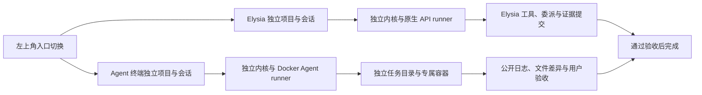

# Agent 终端与 Docker 调度

本轮版本：0.16.0-preview.1。Elysia 与 Agent 终端通过左上角菜单切换，采用独立存储和调度实例。页面热切换保留状态；隐藏入口暂停事件流与预览轮询，未保存草稿仍写入原入口。Codex CLI 和 DSH 默认显示，Claude Code、Gemini CLI 及自定义模板可在管理中心启用。



## 两个独立入口

Elysia 保留原有数据、原生模型设置、计划开关和订阅连接；Agent 终端拥有自己的项目空间、任务、终端模板、草稿、导航偏好、事件流和预览。模板修改不会改变已有任务。切换入口保留对应工作台，已发出的请求始终属于原入口；草稿使用即时恢复副本和独立缓存保存。

原生数据仍位于原数据目录，终端数据位于其中的 `surfaces/terminal/`，数据库、对象、日志、工作区和命令记录分开保存。两个入口共用本地服务进程和登录会话；终端不读取原生凭据库或提供商配置。相同项目 ID 也不会共享记录，但用户在两边主动打开同一宿主目录时，资料来源仍是该目录。

旧版在 Elysia 中创建的 Docker 任务保留只读历史及预览，不自动迁移、恢复执行或删除。启动恢复可以停止遗留的专属容器并更新恢复状态；新任务从 Agent 终端创建。

`pnpm backup` 和 `pnpm restore <备份目录>` 默认覆盖备份包含的两个入口，可用 `--surface=native|terminal|all` 指定范围。恢复先准备并校验全部选中数据库，再统一替换，失败时回滚已安装部分。无入口标记的旧备份仅恢复原生数据，现有终端数据保留。停止服务始终停止两个入口。

## 计划开关

新建项目任务时可以开关计划模式。开启时先规划，只有用户接受当前版本后才获得执行授权；关闭时创建即授权在用户选定的权限和预算内执行，最终仍要求交付证据。开关在创建时固定，已有记录缺失字段继续按开启处理。

原生直接执行收到补充消息时，权限、累计请求与 Token 预算、时间起点和子任务保持。用户问题在安全边界恢复；明确暂停、限流和待核验状态不会被一条消息解除。显式修改约定会同步根任务的交付和验收项。

Docker 终端首版只支持关闭计划模式，以及完整任务目录的读、写、执行权限。外部 CLI 自带工具，不能声称受 Elysia 的目录级工具授权控制；部分目录授权会被拒绝。终端约定与配置在创建时冻结，不能运行中切换为原生模型或修改验收要求。

## 准备与使用

1. 完成 Docker Desktop 初始化，并启用 Linux 容器引擎。
2. 打开 **终端管理 → 应用**，点击所需 CLI 的“安装”。Docker 就绪后会在后台构建新镜像；可继续使用或切换工作台，也可点击“取消安装”。完成后点击“应用已安装镜像”，服务端只更新安装时选定模板的镜像；模板已删除、换 CLI 或改镜像时提示重新安装。安装选项可指定明确版本，留空使用固定版本。也可手动构建原有预设镜像：

   ```powershell
   docker build -f packages/runtime/docker-agent.Dockerfile -t elysia-agents:0.13.0 .
   ```

   镜像固定安装 `@openai/codex@0.162.1` 和 `@deepseek-ai/dsh@0.2.1-alpha.2`。可通过构建参数 `CODEX_VERSION`、`DSH_VERSION` 显式更新，更新后需再次核对 CLI 协议。构建上下文不会包含项目文件或密钥。运行时使用已有镜像，禁止自动拉取。

3. 在 **API 连接** 添加端点、协议、模型 ID 和凭据。可使用终端独立的系统加密密钥库或启动进程的环境变量，再为各应用选择对应连接。Codex 使用 Responses，DSH / Claude 使用 Anthropic Messages，Gemini 使用 Gemini API。DeepSeek 预设为 `/anthropic` 与 `deepseek-flash`，其他供应商模型 ID 手动填写。未绑定连接的模板沿用环境变量方式，DSH 读取 `DEEPSEEK_API_KEY`，Codex 读取 `OPENAI_API_KEY`。终端不复用原生凭据库或宿主 Agent 登录目录。
4. 左上角切换 **Agent 终端**，打开项目，在 **项目默认** 可覆盖默认 CLI 与连接。工作台临时选择优先于项目模板，再使用全局默认模板；应用默认与模板默认同步，同一 CLI 的具体默认模板会被保留。修改全局默认保留项目自己的选择；显式保存项目默认会应用新的覆盖。创建窗口可选择连接或明确仅使用模板环境变量。应用中的“检查”会启动无网络、无挂载和无凭据的版本检测容器；高级模板的“检查 Docker 与镜像”只探测引擎、镜像和环境变量，不调用模型或创建容器。
5. 创建任务后查看对话中的公开输出，右侧预览工作目录与产物。终端正常结束后，先查看日志和差异，再点击“确认交付并验收”。

管理页之间切换保留模板、连接和项目配置草稿；有未保存修改时，关闭窗口或切换正在编辑的连接会显示简短提示。遇到版本冲突会保留当前修改，可明确载入最新配置后继续编辑。安装取消先保存取消状态，再中断构建进程；进程仍在收尾时拒绝重复安装。Docker 构建缓存可能保留，取消不会应用镜像或修改现有任务。旧安装记录可继续读取；新增的 `cancelled` 状态不被 0.15 服务识别，回退旧源码须使用升级前的终端数据备份。

自定义命令使用 JSON 参数数组，例如 `["agent", "--json"]`；目标通过 stdin 发送。不会拼接宿主 shell 命令。输出协议可选择 Codex、DSH、Claude、Gemini JSONL 或普通文本。自定义连接提供 `ELYSIA_API_KEY`、`ELYSIA_API_BASE_URL`、`ELYSIA_API_MODEL`、`ELYSIA_API_PROTOCOL`，自定义程序须自行适配，不保证任意 CLI 自动兼容。产品版本与镜像版本独立，旧模板保留 `elysia-agents:0.13.0`；管理安装使用唯一新标签并保存固定 sha256 镜像 ID，已有镜像不被覆盖。内置版本为 Codex 0.162.1、DSH 0.2.1-alpha.2、Claude 2.1.296、Gemini 0.63.0。

API 连接、应用及项目默认采用版本校验和幂等命令。创建任务时由服务端解析连接并冻结端点、协议、模型和凭据引用，客户端不能注入自己的凭据引用。编辑、换密钥或删除连接不改变已有任务；旧加密引用保留供其恢复。密钥只在私有运行环境注入选定 CLI，不进入管理响应、Run 快照、argv、生成的配置文件或公开终端日志。Agent 及其子进程可以读取自己的 API Key；若程序主动写入工作文件，该文件仍可能进入产物。凭据库不进入历史备份。

## 执行、恢复与证据

- `Run.execution` 保存配置快照；不存在时使用原生 API。每个入口仅调度自己的任务，原生执行器跳过旧 Docker 历史。终端兼容描述符不进入原生提供商目录或模型调用。
- Git 项目使用已有独立 worktree；容器中的 `.git` 用只读文件遮蔽宿主指针。差异与集成由宿主工具处理。无 Git 项目先建立有数量和大小上限的独立文件快照，拒绝链接越界，保持项目主目录不变。
- 容器只映射任务目录和专属状态目录，使用应用、运行、任务及操作标签核对归属。资源限制包括 2 CPU、2 GiB 内存和 256 个进程；最长执行时间不超过任务与配置时限。容器不持有宿主 Docker socket。
- Codex 预设在这一明确授予完整任务权限的容器内关闭第二层审批与沙箱，并忽略宿主配置；隔离边界为 Docker。保留容器的 capability、进程权限和资源限制，避免嵌套 Linux sandbox 所需的 namespace 或 setuid 与容器限制冲突。原生 API 通道的授权不受此设置影响。
- 外部 CLI 的内部模型请求与递归代理由自身运行时管理。Elysia 的 API 请求、Token 和价格预算不适用于此通道，也不将未观测用量记为零；Elysia 控制任务并发、容器资源与时间。终端不允许设置原生 API 费用上限。
- 只持久化公开正文和简短工具活动，过滤私有思考，输出有上限并对跨片段凭据脱敏。绑定 API 时只注入选定连接，未绑定时按模板所列环境名称传入；临时环境文件在容器创建后清除。终端退出码、协议失败、超时和中断分别保存；退出码为零不直接标记完成。
- 暂停、取消和关闭不仅中断宿主 CLI，还要核对并停止本任务容器。重启后遇到不确定操作会进入 `terminal_verification`，禁止自动重播。
- 中断时检查日志和实际任务目录，填写核验说明。确认已发生会生成当前证据并进入 `terminal_review`；确认未发生会保持暂停，允许用户显式恢复。Docker 无法确认容器停止时，核验不会越过这一边界。
- 验收再次校验产物哈希、实际目录签名、运行版本、任务状态和必需子任务。异步准备后的文件或记录变化会被拒绝；最终提交采用同步事务与幂等命令。内容正确性由用户根据约定逐条确认。

源码入口为 `apps/server/src/surfaces.ts`、`terminal-control.ts`、`cli-management.ts`、`apps/web/src/TerminalControlCenter.tsx`、`packages/runtime/src/cli-manager.ts`、`terminal-connection.ts` 和 `docker-agent.ts`。原生 API 为 `/api/*`；终端 API 为 `/terminal/api/*`，包括 `terminal/settings`、`terminal/check`、`terminal/control`、连接 CRUD、应用选择、项目偏好、CLI 检测/安装任务和 `runs/:id/terminal/{accept,verify}`。两侧资源及预览地址使用对应前缀。后续可在 runner 层扩展只读终端规划、会话续接与外部子代理投影。

## 验证边界与参考

本轮使用隔离 SQLite、真实 Git worktree、假 Docker 传输和隐藏 Electron 验证创建、权限、调度、公开日志、暂停恢复及验收。当前本机 Docker Linux 引擎尚未就绪，用户选择稍后完成初始化；镜像构建、真实容器和真实模型验收仍待进行。预览版标签不表示发布或完成该实机验收。

CLI 与生命周期依据：[DSH headless](https://github.com/deepseek-ai/deepseek-harness/blob/d743267388641bc76f17c45ce8b4c231aed1d32c/packages/bundle/headless/README.md)、[DSH 连接配置](https://github.com/deepseek-ai/deepseek-harness/blob/d743267388641bc76f17c45ce8b4c231aed1d32c/apps/cli/reference/README.md)、[Codex 非交互模式](https://learn.chatgpt.com/docs/non-interactive-mode)、[Codex 容器与沙箱边界](https://learn.chatgpt.com/docs/agent-approvals-security)、[Claude CLI](https://code.claude.com/docs/en/cli-reference)、[Gemini 输出协议](https://github.com/google-gemini/gemini-cli/blob/main/packages/core/src/output/types.ts)、[Docker create](https://docs.docker.com/reference/cli/docker/container/create/)、[Docker stop](https://docs.docker.com/reference/cli/docker/container/stop/)。管理交互参考 [CC Switch](https://github.com/farion1231/cc-switch/blob/main/README.md)，本项目采用独立 Docker 配置。DeepSeek 型号与 Messages 端点依据：[官方更新记录](https://api-docs.deepseek.com/updates/)、[Anthropic API](https://api-docs.deepseek.com/guides/anthropic_api/)。DSH 的 Messages 协议不替换 Elysia 的 Chat Completions 适配器。
