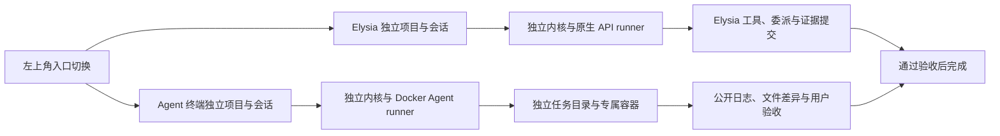

# Agent 终端与 Docker 调度

本轮版本：0.22.0-preview.1。Elysia 与 Agent 终端通过左上角菜单切换，采用独立存储和调度实例。页面热切换保留状态；隐藏入口暂停事件流与预览轮询，未保存草稿仍写入原入口。Codex CLI 和 DSH 默认显示，Claude Code、Gemini CLI 及自定义模板可在管理中心启用。终端及预览等可选界面按需加载；加载失败保留工作台并显示明确的重新加载入口。



两个入口的历史列表均采用小页读取和滚动追加，超过窗口上限仍可手动继续。侧栏“外观与启动”为当前设备的窗口级外观偏好，可自定义内置动画或本地 GIF / MP4 / WebM，最大 4 MiB；服务与认证就绪即退出开屏，不等播放完成。它不参与模型、任务或项目配置。

启动只读显示偏好与当前需要的草稿；鉴权返回独立的稳定工作台范围，同窗口未保存输入可在首次草稿读取失败后刷新恢复。终端管理的应用、安装、项目默认、模板及能力读取分别容错和重试，重试不覆盖脏编辑。SSE 从 Run 快照的事件游标续接，断线恢复优先使用 Last-Event-ID；旧无游标客户端保持历史重放兼容。服务端每批通知32条并限制解压和传输缓冲，大事件通过轻量失效通知提示重新读取完整记录。

顶部任务中心按执行、待回应、核验、暂停、失败和结束状态分页读取当前入口任务，可按标题及项目筛选；Run仍执行中但有效任务等待用户时归入待回应，不把待核验副作用当作完成。点击待回应定位回答位置，终端待核验定位专用恢复面板，通过 `/terminal/verify` 显式提交，不自动核验。桌面状态通知按入口显式启用，默认关闭；首次只建立基线，不补历史，普通标题编辑不触发完成通知。启用后隐藏入口可观察新的状态变化，通知内容固定且不含任务目标或模型响应，点击切换所属入口并打开对应会话。每项最多重试3次，队列最多40项，发送前复核当前状态；失败健康记录只保留安全数量和时间。

对话“搜索正文”按需补齐正文索引，旧目标搜索也改为派生索引，后续不反复解压全部记录。结果每页20条、最多保留60条片段；定位页及刷新保持目标附近小页，可加载更早或返回最新。阅读锚在同窗口 sessionStorage 按入口和实际数据目录范围保存，最近50会话/30天，只有消息ID、偏移和页指针，无正文；切换入口继续保存有效位置，失效锚明确退回最新。首次补旧数据仍随历史增长，按32记录让出事件循环，不承诺固定耗时。

## 两个独立入口

Elysia 保留原有数据、原生模型设置、计划开关和订阅连接；Agent 终端拥有自己的项目空间、任务、终端模板、草稿、导航偏好、事件流和预览。模板修改不会改变已有任务。切换入口保留对应工作台，已发出的请求始终属于原入口；草稿使用即时恢复副本和独立缓存保存。

原生数据仍位于原数据目录，终端数据位于其中的 `surfaces/terminal/`，数据库、对象、日志、工作区和命令记录分开保存。两个入口共用本地服务进程和登录会话；终端不读取原生凭据库或提供商配置。相同项目 ID 也不会共享记录，但用户在两边主动打开同一宿主目录时，资料来源仍是该目录。

旧版在 Elysia 中创建的 Docker 任务保留只读历史及预览，不自动迁移、恢复执行或删除。启动恢复可以停止遗留的专属容器并更新恢复状态；新任务从 Agent 终端创建。

`pnpm backup` 和 `pnpm restore <备份目录>` 默认覆盖备份包含的两个入口，可用 `--surface=native|terminal|all` 指定范围。恢复先准备并校验全部选中数据库，再统一替换，失败时回滚已安装部分。无入口标记的旧备份仅恢复原生数据，现有终端数据保留。停止服务始终停止两个入口。

## 计划开关

新建项目任务时可以开关计划模式。开启时先规划，只有用户接受当前版本后才获得执行授权；关闭时创建即授权在用户选定的权限和预算内执行，最终仍要求交付证据。开关在创建时固定，已有记录缺失字段继续按开启处理。

原生直接执行收到补充消息时，权限、累计请求与 Token 预算、时间起点和子任务保持。用户问题在安全边界恢复；明确暂停、限流和待核验状态不会被一条消息解除。显式修改约定会同步根任务的交付和验收项。

Docker 终端首版只支持关闭计划模式，以及完整任务目录的读、写、执行权限。外部 CLI 自带工具，不能声称受 Elysia 的目录级工具授权控制；部分目录授权会被拒绝。终端约定与配置在创建时冻结，不能运行中切换为原生模型或修改验收要求。

应用管理中的能力说明分别显示执行、计划、原会话续接和用量。当前终端计划模式明确为未支持；须先完成真实固定镜像中只读工具、挂载及执行授权的验证，才可提供计划开关。Codex 原会话续接仍受实际镜像能力与会话检查约束，其他 CLI 原会话续接不猜测参数；内部请求和价格未观测时显示未知。适配器代码支持不等于固定镜像与真实供应商已经验收。

## 准备与使用

1. 完成 Docker Desktop 初始化，并启用 Linux 容器引擎。
2. 打开 **终端管理 → 应用**，点击所需 CLI 的“安装”。Docker 就绪后会在后台构建新镜像；可继续使用或切换工作台，也可点击“取消安装”。完成后点击“应用已安装镜像”，服务端只更新安装时选定模板的镜像；模板已删除、换 CLI 或改镜像时提示重新安装。安装选项可指定明确版本，留空使用固定版本。也可手动构建原有预设镜像：

   ```powershell
   docker build -f packages/runtime/docker-agent.Dockerfile -t elysia-agents:0.13.0 .
   ```

   镜像固定安装 `@openai/codex@0.162.1` 和 `@deepseek-ai/dsh@0.2.1-alpha.2`。可通过构建参数 `CODEX_VERSION`、`DSH_VERSION` 显式更新，更新后需再次核对 CLI 协议。构建上下文不会包含项目文件或密钥。运行时使用已有镜像，禁止自动拉取。

3. 在 **API 连接** 添加端点、协议、模型 ID 和凭据。可使用终端独立的系统加密密钥库或启动进程的环境变量，再为各应用选择对应连接。Codex 使用 Responses，DSH / Claude 使用 Anthropic Messages，Gemini 使用 Gemini API。DeepSeek 预设为 `/anthropic` 与 `deepseek-flash`，其他供应商模型 ID 手动填写。未绑定连接的模板沿用环境变量方式，DSH 读取 `DEEPSEEK_API_KEY`，Codex 读取 `OPENAI_API_KEY`。终端不复用原生凭据库或宿主 Agent 登录目录。
4. 左上角切换 **Agent 终端**，打开项目，在 **项目默认** 可覆盖默认 CLI 与连接。工作台临时选择优先于项目模板，再使用全局默认模板；应用默认与模板默认同步，同一 CLI 的具体默认模板会被保留。修改全局默认保留项目自己的选择；显式保存项目默认会应用新的覆盖。创建窗口可选择连接或明确仅使用模板环境变量。应用中的“检查”会启动无网络、无挂载和无凭据的版本检测容器；“检查就绪”显示配置继承来源以及 Docker、镜像、CLI、本地配置和认证状态。高级模板检查也会运行离线 CLI 版本探测。上述检查不会调用模型；本地凭据可读取不代表 API 已认证。
5. 创建任务后查看对话中的公开输出，右侧预览工作目录与产物。终端正常结束后，先查看日志和差异，再点击“确认交付并验收”。

管理页之间切换保留模板、连接和项目配置草稿；有未保存修改时，关闭窗口或切换正在编辑的连接会显示简短提示。遇到版本冲突会保留当前修改，可明确载入最新配置后继续编辑。安装取消先保存取消状态，再中断构建进程；进程仍在收尾时拒绝重复安装。Docker 构建缓存可能保留，取消不会应用镜像或修改现有任务。旧安装记录可继续读取；新增的 `cancelled` 状态不被 0.15 服务识别，回退旧源码须使用升级前的终端数据备份。

安装显示当前阶段及耗时，构建后的镜像须通过离线 CLI 版本检查，实际版本与请求或固定默认版本一致才标记成功；版本不匹配或无法确认时不能应用。“安装历史”分页保留成功、失败和取消记录，可显式将历史成功镜像恢复到原模板；恢复时核对当前模板、镜像和配置版本，不改变已创建任务，不自动删除历史或镜像。失败按网络、版本、磁盘、引擎、超时等显示安全原因，并提供检查环境、修改版本、编辑模板或定位重试入口；这些入口不会自动安装或启动任务。旧失败记录也使用安全摘要，未知错误显示通用原因，不把构建输出展示为诊断消息。临时诊断失败保留当前续接模式和草稿。

保存 API 连接后，可主动“验证连接”或“读取模型目录”。验证发送一次小型模型请求，会产生少量用量；目录缺失仍可手填。两类结果分别持久保存安全状态、时间及配置版本，失败或取消的目录读取不会覆盖连接验证。修改配置后保留上次检查时间并提示重新检查，关闭页面会取消正在进行的请求；打开管理页只读本地状态，不自动发送付费验证。私有响应、密钥和完整模型目录不写入健康记录，目录仅供本次页面选型。供应商返回不同型号时会明确提示。连接协议修改同时检查应用、项目和直接引用连接的模板，拒绝不兼容配置。

对话只读取当前页消息，可用“更早消息／更新消息／返回最新”翻阅，运行输出不会改变旧页位置。文件链接打开对应任务的工作区预览；工作区与产物切换保留当前阅读状态。终端公开日志产物支持有界全文搜索、命中跳转和分页，搜索只读取已交付的公开日志。

会话列表每页最多 100 条简短记录，另保留当前与最多 40 个置顶会话；搜索读取完整目标，归档管理使用独立筛选，项目对话数量从全量记录统计。请求、操作与产物每页最多 40 条，完整参数和结果在展开时读取；消息关联与全部未确认操作仍保留，费用、请求数和 Token 汇总独立计算。旧无分页参数 API 保持兼容，不删除历史。汇总读取轻量 SQL 元数据，旧压缩记录首次补齐后不再反复解压正文；全量统计与完整目标搜索仍随历史数量增长，不承诺固定加载时延。删除列表游标对应的会话后自动回到最新页；记录有独立版本，展开时更新不依赖 Run 版本变化。

工作区、任务、文件和产物的目录、分页、编码、显示方式及滚动使用分入口的有界检查点；同一窗口整页刷新会在鉴权及新读取完成后恢复有效位置，文件版本变化会失效。每个入口最多 192 项，只保存允许的阅读元数据，序列化上限 512K 字符，不保存正文、模型响应或密钥。检查点与当前本机服务范围绑定，关闭窗口、重启服务或切换数据目录后不沿用；存储损坏、禁用或超限时降级为内存。源码链接支持 `#L420`、`#L420-L430`，Markdown ATX / Setext 标题可跨页查找，重复标题使用原文顺序编号；复杂嵌套和多行标题尚未覆盖，缺失位置给出明确反馈。每次定位扫描最多 8 MiB，可继续或取消，不整份加载大文件。

就绪诊断中的“修复”可定位当前连接、模板或安装入口，保留未保存编辑。保存后返回原诊断并进行本地检查；不会自动发送付费 API 验证或改变已创建任务的冻结配置。

## 补充需求与会话续接

终端正常结束且待验收时，“补充需求并继续”可以显式选择继续原 CLI 会话或新 CLI 会话。新会话使用当前工作目录、原合同与用户消息；原会话仅发送本轮补充文本。权限、冻结 API 配置、原时间起点和累计运行限制保持，不会获得新的授权或重新计算预算。暂停、中断、未知副作用和已完成任务不能通过此入口绕过原恢复与验收流程。

续接文本、继续方式和逐操作核验说明使用本机工作台缓存持久化，切换会话或刷新不会丢失；提交失败保留草稿，成功仅清空所提交的版本。删除会话同时清理关联草稿、终端会话及运行阶段元数据，不直接清除工作区或未知 HOME。

首批原会话续接仅对 Codex 开放：实际固定镜像须通过 `exec resume --help` 及所需参数检查，并存在当前任务专属 HOME 内的可靠 session 文件。可靠结束时记录会话文件路径与内容哈希，续接再次比对；数据库回退、文件变化或旧记录缺少哈希时拒绝原会话，保留新会话。原会话在容器启动前可靠失败后，仅在容器清理成功且源会话未变化时保留原补充需求供显式重试；已启动或结果不确定时不自动重跑。专属 HOME 不包含在普通数据备份中，备份不保证恢复 CLI 记忆。自定义命令、缺失目录或绑定不一致时拒绝续接。DSH、Claude、Gemini 的原会话协议尚未核实，明确提示使用新会话；不会猜测续接参数。宿主 CLI 版本不代替任务镜像能力，正式 Codex 镜像与模型闭环仍待实机验收。

自定义命令使用 JSON 参数数组，例如 `["agent", "--json"]`；目标通过 stdin 发送。不会拼接宿主 shell 命令。输出协议可选择 Codex、DSH、Claude、Gemini JSONL 或普通文本。自定义连接提供 `ELYSIA_API_KEY`、`ELYSIA_API_BASE_URL`、`ELYSIA_API_MODEL`、`ELYSIA_API_PROTOCOL`，自定义程序须自行适配，不保证任意 CLI 自动兼容。产品版本与镜像版本独立，旧模板保留 `elysia-agents:0.13.0`；管理安装使用唯一新标签并保存固定 sha256 镜像 ID，已有镜像不被覆盖。内置版本为 Codex 0.162.1、DSH 0.2.1-alpha.2、Claude 2.1.296、Gemini 0.63.0。

API 连接、应用及项目默认采用版本校验和幂等命令。创建任务时由服务端解析连接并冻结端点、协议、模型和凭据引用，客户端不能注入自己的凭据引用。编辑、换密钥或删除连接不改变已有任务；旧加密引用保留供其恢复。密钥只在私有运行环境注入选定 CLI，不进入管理响应、Run 快照、argv、生成的配置文件或公开终端日志。Agent 及其子进程可以读取自己的 API Key；若程序主动写入工作文件，该文件仍可能进入产物。凭据库不进入历史备份。

## 执行、恢复与证据

对话的“终端状态”默认折叠，展开可查看排队顺序与原因、准备／启动／执行／保存阶段、公开活动时间和全局资源占用。模板可选轻量 1 CPU / 1024 MiB、标准 2 CPU / 2048 MiB、大型 4 CPU / 4096 MiB，任务创建时冻结；后续模板修改不会改变原任务。新模板默认标准，旧冻结配置缺失规格时按标准解释，不补写字段或改变原配置哈希。应用最多预约两个终端，总上限 4 CPU / 4096 MiB，再按 Docker Linux 引擎容量收窄；等待释放与引擎本身容量不足分别说明。预约、容器启动限制、待核验保留及重启恢复使用同一冻结规格。安装按标准预约并与执行共用容量，排队安装可取消；这是安装准入协调，不是 BuildKit 内存硬限制。没有输出不触发自动重跑。队列沿用任务创建顺序并跳过尚未满足依赖或并发的任务，续接不重置其位置。

容器停止未确认时保留资源预约，核验确认后才释放。展开资源项可直接打开来源对话及对应待核验操作，跳转不改变执行或释放状态。同一固定镜像和命令的离线检测共享进行中的结果，最多两个检测并发；每项独立计入 1 CPU / 256 MiB，任务准备中的检测使用其已有预约。只有最后一个调用取消时才中止共享检测，清理失败保留预约和归属，重启后再次检测先核验归属。持久阶段仅用于展示，维护保护使用真实进行中工作与保留预约；用户暂停或取消后的可靠收尾显示“已停止”，重启不因旧阶段误判活动或自动重播。

- `Run.execution` 保存配置快照；不存在时使用原生 API。每个入口仅调度自己的任务，原生执行器跳过旧 Docker 历史。终端兼容描述符不进入原生提供商目录或模型调用。
- Git 项目使用已有独立 worktree；容器中的 `.git` 用只读文件遮蔽宿主指针。差异与集成由宿主工具处理。无 Git 项目先建立有数量和大小上限的独立文件快照，拒绝链接越界，保持项目主目录不变。
- 容器只映射任务目录和专属状态目录，使用应用、运行、任务及操作标签核对归属。CPU 与内存按任务冻结规格限制，进程上限 256；最长执行时间不超过任务与配置时限。容器不持有宿主 Docker socket。
- Codex 预设在这一明确授予完整任务权限的容器内关闭第二层审批与沙箱，并忽略宿主配置；隔离边界为 Docker。保留容器的 capability、进程权限和资源限制，避免嵌套 Linux sandbox 所需的 namespace 或 setuid 与容器限制冲突。原生 API 通道的授权不受此设置影响。
- 外部 CLI 的内部模型请求与递归代理由自身运行时管理。Elysia 的 API 请求、Token 和价格预算不适用于此通道，也不将未观测用量记为零；Elysia 控制任务并发、容器资源与时间。终端不允许设置原生 API 费用上限。
- 只持久化公开正文和简短工具活动，过滤私有思考，输出有上限并对跨片段凭据脱敏。绑定 API 时只注入选定连接，未绑定时按模板所列环境名称传入；临时环境文件在容器创建后清除。终端退出码、协议失败、超时和中断分别保存；退出码为零不直接标记完成。
- 暂停、取消和关闭不仅中断宿主 CLI，还要核对并停止本任务容器。重启后遇到不确定操作会进入 `terminal_verification`，禁止自动重播。
- 中断时检查日志和实际任务目录，填写核验说明。确认已发生会生成当前证据并进入 `terminal_review`；确认未发生会保持暂停，允许用户显式恢复。Docker 无法确认容器停止时，核验不会越过这一边界。
- 验收再次校验产物哈希、实际目录签名、运行版本、任务状态和必需子任务。异步准备后的文件或记录变化会被拒绝；最终提交采用同步事务与幂等命令。内容正确性由用户根据约定逐条确认。

源码入口为 `apps/server/src/surfaces.ts`、`terminal-control.ts`、`cli-management.ts`、`terminal-log-search.ts`、`apps/web/src/TerminalControlCenter.tsx`、`packages/runtime/src/cli-manager.ts`、`terminal-session.ts`、`terminal-connection.ts` 和 `docker-agent.ts`。原生 API 为 `/api/*`；终端 API 为 `/terminal/api/*`，包括 `terminal/settings`、`terminal/check`、`terminal/control`、连接验证与目录、有效配置诊断、CLI 检测/安装历史和 `runs/:id/terminal/{accept,verify,session,continue}`。两侧资源及预览地址使用对应前缀。后续可在 runner 层扩展只读终端规划、更多 CLI 续接协议与外部子代理投影。

## 数据维护与选定会话快照

打开 **终端管理 → 数据维护** 可查看数据库、对象、日志、工作区、CLI HOME 和快照的占用及保留原因。清理先生成明细预览，再由用户明确执行；应用前重查归属、引用、版本和路径。仅删除孤立会话元数据，以及带本应用归属和可靠停止证明的空状态目录或临时环境文件。存活任务、未确认副作用、未知或未标记 HOME、工作区、对象、日志、镜像和凭据库保留。占用区分完整、部分和未知；部分数据仅报告已计入下限，未知不显示为已确认零。扫描显示阶段及数量，可取消，关闭时中止；后台任务最多两个，120 秒到期。目录遍历与预览文件哈希分块处理，最终同步一致性和复制守卫仍保留：单会话 seal 上限64 MiB，工作区上限512 MiB / 20000文件，不能承诺所有维护操作零阻塞。清理登记成功但文件移除失败时，记录跨重启保留，需重新预览后明确重试；未知文件或新增引用继续保留。

可靠且停止的 Codex 会话可生成选定快照，保存当前会话文件和过滤后的任务工作区。只支持同机、同入口、同任务、同最新已完成操作及相同冻结镜像身份恢复，已执行新轮次的旧快照拒绝恢复。恢复先保留当前文件为恢复前快照，校验后再复制；不替换在线数据库，不启动任务。原文件已经损坏时，恢复前快照仅用于保全，不能作为可续接检查点。快照包含私有会话与业务文件；排除密钥库、CLI 认证配置、环境文件、其他 HOME 和镜像，但无法识别业务文件中自行嵌入的秘密。

快照历史每页 20 条，可按标题、运行/任务/快照 ID 或日期搜索。轻量索引只用于列表展示；选择后按当前任务状态说明恢复和删除资格，恢复预览异步读取选定清单，不扫描全部正文。改变搜索、翻页或选择会取消旧计划；取消未确认时显示错误，并在预览新计划前重试。未取消且未过期的恢复预览，以及正在读取的恢复扫描，会保护其快照。

删除须先预览，再明确确认。执行前重新读取实际清单，核对归属、目录、摘要、当前版本及运行/会话/操作引用；未知文件、活动任务或未确认副作用会拒绝删除。只删除选定快照，冻结任务、工作区和 CLI HOME 保留。删除登记和索引墓碑在同一事务保存，重放命令不会重新生成快照；暂存文件移除失败会单独显示快照清理记录，跨重启保留，重新预览和确认后才重试。新增引用或未知状态继续保留。

清单读取分块并可取消，单清单上限 32 MiB；最终解析、摘要一致性和复制守卫仍有同步步骤。旧无分页快照 API 保留同步历史读取以兼容旧调用，新界面使用分页入口；首次索引仍随历史数量增长，不承诺固定时延。

离线 CLI 复用上述维护逻辑及根服务锁，须先停止应用；默认只操作终端入口。执行预览后检查 JSON，再将同一文件提交给对应 apply 命令，版本过期须重新预览。例如：

```powershell
pnpm exec tsx apps/server/src/maintenance.ts terminal-inspect
New-Item -ItemType Directory -Force .tmp | Out-Null
pnpm exec tsx apps/server/src/maintenance.ts terminal-cleanup-plan > .tmp/cleanup-plan.json
pnpm exec tsx apps/server/src/maintenance.ts terminal-cleanup .tmp/cleanup-plan.json
```

选定备份输入为 `{ "runId": "运行 UUID", "expectedRevision": 版本号 }`；恢复输入为 `{ "backupId": "快照 UUID", "expectedRevision": 当前运行版本号 }`。对应 `terminal-session-backup-plan`／`terminal-session-restore-plan` 生成 `{commandId,plan}`，由 `terminal-session-backup`／`terminal-session-restore` 读取原计划文件执行。`terminal-session-history` 可读取分页历史；删除输入为 `{ "backupId": "快照 UUID" }`，用 `terminal-session-delete-plan` 预览，再以 `terminal-session-delete` 提交同一计划文件。CLI 不调用 Docker、获取凭据或自动恢复执行；不能用它绕过不确定副作用或停止证明。

## 验证边界与参考

本轮使用隔离 SQLite、真实 Git worktree、假 Docker 传输和隐藏 Electron 验证创建、权限、调度、公开日志、暂停恢复及验收。当前本机 Docker Linux 引擎尚未就绪，用户选择稍后完成初始化；镜像构建、真实容器和真实模型验收仍待进行。预览版标签不表示发布或完成该实机验收。

CLI 与生命周期依据：[DSH headless](https://github.com/deepseek-ai/deepseek-harness/blob/d743267388641bc76f17c45ce8b4c231aed1d32c/packages/bundle/headless/README.md)、[DSH 连接配置](https://github.com/deepseek-ai/deepseek-harness/blob/d743267388641bc76f17c45ce8b4c231aed1d32c/apps/cli/reference/README.md)、[Codex 非交互模式](https://learn.chatgpt.com/docs/non-interactive-mode)、[Codex 容器与沙箱边界](https://learn.chatgpt.com/docs/agent-approvals-security)、[Claude CLI](https://code.claude.com/docs/en/cli-reference)、[Gemini 输出协议](https://github.com/google-gemini/gemini-cli/blob/main/packages/core/src/output/types.ts)、[Docker create](https://docs.docker.com/reference/cli/docker/container/create/)、[Docker stop](https://docs.docker.com/reference/cli/docker/container/stop/)。管理交互参考 [CC Switch](https://github.com/farion1231/cc-switch/blob/main/README.md)，本项目采用独立 Docker 配置。DeepSeek 型号与 Messages 端点依据：[官方更新记录](https://api-docs.deepseek.com/updates/)、[Anthropic API](https://api-docs.deepseek.com/guides/anthropic_api/)。DSH 的 Messages 协议不替换 Elysia 的 Chat Completions 适配器。
