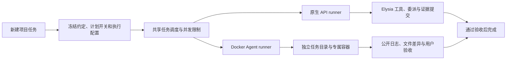

# Agent 终端与 Docker 调度

本轮版本：0.13.0-preview.1。原生 API 与 Docker Agent 是同一调度器下的两种执行通道。首批预设为 DSH 和 Codex CLI，自定义程序可以用显式参数数组接入；协议注册还保留 Claude Stream JSON 的扩展入口。



## 计划开关

新建项目任务时可以开关计划模式。开启时先规划，只有用户接受当前版本后才获得执行授权；关闭时创建即授权在用户选定的权限和预算内执行，最终仍要求交付证据。开关在创建时固定，已有记录缺失字段继续按开启处理。

原生直接执行收到补充消息时，权限、累计请求与 Token 预算、时间起点和子任务保持。用户问题在安全边界恢复；明确暂停、限流和待核验状态不会被一条消息解除。显式修改约定会同步根任务的交付和验收项。

Docker 终端首版只支持关闭计划模式，以及完整任务目录的读、写、执行权限。外部 CLI 自带工具，不能声称受 Elysia 的目录级工具授权控制；部分目录授权会被拒绝。终端约定与配置在创建时冻结，不能运行中切换为原生模型或修改验收要求。

## 准备与使用

1. 完成 Docker Desktop 初始化，并启用 Linux 容器引擎。
2. 在项目根目录构建镜像：

   ```powershell
   docker build -f packages/runtime/docker-agent.Dockerfile -t elysia-agents:0.13.0 .
   ```

   镜像固定安装 `@openai/codex@0.162.1` 和 `@deepseek-ai/dsh@0.2.1-alpha.2`。可通过构建参数 `CODEX_VERSION`、`DSH_VERSION` 显式更新，更新后需再次核对 CLI 协议。构建上下文不会包含项目文件或密钥。运行时使用已有镜像，禁止自动拉取。
3. 在启动 Elysia 的进程环境中配置所选 Agent 的凭据。DSH 默认读取 `DEEPSEEK_API_KEY`，Codex 默认读取 `OPENAI_API_KEY`。终端不复用原生 API 设置中的加密密钥，也不映射宿主 Agent 登录目录。
4. 在项目输入目标，点击“继续”，选择“Agent 终端 · Docker 调度”。选择 Agent、镜像与参数，并点击“检查 Docker 与镜像”。该检查只探测引擎、镜像和环境变量名称，不调用模型或创建容器。
5. 创建任务后查看对话中的公开输出，右侧预览工作目录与产物。终端正常结束后，先查看日志和差异，再点击“确认交付并验收”。

自定义命令使用 JSON 参数数组，例如 `["agent", "--json"]`；目标通过 stdin 发送。不会拼接宿主 shell 命令。输出协议可选择 Codex JSONL、DSH JSONL、Claude Stream JSON 或普通文本。

## 执行、恢复与证据

- `Run.execution` 保存配置快照；不存在时使用原生 API。共享调度循环按通道分派，避免两个执行器重复领取任务。终端兼容描述符仅用于旧任务历史展示，不进入提供商目录或原生模型调用。
- Git 项目使用已有独立 worktree；容器中的 `.git` 用只读文件遮蔽宿主指针。差异与集成由宿主工具处理。无 Git 项目先建立有数量和大小上限的独立文件快照，拒绝链接越界，保持项目主目录不变。
- 容器只映射任务目录和专属状态目录，使用应用、运行、任务及操作标签核对归属。资源限制包括 2 CPU、2 GiB 内存和 256 个进程；最长执行时间不超过任务与配置时限。容器不持有宿主 Docker socket。
- Codex 预设在这一明确授予完整任务权限的容器内关闭第二层审批与沙箱，并忽略宿主配置；隔离边界为 Docker。保留容器的 capability、进程权限和资源限制，避免嵌套 Linux sandbox 所需的 namespace 或 setuid 与容器限制冲突。原生 API 通道的授权不受此设置影响。
- 外部 CLI 的内部模型请求与递归代理由自身运行时管理。Elysia 的 API 请求、Token 和价格预算不适用于此通道，也不将未观测用量记为零；Elysia 控制任务并发、容器资源与时间。终端不允许设置原生 API 费用上限。
- 只持久化公开正文和简短工具活动，过滤私有思考，输出有上限并对跨片段凭据脱敏。凭据仅按所列环境名称传入，临时环境文件在容器创建后清除。终端退出码、协议失败、超时和中断分别保存；退出码为零不直接标记完成。
- 暂停、取消和关闭不仅中断宿主 CLI，还要核对并停止本任务容器。重启后遇到不确定操作会进入 `terminal_verification`，禁止自动重播。
- 中断时检查日志和实际任务目录，填写核验说明。确认已发生会生成当前证据并进入 `terminal_review`；确认未发生会保持暂停，允许用户显式恢复。Docker 无法确认容器停止时，核验不会越过这一边界。
- 验收再次校验产物哈希、实际目录签名、运行版本、任务状态和必需子任务。异步准备后的文件或记录变化会被拒绝；最终提交采用同步事务与幂等命令。内容正确性由用户根据约定逐条确认。

源码入口为 `packages/contracts/src/index.ts`、`packages/kernel/src/index.ts`、`packages/runtime/src/index.ts`、`packages/runtime/src/docker-agent.ts`，HTTP 入口为 `/api/terminal/check` 和 `/api/runs/:id/terminal/{accept,verify}`。后续可在 runner 层扩展只读终端规划、会话续接、专属凭据引用和外部子代理投影，不改变现有原生 API 通道。

## 验证边界与参考

本轮使用隔离 SQLite、真实 Git worktree、假 Docker 传输和隐藏 Electron 验证创建、权限、调度、公开日志、暂停恢复及验收。当前本机 Docker Linux 引擎尚未就绪，用户选择稍后完成初始化；镜像构建、真实容器和真实模型验收仍待进行。预览版标签不表示发布或完成该实机验收。

CLI 与生命周期依据：[DSH headless](https://github.com/deepseek-ai/deepseek-harness/blob/d743267388641bc76f17c45ce8b4c231aed1d32c/packages/bundle/headless/README.md)、[Codex 非交互模式](https://learn.chatgpt.com/docs/non-interactive-mode)、[Codex 容器与沙箱边界](https://learn.chatgpt.com/docs/agent-approvals-security)、[Docker create](https://docs.docker.com/reference/cli/docker/container/create/)、[Docker stop](https://docs.docker.com/reference/cli/docker/container/stop/)。DeepSeek 旧型号迁移依据：[官方更新记录](https://api-docs.deepseek.com/updates/)。DSH 当前的 Messages 协议不直接替换 Elysia 的 Chat Completions 适配器。
