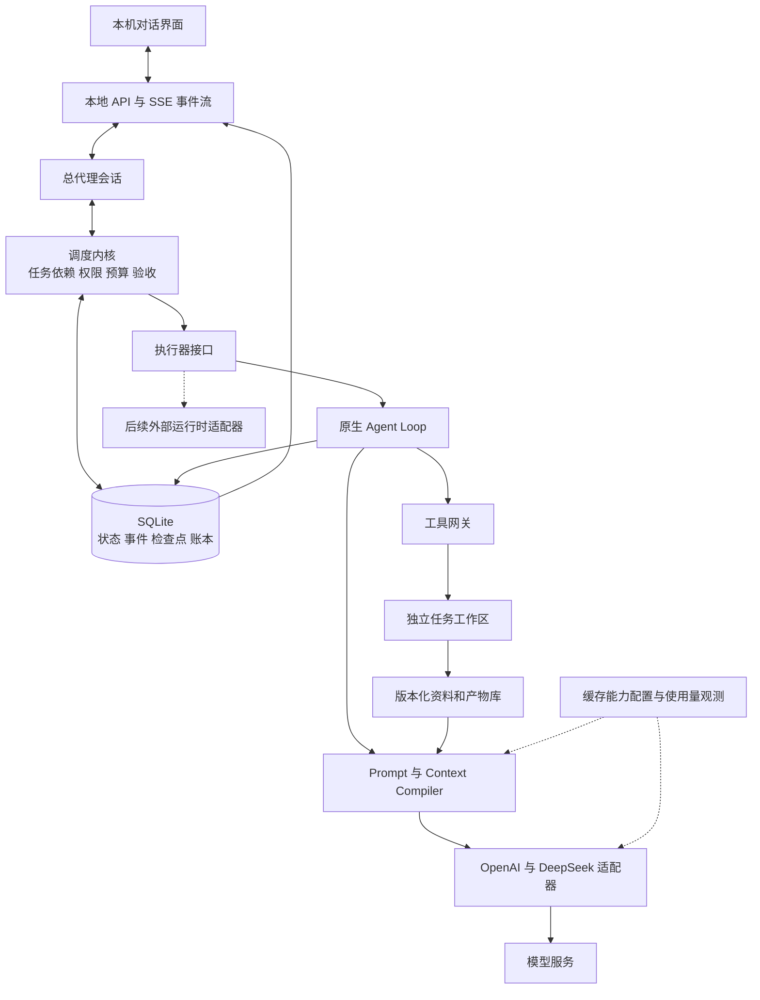

# Elysia 首版执行文档

## 当前迭代：v1.2.0 读取余量与计划替换核对

2026-10-12，cd8e47d / v1.1.0 → v1.2.0，沿用codex/initial-build，开始时工作区干净。用户授权落地上一轮建议：完整用量读取同夹具定位与优化、导入容量预检及完整原稿导出、当前草稿与导入计划的替换影响对照。因包含兼容新功能，目标采用1.2.0；不扩展计划库或自动执行，用量准备作业仅在定位优化后仍接近/超过原15秒期限时按证据决定。主代理负责版本、整合与交付；性能代理负责同夹具完整入口分段和直接瓶颈；计划代理负责无写入预检、原稿出口与对照；独立代理负责冻结1.1基线和最终生产UI验收。

| 里程碑 | 状态 | 验收 |
| --- | --- | --- |
| 完整用量首读 | 已完成 | 精确1.1同seed完整HTTP分段，正常轮询、原15秒期限；SQL编译瓶颈已修，生产UI10k5.719s，SHA/revision、坏记录、批回滚和取消保持 |
| 导入预检与对照 | 已完成 | combined新稿+完整undo容量按实际写入同规则预检，原稿可完整导出；实时替换对照/新编号说明，失败不写入，undo/CAS/重开/迟到/窄屏验收通过 |
| 1.2.0本地交付 | 已完成 | 最终类型/构建、必要生产UI/双入口兼容、版本/差异/敏感信息核对通过；对应提交由本地v1.2.0标签定位，未发布与验收缺口分列 |

验证仅用隔离profile，不调用模型、凭据或外网；必要脚本、样本、报告、截图和诊断保留在既有忽略目录。保护原1.1提交和用户数据，历史被拒清理路径不重试。

性能定位：精确冻结1.1基线v110-v120-baseline-3df620，先用原preview9 10k × 4 KiB seed跑完整服务入口，真实原15秒客户端超时，在8832/10000条后停止，原正文SHA/revision保持（zgM3oQ）。完整入口与此前独立Store+UsageReads不同，不能用核心6.189s和界面14.578s相减归因。原界面代码同body/binding/20Run及1k+10k+bad129重新生成seed，正常5秒侧栏轮询启用；分段诊断（9fyZqs）完整GET14.065s、warm13.841s，其中10k次请求UPDATE prepare7.416s、UPDATE执行1.784s、COMMIT2.300s、解压0.637s、查询0.096s。路由进入到summary约0.86ms，summary完成到socket约3ms，证据指向逐条SQL编译。为完整诊断仅该客户端用60秒截止，产品及生产验收仍保留15秒；中断留下的Cr3AqC无result，不计验收。

已实现：Store仅为requests的读取投影更新懒复用一条SQL statement，关闭时清引用，原revision/content guard、逐条savepoint、批事务、epoch及正文保持；其余表路径不变。同原UI seed当前完整入口首读4.941s、warm4.760s，prepare仅1次/0.69ms，32条313批保持，正文SHA/revision一致且原15秒成功200（cytoR4）。正常轮询未移除，该样本完成早于下一次5秒轮询；原preview9同seed优化后5.799s成功200，期间5秒sidebar三项请求均正常（ebzzTo）。两组body/revision全保持，暂不新增用量准备API。原15秒超时报告与未完成诊断保留。

前端已实现纯prepareProjectBoardDraft，与实际写入共用结构/容量和可选基线规则；预检读取完整当前草稿，用固定36字符占位ID计算新稿和完整undo，不写cache或分配真实UUID。预览提供当前草稿与导入计划目标/范围/不做事项、全部交付项文字及必需计数对照，不按名称合并；确认绑定edit/file，编辑后失效。可读原稿也能完整TXT导出，超200000字符禁用应用，恢复和保存仍沿用既有CAS/三方合并。

最小直接影响验证：statement边界6组（oe76bp）覆盖prepare一次/逐条绑定守卫、真实触发器DDL自动recompile、新增abort触发器整批回滚及drop后重试、same-revision rawbody修复与close清引用/503/幂等；用量19组（1qDNWU）、缓存4组（quRAxq）、批故障6组（XN1QNk）通过，正文、坏记录、取消及原生外层事务保持。容量/兼容新6组（YRxXjI）覆盖零UUID/无写、全部其他draft字段与完整undo、准确200000边界、可选基线省略、cache写失败、旧稿/三方合并/重开；原计划协议6组（CXShcY）回归通过。初次边界夹具有可选baseline，超1字符依法触发省略；另一次undefined属性被JSON省略导致夹具比较不符，只修ignored夹具且保留失败记录与原断言。

全类型、7份功能源码Prettier、server/Vite生产构建通过。最终主包index-BgoTkZ3z.js433.22kB、ProjectWorkbench-BwUEba9Z.js77.24kB，无新依赖；11份package清单及contract VERSION一致1.2.0，schema6/minimumReader preview.6不变。正式改动敏感模式与差异检查通过；独立Storage只读评审无阻塞。

最终production UI5组通过：复用原1.1界面fixture生成代码及完整服务，正常sidebar5秒轮询、原15秒GET期限，1k0.733s、10k5.719s（原1.1同生成代码UI14.578s），坏gzip仅1项缺口、取消/跨项目迟到及body SHA/revision保持（rpY3UR）。这与同seed完整HTTP的4.941/5.799s计时分别记录，仍不保证所有硬件/规模/压缩类型均不超时。

容量/对照生产UI4组（WxDIWm）：原稿125172字符/30项、合法incoming82855 UTF-8字节/20项，新稿+完整undo超过200000时ack/apply禁用；原稿TXT真实下载字节SHA与cache原文一致，预览/下载无draft或plan写入。删3项后同一预览即时可应用，当前goal对照随编辑更新，已勾选确认实际变为unchecked且apply disabled；20新UUID/27项完整undo只入草稿。新窗口重开保持，真实另连接CAS409保留两稿，恢复不覆盖remote最新计划、Runs数未增；File迟到切项目保持，未知版本/无效UTF-8和取消仍不改稿。root已目视1440完整双列对照和容量拒绝、320堆叠/checkbox可读，无横向溢出。初次TOJMMP仅QA executeJavaScript选择器引号嵌套SyntaxError，只修ignored框架后补容量组，未重复已过用量或改产品，失败证据保留。

最小数据兼容/双入口3组（VOqxX9）通过：精确1.1双入口schema6重开1.2无重复升级备份，body/revision及minimumReader保持；最终compiled服务原生/终端health均1.2.0；compiled CLI双入口backup为app1.2.0/schema6/minreader preview.6，1.1旧reader读取原账本。此前1.1实际immutable desktop启动验收沿用原记录，1.2本轮不宣称重新核验物理前台或正式窗口。相关fixture完整性ok/ok，无模型、外网、凭据或Docker调用，正式profile未碰。

本次正式提交由本地标签v1.2.0定位，未推送、公开发布或部署，正式窗口未重载；1.2实际launcher与物理前台行为未验。验收简表v120-release-qa-summary记录原UI计时HTTP/DOM：1k0.665/0.733s，10k5.658/5.719s，性能组无人工延迟。UI监听61545/61309/56729及相关Node/Electron进程确认0，compat app.close已等待且runner退出0。本轮失用baseline source.tar已精确单文件删除，必要脚本、seed、备份、报告、截图及失败诊断保留在忽略目录，不入Git；历史被拒清理目录不重试。正式差异和相关引用已核对，无失用正式文件或临时依赖。

## 当前迭代：v1.1.0 旧库读取与项目计划复用

2026-10-12，e6cf100 / v1.0.0-preview.9 → v1.1.0，沿用codex/initial-build，开始时工作区干净。用户要求思考改进并迭代到1.1.0，主线为解决已实测旧账本首读33.9–36.6秒/15秒期限，以及版本化项目计划JSON复用。模板库、依赖图和自动执行不扩展；数据库兼容与原流程复用优先。主代理负责版本/整合，性能代理负责批事务及前后同夹具，计划代理负责导入预览/草稿/导出，独立代理负责生产UI及双入口版本验收。隔离材料，不触及正式profile或新模型/凭据调用，不重试此前被拒清理。

| 里程碑 | 状态 | 验收 |
| --- | --- | --- |
| 旧账本首次读取 | 已完成 | 同preview9真实v1 1k/10k(4/64KiB)前后测，原15秒期限生产UI真实HTTP通过；取消/坏记录隔离/SQL故障批回滚、正文SHA/revision/缓存失效保持 |
| 项目计划复用 | 已完成 | 版本JSON导出/本地导入预览，生成新ID、只应用编辑草稿并显式保存；旧稿保护、未知/损坏/超限/额外字段拒绝、迟到/切项目隔离、CAS与重开恢复 |
| 1.1.0本地交付 | 已完成 | 必要类型/构建、最终生产UI、双入口同版本/数据兼容核对、正式差异/版本/敏感信息检查通过；对应提交由本地v1.1.0标签定位，发布与未验收能力分列 |

已实现：旧请求投影每32条共用短事务，每条继续使用失败隔离savepoint；调用方已有SQLite事务时使用批次savepoint，保留外层事务。SQL失败或同步取消回滚当前批，成功提交后才推进游标，保留逐批yield和原15秒GET期限。项目编辑器增加version 1计划JSON导出/读取/预览，严格限制UTF-8、192 KiB、40项、字段和原有标准。只迁移计划文字，每次生成新UUID；读取不写草稿，确认应用后保留一层导入前原稿，显式保存成功才清除。原basedOn/baseline及CAS/三方合并保持，旧v1草稿兼容；容量或缓存写入失败保留原输入和预览，迟到读取按项目和代次隔离。

同preview.9精确冻结源码、同原始preview.4 v1夹具、独立进程及数据副本逐组对照（project-usage-legacy-compare-v110-QJYFQ2），5组通过：

| 请求样本 | preview.9首读 → 1.1.0首读 | 1.1.0最大32条批次 |
| --- | --- | --- |
| 1k × 4 KiB | 3.119 → 0.440s | 18.00ms |
| 10k × 4 KiB | 33.794 → 6.189s | 23.76ms |
| 1k × 64 KiB | 3.272 → 0.631s | 21.70ms |
| 10k × 64 KiB | 35.573 → 8.417s | 41.10ms |
| 1k + 外项目10k | 3.310 → 0.603s | 36.93ms |

5ms定时取消意图到停止由195–212ms降至28–42ms，处理abort后停止均小于0.2ms；单条同步解压不可中断。各样本原请求compressed-body SHA/revision全保持；foreign项目10k条v1未回填，缓存复读0正文读取。复用可复现96段ASCII压缩夹具，不清OS/文件系统缓存，只计Store/用量服务而非完整HTTP启动，不保证其他硬件、不可压缩正文或更大规模均满足15秒期限。

功能用量19组、缓存4组、批事务故障6组通过（kmJQgp/L7rtoW/n5n5e1），覆盖中途SQL回滚、同批坏记录隔离、同步abort与原生调用方事务成功/失败。旧缓存夹具raw BEGIN后Store.put造成嵌套事务失败，只将ignored夹具改为等效原生SQL，保留断言和初次失败。计划辅助/兼容6组通过（0zm3WF）：导出字段边界、未知/额外/损坏拒绝、数组与UTF-8字节边界、新UUID/基线、三方合并、旧稿与undo重开、容量失败不覆盖。验证材料均忽略、不纳入Git。

独立最终production UI共5个验收组通过：真实旧v1 1k/10k在原15秒客户端期限分别1.488/14.578s，坏gzip明确1项缺口，跨项目迟到用量隔离；实际下载纯计划JSON、非法文件拒绝和预览不写项目、新UUID仅入草稿；新窗口恢复UUID/原稿及另连接真实CAS409保留undo，恢复只改本机草稿；切项目/后选文件的迟到读取隔离；另一项目显式保存清undo且旧任务/尝试/确认均不迁移，Runs数未增加。V8w5tj前两组通过，第三组QA未等待保存finally后restore按钮启用导致首次失败；只修ignored框架等待enabled，Tscwhk补计划组通过，产品源码/dist未变，不重复已过性能。完整UI10k耗时接近期限，不能据此保证所有数据规模或环境均不会超时。root已目视1440计划预览及320编辑器布局，窄屏可读，无横向溢出；两次报告和首次失败保留。

全类型检查、7份功能源码Prettier及server/Vite生产构建通过；当前主包index-SuCnrdem.js433.16kB、ProjectWorkbench-DCkF4Ee2.js73.16kB，无新依赖。11份package清单及contract VERSION一致1.1.0，schema6/minimumReader preview.6保持；正式改动敏感模式扫描与差异检查通过，独立前端只读评审无阻塞。

独立最小双入口/数据兼容3组通过（v110-compat-desktop-3rd831，passed_with_visibility_limit）：精确preview.9双入口schema6重开1.1无需重复before-upgrade备份，正文SHA/revision保持；隔离actual desktop/main.cjs使用immutable snapshot a08f0920…启动，原生/终端health和UI版本同为1.1.0，会话认证200，server/web/resources同digest且资源SHA匹配，安全停止；compiled CLI双入口backup记录app1.1.0/schema6/minreader preview.6，preview.9旧reader能读取原冻结账本。没有验证物理前台show/focus，未重载正式窗口或接触正式profile。既有订阅/API验收沿用原记录，本轮无新供应商请求，Docker及其他实验能力不因此升级为已支持。

本次正式提交由本地标签v1.1.0定位，未推送、公开发布或部署。两次生产fixture库integrity ok/ok、原请求SHA/revision一致，模型/外网/凭据/Docker调用均0；隔离监听61456/62553/51386及相关Node/Electron进程确认关闭。本轮生成且失用的source.tar已精确删除；必要baseline、验收脚本、样本、报告、截图和失败诊断保留于忽略目录，不入Git，历史被拒清理目录保持。正式交付物及引用已核对，无新增失用正式文件。

后续方向：扩大真实数据规模与压缩类型对照，若完整HTTP再次超过15秒，复用已有准备作业提供明确进度与取消；计划复用继续观察实际使用，再决定计划库与差异预览，避免直接扩为自动执行。

## 当前迭代：preview.9 冻结依据直达与旧账本首读测量

2026-10-12，c7fdf35 / v1.0.0-preview.8 → v1.0.0-preview.9，沿用codex/initial-build，开始时工作区干净。用户授权落地上一轮建议：P1保存包直达冻结依据，以及P0旧账本首读实测。计划复用、用量准备作业与稳定版全范围验收不纳入本轮。主代理负责版本/整合，界面代理负责入口与选择绑定，测量代理负责旧库规模/取消，独立代理负责生产UI验收；隔离数据，不触及正式profile/模型/凭据，不重试被拒清理目录。

| 里程碑 | 状态 | 验收 |
| --- | --- | --- |
| 冻结依据直达 | 已完成 | 按project/id/hash定位，同名和历史分页外可查；明确冻结/保存时间，删源仍保留冻结标准/意见；失败及迟到不清草稿、不混淆详情 |
| 旧账本首读基线 | 已完成 | 精确旧版本真实v1账本，1k/10k普通/较大正文、foreign对照；初始化/回填/汇总/批次/事件循环/取消与重试分别记录，业务正文/revision保持 |
| 本地预览交付 | 已完成 | 相关静态与最终生产UI验证通过，必要图证、类型/构建、版本同步与差异检查；正式提交、本地标签，验证材料忽略 |

实现：保存包列表提供查看冻结依据入口（仅提供callback的项目汇总场景），按project/manifestId/manifestHash定位，详情直接GET不依赖历史页或标题。既有v1草稿增加可选selectedManifestHash，旧稿兼容；历史选择也捕获hash。切换选择只显示匹配的已读详情，same-ID重读失败保留冻结标准/意见并注明当前来源未确认，错三元组报错，迟到GET/JSON或Markdown导出不覆盖新选择。下载错误独立，不清掉详情读取缺口；冻结于/保存于明确分开，点击入口聚焦滚动到详情。草稿兼容/绑定往返/无效hash保护3组通过，必要脚本忽略。

旧账本测量使用逐blob核对10079ce的20份storage/contracts源码，真实preview.4 Store写v1，再独立进程重开当前Store；1k/10k各4KiB/64KiB正文及1k+10k foreign，5样本通过（project-usage-legacy-measure-preview9-pHoFKZ）。正文为可复现96段ASCII块，完整request JSON gzip比率约37.1%/7.30%，并非不可压缩文本；不清操作系统缓存。初始化Store约152–163ms、用量服务40–82ms，初始化request解码0。

| 样本 | 首读 / 回填 | 32项批次P95 / 最大 |
| --- | --- | --- |
| 1k × 4KiB | 3.135 / 3.119s | 104.60 / 107.05ms |
| 10k × 4KiB | 33.872 / 33.737s | 125.96 / 137.70ms |
| 1k × 64KiB | 3.266 / 3.240s | 118.94 / 128.48ms |
| 10k × 64KiB | 36.565 / 36.485s | 138.66 / 152.07ms |
| 1k + 10k foreign | 3.348 / 3.280s | 113.92 / 115.99ms |

首次只解压本项目1k/10k，foreign v1不变；缓存复读0.42–0.69ms、正文解码0。事件循环最大107–152ms（含计量bookkeeping），定时取消意图等待约195–212ms才被处理，处理后0.17–0.29ms停止；重试仅余量，所有正文SHA/revision及完整性保持。最终compiled preview.9的真实HTTP单项0QjHfY：独立客户端15009.77ms触发15秒截止并AbortError，服务器15186.53ms处理断连、0.412ms后停止，回填4512/余5488，停止后120ms全局计数无新增正文读取；无截止重试18.787s，仅解压余量，不冒充15秒期限下成功。本轮只完成测量，旧库首次读取仍可超时，未优化此路径。

下一轮据此优先验证按32项外包事务提交，复用已有ProjectionReads.batch的边界并保持逐条savepoint/坏记录隔离，再决定是否引入用量准备作业。当前仅证实成本集中回填、单条decode远小于整批，尚不能宣称fsync为唯一根因或一般性能保证。

独立生产UI3组通过（project-manifest-basis-production-preview9-summary.json / CYaiqj）：两份同名真实保存包及21份更新历史使目标清单在首页之外，分别正确定位不同计划/标准/复核；真实删Run后冻结依据保持，ZIP删前/删后字节相同且CRC/SHA/正文验证通过；失败、同ID错hash、迟到/切项目、新窗口UUID/hash及原冻结草稿保持，JSON导出不清掉来源未确认状态。前两组用lyiiXXVh，第三组功能首次到末尾布局检查均过；320内部宽度310/312失败，诊断到复选框继承width100%把span挤为0，CSS只增width:auto，不隐藏溢出。最终Bjs1AD1-构建仅补第3组、布局及窄屏同名点击：310/310、checkbox13px/span200.4px；前2组功能源码未变，不重复。另4秒导出取消专项export-result.json通过，迟到甲JSON不下载、不污染乙，返回甲绑定/草稿保持。root已目视1440删源冻结标准及320详情，无横向溢出。首次fixture在ready后addHook被拒，仅修测试框架，非产品故障；原准备/布局失败诊断保留。

全类型、server/Vite生产构建、4份功能源码格式与差异、11份package清单+contract VERSION一致性通过。最终主包index-Bjs1AD1-.js433.11kB、ProjectWorkbench-BPdmdOvQ.js65.17kB；没有新依赖，后端契约与schema6/minimumReader preview.6保持。本次正式提交由本地标签v1.0.0-preview.9定位；未推送、发布或重载正式窗口，正式profile未变。模型/外网/credentials/Docker均0，两个生产fixture库完整性ok；QA进程及监听口关闭，必要脚本、样本、报告和截图均忽略、不入Git。无新增失用tar/日志；首次准备失败97aF0I的6个state.db相关文件及空目录已核验后尝试非递归精确清理，被自动审批以blocked by policy拒绝，保留且不重试/绕过；此目录清理未完成，不影响功能及版本交付。

## 当前迭代：preview.8 工作台后台刷新

2026-10-12，db7e508 / v1.0.0-preview.7 → v1.0.0-preview.8，沿用codex/initial-build，开始时工作区干净。用户授权思考改进并完成一个小版本；本轮聚焦健康项目准备直接完成及后台刷新无干扰，旧库进度/独立取消保留。旧request账本首次规模回填、模板与稳定版验收继续单列，不扩大本轮。主代理负责界面、整合与版本，后端代理负责准备快读，独立代理负责API/生产UI验收。仅使用隔离材料，不触及正式profile或模型/凭据。

| 里程碑 | 状态 | 验收 |
| --- | --- | --- |
| 健康项目准备 | 已完成 | 无dirty合法任务时POST即completed，不创建Run子作业；两个慢项目准备不阻断健康项目，异常关联保留缺口 |
| 后台刷新体验 | 已完成 | 健康项目15秒刷新无进度/按钮闪烁；初次和手动读取可见，出现dirty仍显示真实准备及独立取消 |
| 本地预览交付 | 已完成 | 必要API/最终生产UI、类型/构建与差异核对通过；版本同步，正式提交及本地标签；测试材料不入Git |

实现仅两份功能源码：项目准备同事务捕获source/epochs，核对本项目native task后检查dirty；无需回填则同步返回completed及完整计数，不创建Run子作业或占慢项目并发槽，仍保留UUID/会话绑定、64条短期回执与取消真值。工作台首次/手动读取显示状态，后续15秒后台刷新只有实际warming才显示进度，取消仍停止本窗口并待显式刷新。

基线4BYvY8：3个健康Run/9产物POST仍warming、3个child；两dirty项目运行时clean返回429。修复o71mGL共6组通过：clean即时completed、0child/0batch；双慢时clean202而第三dirty仍429；绑定、终态取消、3项非法关联缺口、实际回填与版本变化409、70次回执有界淘汰。一次版本竞态夹具在8条单批已完成后才改source，改为128条实际pending后通过，原断言保留。真实全路由source-CYid95：clean70产物回执完成后另一SQLite连接raw改正文，随后board读取补1batch、指纹变化且元数据/原文一致，旧回执不冒充新交付，完整性ok。最终dist核心2组pyTAEf通过；无新增依赖，schema6/minimumReader preview.6不变。

独立生产UI3组通过（project-refresh-production-preview8-summary.json）：旧main BI3QY06L基线6oG5j8，每轮POST+job GET+board GET共3请求、首读+自动两次共6 child，后台进度/按钮闪现；最终main DaSIp4lQ的健康轮询2请求、0job GET/0child、无进度/按钮变化，初次/手动仍可见。真实新增1600产物并使metadata失效后，双窗口显示进度，一窗取消保留原数值及草稿、标明当前状态未知，另一窗完成；GET失败重试、迟到POST跨项目隔离及返回旧项目草稿保持。首轮夹具将取消后的正常未知前缀当作统计变化，改为逐数值/版本span保持并单独要求未知提示，原断言与失败诊断保留；已过clean组xu9fDT不重复，只补两组focus-l5I7a4。root已目视1440正常总览及320回填/草稿页，无横向溢出。为观察进度，隔离夹具对实际批处理额外加80ms；不作为回填性能测量。

全类型、server/Vite生产构建、功能源码格式/差异及11份package清单+contract VERSION一致性通过。主包index-DaSIp4lQ.js432.88kB，ProjectWorkbench-DSL0L-Ub.js63.74kB；正式改动凭据模式扫描无匹配。本次提交由本地标签v1.0.0-preview.8定位，未推送/发布/重载正式窗口，正式profile未变。生产测试模型/外网/credentials/Docker均0，两库完整性ok；Node/Electron正常退出，3个隔离listener确认关闭，相关进程0。必要复现、截图及失败诊断均在忽略目录，不纳入Git。首次QA框架addHook时机错误留下无报告的.local-qa/project-refresh-production-preview8-baseline-iK7w8P（仅两空Store及wal），核实绝对范围后的递归清理被自动审批以blocked by policy拒绝；已保留，不绕过或重试。这一冗余目录清理未完成，不影响正式源码和已通过验收。

下一优先方向：先实测旧request账本1k/10k首次回填与取消延迟，再决定用量首读准备流程。当前每32项yield已存在，但单GET仍受15秒期限，现代账本规模证据不能代替旧库首次回填；本轮不声明该缺口已解决。

## 当前迭代：v1.0 交付留存与持续使用

2026-10-12，基线7f3eef6 / v1.0.0-preview.5，codex/initial-build，开始时工作区干净。用户授权落地上一轮建议，分为preview.6交付包留存、preview.7用量分页与旧库/删除读取优化。稳定版发布、项目模板与依赖继续单独验收。本轮只用隔离材料验证，不触及正式profile，不重新删除此前被拒的目录。

| 里程碑 | 状态 | 负责人 / 依赖 | 验收 |
| --- | --- | --- | --- |
| M1 / preview.6 / 显式交付保存 | 已完成 | 打包代理后端、界面代理 | 每清单一份64MiB内完整ZIP；状态/大小/移除；删除源Run、重启及对象清理后字节相同；取消/落盘/提交边界不假成功 |
| M1 / 数据保护与恢复 | 已完成 | 主代理 | schema6/minimum reader preview.6；旧schema备份正确门禁；对象引用保护；备份恢复保存包完整性；项目删除须确认当前存档集合 |
| M2 / preview.7 / 用量汇总复用 | 已完成 | 性能代理 | 同版本连续5页只聚合一次；有界内存/项目隔离、修复/归属/结算失效、事务回滚不污染缓存 |
| M2 / 回填与删除性能 | 已完成 | 性能代理回填、主代理删除、后端代理独立QA | 旧元数据分批进度/取消，完整指纹与正文版本保持；删除按同夹具测基线并优化必要范围，共享/嵌套/存档引用保留 |
| 分阶段交付 | 已完成 | 主代理整合、独立QA | 必要专项、真实生产UI、格式/类型/构建，分别提交与本地标签；已实现/已验证/已发布区分 |

M1：新增显式保存作业，一份冻结清单保存一份完整核验的ZIP，流式写入原objects内容寻址目录，核对来源版本和SHA后无覆盖发布，落盘后事务保存独立清单绑定记录。提交前取消不写记录，提交后成功凭据不倒退。临时下载不当作保存；重复保存保持原记录。已保存包独立校验下载，源Run/Artifact删除后可读；移除只撤引用。项目列表包含完整集合setHash，两个删除入口先读取保存包并明确确认，后端prepare/finish都核对当前集合，集合变化409保留弹窗。对象目录与父级链接拒绝，64MiB/双槽沿用。

后端保存7组（project-delivery-archive-v100p6-y1qQnE）及原ZIP11组（project-delivery-bundle-v1-Y98POH）通过。发现并修复同hash发布时临时硬链接移除改变ctime导致误报损坏：最终对象核对inode/size/mtime及完整SHA，来源仍严格核对ctime；已有对象不覆盖。升级/CLI备份恢复6组（delivery-archive-upgrade-preview6-UMK89U），并在仅M1的Git树934de8c导出的project-preview6-release-tree-7e4c7b精确源码重跑6组（5JGj1S）通过：真实preview5双入口schema5→6，正文不改，旧备份仍schema5/minreaderpreview.1可读；旧reader拒新库，保存ZIP删源后备份恢复字节一致，坏包/错误清单绑定在安装前拒绝，旧schema5备份仍可恢复迁移。精确对象维护3项（archive-cleanup-preview6-vObtxn）确认保存包、共享与嵌套对象保留，无引用对象按计划清理，损坏存档引用拒清理。

M1精确源码全类型与server/Vite构建通过，主包index-VoekRA8i.js432.77kB，排除并行M2全部warm/cache源码及Store包装。生产UI8组通过（project-archive-production-preview6-summary.json，截图3mK2rn）：真实ZIP CRC/索引/hash、取消/提交竞态、源删除后下载、移除、两删除入口集合变化/读取失败保护、重建窗口及1440/320无横向溢出。管理入口首轮停在既有归档tab，修正测试点击项目tab后只复验第8组，无产品修改；失败记录保留。模型/外网/credentials/Docker均0，4库完整性ok。M1正式提交由本地标签v1.0.0-preview.6定位；未发布或重载正式窗口，正式profile未变。临时源码tar/暂存blob文件已精确清理，必要复现/诊断/证据留忽略目录，不纳入Git。

M2已实现：用量汇总按项目/现有统计版本有界复用，最多4项目、16MiB序列化payload，不声明等于V8/RSS。缓存命中只检查代际并返回克隆的20条任务页，不warm或重扫全项目；事务中不读写缓存，关闭Store清空。旧产物派生metadata脏队列每32–64项短事务回填，原始body/metadata任何变化及派生表增改删都排队，合法回填清队列；坏body保留脏项。Run/项目拥有独立有界warm作业，常用交付、历史详情、差异及项目board先准备再读完整结果；POST快速响应、短progress GET、只取消当前订阅，其他窗口继续。Store关闭先同步abort，服务器关闭再await，不在闭库后继续读取。

读取指标来自本机同类隔离夹具：100个本项目Run＋5000 foreignRuns、10k请求，五页旧124.95/111.81/105.99/104.64/109.43ms且每页聚合10k；新118.72/0.357/0.174/0.141/0.142ms，仅首页聚合，后4页warm/聚合SQL和request正文解码0，缓存45878序列化字节（project-usage-cache-v100p7-after-10000-fcu7Yh）。旧产物10k分批固定32总1587.95ms，自适应32→64总1150.56ms、173批、最大batch14.16ms、事件循环最大24.05ms/p95 13.12ms，7一致性/取消/跨连接/损坏组通过（delivery-warm-v100p7-10000-vWqa7u）；总耗时仍比原同步330.79ms长，收益是进度、可取消及短阻塞。现代10k首读60.06ms/首次diff32.25ms、产物解码0，最终全量指纹/差异仍同步、最大eventloop51.45ms，不宣称全部首读或内存全面下降。M2旧request账本初次规模回填仍无实测，未把产物数据替代它。

删除优化：原始body事务写入派生引用及命令字符串token，原始content增改删触发失效，损坏投影从原文回填。删除Run先按SQL收集ID，命令索引只筛候选，最终仍核对原始result和run_refs。现代引用汇总不展开无关core正文；嵌套压缩对象核对大小、内容hash及寻址标识，无法核验则整个删除回滚，合法非JSON文本保持opaque。精确preview5基线1k/10k无关单元（三表3k/30k、每row8KiB）删小Run76.46/592.22ms、4011/40011解压；新8.87/59.71ms、6次/611B，再删10k第二Run47.41ms/3次/424B；完整性保护补验10k54.73ms/6次，非通用性能保证。7行为组（gc-reference-behavior-v100p7-wZee2P）及1损坏组（gc-reference-corruption-v100p7-moqjHD）通过，覆盖raw同revision、坏投影、rollback、命令token修复、共享/嵌套/真实保存ZIP、重开及旧库240历史首回填每条一次后零展开；损坏/缺失嵌套父对象阻断并保留待删Run、command和child。报告基线BUelF8、新6Pk9xW、补验CxX6vv均在.local-qa。

独立并发回填5组（delivery-warm-independent-v100p7-qOfFB0）通过，覆盖两个项目、共享Run订阅单独取消、70个Run/项目读者、坏/缺失/foreign/非原生任务及Store关闭。首轮发现完成凭据在worker槽位释放前唤醒项目下一项，误报429；修复为先按worker身份释放再通知，旧finally不删除新worker，退役中的work另行等待关闭。最小槽位2组（delivery-warm-slot-regression-v100p7-eSEbeD）复验立即取消重开、旧finally及同步坏body失败，不把活跃槽位超过2。Run自动读取HTTP4组、项目HTTP6组通过。用量18组受影响回归、4缓存边界组及1k/10k规模各5边界通过；两项并发夹具改为在缓存查询前完成外部提交、或先LRU淘汰再触发聚合竞态，保留原断言及失败诊断。

生产UI5组（delivery-progress-production-preview7-summary.json）通过：6402条真实元数据准备16.787秒，各短请求保持原15秒期限；双窗口独立取消，Run/复核详情/差异取消重试保留原备注，迟到POST不覆盖新项目，五页100任务完整且cache gets5/hits4/puts1，保存preview.6完整ZIP一次直接回归。进度2722→2818→2914→3010/6402，1440/320无横向溢出，主代理已目视窄屏进度及M1宽屏保存包页面。首轮SQL计数夹具误将pending-ID查询混作聚合，区分SELECT字段后仅补五页HTTP计数：pending返回0，账本两次SELECT共101条，当前request正文0解码；无产品改动。两库完整性ok，模型/外网/credentials/Docker均0。

删除日志兼容最小1组（delete-run-legacy-stream-v100p7-1hL0LD）通过：现代投影直接取partialStreamRef，缺该字段的旧投影只展开选中请求1次；现代/非法现代/无关请求零展开，正确清理选中日志，其他Run与越界文件原字节保留。两槽2组（compiled-SafFiS）及旧日志1组（compiled-UMJYs3）编译冒烟通过，报告记录SHA256且执行前后未变。

收尾只读复核发现并修复两处集成回归。日志路径在外部正文修复后可能仍旧：独立request_log_pointer_dirty_v1在原始content/投影pointer变化时失效，可信Store.put同事务清除，选中dirty请求读原文；不UPDATE requests.data，避免触发用量派生清掉既有dirty。失败u2bxQV保留，修复源码联合组WNnq3L及最终dist联合组oGABWl通过：同revision content-only、content+data、data-only pointer三种只删新B留旧A/无关C；正常现代0解码，dirty选中各1次；重复raw UPSERT无冲突，账本dirty保留并回填43/66Token、USD4.25。项目board自动warm原本包含不可关联Run，现复用assertRunScope筛本项目native task；其余保留原unknown。真实认证GET专项ALTGLj通过：健康70项回填，foreign/非原生/缺失/坏Run各20dirty不变、无产物展开，4项缺口不阻断健康指纹与热读；缺失Run的dirty children由隔离夹具FK-off故意构造。

以上修复后最终全类型、server/Vite构建、格式与差异检查通过，主包仍index-BI3QY06L.js432.88kB，ProjectWorkbench63.65kB。schema6/minimumReader preview.6不变，11份package清单与contract VERSION为preview.7；没有新增依赖。前端源码/产物未再变化，复用生产UI5组；最后新增联合专项使用最终dist的storage/usage模块，SHA执行前后不变。项目scope最终编译API专项dist-rvkLu8同样通过，四项缺口与健康70项保持，并确认热重读无额外展开。

M1已提交3011ff2 / 本地标签v1.0.0-preview.6，M2正式提交由本地标签v1.0.0-preview.7定位。正式改动凭据模式扫描无匹配，测试材料、截图与构建输出未纳入Git；已精确清理本轮无用tar、暂存blob和三份编译冒烟复制脚本，原复现、失败诊断与有效证据保留于忽略目录。未推送、发布或重载正式窗口，正式profile未变。稳定版全范围验收、物理前台聚焦、真实Docker及其他供应商、旧request账本首次规模回填仍为单列缺口；本轮只完成本表授权范围。

## 当前迭代：v1.0 性能、打包恢复与项目用量

2026-10-12，基线928632e / v1.0.0-preview.3，沿用codex/initial-build，开始时工作区干净。用户授权完成上一轮建议：M1 / preview.4优化大型交付冷首读与差异读取、维护取消，并补齐打包进度及未来新作业的崩溃恢复；M2 / preview.5增加只读项目订阅/API用量。正式发布与稳定版门槛独立记录，交付包长期存档、模板和依赖提示仍为后续。

| 里程碑 | 状态 | 负责人 / 依赖 | 验收 |
| --- | --- | --- | --- |
| M1 / 冷首读与差异 | 已完成 | 性能代理 | 当前1k/10k夹具前后对照；指纹、完整分页、损坏隔离和跨连接修复语义保持；耗时、解压数量、事件循环及内存有证据 |
| M1 / 维护取消 | 已完成 | 维护代理 | 64MiB与75万引用测取消；锁重新取得、结果完整、安全停止及审计一致，不把已经删除的结果报告成未发生 |
| M1 / 打包进度与恢复 | 已完成 | 打包代理 | 核验/准备/发送状态可见、取消与迟到状态隔离；强杀后只回收经所有权/存活核验的新孤立作业，活动与未知目录保留 |
| M2 / 项目用量 | 已完成 | 主代理，性能代理独审，维护代理独立QA | 按请求冻结连接聚合，Token/已知费用估算/未知及未结算分开，多币种分列，任务可定位；不读取当前配置猜历史、不自动调用模型 |
| 分阶段交付 | 已完成 | 主代理整合 | 两阶段专项、独立复核及生产界面、最终类型/构建通过；版本同步、分别提交与本地标签；测试材料仅在忽略目录 |

本轮所有验证使用隔离数据，不触及正式profile。不重新删除此前已被自动审批拒绝的目录；新打包作业回收只适用于本轮新建且拥有完整所属标记的目录。数据格式与最低reader是否变化在实现冻结后核对，不把派生统计或读取回填作为权威任务修改。

M1实现：产物七字段派生元数据与原始写事务绑定，任何原始记录变化触发失效，校验失败或旧记录只回填必要项；v1指纹保持相同字节，差异比较直接核对七字段。当前同夹具1k/10k现代冷读16.12/134.42→8.21/60.57ms、产物解压1000/10000→0；10k首次比较125.94→45.69ms、事件循环最大141.43→63.31ms。10k冷请求RSS增量77.87→19.34MiB，全进程峰值385.35→395.13MiB，不能宣称总体内存下降。测量为本机合成Store/app重开，不清操作系统缓存；首次比较之前已读取当前交付。旧库一次回填1k34.60ms、10k330.79ms，仍解压全量，正文与revision不变，回填后重开零解压。规模/故障、旧库兼容、复核摘要10项及历史6项通过，报告delivery-scale-v0281-10000-mM61JX/i8Ffj8与delivery-metadata-v100p4-bnKvuI/iomjvP，材料均在.local-qa。

维护取消：引用遍历每256项及解压前后检查；50ms协作窗口后仅原子门闩确认未进入preflight时可停止只读worker，进入核验/删除后始终协作取消；worker真正退出才释放服务锁。64MiB取消最大观测78.2→43.9ms，75万引用473.3→60.6ms，50ms并非总等待保证。完整计划新旧一致、首/中/尾引用、12取消样本无删除且锁重取、核验保护、实际删除1项后取消与原计划重试、审计9组回归通过；强制中断保留真实incomplete审计，不伪造footer。汇总object-cancel-preview4-summary.json及object-cancel-boundaries-preview4-qoHojE。

打包改为异步作业＋短状态读取，核验/准备/发送文件数及字节可见，五分钟作业上限、ready未领取60秒释放、终态短暂保留。严格绑定session/clientId/项目/清单/hash，同窗口重试等待前驱清理，不替换其他窗口。新专属平面目录只按严格root/job所属标记及PID确认孤立回收，拒绝链接、额外文件、未知或活跃实例；不扫描旧系统temp。实际准备/发送子进程强杀、跨窗口访问、并行刷新、TTL、取消迟到、ready打开失败及响应header异常均通过（project-bundle-jobs-v100p4-RMS8bZ、project-bundle-independent-review-v100p4-tdfyhK）；原ZIP11组回归通过。生产UI6组（project-bundle-production-v100p4-ZBHIXU）含同窗口整页刷新2次、核验超过16秒、1440/320和12MiB真实ZIP独立字节/CRC/SHA验证；无外网/模型/凭据调用。极早初始化在mkdir后、owner写入前崩溃会留下未认领根并503保留，不自动认领；已完整标记的准备/发送强杀能够回收。

主代理仅暂存M1（排除并行M2的ledger2及项目用量路由），从Git树b231484e导出project-preview4-release-tree-yhA7bb。精确源码全量类型及server/Vite构建通过，并重跑旧库10k兼容6项、作业生命周期11项、独立刷新/TTL/错误流4项、维护边界2项全部通过；首次维护边界运行缺少脚本指定的旧夹具，保留失败记录，复制原夹具后通过，并未修改产品取消语义。schema5与最低reader1.0.0-preview.1不变，11份package清单/contract VERSION同步。正式M1提交10079ce、本地标签v1.0.0-preview.4，未发布或重载正式窗口；无新依赖、无测试材料入Git。

M2实现：原生项目增加显式“项目用量”，包含全部项目任务/对话及已归档记录，重试按独立请求计数。请求轻量账本v2捕获原冻结连接/模型/账号信息；分批读取派生账本，旧v1只在首次显式读取项目时回填，正文与业务revision保持。费用取已结算请求保存的估算金额及当时币种，不使用当前模型价格重新计价；USD/CNY分列，订阅未知成本、缺失用量、未结算和不可读记录保留明确缺口。无法确定项目归属的旧任务显示全局未分配计数，不猜归属。任务明细每页20项，可直接打开原任务；翻页绑定项目统计版本，变化返回409。项目切换取消读取，失败保留上次结果并提示过期；新增usageOpen可选草稿标志，保留原tab枚举以兼容旧草稿读取。

独立后端15组通过（project-usage-preview5-independent-tjsh2K），覆盖冻结订阅/API、多币种及状态缺口、坏账本隔离、旧库一次回填、同revision正文修复、真实流式追加不误解压、跨连接写入、归属及读取缺口变版、45任务分页20/20/5。修复独审发现的跨项目Run变化误失效、流式revision变化误回填、可读性变版和同revision附带元数据修复失效问题，保留原失败诊断。10k当前账本读取130.5/122.0ms，正文展开0次；另50次外项目并发写入时284.9ms仍返回同项目一致版本。本机多夹具进程RSS200.6→201.5MB、heap约51.7MB，仅观测不作为通用性能保证。额外累计溢出1组（project-usage-preview5-independent-VMwuMf）：输入/输出/同币费用及Token合计4类有限数溢出均422，不序列化为伪null；空项目、正常未知记录及仍有限的临界值200，业务正文/revision不变。

生产UI7组通过（project-usage-production-preview5-ul0LrH）：按项目进入、历史连接不受当前配置变化、币种与缺口、45任务完整分页、真实409保留旧值后刷新、延迟请求跨项目隔离、任务打开往返及新窗口重开项目恢复用量页。1440/320六张截图均保留，已目视总览及连接布局；无横向溢出，控制台错误、外网、模型、凭据及Docker调用均0，两个入口SQLite完整性ok/ok，45任务正文不变。该流程使用index-3LiL671I.js，之后明确费用“估算”文案，并补齐下述后端边界；最终全类型与server/Vite构建通过，主包index-Buk_6hhA.js419.84kB、工作台按需模块62.91kB。schema5、最低reader和原清单协议不变，没有新增依赖。

提交前性能代理只读独审发现三处边界并修复：epoch完整比较账本，账本内部revision损坏/恢复均使旧分页409，真实增量流只改顶层revision仍零正文展开、版本稳定；项目归属统一为明确null或UUID形状字符串，数值/对象/空串/非法UUID计未知，未知数量变化使分页失效；跨连接在请求查询前新增Run导致映射缺失时转入原重试，避免500。补验3组（project-usage-preview5-independent-2RQtU4，含2组受影响回归）及2组（DLU0E7）全过。后者16种归属形态、缺口版本与foreign排除正确；独立DatabaseSync在旧runRows后定点插入新Run＋request，重试返回2Run/2请求/145Token/USD1.5完整统计，旧expectedVersion返回409，无500。原正文/revision保留，SQLite完整性ok，外部调用0。

M2正式提交由本地标签v1.0.0-preview.5定位；11份包版本与contract VERSION一致。无测试材料、截图、构建输出或凭据入Git，已移除本轮失用的旧构建临时日志及导出源码临时归档，必要复现、失败诊断和验收材料保留在忽略目录。未推送、发布或重载正式窗口，正式profile未变；旧库首次回填和未完整写入owner根的保守503仍为已注明边界。

## 当前迭代：v1.0 项目推进与可携带交付

2026-10-12，基线1a92379 / v1.0.0-preview.1，沿用codex/initial-build，工作区开始时干净。按用户“完成落地”完成两个可验收版本：preview.2项目待办导航和计划/创建草稿变更对照（e8288f4），preview.3含实际文件的可携带交付包（同名本地标签定位提交）。正式发布与稳定版验收独立记录；大型交付首读/维护取消性能、项目模板/依赖及项目用量汇总继续作为后续专项，本次不扩大到这些功能。

| 里程碑 | 状态 | 依赖 / 负责人 | 验收标准 |
| --- | --- | --- | --- |
| M1 / v1.0.0-preview.2 / 待办与变更对照 | 已完成 | 界面代理实施，独立QA与主代理整合 | 必需项优先、具体原因和直接处理入口；原始/当前/本人计划对照，冲突明确选择，保留其他窗口变更及创建输入；旧草稿兼容、CAS不绕过 |
| M2 / v1.0.0-preview.3 / 实际文件交付包 | 已完成 | 后端代理，主代理界面，独立QA | 按冻结版本选定正文，预检说明大小及缺失；ZIP含清单、说明和校验信息；缺失/变化/损坏拒绝，不产生冒充完整的包；取消/失败清理，复制后独立读取 |
| 分阶段整合 | 已完成 | 主代理 | 最小相关测试、真实生产界面与文件字节验证、类型/构建、版本同步、差异核对；分别提交与本地标签，发布状态单列；冗余清理受策略限制的目录保留 |

交付包采用显式下载时读取并核验冻结清单所选原产物的方式；现有清单继续只保存元数据，不改写历史、不承诺永久保留源正文。已下载的包可以独立保存；未下载前源正文缺失将阻止完整打包。所有验证在隔离数据和既有忽略目录进行，本轮不需要新的模型调用，不触及正式profile。

M1：项目总览按首个未满足门槛列出具体原因、必需项优先和直接处理入口，返回项目保留目标交付项。计划及创建草稿新增基线、三方字段比较与显式冲突选择；远端不同字段/新增保留，删除对修改明确选择，当前版本再次变化撤销此前选择。创建比较使用setupRaw中实际交付要求，保留模型、权限和预算。旧草稿无基线不推断修改方；大草稿因基线翻倍超过200000字符时只省略可选基线并说明，同版本仍受CAS保护，变版后所有差异明确选择；用户正文超限仍拒写并保留原文。schema5与最低reader保持1.0.0-preview.1。

M1独立合并9组、生产UI/真实API4组通过（project-draft-merge-independent-v100p2-Bx711M、project-workbench-production-v100p2-XitVTJ），覆盖105k/185k容量、真实409、二次变版、约140k合法计划、setupRaw及全新窗口恢复；1440/320截图已逐张目视。主代理另外从仅含M1的Git树a2907718导出隔离源码（project-preview2-release-tree-9u9hvH），全量类型检查与server/Vite构建通过，并重跑生产4组（n1aUtb）及合并9组（SvHu8o）全部通过；外网/凭据/模型/Docker调用均0，SQLite完整性ok/ok。该树不含并行开发的M2，M1主包419.82kB、工作台模块49.25kB。正式内容按本地标签v1.0.0-preview.2定位，未发布或重载正式窗口；无新依赖，验证材料留在忽略目录。

M2：新增按清单hash绑定的显式文件预检与ZIP下载，检查原生项目/产物归属、冻结名称/版本/哈希/类型及原始字节；来源缺失或变化不替换为最新内容。空产物清单只支持原JSON/Markdown导出。ZIP包含安全相对路径下的原始文件、manifest.json、manifest.md、README.md、bundle-index.json与SHA256SUMS.txt；文件与说明合计64MiB上限，每入口最多两个核验/下载，复用磁盘/压缩对象流并边读边验证，完整临时包验证成功后才发送。客户端显式读取、切换/取消中止、迟到结果不恢复旧计划；失败与重复下载不写新的成功交付记录。schema与旧清单协议不变，没有新增依赖。

M2后端11组及旧项目交付回归5组通过（project-delivery-bundle-v1-FcSD78、project-delivery-v1-ZlVxI6），涵盖磁盘/压缩正文、元数据变化、跨项目/任务、路径越界、缺失损坏、展开前超限、读中变化、并发槽释放，12MiB真实HTTP准备阶段断开及发送阶段断开后清理与重试。ZIP逐entry CRC、大小、SHA256、索引对应验证通过；主代理另用Python标准zipfile独立核对首轮包全部索引与校验记录。最终preview.3生产界面/真实API5组通过（project-bundle-production-v100p3-8Eax2G）：真实下载ZIP、复制到新目录后独立验证每份正文和清单、取消迟到结果、源变化阻断与既有包不变、刷新后不沿用旧预检、1440/320无横向溢出；截图已目视。模型/外网/凭据调用0，源Run与冻结清单未改，SQLite完整性ok。

最终全量typecheck、server/Vite生产构建、改动源码格式与差异、11份package清单及contract VERSION一致性通过；主包index-D79EaKOJ.js为419.82kB、工作台模块53.59kB。正式源码与文档提交，本地标签v1.0.0-preview.3定位，未推送/发布或重载正式窗口；本轮没有重复真实模型调用，沿用preview.1已记录的订阅/API接入验收，不扩大其证明范围。

清理：已删除本轮重复源码tar和无用路径记录两份文件；必要隔离版本源码、构建及验证材料保留在忽略目录。自动审批以“blocked by policy”拒绝删除10个本轮中间QA目录和1个测试进程异常退出留下的临时ZIP目录，均保留且不重试；准确列表见本地忽略材料.local-qa/project-iteration-v1-final-cleanup.json。正常异常/取消清理已验证，进程崩溃后的孤立临时目录自动回收未实现；先前已被拒清理的历史目录也未再次操作。

## 当前迭代：v1.0 项目交付工作台

2026-10-11，基线bb95f8b / v0.29.0-preview.1，本轮交付v1.0.0-preview.1，沿用codex/initial-build，由同名本地版本标签定位功能提交。用户明确选择“项目交付工作台”为本次大版本主线。从单任务的执行与复核，扩展到项目目标、交付项、多次执行、当前候选、人工符合性确认和不可变项目交付清单。版本是功能预览，不代表稳定版发布、自动部署或所有实验性终端能力验收完成。

| 优先级 / 里程碑 | 状态 | 依赖 / 负责人 | 交付与验收 |
| --- | --- | --- | --- |
| P0 / 项目目标与交付项 | 已完成 | 后端与界面代理并行 | 稳定ID、目标/范围/不做事项、交付标准、草稿、CAS与重开；旧任务不自动归类，既有执行约定不被修改 |
| P0 / 关联执行与项目总览 | 已完成 | 项目契约 / 后端与界面代理 | 多次尝试与显式当前候选；从交付项原子创建关联任务；执行、复核、来源复验分开，DONE和未知不能计为验收通过 |
| P0 / 冻结与导出交付清单 | 已完成 | 当前候选 / 后端、界面、主代理整合 | 按交付项版本、Run、当前指纹/采纳/人工符合性确认冻结；必选项和未解决意见不得遗漏；历史不可变，JSON/Markdown导出仅包含清单元数据 |
| P0 / 升级与可靠恢复 | 已完成 | 运行时代理 | schema4→5升级前双入口备份与回退门禁；停止跨重启保持、显式恢复才释放；恢复读取未决候选，坏记录隔离且不重写原文 |
| P1 / 规模与独立验收 | 已完成 | 实现冻结 / 主代理与交叉审查 | 1k/10k项目历史有测量；项目总览不逐个解压全部历史；多交付项/分支/冲突/改标准/删除来源/备份重开有真实证据 |
| P0 / 大版本整合交付 | 已完成 | 上述功能 / 主代理 | 最终生产UI、类型/构建、订阅与API真实项目流程、版本/差异/清理核对；一个最终功能提交及本地版本标签，发布状态单列 |

范围边界：首版工作台用于原生项目，独立聊天和Agent终端保留原入口；旧任务由用户显式关联。冻结清单保存目标、标准、选定交付及复核的元数据快照，不承诺永久保存源文件正文；当前任务和产物记录状态另列，正文须打开原任务按需读取核验。删除来源任务不改冻结内容，删除整个项目会级联删除该项目清单，应先导出需要保留的记录。项目标准改变只使相关项的确认过期，不修改已执行任务的权限、预算和来源快照。暂不纳入多人云协作、自动发布、跨项目自动调度、自动语义验收、终端引擎重写、自动缓存删除或新的安装器分发。真实验证只用隔离数据及已有授权连接，凭据不进入文件或Git。必要测试材料沿既有精确忽略规则保留；此前被策略拒绝清理的目录不再尝试删除。

项目后端5组通过（project-delivery-v1-Va3Toz），覆盖创建/关联事务与重放、确认/冻结、未知与hold阻断、尝试/清单分页、归档/跨项目/CAS、项目权威表级联及草稿精确删除。主代理使用已冻结v0.29构建生成schema4旧夹具（project-workbench-baseline-v1-i5g9Iu），独立7组通过（project-workbench-independent-v1-bC9oLQ）：旧Run/source哈希保持、两项与分支隔离、必选项遗漏拒绝、同指纹新复核使确认过期、项目标准局部失效、创建冲突无游离Run、清单幂等/导出/校验、SQLite真实备份重开及删除来源。另故障4组通过（project-workbench-fault-v1-7Nng5Z）：坏工作台不变空不覆写、清单校验及跨项目身份拒绝、DONE带持久hold不能确认/冻结、关联缺失不能越过守卫。均为合成隔离材料，零模型与网络调用。

1k/10k未选中已结束任务规模测量（project-workbench-scale-v1-1000-bh5JrP、project-workbench-scale-v1-10000-u5Va5t）各选择4个Run：Store/app重开首读12.83/3.92ms、热读P95 17.91/2.33ms，首读均只解压4个Run、4个根任务、6个产物，未选历史Run解压为0。10k样本事件循环最大观测62.03ms，测量末RSS182,198,272字节，进程峰值RSS369,972KiB含夹具准备。操作系统缓存未清空，两个样本负载时序不同，不能据此推断数据越多越快或一般性能保证；结论限于项目总览未按历史任务数量解压正文。

持久停止先写execution_holds_v1再中断；存储失败不报告停止成功、不中断现有执行，部分中断未确认仍保留hold并提示核验。重开、普通重读和修复不自动释放；显式恢复在记录及归属校验后与状态变更一同提交，失败回滚。已结束任务提供“解除停止标记（不执行）”，保留DONE/CANCELLED和原revision。启动按未决候选逐行恢复，坏压缩、缺字段或跨Run执行关联隔离到所属任务并保留原文；已结束operation正文不全量解压，已知终端环境清理保留。独审实证两个边界（并发停止提前解除、未修复跨Run关联错误释放）已修复；另校验DONE聊天根任务与agent归属。可靠性6组通过（runtime-reliability-v1-mxQ7VS）：实际重开tick不调度held任务，10001条已结束operation启动仅72次正文解码；不是启动零读取或所有损坏记录都能修复的保证。独审复验project-runtime-review-v1-tFZPRb显示两问题均被阻断；根fault专项真实stop→终态清标记及命令重放后完整Run/Task保持、实际tick零调用。

双入口升级5组通过（runtime-upgrade-v1-EEYaxa）：使用冻结v0.29实际schema4数据，启动前双入口备份保留原正文、对象与工作区；升级schema5，旧0.29拒绝新库。schema4备份最低reader仍0.25.0-preview.1，新schema5备份最低reader1.0.0-preview.1；两种格式均完成真实CLI恢复并统一迁移副本，重开不重复升级或备份。项目交付权威表、持久hold与恢复隔离随SQLite备份保存；旧客户端回退须恢复升级前备份，不能直接打开新库。

界面组件7组（project-workbench-v100-gGaLrD）与生产主界面/真实API5组（project-workbench-production-v100-cIIrzP）通过：项目草稿刷新、全新窗口及项目切换恢复，真实409保留输入并明确核对后保存；RunSetup取消保留、原子创建关联、多次尝试与当前选择、独立采纳/标准确认、冻结及真实JSON/Markdown下载、来源删除后历史保持。最终窄修复组件2组（finished-hold-ui-v100-W6pqET）、生产2组（finished-hold-production-v100-FKKW0n）验证DONE/CANCELLED清标记，完整Run/Task与revision不变、scheduler及外部调用均0。1440/320截图已目视，无横向溢出；主界面合成任务完成不作为真实模型证据。最终主包index-B5NifZpZ.js 418.74kB，ProjectWorkbench延迟模块36.58kB。

真实模型验收（project-workbench-live-v1-rGyhRa）使用新隔离项目、随机目标内容及既有授权连接：Codex订阅gpt-6.1-sol/运行时0.162.0、DeepSeek deepseek-flash各3次调用，共6次；各一次成功write，文件原始字节、产物和结构化证据一致，人工采纳后仍需项目标准确认。两项冻结成清单并导出JSON/Markdown，实际Store/app重开后仍为DONE、清单不变、文件hash/mtime不变、零新增模型调用和写入，SQLite完整性ok。任务原工作区文件保持。凭据只经内存IPC使用，子进程exit0已退出、内存引用已清，没有写入文件、报告或Git。

对象维护新增三张项目权威表的保守引用扫描，4组通过（project-object-references-v1-dNmlk2）：board/manifest嵌套用户文本及links标题中的独占引用保持、缺表入口兼容、坏JSON与过期计划均零删除，有效计划实际仅删除2个孤立对象。独审最终复跑（project-runtime-review-v1-AS0Mpw）确认并发停止和跨Run隔离均不可提前释放，实际修复归属后可显式解除。没有改变对象删除授权与核验流程。

最终隔离桌面3组通过并保留可见性限制（runtime-desktop-v1-jaZT11，status=passed_with_visibility_limit）：旧精确v0.29构建仍存活时重复打开不构建、不新增窗口或后端；安全退出后，最终v1构建53e92ff5eb5ff369e19f5cc4a32506a55819b883bf7344380a9bb59880d5e6b4的server/web/13份资源同根，HTTP逐字节核对主包及工作台懒加载包。真实桌面启动完成双入口schema4→5备份升级，重复与实际重开均零新增请求/写入，文件hash/mtime保持，重开不重复迁移。全部QA owner/backend已退出，双锁释放；未复制凭据、未触及正式profile。物理前台聚焦仍待验收，wrapper主动抑制focus，capturePage仅证明渲染；未操作其他全屏应用。首轮QA shim的Windows --import路径错误保留为失败诊断P10Sqg，修正测试入口后通过，不混记为产品故障。

最终全量类型检查、server/Vite生产构建、改动源码格式、11份package清单与contract VERSION一致性、正式变更凭据模式扫描通过。本轮正式内容纳入Git，本地标签v1.0.0-preview.1定位交付，未推送或发布，正式窗口未重载。无新增依赖；已精确清理本轮无用中间bundle、旧build.log与失败预检留下的空fixture，必要测试脚本/失败诊断/验收材料保留在忽略目录。先前被策略拒绝清理的三个目录仍保留、未重试。后续为物理前台聚焦补验、旧产物首读及维护同步阶段优化、缓存实际回收和稳定版全范围验收。

## v0.28.1 / v0.29.0 本地预览交付记录

2026-10-11，新一轮从33f4206 / v0.28.0-preview.1推进，沿用codex/initial-build。M1目标v0.28.1-preview.1：详情按区降级、审计与原计划关联核验、规模/取消/峰值内存测量。M2目标v0.29.0-preview.1：差异带入修订清单、原意见逐条复验、旧备注显式重新关联。主代理负责规模测量、协议整合、版本与最终验收；后端代理负责详情与修订复验契约；界面代理负责降级及修订复验操作；运行时代理负责审计完整性、维护测量及独审。M1已提交b92be95并创建本地标签v0.28.1-preview.1；M2功能与必要验证已完成，由本地标签v0.29.0-preview.1定位。物理前台聚焦受当前环境限制仍待验收；缓存实际回收仍为后续，不纳入本轮。规模测量支持本次有界读取缓存，首读和同步取消限制保留。

| 里程碑 | 状态 | 验收标准 |
| --- | --- | --- |
| M1 / v0.28.1 / 详情恢复 | 已完成 | 单条坏task/request/operation不阻断健康详情；分区缺口明确、不完整执行受限；原文保持、显式重试与修复恢复 |
| M1 / v0.28.1 / 审计完整性 | 已完成 | 指定计划/范围/候选成员与审计核对；错计划不冒充核验，旧日志未绑定；中断及部分执行如实显示 |
| M1 / v0.28.1 / 规模测量 | 已完成 | 1k/10k产物冷读与连续翻页P95/解压/内存；大单记录及高基数维护取消最长观测值，结果可复现 |
| M2 / v0.29 / 修订闭环 | 已完成 | 显式选差异/要求进入既有确认流程，选择与草稿可恢复；原意见关联本次标准/证据及手工复验，交付变更失效，分支独立 |
| M2 / v0.29 / 备注关联 | 已完成 | 未关联旧备注可显式重新绑定或转整体；不猜测、不覆盖目标已有备注，失败保留草稿 |
| 整合与本地交付 | 已完成 | 功能相关验证、类型/构建/差异/版本、独立审查；分阶段本地提交标签，测试与敏感信息不入库；物理前台聚焦单列未验收 |
| 桌面物理前台聚焦 | 待验收 | 隔离窗口被其他全屏应用遮挡且一次前置失败；后续在无遮挡环境下补验，不影响已核对的资源同版、重复实例和重开零重放 |

### v0.29.0-preview.1 差异修订与来源意见复验

2026-10-11，v0.28.1-preview.1 → v0.29.0-preview.1，基线b92be95。显式选择产物差异及修改要求，服务端按原reviewId和当前交付指纹捕获历史/当前元数据；最多20项，要求合计16KiB、差异快照32KiB。已移除项不提供旧文件正文，只有另行明确选择的原始产物可复制。含差异的完整来源快照上限96KiB，旧备注来源仍为64KiB、普通来源32KiB；均按UTF-8计数，超限拒绝而不截断。上下文仅展示要求短摘并要求读取完整来源包，原来源哈希和历史原文保持。

原意见逐条复验独立保存pending/resolved/needs_changes，须手工关联当前标准或整体问题，可选择最多10项当前证据；已解决或仍需修改必须填写说明。服务端捕获完整标准和证据，单条32KiB、当前来源合计128KiB，超限事务及命令一起回滚。执行DONE、采纳交付不自动解决意见；交付变更后旧结论过期，分支及A→B→C分别保存、不自动继承。新增source_note_resolutions_v1权威表及独立草稿，schema4保持；SQLite备份包含记录，删除目标任务级联清理，删除父来源不影响已捕获快照。维护扫描纳入复验中的对象引用，兼容尚无新表的入口，坏JSON拒绝删除。回退旧客户端仍应使用升级前备份，避免旧维护器遗漏新增引用。

未关联旧备注可明确选择当前标准或整体备注，显示完整追加预览后合并；标明本次手工关联，不伪造历史对应关系。已有目标文字保留，取消、超限和冲突保留原草稿。差异选择、修改要求与逐条复验草稿可恢复；交付变更需要重新核对，迟到保存响应不覆盖新交付或清除当前输入。

后端专项7组（source-followup-v0290-fsakv0）、旧来源9组（review-source-v0270-CWSKoG）、工作流6组（workflow-v0251-dlPtXI）通过。独立使用冻结0.28夹具完成5组（review-followup-verify-v0290-pywWgt）：旧source hash、差异元数据与跨任务拒绝、完整标准和证据、分支/多代独立、冲突/过期/重开、删除目标和保留其他草稿。独审发现原复核SQL身份与JSON不一致可被捕获，已校验reviewId/fingerprint/review_hash并复验422（source-review-binding-fault-v0290-rtzypO）；缺reviewId旧记录兼容及篡改/跨任务专项通过（source-review-binding-compat-v0290-XYEFsy）。原失败证据保留。维护新增引用3组（object-resolution-references-v0290-ynrSKJ）通过，未删除引用中的对象。

真实验收使用合成父交付和已有授权连接，子修订实际调用模型读取来源包，要求位于180字符摘要之外；随机目标原始字节、单次成功写入、手工复验、采纳和来源链均核对。Codex订阅gpt-6.1-sol/运行时0.162.0共4次调用通过；DeepSeek deepseek-flash首轮6次调用因模型误算字符数而重复写入，并在提交时声称未完成，该次明确失败并保留（live-workflow-v0290-AZJdki）。诊断确认实际24字节且无换行，仅澄清工具按原文写入后补验，保留相同字节/单次写入断言及预算，4次调用通过（live-workflow-v0290-G1MdTy）。本轮实际合计14次调用。订阅独立重开（live-reopen-subscription-v0290-pxLB9u）及API补验内重开均0新增模型调用/写入，来源/版本/人工结论保持，SQLite完整性ok。凭据仅通过内存IPC使用，子进程退出后已释放引用，未写入文件、报告或Git；人工结论仍不是语义正确性的自动保证。

界面组件9组（revision-loop-v0290-sc1VqZ）验证差异待选/加入分离、明确重新核对、旧备注追加及超限原文保留、手选标准/证据、409和迟到POST不覆盖新交付、损坏草稿安全读取。生产main+真实API/SQLite3组（revision-loop-production-v0290-CW4Eby）完成创建、DONE仍待复验、resolved、实际标准重排后stale及手选新标准保存needs_changes；原source和原复核保持，320/1440截图已目视。该组仅证明同窗口保留，不用于证明刷新恢复。

最终核对发现WorkbenchCache漏掉新草稿键的读取/恢复及清理规则，已补齐。最终生产专项2组（resolution-cache-production-v0290-M2EqWJ）验证真实GET含新键、页面刷新与全新窗口从服务器恢复原稿、草稿PUT失败后刷新恢复本机未保存正文且服务器旧稿不覆盖。实际Cache补1组（resolution-cache-prune-v0290-coaKzY）验证新实例recovery、不完整列表不清、完整列表仅清删除目标并保留其他任务。最终主包index-B3Gklgwo.js为413.18kB；全类型、server与Vite生产构建、源码格式/差异及11份package清单/contract VERSION一致性通过。

最终隔离桌面4组通过并保留可见性限制（desktop-visible-switch-ZR2eee/v0290-result.json，status=passed_with_visibility_limit）：旧0.28存活时新源码重复启动不构建/不增后端，旧版退出释放双锁；最终build fe1aaf14对应0.29 API/session/UI/后端、13份资源及懒加载asset。最终两次真实Electron启动和一次重复启动维持合成请求1/write1、文件hash/mtime，真实模型调用0，全部QA窗口/进程已关闭，双锁释放。旧repeat证据复用最终草稿补丁前本轮结果，该补丁不修改启动器或快照协议；中间5bdaa3d8和未启动991def65构建均排除最终验收。一次Computer Use前置失败、截图被其他全屏应用遮挡，未操作其他应用且不重复尝试；Electron capturePage只证明渲染内容，不能证明物理前台聚焦。该项待无遮挡环境补验，不声称已完成。

M2版本提交由本地标签v0.29.0-preview.1定位，未推送、发布或重载正式窗口。本轮无新依赖、无测试材料或凭据入库；必要复现、失败诊断和验收证据保留在既有忽略目录。M1所列三个冗余QA目录清理被自动审批拒绝，继续保留且不尝试绕过。后续仍为缓存实际回收、首读/维护同步阶段优化及物理前台聚焦补验，不在本次已完成的功能范围内。

### v0.28.1-preview.1 详情恢复、计划绑定与规模读取

2026-10-11，v0.28.0-preview.1 → v0.28.1-preview.1，基线33f4206。审计格式2记录原计划规范化摘要、入口/数据库范围，`objects:audit <audit> --plan <plan>`核对候选及事件配对；旧格式或无计划明确unbound，错计划mismatch，结构异常invalid。无finished或未配对项保持incomplete；宣称完成却遗漏候选不会显示完整。计数只表示日志配对，不证明当前磁盘状态；实际删除前的安全复核不变。专项9组、清理回归7组及审计写失败1组通过，证据object-audit-binding-v0281-rjAEVn、objects-v0260-whuu7t与object-audit-review-v0270-X2Rg4O。

规模夹具在独立Node进程中创建1,000/10,000份合成产物，共用小型内容对象；“重开首读”是Store/app重开，不是清空操作系统磁盘缓存。优化前1k首读17.15ms、连续20页P95 27.30ms；10k首读157.23ms、热读P95 263.39ms、连续20页P95 786.63ms，每个请求均解压全部产物。基于该证据增加每Store最多4项、序列化内容合计16MiB的LRU读取缓存；事务内随机代次触发器覆盖run/task/artifact/history写入、同revision正文修改、回滚及跨连接写入。该阈值不是V8实际堆或临时分配的上限，超限结果不缓存；缓存丢失不影响权威数据。

最终10k测量：重开首读349.80ms（未改善）、热读P95 5.58ms、连续20页P95 2.13ms；首次变化比较204.85ms仍需构建完整比较，之后页面零产物解压。20页共400个不同变化项及旧指纹409通过；事件循环最大观测延迟215.09ms，进程峰值RSS378,249,216字节，优化前346,546,176字节，不能宣称内存降低。初次构建和进程内缓存以空间换取重复读取效率，数据更新保守失效。测量为本机合成数据观测，非一般性能保证。证据delivery-scale-v0281-1000-cVJl37、delivery-scale-v0281-10000-sUg3qC与最终delivery-scale-v0281-10000-CfPvBO。故障5组（delivery-scale-v0281-1000-n99Qcn）验证坏正文/恢复、事务回滚后再写、第二SQLite连接同revision改写、历史基线损坏恢复、LRU及超限绕过；原产物比较4组（artifact-comparison-independent-v0281-fI8lZi）与矛盾基线独立复验（review-baseline-independent-v0271-N0Oo3V）通过。

维护极限测量共12个独立子进程样本（每场景3次完整、3次取消）：64MiB单压缩JSON扫描353–454ms，取消最长观测120.43ms、峰值RSS298.46MiB；单记录75万唯一引用（原文58.5MB）扫描1032–1125ms，取消最长观测636.91ms、峰值RSS374.46MiB。均取消后可重新取得双入口锁，未删除对象。单次解压、JSON.parse及引用遍历仍不可中断，本轮不引入硬取消，不把观测值当作最坏耗时保证。证据object-scan-extremes-v0281-VEaKma。

所有证据位于Git忽略目录.local-qa；必要复现代码在.local-tests，无新增依赖。两个被替代的审计QA目录及一个本轮失败预检留下的空QA目录，清理均被自动审批以“blocked by policy”拒绝，已保留且未重试；不影响正式产物。详情后端8组（detail-degrade-v0281-ClTEdk）、旧投影回归9组（projection-isolation-v0271-NRcgZ3）、真实Store/tick独立4组（stop-current-runtime-v0281-EdTyw3）通过：坏正文或有效JSON缺必要结构均单条隔离，完整详情/会话保留健康内容和分区覆盖，context晚发现异常后用量同步注明缺口；执行写入在事务前及异步解析后重新校验。本机停止通过SQL任务ID及内存活动项中断，不解压坏任务，抑制本进程调度并覆盖await竞态；普通重读/修复不释放，完整校验后的显式开始/恢复才释放。旧停止命令重放仅返回历史结果和当前抑制状态，不重复停止。Run本体及agents/messages/artifacts等不在本轮降级范围，abort原有结算照常，本机停止不持久。React/Electron组件3组（detail-read-v0281-kmtkJX）、最终生产main与真实API/SQLite3组（detail-read-production-v0281-SkYJbj）通过，320/1440宽度逐张目视：健康内容、失效缓存移除、selected范围、草稿可编辑但不能发送、每次重试单请求、修复后明确恢复。生产UI夹具无真实执行器，不能作为真实模型中断证明。全类型、server生产编译、Vite生产构建、改动源码格式/差异、11份清单及VERSION一致性通过；主包412.77kB。M1由本地标签v0.28.1-preview.1定位，未推送、发布或重载正式窗口。

以下为v0.28.0已完成交付记录。

2026-10-11，本轮基线 `4edbfc2` / v0.27.0-preview.1，目标分为 v0.27.1-preview.1 与 v0.28.0-preview.1，沿用 `codex/initial-build`。主代理负责历史基线格式校验、版本整合及订阅/API真实验收；后端代理负责旧投影异常隔离与读取；界面代理负责错误降级、待选确认及精确复核导航；运行时代理负责隔离可见桌面的同版切换验收。M1已验收并提交9953e90、标签v0.27.1-preview.1；M2已按本表范围完成并提交8eeb363，v0.28.0-preview.1本地标签定位最终功能交付。维护审计与计划绑定、极限取消/内存优化及自动缓存删除仍为后续方向，不纳入本轮。

| 里程碑 | 状态 | 验收标准 |
| --- | --- | --- |
| M1 / v0.27.1 / 旧数据恢复 | 已完成 | 单条损坏不阻断健康列表/任务中心/直接相关搜索；未知计数明确，热读不反复解压，显式重试及修复后可恢复 |
| M1 / v0.27.1 / 复核可靠性 | 已完成 | 交付失败停止加载且保留只读历史；损坏/未知基线只降级比较；配置页明确处理尚未加入的备注 |
| M2 / v0.28.0 / 复核效率 | 已完成 | 复用交付计算，实际测量解压/耗时；产物变化可定位、来源可精确打开原复核，旧记录未知保持未知 |
| 当前版真实验收 | 已完成 | 订阅/API各完成长备注来源→修订→再复核→重开；独立可见桌面安全切换、同版资源与重复聚焦，无重复调用/写入 |
| 整合交付 | 已完成 | 两阶段必要验证/类型/生产构建/差异/版本一致；分别提交和本地标签，已实现与已发布明确区分 |

本轮真实验收仅使用隔离任务/数据和已有授权连接；凭据只在内存使用，不进入Git或报告。

### v0.27.1-preview.1 旧记录隔离与复核恢复

2026-10-11，v0.27.0-preview.1 → v0.27.1-preview.1，基线4edbfc2。缺少读模型的旧run、task、request和operation逐条补建；正文损坏只隔离该记录，健康列表、任务中心和目标搜索继续读取。派生隔离记录与原正文分开，热读及重开不反复解压失败项，显式重试每32条让步，真实正文修复或删除后同步恢复。异常状态与统计缺口保持未知，不触发完成通知；侧栏移除确切失效缓存，项目筛选排除已知其他项目的缺口，归属丢失则保守显示未知。

交付首次读取失败时停止加载并显示重试，历史独立只读；比较基线校验版本、字段、哈希、唯一产物ID及指纹一致性。无基线、损坏基线和当前不可读分别说明，不误判一致，不重写原始历史。修订配置显示已加入和待加入备注，须返回处理或明确忽略待选项才可创建；返回选择、选择变化或重新打开都会撤销忽略确认，成功创建只带入已加入快照。

必要隔离验证：旧投影9组（projection-isolation-v0271-pii8uF），基线与历史8组（review-baseline-v0271-hCypk7），两种矛盾指纹独立复验（review-baseline-independent-v0271-PBRUM9）；组件4组（review-recovery-v0271-WTkfOz），真实生产UI/API恢复2组（review-recovery-production-v0271-cNl7xx），坏gzip修复生产UI1组（projection-ui-production-v0271-CyTfPb）。独审发现的SQL与正文元数据版本不一致导致无限补建已修复，独立复验仅解压1次（projection-revision-independent-v0271-Bjw42F），原正文不变。覆盖35条重试让步、事务回滚、首屏最多4条正文、跨run记录拒绝、历史分页/备份/重开、冲突草稿保留及320/1440宽度。类型、生产构建、差异和11份清单/contract VERSION一致性通过，主包408.03kB。真实可见桌面旧0.27.0→新0.27.1切换4组通过（desktop-visible-switch-ZR2eee/m1-result）：新源码重复启动恢复旧窗口且不构建/不增服务，退出释放双锁，新版API/session/UI及13份资源哈希同版；重复及重开维持请求1/write1和文件hash/mtime，全部QA窗口与服务已退出。

边界：隔离保护列表、摘要和相关分页读取，不修复坏正文；完整旧详情接口遇到坏request仍会失败，坏task详情也不保证可用。低层手工只替换压缩正文却保留过期投影不构成完整修复，正常Store.put或恢复配套data/content可恢复。schema4保持，新增表和触发器为可重建派生数据。测试材料及证据保留在忽略目录；已移除本轮无用凭据探测辅助脚本，无新依赖。真实订阅/API长备注流程由M2最终版本验收。v0.27.1-preview.1本地标签定位本阶段提交，未推送、发布或重载正式窗口。

### v0.28.0-preview.1 复核定位、产物明细与请求内复用

2026-10-11，v0.27.1-preview.1 → v0.28.0-preview.1，基线9953e90。交付读取在同一请求内复用产物数组、证据映射和比较基线；保存复核返回时复用已核对的基线。独立证据页按引用懒读，不为单页加载全部产物；未增加全局缓存，后续请求仍读取真实当前版本。120产物/40标准/80条重复证据实测：GET产物解压220→120，PUT复核240→120，每项最多1次；历史列表和幂等重放维持0次，历史详情120次保持。单次测量耗时GET首读9.02→4.64ms、重复4.64→3.09ms、PUT16.47→15.26ms，仅为该本机夹具观测，不代表整体应用加速比例。证据delivery-read-cost-v0280-before-01BWjw与after-Te0TWZ；后者还覆盖旧产物游标、跨run证据、独立证据页仅解压1次及后续版本读取。

产物比较接口固定每页20项，严格绑定来源runId、历史reviewId与本次currentFingerprint；页间交付变化返回409。新增、移除、变化项保留实际拥有的名称、版本、哈希、媒体类型、核验状态及任务ID，只有当前存在的产物提供当前入口，不构造旧文件正文或未知size。损坏/缺失基线返回unknown且page为空，不伪报零变化；当前交付不可读明确报错。比较仍需读取当前产物全集和单份历史基线，分页限制的是返回与界面内容。

后端必要验证：新接口4组独立验收（artifact-comparison-independent-v0280-IrUgiP）验证33项差异20+13、精确旧/新复核、跨run404、必传指纹、真实页间变化409、未知基线、坏root422及历史原文不变；既有验收证据7组（workflow-v0241-ghaODI）、历史6组（review-history-v0270-HVYBhj）与两种矛盾指纹独立复验（review-baseline-independent-v0271-G4nDa2）通过。界面组件6组（artifact-review-v0280-yFr8Ct）、生产main与真实API4组（artifact-review-production-v0280-F6hdGx）通过：当前复核直接明细和真实文件预览、精确旧review而非最新结论、24差异20分页、409显式重读回首页、源删除404保留原文及未保存草稿保持；320/1440截图和Esc焦点已检查。独立后端及界面审查未发现剩余可证实P1/P2。类型、生产构建、改动源码格式、差异和11份清单/contract VERSION一致性通过，主包408.04kB；最终真实可见桌面0.27.1→0.28切换4组通过（desktop-visible-switch-ZR2eee/m2-result）：旧存活窗口期间新源码重复启动不构建、不增服务，最小化后恢复焦点；退出释放双锁，新版build 68b9f4cb对应API/session/UI/后端0.28与13份资源及懒加载asset，重复和退出重开保持请求1/write1及文件hash/mtime。全部QA窗口和后端已关闭。

本版真实模型5组通过（live-workflow-v0280-ojht8a）：Codex订阅gpt-6.1-sol/运行时0.162.0共7次、DeepSeek deepseek-flash共8次，总计15次且未超过24次上限。两条路线各完成初始交付、4000字备注中段要求修订、原复核精确读取和再次复核；修订模型实际调用read_artifact，最终文件原始字节符合备注中的随机要求。四个任务均DONE且各只有1次成功写入，真实SQLite重开后模型与写入重放均0，来源/历史/产物哈希保持，项目原文件不变，完整性ok。测试子进程exit0；凭据只经内存IPC使用，未写入文件或报告，完成后释放引用。无新依赖、无全局缓存；无用辅助脚本已清理，必要复现脚本、隔离数据及证据按既有精确规则留在Git忽略目录，不纳入提交。M2交付提交8eeb363及本地标签v0.28.0-preview.1已创建；未推送、发布或重载正式窗口。

以下为上一轮交付记录。

2026-10-11，本轮从 `ee17235` / v0.26.0-preview.1 依次完成 v0.26.1-preview.1 与 v0.27.0-preview.1，沿用 `codex/initial-build`。主代理负责来源快照协议、整合与版本；运行时代理负责资源快照、真实桌面启动及维护；后端代理负责复核摘要容错和历史；界面代理负责跨页备注与复核接续。M1提交为05518c2，M2提交由v0.27.0-preview.1本地标签定位。

| 里程碑 | 状态 | 验收标准 |
| --- | --- | --- |
| M1 / v0.26.1 / 运行一致性 | 已完成 | 内置提示及技能随构建冻结；真实隐藏 Electron 重复启动、focus调用、退出与恢复通过，前台视觉焦点未验 |
| M1 / v0.26.1 / 复核可靠性 | 已完成 | 跨页未变标准保留备注；现有投影中的异常交付不阻断健康任务、不显示过期采纳，计数完整性明确 |
| M2 / v0.27.0 / 修改意见接续 | 已完成 | 4000字合法备注完整带入独立有界来源；待选状态恢复，未选内容不带入 |
| M2 / v0.27.0 / 复核追溯 | 已完成 | 每次结论绑定交付版本，分页历史可读，变化原因可解释，旧记录未知保持未知 |
| M2 / v0.27.0 / 维护体验 | 已完成 | 长历史扫描有测量、进度及检查点取消；审计保留待核验项，缓存保留预览保护活动构建 |
| 整合与交付 | 已完成 | M1 53组、M2 86组及类型/构建/差异通过；两个版本分别提交与本地标签，未发布或重载正式窗口 |

本轮使用隔离数据和本地测试材料；正式窗口、正式项目及凭据不参与破坏性验证。以下为上一轮已交付记录。

2026-10-11，当前基线 `1c09823` / v0.25.0-preview.1，目标依次为 v0.25.1-preview.1 与 v0.26.0-preview.1，分支沿用 `codex/initial-build`。本轮落实创建草稿、来源容量口径、同版启动及可恢复升级，再完善复核状态和修改意见接续。前端代理负责草稿和复核体验，后端代理负责来源/复核协议，运行时代理负责桌面启动与双入口升级，主代理负责整合、版本及真实订阅/API验收。

| 里程碑 | 状态 | 验收标准 |
| --- | --- | --- |
| M1 / v0.25.1 / 创建与来源 | 已完成 | 修改目标、切换项目和刷新可恢复配置；成功创建仅清除对应草稿；前后端16KiB口径一致 |
| M1 / v0.25.1 / 启动与升级 | 已完成 | 重复启动不覆盖活动构建；双入口先锁定预检，升级前备份，失败可恢复 |
| M2 / v0.26.0 / 复核接续 | 已完成 | 完成页/任务中心可见独立复核状态；选定草稿备注及原标准快照进入修订 |
| 维护与性能评估 | 已完成 | 无引用二进制可预览回收且保护共享来源；预算读取测量支持保留当前索引，无需新缓存 |
| 整合与真实验收 | 已完成 | M1 62组、M2 55组隔离验证；两阶段各5组真实流程，订阅/DeepSeek累计32次受控推理；分别提交和本地标签 |

验证使用隔离数据与任务目录；真实连接复用已有授权，凭据只在内存使用，不进入报告或Git。正式应用升级与发布状态单独记录。

以下为 v0.25.0 已交付记录。

2026-10-11，当前基线 `6003193` / v0.24.0-preview.1，目标依次为 v0.24.1-preview.1 与 v0.25.0-preview.1，分支沿用 `codex/initial-build`。本轮落实已评审的可靠性、交付闭环、创建流程和存储兼容优化；主代理负责版本、存储性能与整合，运行时代理负责依赖失败及无进展恢复，后端代理负责来源/证据与复核协议，界面代理负责可见状态及操作流程。

| 里程碑 | 状态 | 验收标准 |
| --- | --- | --- |
| M1 / v0.24.1 / 来源与证据 | 已完成 | 内部运行提醒不进入用户来源；逐项证据分页完整且不误报缺失 |
| M1 / v0.24.1 / 失败恢复 | 已完成 | 失败依赖不死锁；重复确定性错误有界暂停；恢复保留已完成分支及副作用核验 |
| M2 / v0.25.0 / 交付闭环 | 已完成 | 创建可定义产物与标准；人工复核绑定交付版本；修订双向定位，默认配置可紧凑确认 |
| M2 / v0.25.0 / 数据与性能 | 已完成 | 数据格式显式升级、旧客户端拒读、备份恢复兼容；基于测量减少长历史热路径解压 |
| 整合与交付 | 已完成 | M1 59组、M2 102组必要隔离验证及类型/构建/差异通过；两个版本分别提交和本地标签 |

本轮仅在隔离数据中验证，不重新配置凭据、不重载正式窗口。真实订阅与 API 证据属于 v0.24.0 历史验收，不能替代本轮新增行为的验证。

以下 v0.24.0 表格为上一轮已交付记录。

2026-10-11，v0.23.1-preview.1 → v0.24.0-preview.1。基线提交 `2b218f8`，沿用 `codex/initial-build`。本轮落实交付复核与修订、独立聊天转项目执行、原生项目默认配置及流式持久化优化；真实验收按用户要求使用订阅和 API。主代理负责真实连接、整合验收与版本，后端代理负责来源快照/交付与默认配置，界面代理负责交付和创建流程，运行时代理负责增量存储及恢复。

| 里程碑 | 状态 | 验收标准 |
| --- | --- | --- |
| M1 流式存储 | 已完成 | 长流减少重复处理，完成文本一致，已展示内容可在进程中断后恢复，旧记录兼容 |
| M2 连续交付 | 已完成 | 验收项直达证据，修订和聊天转任务携带选定来源，新任务单独确认范围，旧记录不变 |
| M3 项目默认 | 已完成 | 保存并复用模型/计划/预算/并发，失效配置明确提示，迟到读取不覆盖编辑，旧任务绑定保持 |
| M4 真实验收与交付 | 已完成 | 订阅与 API 实际工具/产物、多代理及恢复/用量有证据，必要隔离验证/类型/构建通过，记录剩余缺口 |

测试只使用独立任务目录和数据；凭据由现有连接服务在内存中使用，不写入测试报告或 Git。真实调用按小规模验收任务控制，正式项目和既有任务不参与试验。稳定版发布仍遵循第十一节门槛；预览标签不能代替实机验收。

以下为上一交付版本及历史施工记录；当前状态以上表及本轮最终结论为准。

上一版本历史状态：文档版本0.23.1，2026-10-11；隔离验收构建v0.23.1-preview.1，正式窗口未重载，稳定版未发布。

本文是施工规格及验收记录。已实现本地多 Agent、独立桌面预览、文件夹建项、官方 Codex 订阅和提供商配置中心。当前界面采用 Elysia 玫瑰色强调、柔和背景、原色白花品牌资源及克制动效，消息与底部输入框居中对齐，工作区和产物可在右侧分屏预览。本机 ChatGPT 订阅及单代理资料产物闭环已通过真实调用；两家 API、完整多代理与缓存验收仍待完成，稳定版未发布。项目和任务不再分 Code / Work，文件修改与办公产物使用统一上下文、权限、预算内核及模型按需加载的技能。

本轮从v0.18.0-preview.1实施上一轮只读优化清单，分v0.18.1-preview.1修复和v0.19.0-preview.1功能两次可验收提交。P1已完成隔离验收：大目录文件直达、读取与调度减负、held资源定位、诊断并发控制、维护异步扫描和清理失败恢复。P2已完成隔离验收：独立API健康记录、同窗口刷新阅读恢复、快照分页/搜索/受控删除、可选冻结资源规格。主代理负责读取/存储/整合和版本；预览代理负责文件直达与阅读恢复；运行时代理负责诊断与资源；管理代理负责维护和连接/快照UI。两个本地预览标签定位相应提交，真实Docker/CLI/模型仍待实机验收；正式应用未重载。

本轮 v0.19.0-preview.1 → v0.20.0-preview.1 已完成本机可自定义启动动画与历史动态加载的37组必要隔离验收及类型/构建/格式核对。验收要求：动画可预览/关闭、尊重减少动态效果、不等待播放才进入工作台；首屏只读小页，滚动按需加载且窗口有界，选择/草稿/阅读位置与完整统计保持准确。主代理负责状态、加载整合和版本，启动代理负责桌面及配置，历史前后端代理分别负责滚动锚定与读取接口。真实模型、容器和正式数据不参与该隔离验证。

本轮 v0.20.0 → v0.20.1 → v0.21.0 分两个里程碑落地上一轮只读清单。M1修复草稿恢复、迟到导航、事件游标及背压、按需工作台读取和终端中心局部容错，25组必要隔离验收及类型/构建/格式/差异核对通过。M2目标及正文搜索、对话阅读恢复、独立任务中心与显式通知、启动媒体按需读取及有界阶段记录已完成64组必要隔离验收。主代理负责整合、任务中心及版本；历史后端负责读取、搜索和状态摘要；历史前端负责草稿、管理容错、搜索定位和阅读恢复；启动代理负责媒体、性能记录和桌面通知。真实 Docker Linux 引擎接口检查失败，实机 CLI 闭环保持待验收。

### v0.21.1-preview.1 实时预览前的可靠性修复

M1已完成52组必要隔离验证：摘要恢复与闲置调度6组、限流与预算约束12组、CLI版本/续接5组、阅读与搜索组件4组、生产阅读搜索10组、通知队列3组、实际生产通知/任务中心7组及分批加载/启动竞态5组。单项任务核验接口只读摘要，通知默认为关闭，已启用入口即使未挂载也可接收新状态；每项最多重试3次、40项队列、当前状态复核，失败只持久化数量与时间。历史列表先返回时先显示，项目读取迟到不覆盖新输入。CLI结果以实际版本核对，临时诊断失败不改变续接选择或文本。类型、构建、格式、差异及统一版本通过，SQLite完整性正常，真实模型/凭据/容器/执行/外部API均0。M1最终主包624.12kB，分包警告留待M2处理。本地提交a28810b、标签v0.21.1-preview.1，未发布或重载正式窗口；两次失败夹具目录清理被自动审批以blocked by policy拒绝，保留在忽略目录，未绕过。

### v0.22.0-preview.1 上下文预览、模型入口与持续使用优化

M2已完成49组必要隔离验证：读取/搜索/上下文后端7组、实际原生执行器使用替身的指标发布链2组、CLI安全诊断与版本10组、模型及浮层组件6组、生产阅读恢复10组、最终生产桌面整合9组、通知IPC2组、上下文读取与事件竞态3组。输入区显示当前冻结模型、支持的思考强度与上下文占比，浮层通过单代理轻量读取和SSE实时更新，估算与实际用量分开，未知保持未知；刷新失败保留已知数据，同毫秒的迟到HTTP不能覆盖新事件。完整上下文设置独立读取，版本已变化时禁改并提示重新读取，模型应用保持原权限、预算和检查点约束。终端模型及未观测上下文保持冻结/未知。

任务中心增加项目及标题筛选、回答和核验直达；终端核验、资源定位及操作按钮统一进入专用恢复面板，修复独立审查发现的通用核验路由误用。桌面通知点击定位所属入口和Run，不自动执行。历史搜索增量索引、共享在途工作、请求取消和有界扫描已覆盖中断、更新竞态及重启；CLI失败显示安全分类和显式修复入口。可选预览、Markdown、上下文与终端界面按需加载，冷启动不请求未打开的面板；最终主包407.95kB，较M1减少约35%，500kB主包构建警告消除，仅为构建体积结果，不声称等比例启动加速。

类型、构建、格式、差异、统一版本及双SQLite完整性通过。独立审查发现的P2已修复并以专用终端核验跳转回归验收，未发现其他有证据的P1/P2。schema3、旧完整读取接口和业务正文/revision兼容；新增索引、搜索队列和上下文指标均为派生数据，旧指标按有界兼容读取。测试使用隔离数据、合成适配器及通知替身，真实模型/凭据/容器/执行/外部API均未调用。真实Docker、固定CLI镜像、供应商闭环与系统通知实际展示保持待实机验收；正式窗口未重载，未推送或发布。本地标签v0.22.0-preview.1定位交付提交。无新依赖；无用的一次性辅助脚本已清理，仍有用途的验收证据保留在Git忽略目录。

## 一 首版范围

本轮 v0.22.0-preview.1 → v0.23.0-preview.1：上下文采用十进制1M/512K/256K档位与整数K自定义；原生入口增加Codex、Claude Code、DSH的选择同步、技能按需加载、公开文字记忆回查及受控MCP连接。主代理负责UI/API、GC引用保护、集成与版本；上下文代理负责档位、历史兼容和目录预算；同步代理负责来源格式、哈希冲突及不可变库；MCP代理负责协议、分页及子进程回收。验收标准是新窗口不超过1,000,000 Token及模型容量，来源不写入、旧会话不重写、目录读取有界、MCP显式启用且不扩大任务权限。仅使用隔离数据、合成MCP和隐藏Electron验证，正式应用和真实凭据不参与。

本轮 v0.21.0 → v0.21.1 → v0.22.0 分两阶段完成上下文实时预览、紧凑模型切换和上一轮只读优化。M1 修复摘要补建中断、闲置调度读取、分批加载、通知有界重试、CLI 版本核验和搜索阅读热返回；M2 增加独立上下文轻量投影、输入区浮层、任务直达及按需界面模块。主代理负责整合、通知、任务中心及版本；历史后端负责摘要、调度投影、搜索和上下文读接口；历史前端负责阅读、搜索和模型浮层；终端代理负责安装版本与诊断。验收须保留原权限、预算、冻结绑定及不确定副作用核验，估算和实际 Token 分开显示。测试只用隔离数据与替身，真实容器和供应商验收缺口保留。

| 必须交付 | 首版边界 |
| --- | --- |
| 需求到交付 | 澄清需求、任务约定、计划、执行、验证、产物交付；支持中途补充需求 |
| 多模型协作 | OpenAI Responses 与 DeepSeek Chat 两个原生适配器；模型 ID、端点和额度可配置 |
| 代理管理 | 指定总代理模型；同模型独立多实例；有限深度的递归委派；任务依赖与并发限制 |
| 项目与工作区 | 自动检测 Git 基线并创建独立 worktree，普通目录使用独立任务目录；统一文件、命令、资料与产物工具 |
| 办公技能 | Word 文档、电子表格、演示文稿、PDF、资料研究、办公写作与数据分析，由模型按目标选择并加载 |
| 可靠性 | 事件持久化、消息边界检查点、取消、有限重试、进程重启后的恢复与结果核验 |
| 缓存 | 稳定前缀、资料快照、厂商缓存配置、实际使用量、请求差异及成本观测 |
| 本机界面 | 项目与设置、对话与计划、任务图与代理树、产物与差异、用量与缓存 |
| 桌面预览迭代 | Electron 独立窗口、一键入口、可变端口及占用回退；按代理查看页面、文件更改、源码和动态 |
| 本机项目与订阅迭代 | 系统文件夹选择、名称/Git 检测、路径去重、文本浏览；OpenAI API Key / ChatGPT 订阅选择、加密账号凭据、模型目录、流式调用 |
| 订阅与配置重构 | Codex 官方订阅、登录来源、设备码、系统代理、模型/思考强度/额度；提供商预设、新增/编辑/复制/删除、API Key 加密引用与实际调用验证 |
| 界面优化 | 统一字号、对比度、导航与控件；精简首页目标输入，侧栏统一项目/模型/会话入口；可折叠侧栏、代理预览、小窗口适配与弹窗键盘导航 |
| 双入口终端管理 | 左上角切换原生工作台与独立终端工作台；各自存储、项目/会话、设置、草稿、任务、日志和预览，终端模板快照及双入口维护 |

Codex App Server 继续作为原生通道的官方认证及单步模型连接，工具由 Elysia 执行。新增 Docker 通道由 DSH/Codex CLI 在独立任务目录调度，终端结果需人工验收，暂不投影外部子代理树或提供计划阶段。办公技能配置面向当前文件与命令工具；格式库及渲染器先检测，有缺口则明确报告。后续可扩展完整外部执行器接口、Claude Agent SDK、DSH SDK、本地推理服务、云端办公工具、浏览器操作和自动搜索。云端、多用户、插件市场、语义答案缓存和自动缓存保温不纳入首版。

有界递归和基础恢复提前纳入首版，以覆盖最初需求。复杂恢复、自动模型路由与缓存调度优化后置。各代理共用同一技能目录，加载指令不会改变权限或按文件类型限制任务能力。

## 二 架构与模块职责



总代理提出问题、计划和分派决策，内核校验后落地。模型不能直接修改状态库、授予权限或增加预算。工具只通过工具网关执行。控制状态和事件在同一个数据库事务中提交，避免聊天显示与真实状态分离。

| 模块 | 责任与禁止跨越的边界 |
| --- | --- |
| contracts | Zod Schema、状态枚举、命令与事件协议；供前后端共用 |
| kernel | 任务依赖图、原子准入、租约、预算、权限、取消和验收；不依赖具体模型 SDK |
| runtime | Agent Loop、委派与等待、重试、结果提交；不直接访问模型厂商 HTTP 接口 |
| context | Prompt 组合、资料选择、历史投影、压缩、请求清单；不执行工具 |
| providers | 请求编译、流式解析、原生内容、缓存参数、使用量归一化 |
| tools | 文件、命令、网页、产物与工作区；每次调用检查权限和参数 |
| plan-alignment | tools中的内置计划贡献与web中的计划面板，首次规划/接受或展示计划时动态加载；只调用内核原有propose/accept，不授予权限、不持有状态库 |
| storage | SQLite 迁移与事务、事件、资料和产物引用；原始大内容存文件 |
| web | 展示、输入、操作请求；不持有厂商密钥，不自行推断完成状态 |
| desktop | 独立窗口、单实例、Node 服务生命周期、端口握手、文件夹对话框和凭据加密；渲染器无 Node 权限，仅官方账号授权与用量设置可打开系统浏览器 |

参考 DSH 的插件生命周期与事件投影、Pi 的消息转换与工具结果排序、Codex 的结构化执行事件。其他模块沿用既有注册；任务计划对齐采用固定内置模块描述、首次使用动态import、共享pending、实例缓存、失败重试与释放接口。模块实现位于packages/tools/src/modules/plan-alignment.ts，宿主只传入propose/accept能力；动态加载在SQLite事务外完成，状态修改继续在内核原事务中执行，异步之后重新读取任务。服务关闭先等待在途任务结束，再释放模块。前端PlanAlignmentLoader使用固定同源构建入口，失败以新URL重试，卸载后过期响应不挂载；面板分包且普通聊天不请求。DSH官方为name/inject/apply/Config及ctx.effect可逆贡献，Elysia采用自己的契约借鉴生命周期，不依赖DSH运行时。运行中的插件热更后置。相关依据见第十二节。

## 三 技术栈与工程布局

采用 Node.js 24 LTS、pnpm 11、TypeScript、React、Vite、Fastify、Zod。SQLite 通过 Node 内置 `node:sqlite` 使用；存储操作封装在独立模块，短事务同步完成，大文件处理放在事务外。M0 锁定实际通过构建的依赖版本与锁文件，不使用浮动版本作为交付依据。

桌面采用锁定版本 Electron 44.6.0；主进程以系统 Node.js 24 启动后端，避免 SQLite 与 Electron ABI 耦合。Markdown 使用 react-markdown 10.1.0 与 remark-gfm 4.0.1，禁用原始 HTML，外部图片不自动请求。桌面依赖、校验和与锁文件一起核对。

默认订阅通过 Codex CLI 0.160.0 或更新版本的 App Server 接入，认证与刷新交给官方运行时，不读取 auth.json 或改写用户 config.toml。旧 SIWC 身份验证保留 jose 6.2.12 和 OpenAI OIDC/JWKS；动态注册、稳定 host ID、客户端与 subject 隔离规则不变。

原生模型适配器分别处理两家的请求和流式协议；可复用官方 SDK。Pi 的模型库可以在以后替换适配器内部实现，业务代码只依赖平台接口。

```text
apps/web/                 对话与预览界面
apps/desktop/             独立桌面窗口与启动页
apps/server/              API、SSE、启动与恢复
packages/contracts/      Schema 与事件协议
packages/kernel/         调度、状态机、权限、预算
packages/runtime/        原生执行循环与执行器接口
packages/context/        Prompt、上下文与缓存清单
packages/providers/      OpenAI、DeepSeek、能力配置
packages/tools/          文件、进程、网页与产物工具
packages/storage/        数据库、迁移与文件对象库
prompts/                 平台规则、角色、统一工作区约定
skills/                  办公技能，名称与说明来自 SKILL.md
docs/EXECUTION.md        施工规格、进度与验收结论
.local-tests/            本地验证脚本与样例，忽略跟踪
.local-qa/               测试结果与截图，忽略跟踪
```

Windows 的运行数据默认放在 `%LOCALAPPDATA%/Elysia/`，可用 `ELYSIA_DATA_DIR` 修改。schema v4保留v3的gzip BLOB实体、消息、事件、命令结果及摘要，并显式约束权威流分块版本；JSON投影包含列表、调度与轻量请求账本字段，不包含请求manifest或消息正文。二进制内容保留 `objects/` 哈希文件，任务目录在 `workspaces/`。API Key 与订阅秘密使用 `credentials/` 和可选的 `codex-home/`，数据库仅存引用。旧JSON和已引用消息/摘要/流日志在事务中迁移并校验，再清理对应旧明文内容；未知文件保留。备份兼容schema v1/v2/v3/v4，新备份记录应用版本、封装版本与每入口数据格式/最低读取版本；恢复前数据保留于备份归档，未知格式拒绝安装。旧客户端拒读schema4，回退必须恢复升级前备份。压缩不等同于加密。

## 四 需求流程与数据模型

ProjectSpace 是平级分区，初始 `default` 空间固定保留，不可改名、删除或作为合并来源；新空间可管理，删除时项目移回初始空间，合并时移入目标空间。Project 属于一个空间并绑定资料目录。Run 的 `kind=chat` 时 `projectId=null`，`kind=task` 时必须绑定一个项目；子任务通过 run 明确继承项目归属。项目与对话各有名称及归档标记；归档暂停代理，删除先冻结修改入口、取消并等待在途执行退出，再事务清理关联记录，保留原目录与工作目录。

独立聊天流程为：用户消息 → 模型回复 → 等待下一条消息，允许按需加载办公技能，不开放目录、命令或委派。回复完成即结束当轮 Attempt，后续保留同一 session 与消息历史；每轮重新计时，请求与 Token 总预算继续约束整个会话。

项目任务流程为：输入需求 → 澄清关键缺口 → 保存 TaskContract → 生成 Plan → 一级子代理模型分配 → 开始执行 → 验收 → 交付。用户在创建时及接受计划前从订阅或 DeepSeek 目录选择型号、思考强度，其他 API 连接使用已验证配置。所选 binding 冻结到代理与每次请求，原提供商配置不变，共享账号配额。目录表示可选择型号，实际调用权限以服务返回为准。用户已经明确授权自动执行时复用授权；否则在展示计划后提供一次“开始执行”。低风险细节采用可见假设，不反复询问。任何计划修改均不能扩大已有权限或预算。

TaskContract 必须包含：`objective`、`scope`、`nonGoals`、`inputs`、`deliverables`、`acceptanceCriteria`、`constraints`、`permissionProfile`、`budget`、`assumptions`。验收项必须对应可检查的文件、差异、命令结果或有来源的结论。

Plan 必须包含：`version`、`contractVersion`、任务列表、依赖、角色与模型绑定、预期产物、验收项、共享资料快照。每个子任务继承根约束，可增加限制；任务目标可以细分。补充需求形成新版本，在安全检查点判定哪些任务继续、重做或取消。

| 表或实体 | 最少字段及约束 |
| --- | --- |
| projects | id、name、workspaceRoot、baseline、configVersion |
| runs | id、projectId、contract、plan、status、coordinatorAgentId、limits |
| tasks | id、runId、parentTaskId、spec、status、revision；依赖放 task_edges，禁止跨 run |
| agents | id、runId、parentAgentId、profileVersion、providerBinding、sessionId、status |
| attempts | id、taskId、agentId、sequence、status、lease、checkpointRef、error；同任务最多一个活跃 attempt |
| events | runId、单调 seq、eventId、type、taskId、attemptId、payloadRef、occurredAt；eventId 唯一 |
| messages | sessionId、ordinal、role、contentRef、providerNativeRef；保存已完成消息与工具调用配对 |
| snapshots 与 artifacts | id、runId、内容哈希、路径或来源、版本、依赖、验收状态 |
| requests 与 usage | requestId、attemptId、contextManifest、usage、priceVersion、cost、settlementStatus |
| tool_operations | operationId、attemptId、toolCallId、intent、status、resultRef；持久记录副作用结果 |
| checkpoints 与 decisions | 任务版本、会话位置、待处理工具、等待关系、授权或验收决定及其来源 |

任务状态：`DRAFT → READY → RUNNING → VERIFYING → DONE`；运行中可进入 `WAITING`，等待结束返回 READY；执行失败进入 FAILED，允许新 attempt 重试；取消进入 CANCELLED。WAITING 必须带原因，如子任务、用户输入、权限或限流。

Agent 父子关系表示委派责任，任务依赖图表示执行顺序，二者独立。数据库启用外键、WAL 和有界 busy timeout；状态修改携带 revision，过期修改返回冲突。事件回放只重建视图，不能再次执行工具。

## 五 调度和执行循环

总代理与子代理均运行相同循环，区别在角色、权限和任务输入。总体执行方式如下。

1. 内核选择依赖已满足的 READY 任务，在事务中获得执行租约。首次执行或失败重试创建 attempt；从等待恢复时复用原 attempt 和会话。
2. 读取任务约定、有效授权和检查点；Context Compiler 生成确定性请求及清单。
3. 检查根任务和全部祖先预算，预留调用额度；取得模型调用槽位，再发出请求。
4. 收集完整工具调用，校验 Schema、工具权限和调用配对后执行；中途流式参数不能直接执行。
5. 持久化消息、工具结果、使用量和检查点；决定继续、等待、提交验收或失败。
6. 待验收任务核对必需子任务及产物证据；满足验收项才进入 DONE，否则附原因返回执行。

| 机制 | 首版施工要求 |
| --- | --- |
| 多实例 | 模型配置可共享；实例 ID、会话、工具操作和工作目录独立，不能复用其他实例的私有历史 |
| 递归委派 | `spawn_task` 由内核创建任务和 Agent；检查深度、数量、权限与预算；连同父子等待关系检查依赖环 |
| 等待 | `join_tasks` 持久化等待集合后释放调用槽；未完成的必需子任务阻止父任务验收 |
| 限流 | 全局、厂商账号、实例分别限流；同账号多开仍共用 RPM、TPM 等额度 |
| 预算 | 每次实际发起调用分配 requestId，重试保留逻辑关联；调用前沿祖先路径原子预留，每个 requestId 只结算一次 |
| 重试 | 429、临时网络或服务错误最多自动重试 2 次，遵守 Retry-After 并退避；鉴权和参数错误直接暴露 |
| 模型切换 | 首版使用显式模型绑定；会话/单代理在安全边界选择已验证连接、型号与强度，旧会话保留、公开历史以有界摘要及原始引用交接。可仅应用并保留等待，或明确继续后创建新 attempt；继续已应用的模型不重置原速率续期。执行、核验和人工决定不能被切换绕过 |
| 取消与暂停 | 取消向后代传播，停止排队与在途请求；暂停在安全边界保留检查点；清理租约和进程句柄 |
| 验收 | 按目标核对命令结果、差异、文件、来源及产物证据；审查 Agent 只能提供意见 |

初始保护参数：根 Agent 深度为 0，最大深度 2；每 run 最多创建 12 个 Agent；全局模型并发 4、每账号 2；并发工具 4；每 Agent 最多 20 步、每 run 最多 80 次模型请求；run 最长 30 分钟。参数可配置，属于施工默认值，不是性能承诺。达到上限时返回可恢复的停止原因，不能无限拆分或重试。

货币预算只在模型价格和调用上界已知时启用准入拦截；无价格信息时使用调用数和 token 限制。缓存写入费、输出及推理 token 按厂商语义计费，不能双算。用量未返回的调用保留预留并标记待核验，不按零费用结算。中断在途请求仍可能产生费用，客户端限额不等于供应商账单的绝对上限。

恢复时先取得单实例服务锁，再核验过期租约。未结算的流式消息作为中断记录保留，不伪装成完整消息；已成功工具结果直接复用。对 `intent` 已写入而结果缺失的副作用操作，先核验文件哈希、进程状态等证据；无法判断时等待核验，不盲目重做。停止前先记录状态、停止接单、回收执行进程，最后关闭数据库。

## 六 Prompt 和 Context 施工要求

Prompt 采用“平台规则 + 统一工作区约定 + 角色 + 授权工具 + 技能摘要/按需 Skill + 任务”组合。只提供 coordinator、worker、reviewer 三种角色，角色配置包含职责、委派能力和完成条件。技能元数据从各 SKILL.md 单一读取，模型通过 load_skill 加载正文；当前任务已成功加载的技能在历史压缩后仍保留，版本和哈希进入请求清单。

| 角色 | 必须输出或调用 |
| --- | --- |
| coordinator | 汇总需要用户回答的问题；生成 TaskContract 和 Plan；分派；核对验收项；整理交付 |
| worker | 目标、产物引用、实际验证、未完成事项；必要时通过 spawn_task 和 join_tasks 继续拆解 |
| reviewer | 按验收项输出通过、失败或证据不足及对应引用；默认只读，不自行更改产物 |

编译流程为：事件和快照 → 选择相关上下文 → 按固定顺序投影 → 厂商协议编译 → 请求。工作台进度、完整日志、运行时间和随机 ID 不自动进入公共前缀。网页、文件与工具输出保留来源和信任标记，不提升为平台指令。

```text
P0  稳定平台规则和工具 Schema
P1  统一工作区、角色、技能摘要与已加载技能
P2  已确认项目约定、相关资料快照
T   当前任务、实例工作区和必要动态信息
H   本实例按规则追加的消息与工具结果
```

上述是逻辑顺序，适配器负责实际的 system、developer、tools、messages 布局。模型不支持的角色或工具特性必须有明确映射或拒绝原因。工具按任务阶段、角色、用户授权和可用 Git 基线提供；load_skill 只读取受控技能指令，规划和只读任务也能加载，不会开放写入或命令权限。

每个Agent可配置contextPolicy（manual/managed及windowTokens）。旧Agent未配置时兼容为managed/冻结模型容量，实际请求最高1M。新手动窗口提供1M/512K/256K预设或整数K自定义，1K=1000 Token、1M=1000K=1,000,000 Token，最高1M且受真实模型容量限制；历史非整K及超过1M的原始配置仍可读取，不静默改写，用户调整时须明确采用新规格。windowTokens是单代理单请求总容量，各代理独立，不从上级扣除一个共享容量池；输入额度为窗口减outputLimit和2048安全余量，Codex额外16384运行预留计入输入。手动容量仅用户修改；托管子代理通过TaskSpec.contextWindowTokens或直属上级allocate_context指定，未指定时继承上级容量并受自身模型上限夹取，总代理无上级时取模型容量与1M较小值。用户接受计划可逐代理覆盖模式和窗口；已存在代理仅在安全检查点调整，拒绝运行/验证中、未结算/待核验请求或操作、未闭合工具调用、归档和完成记录。配置采用Run与Agent双revision及commandId幂等，父模型分配采用子Task revision；策略revision避免旧指标在改回旧配置后复活。手动窗口不适合新模型时拒绝切换，托管按新模型容量调整，不改变累计预算或授权。

compileContext生成ContextRuntimeMetrics，运行时将compiled、streaming、settled或blocked投影持久写入request manifest及context.updated事件。流式最多每500ms更新一次，最终结算强制刷新；超限时在预算预留和适配器调用前记录blocked。GET /api/runs/:id/context-preview?agentId=UUID提供单代理只读轻量指标，不扫描完整请求、操作或历史，不核验配置资格；SSE指标更新不触发完整详情重读。新事件保留有界派生投影，旧事件最多扫描64项有界载荷，跨会话/策略/冻结绑定或非法指标不作为有效用量。GET/POST /api/runs/:id/context及详情contexts保留完整查看和配置，输入区仅显式打开窗口详情才读取完整设置。界面输入区、代理卡片及用量页显示窗口/输入占比/剩余空间/生成量/实际用量。输入和生成均为保守UTF-8字节估算（Codex双倍编码预留），不是模型tokenizer结果；生成只计可见文本，不含隐藏思考。供应商实际输入输出仅来自有效usage，缺失保持null。输出预留不再与实时生成重复加到输入占比。

压缩算法为tiered-recoverable-v1，本地两阶段确定性抽取，不调用额外模型。估算输入超过输入额度75%触发，目标60%，这是项目默认值而非开源论文性能结论。先裁剪最近四组完整交互之前的工具文本：超过8192 Unicode码点时保留4096头部、1024尾部及原文引用。仍有压力时按完整工具调用/结果组边界提取旧历史；全部旧用户文本保留，重复文本仅按完全一致去重，保留调用ID/名称、结果状态、错误、路径、哈希及产物引用，其他文本按512/192/0档头尾摘录递减。最多评估八个旧边界与三档摘录；候选必须严格减少估算且通过工具配对检查。固定规则、约定、已加载技能及最近四组完整交互不进入摘要，原始消息/native内容不改写。历史摘录使用user角色并明确为历史资料，不提升为新指令或授权。原始对象及摘要引用按schema3存储；recall_context仅允许当前代理自身记录中的引用，可query定位或offset/textOffset分页读取，拒绝其他代理和任意对象。

该算法适合目前Node本地多代理架构：优先压缩冗长工具输出、保留协议边界、无额外服务依赖且可回查。它会省略中间语义，原文可恢复不等于摘要无损；若固定内容、用户原文或近期交互仍超过窗口则明确阻止请求，需要扩大窗口或减少资料。压缩会改变历史缓存前缀，不能承诺缓存命中率提升。LLMLingua/LLMLingua-2具备学习式Token重要性压缩，但需要压缩模型及Python/torch/transformers依赖；Pi或LangChain的模型摘要会增加调用成本。本轮采用DSH的先裁剪后压缩与原文留存原则，借鉴Pi完整交互边界，未集成其SDK，也未实施LLMLingua模型。参考链接见第十二节；任务质量、跨语言Token误差与真实供应商性能仍待后续验收。

子代理使用定向交接包：任务与验收项、相关约束、只读快照、可访问产物、预算和权限。公共记忆仅在验收后更新；资料更新创建新快照并在检查点核对影响。厂商原生推理块、签名和续接标识按适配器规则保存和重放，跨模型仅交接公开结论、证据、产物与待办。

## 七 缓存和使用量

缓存分为本地资料复用、厂商 Prompt 缓存、运行时会话续接。三者分别记录；不同模型和服务商之间不承诺共享 KV 缓存。首版优化原生模型请求，外部运行时未来接入时按可观测能力展示。

1. 工具定义、属性顺序、资料顺序和 Prompt 文本确定性生成。公共资料快照不可原地修改；真实约束变化立即生效并形成新版本。
2. 同模型、同工具包、同角色和同资料快照的 Agent 共享前缀；不同任务和实例信息位于后部。同一任务继续使用原模型和会话。
3. 并发工具按实际完成顺序更新界面，写入模型上下文时按原调用顺序排列；超时和失败也产生配对结果。
4. 每次记录 `providerBinding`、实际模型、端点、账号作用域引用、编译器版本、Prompt/工具/快照哈希、分段前缀哈希和缓存参数。只有在厂商协议支持时映射为缓存键；哈希本身不创建缓存。
5. 能力表记录缓存模式、最小长度、有效期、断点支持、用量字段及价格版本；未知能力不得套用另一厂商参数。OpenAI 缓存参数按实际模型配置；DeepSeek 采用其自动缓存机制。
6. 并发冷启动按真实请求观测，不假设首个请求必然预热所有兄弟任务。首版不额外发保温请求；先测量重复前缀、分叉前缀和 TTL 后的行为。
7. 只读工具结果缓存键包含工具版本、规范化参数、资料版本和权限作用域。文件读取以内容版本失效，网页记录来源与抓取时间；命令、写入和其他副作用不使用结果缓存。

统一 usage 结构包括 `inputTotal`、`cacheRead`、`cacheWrite`、`uncachedInput`、`outputTotal`、`reasoning`、`cost`、`ttftMs`、`rawUsage`。适配器注明各项是否已包含在总量中，缺失值为 null。展示每厂商 token 命中比例、缓存读写费用、首字延迟、总成本和每个验收通过任务的成本。

缓存验收核对实际 usage 与请求清单，不规定未经基线测量的命中率目标。请求差异可以说明结构变化；供应商未提供原因时，失效原因只能标记为推测。

## 八 工具和工作区

| 工具集合 | 首版要求 |
| --- | --- |
| list/read/search | 项目内文件浏览和搜索；结果带来源与内容哈希，大结果存对象库后返回截取和引用 |
| write/apply_patch | 检查目标范围和预期原文哈希；先记录操作 intent，再原子写入并记录结果 |
| exec | 明确 program、args、cwd、timeout、输出上限；由服务端授权后启动子进程，清理整棵已登记进程树 |
| fetch_url | 读取用户或任务授权的 URL；设置超时、大小及重定向限制；每次跳转重新检查目标，防止越权访问本机服务 |
| artifact | 注册产物、版本、来源和验证证据；先写临时文件，再完成对象发布和数据库登记 |
| orchestration | clarify、propose_plan、spawn_task、join_tasks、submit_result，由内核验证和执行 |

路径检查使用规范化绝对路径及实际路径解析，处理 `..`、符号链接和 Windows junction。授权分为项目内只读、指定目录写入、命令执行和网络访问；每次执行均检查当前有效授权。执行子进程采用环境变量白名单，不传入模型密钥。

有 Git 基线的项目从选定 commit 创建独立 worktree，界面展示基线；不自动复制主目录未提交改动，不 stash/reset 用户工作。集成任务在自己的 worktree 收集相同基线的已完成后代变更、处理冲突、执行验证，并交付 diff。普通目录使用独立任务目录，验收通过后注册版本化产物。已有任务保留原工作区及基线。发布、push 和主分支合并不自动执行。

文件夹入口调用系统选择器，也支持绝对路径。自动识别名称、Git 根目录和 HEAD，无需类别选择；只有有提交的 Git 根目录登记基线。仓库子目录和无提交仓库按普通目录建项，不继承外层基线。realpath 去重；注册不修改原文件夹。代理上下文始终包含项目资料目录，额外 inputs 可留空。侧栏项目菜单可浏览项目目录和有界文本内容。

首版是受用户授权的本机执行，任意命令按当前系统用户权限运行；目录分离与工具检查不构成完整 OS 沙箱。需要隔离不可信命令时保留 SandboxBackend 接口，增加真实系统隔离后再声明该能力。

## 九 接口与界面

`ProviderAdapter` 提供 `capabilities`、`compile(context)` 和 `stream(request, signal)`；输出统一的文本增量、完整工具调用、使用量、完成或错误事件，并保留必要原生字段。`ExecutorAdapter` 提供 `start`、`interrupt`、`resume`、`dispose` 和能力声明；首版只实现 NativeExecutor。

本地 HTTP API 使用 `/api` 前缀，所有修改请求包含 `commandId`，已处理的 ID 返回原结果。涉及已有对象时携带 `expectedRevision`。错误返回 `code`、`message`、`retryable`、`details`。初版入口如下。

| 接口 | 行为 |
| --- | --- |
| POST /projects；GET /projects | 注册本机项目、获取项目列表 |
| PUT /providers/:id；POST /providers/:id/check | 保存端点、模型、密钥环境变量引用和能力配置；显式连通性验证 |
| POST /runs；GET /runs/:id | 创建需求会话；读取约定、计划、任务和使用量快照 |
| POST /runs/:id/messages | 用户回复或补充需求，进入持久收件箱，在安全边界处理 |
| POST /runs/:id/plan/accept | 接受具体计划版本和执行范围；已有有效授权可由内核直接启动 |
| POST /runs/:id/actions | start、pause、resume、cancel；支持 taskId 范围，返回操作状态 |
| POST /runs/:id/decisions | 提交权限或待核验结果的用户决定，绑定具体请求及版本 |
| GET /runs/:id/events?after=seq | SSE 增量事件，支持断线续接与序号去重 |
| GET /artifacts/:id | 校验访问范围后流式下载产物；仅使用已登记引用，核验完整哈希 |
| GET /local-agents；POST /local-agents/scan | 原生入口的已导入元数据目录及显式有界扫描，不自动读取来源 |
| POST /local-agents/sync；POST /local-agents/items/:id | 选择同步、启停、移除及安全MCP配置编辑；revision与commandId保护 |
| GET /local-agents/items/:id?offset&limit&query | 不可变导入正文分页预览，核对哈希与Unicode边界 |
| POST /local-agents/mcp/:id/check | 用户显式检查已启用MCP连接，不执行tools/call |
| GET /artifacts/:id/preview?encoding&offset&limit&version | 产物文本分页或二进制元数据；磁盘对象及 SQLite 压缩对象均有界读取 |
| GET /projects/:id/files?path&encoding&offset&limit&version | 项目目录及文本分页；字符边界完整，文件版本冲突返回 FILE_CHANGED |
| GET /projects/:id/resources/* | 登录与项目范围校验后的本地资源流；图片/PDF 支持单段 Range |
| GET /runs/:id/tasks/:taskId/preview?path=相对路径 | 只读文件快照；可选 path 限定当前页面的依赖观察，省略时兼容原全快照行为 |
| GET /runs/:id/tasks/:taskId/preview/file?path&encoding&offset&limit&version | 只读文本分页、当前段 hash 和有限差异；每段最多 256 KiB，版本冲突返回 FILE_CHANGED，资源使用受限入口 |

事件至少包括 `run.updated`、`plan.proposed`、`task.updated`、`agent.started`、`message.delta`、`message.completed`、`tool.started`、`tool.completed`、`decision.required`、`artifact.created`、`usage.updated`、`error`。持久事件带 runId 和 seq；文本增量是临时帧，重连以已落盘消息和状态快照恢复，不能把临时帧当检查点。

界面采用左侧项目与历史、中间对话和计划、右侧任务/代理/产物/用量详情。最小操作包括选择项目与总代理、编辑约定、查看并开始计划、回答合并后的问题、暂停/恢复/取消、检查 diff 和打开产物。模型自行选择办公技能，用户不额外选择任务类别或技能包。任务依赖图和代理树分开显示，提供列表回退视图。

服务仅绑定 `127.0.0.1`。开发时 Vite 代理 `/api` 和受限 `/preview` 资源，交付时由本地服务托管构建后的前端。启动器通过 IPC 把实际端口和一次性引导令牌交给独立桌面窗口，换取本机会话；API 校验实际 Host、Origin 和修改请求凭据，禁止通配 CORS。API Key 不发送到前端。`ELYSIA_PORT` 设置首选端口，默认 4317，0 表示自动分配；EADDRINUSE 时交给系统分配空闲端口，不结束占用进程。开发前端端口占用也自动避让。

暂时网络或 HTTP 5xx 读取失败提供显式连接重试，保留同步单飞限制。首次会话失败释放在途缓存；显式重试先 GET 当前 cookie，会话确实缺失且原引导未明确失效时才可使用仅留在模块内存中的原令牌提交一次。授权失效不循环重试或重发业务修改。读取错误分别绑定会话、列表和当前任务请求，成功只清除对应读取错误；发送等动作错误独立保留。

桌面 preload 仅向可信主框架开放选择文件夹及打开官方用量页；IPC 校验发送方、主框架和当前工作台 origin。预览子框架没有该接口。OAuth 回调单独监听 `127.0.0.1` 的空闲端口，校验一次性 state、PKCE、nonce、签名、issuer、audience 与有效期；返回账号不匹配时保留原凭据。授权 URL 不传给渲染器。凭据经 safeStorage 加密后原子写入 `credentials/chatgpt.bin`，不进入数据库、上下文、模型工具环境或日志。

默认 Codex 订阅从 account/read、model/list、account/rateLimits/read 获取连接信息，每次创建 ephemeral thread，environments 为空、sandbox 为 readOnly。进程级配置禁用 MCP、插件、命令、浏览器、多代理及 hooks，不覆盖全局配置；原生请求默认拒绝。模型以结构化 JSON 返回一次文本和工具意图，Elysia 验证工具名称/参数后交回现有执行器。各代理独立上下文，所有实际文件、命令、验收与预算仍通过原内核。文本在步骤完成后显示，不声称支持原生推理重放；上下文为 Codex 开销额外保守预留。

本机复用与 Elysia 独立登录分开管理。每次请求先核对登录邮箱的指纹与配置来源；邮箱变化时拒绝调用，同邮箱切换工作区无法由当前官方账号协议自动辨别，需重新验证。相同邮箱的两种登录来源共享 Elysia 额度分组。独立登录支持网页登录/设备码、取消与退出，在途进程随取消或退出清理；复用模式不提供退出本机 Codex 的操作。凭据由官方运行时管理，Elysia 不提取令牌。模型和权限采用显式配置，不自动更换模型或回退 API 计费。

旧 SIWC 订阅继续使用公开 Responses、namespace 与 SSE 完成事件，账号注册、串行续期和退出撤销规则保持兼容。新增 API Key 由 Electron safeStorage 原子写入独立 api-keys.bin，设置接口不回显密钥，命令表只保存输入哈希和无秘密结果；轮换生成新引用，保留已有任务引用。

订阅当前不接受 `max_output_tokens`：输出值仅用于请求前估算，最终按真实 usage 结算，单次输出没有本机承诺的硬 Token 上限。订阅 API 价格保持 null；货币预算沿用价格未知时拒绝准入。完成事件之前的失败和缺失 usage 不记为成功，也不把未知用量清零。

预览 API 按 run/task 校验归属和读取授权，路径限定当前代理工作区，拒绝 junction、符号链接、Git 内部目录和常见密钥文件。快照和 Git diff 全程只读。HTML 资源凭短期随机能力令牌读取，令牌限制在对应代理及页面目录；此类资源允许无凭据 CORS 以支持沙箱模块加载，不开放 API CORS。HTML 使用独立源沙箱，只加载该目录资源，阻止顶层导航、弹窗、外部网络和 Node 访问。

页面支持静态 HTML、本地脚本/样式、Markdown、图片及常见构建目录，约 1.5 秒同步文件列表。选中 HTML 按实际内容 hash 决定重载，同内容保存与无关列表更新保留页面；已实际请求的本地依赖按入口独立观察，以 size/mtime/ctime 版本检查变化，只轮询当前选中页面的依赖。每页最多观察 1,500 条路径，超过时提示手动刷新。文件首次失败加两次自动重试后保留错误，列表/资源变化及自动更新开关不重开同一版本预算，手动重试可恢复。代理动态独立展示流式会话、工具记录和产物。动态后端和依赖外部 API 的应用不在此静态预览验收内；TSX/JSX 入口需先构建。预览不自动执行项目命令。

项目、代理与产物使用共享 Markdown 文档渲染，支持 GFM 表格、任务列表、删除线、脚注、嵌套列表、代码复制、本地图片和跨文档锚点；对话模型消息也使用相同排版。大文本使用分页与位置跳转，Markdown 每段 64 KiB，代理普通源码最多 256 KiB；未请求分页的小文本兼容原完整读取。UTF-8、UTF-16 LE/BE 及 GB18030 保持字符边界。分页 Markdown 的跨段代码、表格和引用不能保证整块排版，提供源码核对。超过 8 MiB 的 HTML 默认源码，点击加载后才整页渲染；资源有界流式传送不代表浏览器可以同时排版任意大小的页面。大型当前文件或基线超过 1 MiB 时跳过完整 Git diff，不显示为无差异。图片、PDF 及 HTML/CSS 不沿用旧 12 MiB 拒绝上限；不支持的二进制格式提供元数据及下载。产物预览和下载保留完整 SHA-256 核验，SQLite gzip 从只读快照分段解压；首次核验和压缩对象远处跳转可能耗时，取消会释放读取及数据库快照。

## 十 施工顺序与操作入口

当前 M0 已完成，M1 至 M5 已实现本地代码并处于待验收，M6 待验收。缺少服务端 OpenAI、DeepSeek 凭据，依照本节规则继续推进本地逻辑；协议夹具与合成执行器验证不替代真实服务验收。各阶段的“负责人”是施工职责；本轮由主代理整合交付，界面实施、会话协议验证和实机证据审查并行完成。

| 阶段 | 优先级与依赖 | 负责人 | 施工内容与退出条件 |
| --- | --- | --- | --- |
| M0 工程基座 | P0，无 | 工程 | 创建 workspace、Schema、迁移、服务锁和空界面；开发启动、构建、重启、数据目录检查通过 |
| M1 单 Agent | P0，M0 | 运行时 | 两家适配器、Prompt 编译、流式工具循环、usage；各完成一次真实工具调用并正确记录结果 |
| M2 协作内核 | P0，M1 | 内核 | TaskContract、Plan、状态机、DAG、多实例、递归、join、预算；同模型多开和跨模型委派通过 |
| M3 统一任务与技能 | P0，M2 | 工具与产品 | 工作区、工具授权、按需技能与产物验收；文件修改和办公任务可交付 |
| M4 可靠性 | P0，M3 | 内核 | 中断、取消、重试、恢复与副作用核验；断网、进程中止和等待恢复用例通过 |
| M5 缓存观测 | P0，M4 | 上下文 | 前缀指纹、能力配置、使用量对照、成本界面；完成缓存基线并解释请求结构变化 |
| M6 发布验收 | P0，M5 | 集成与验收 | 执行第十一节，修复阻塞问题、清理无用临时产物、提交并标记产品版本 |

持久化、权限和稳定序列化从 M0/M1 建立，M4/M5 是完善和专项验收阶段。M1 前需要用户配置两家服务可用的 API Key 和模型 ID；无凭据时可推进本地逻辑，真实接入验收保持未通过。

M0 已提供以下命令。首次安装、模型配置、停止、备份恢复与目录边界详见根 README.md。

```powershell
pnpm install --frozen-lockfile   # 首次建工程时先生成并提交锁文件
pnpm db:migrate                 # 幂等迁移，升级前停止服务并备份数据库与对象库
pnpm dev                        # 启动本机开发服务和界面
pnpm typecheck                  # 类型与跨包协议检查
pnpm build                      # 构建前后端
pnpm verify:local               # 本机最小核心验证，材料放 .local-tests 和 .local-qa
pnpm start                      # 一键准备并打开独立桌面窗口
pnpm start:server               # 保留无桌面服务入口
```

运行配置提供 `ELYSIA_DATA_DIR`、`ELYSIA_PORT`，可选 `ELYSIA_CODEX_BINARY`、`OPENAI_API_KEY`、`DEEPSEEK_API_KEY`；模型 ID、厂商 base URL、上下文上限、输出上限、价格与能力配置由设置页保存。`.env.example` 仅包含变量名与非敏感示例，密钥通过环境或桌面加密保存。模型配置变更先做显式连通性检查，再用于新任务。

数据库迁移必须带 schema 版本。首版优先向前迁移，失败时停止启动并提供错误；回退旧应用须恢复相容备份，不直接用旧版读取新版数据库。首次安装、备份恢复和停止服务的入口随 M0 提供，并在 M6 复核。

### 2026-10-07 本地构建进度

| 阶段 | 状态 | 已实现与验证证据 | 剩余验收 |
| --- | --- | --- | --- |
| M0 | 已完成 | pnpm 锁文件安装、类型检查、前后端构建、开发与生产启动、schema v2 幂等迁移与 v1 备份恢复、单实例锁、停止；本机界面已预览 | M6 从新检出目录复核安装 |
| M1 | 待验收 | 两家原生 SSE 解析、完整工具调用、原生内容重放、usage、消息与大内容对象引用；HTTP 夹具通过，Codex 订阅已实际返回文本、工具意图与 usage | 两家 API 真实工具调用、账号可用模型与协议能力核对 |
| M2 | 待验收 | 约定与版本化计划、DAG、原子租约、多实例、深度/总量限制、join、祖先预算、账号并发与速率门控；合成执行器在并发 1 下完成 5 实例异构/同模型/孙代理闭环 | 真实模型分派、账号并发与 Token 上界观测 |
| M3 | 待验收 | 统一任务入口、Git 工作区集成与 diff、资料快照和报告、七类按需办公技能、二进制产物与格式类型、路径/原文哈希检查、指定 URL 与 DNS 固定连接；临时 Git 主目录未提交内容保持完整 | 真实模型办公技能/文件修改任务、内容语义与来源完整性复核 |
| M4 | 待验收 | 取消后代、清理已登记进程树、两次有限重试、部分流落盘、安全收件箱、重启恢复、已确认工具复用、写入哈希核验、待核验决定；实际流中进程终止、文件结果缺口、429 夹具通过 | 真实供应商断网/中断、各副作用时点故障注入及完整等待恢复 |
| M5 | 待验收 | 确定性 Prompt/工具/资料指纹、请求结构差异、上下文压缩及工具配对、已知价格成本、缺失 usage 预留、缓存/用量界面 | 两家真实重复/分叉/TTL 调用与缓存费用基线 |
| M6 | 待验收 | 本地核心验证、UI 预览、维护入口和简短记录已准备；正式内容入 Git，测试材料与构建产物忽略 | A1–A10 全部通过后才创建稳定版产品标签并发布 |

明确边界：验收内核核对验收项覆盖、文件哈希、不可变产物引用、命令结果和必需子任务；自然语言结论的语义正确性仍需用户复核。摘要采用确定性历史摘录与原文对象引用；超限仍会停止，尚未测量真实模型的摘要质量。备份包含 state.db 与 objects；工作区和中断日志留在原数据目录，继续未完成任务需要原工作区。任意授权命令不具备 OS 沙箱隔离。

恢复真实验收的最小输入：在启动服务的环境配置 OPENAI_API_KEY、DEEPSEEK_API_KEY，设置账号可用模型、端点与能力上限，再显式验证连通性。不要将密钥写入 Git 或聊天。现有本机测试材料保留于 .local-tests/ 与 .local-qa/，均不跟踪。

## 十一 最小验收集

测试脚本、样例仓库、录制请求和截图统一放入被忽略的本地目录；Git 保留以下验收步骤及简短结论。`package.json` 的 `verify:local` 调用本地脚本，专用测试代码与断言不入库。新检出目录按本表准备本地用例；材料缺失时必须报告，不能跳过后返回通过。

| 编号 | 操作与合格条件 |
| --- | --- |
| A1 需求闭环 | 输入存在关键歧义的任务；总代理集中提问，形成有边界和可检查验收项的约定与计划；授权范围正确继承 |
| A2 异构与多开 | 同时运行两家模型，并启动同模型两个实例；任务、消息和工作区不串用；账号并发限制生效 |
| A3 递归与等待 | 子代理创建孙代理、等待后继续；并发设为 1 仍能完成；超深度、任务上限和依赖环被拒绝 |
| A4 Git 修改 | 在临时 Git 仓库完成含并行子任务的修改；产物有 diff 和验证证据，主目录已有内容保持完整 |
| A5 办公产物 | 对给定资料生成报告与附件；按需加载对应技能，结论有来源，格式可读取，未覆盖内容显式列出 |
| A6 恢复与副作用 | 分别在模型流中、工具完成后和结果落盘前停止服务；恢复状态正确，不重复已确认的写入；不确定操作进入核验 |
| A7 预算与取消 | 多代理同时接近额度；原子准入不重复占额，usage 按 requestId 去重；取消后代和执行进程，保留已发生费用 |
| A8 上下文与缓存 | 同输入编译得到一致前缀；改变工具或资料产生可追溯变化；压缩保留约束和工具配对；记录两家真实重复调用 usage |
| A9 权限与本机入口 | 越界路径、junction、未授权工具和非法 Origin 请求被拒绝；子进程及前端看不到模型密钥 |
| A10 交付 | 从锁文件安装、迁移、构建、启动成功；事件断线续接无重复状态；备份恢复后能读取历史和产物 |

产品发布条件：A1 至 A10 全部通过，真实模型验收和缓存观测有记录，无未解决的数据完整性问题。供应商缓存未命中但参数和记录正确时，报告实际结果，不伪造命中率；实现错误或指标错误必须修复。权限、预算、验收状态不可由模型自报绕过。

### 本轮验收结论

本地最小验证的 16 组用例通过，覆盖：事务回滚与修订冲突、commandId 幂等、DAG/等待环、递归深度、独立会话、原子预算/usage 去重、文件哈希与来源、junction 越界、子进程无模型密钥、两家 SSE 协议夹具、worktree 并行变更集成、服务恢复、合成多 Agent 闭环、实际流中进程终止、429 重试上限、写入结果缺口核验、取消与进程树、HTTP SSE 游标续接、独占锁与历史/对象备份恢复。类型检查与生产构建通过；开发入口、生产入口和界面注册项目/模型设置已检查。

上述属于本地逻辑和协议夹具证据，**A1–A8 的真实模型部分均未通过验收，A9/A10 仍需 M6 全集复核**。供应商缓存命中率、实际成本、首字延迟、真实账号限制尚无结果。不创建稳定版产品标签，不声明稳定版发布完成。

### v0.2.0-preview.1 增量验收

| 优先级 / 依赖 / 负责人 | 交付与状态 | 实际验证 |
| --- | --- | --- |
| P0 / M0 / 工程 | 独立桌面窗口，已完成 | Electron 实际窗口自动登录；Node 与页面隔离；重复进程退出并聚焦已有窗口；关闭释放数据锁 |
| P0 / M0 / 工程 | 可变端口，已完成 | 默认 4317 被占用仍启动，保留占用者；显式端口冲突回退；端口 0；开发前端 5173 占用回退；Host/Origin 随实际端口更新 |
| P0 / 桌面窗口 / 工程 | 一键入口，已完成 | 实际运行 Start-Elysia.vbs，自动构建/启动；重复运行保持同一后端 PID；桌面 Elysia.lnk 创建；pnpm stop 正常退出 |
| P0 / M3 / 工程 | 子代理预览，已完成 | 两个独立 worktree 的页面、会话切换；文件变化自动刷新；新增/修改/删除 diff；主目录和暂存区未变化；路径/junction/跨 run 读取被拒绝 |
| P1 / 预览 / 工程 | 渲染与开发更新，已完成 | HTML 交互、相对 CSS、构建目录根资源路径、ES 模块、Markdown；桌面开发模式 CSS HMR；SSE 连接存在时仍能正常关闭 |

本轮类型检查、构建及原有 16 组核心回归通过。新增材料保存在被忽略的 `.local-tests/` 和 `.local-qa/`，Git 只保留此验证结论。兼容性：SQLite schema v1 和原有数据保留；`pnpm start` 转为桌面入口，原服务模式为 `pnpm start:server`。尚未测真实模型或外部动态应用，不据此提升 M1–M6 验收状态。

交付清理核对：无测试材料、构建文件或日志进入提交。一个已失去用途的失败测试目录删除被自动审批拒绝（仅返回 `blocked by policy`），保留在忽略的 `.local-qa/` 内；成功验证材料继续用于复核。旧服务已安全停止，默认数据目录由新桌面窗口接续。

### v0.3.0-preview.1 增量验收

| 优先级 / 依赖 / 负责人 | 状态与交付物 | 验证结论 |
| --- | --- | --- |
| P0 / 桌面桥 / 工程 | 文件夹建项，已完成 | 中文及空格路径、取消选择、自动名称、Git 根与子目录检测、同路径重复打开、原目录未修改 |
| P0 / 项目服务 / 工程 | 本机资料读取，已完成 | 首页文本预览、文件夹层级、路径穿越与 junction 拒绝；项目目录进入代理上下文，无需逐项填写 inputs |
| P0 / 官方协议 / 工程 | 订阅授权实现，已完成本地验收 | PKCE/随机回调/state，真实签名夹具检验 nonce/issuer/audience/过期/伪造拒绝；多账号隔离、scope 检查、串行续期、退出与远端撤销失败 |
| P0 / 加密桥 / 工程 | 订阅桌面流程，已完成本地验收 | Electron 实际窗口内选择账号、模型、保存和短请求验证；系统加密文件不含明文令牌，页面与本地存储无令牌，预览框架无本机接口 |
| P1 / 适配器 / 工程 | 订阅调用实现，已完成本地验收 | 官方端点固定、namespace 工具、SSE 完成事件与 usage；订阅字段兼容、额度错误暂停；保留 API Key 路径 |
| P1 / OpenAI 可达性与用户授权 / 用户 + 工程 | 真实订阅账号调用，阻塞 | 2026-10-07 登录发现端点返回 HTTP 403；未进行真实用户授权和订阅推理，需网络恢复后在设置页登录并验证 |

本轮类型检查、生产构建、原有 16 组核心回归、5 组新增协议/文件夹用例及 Electron 窗口流程通过。补测凭据落盘失败后保留旋转令牌、不重复刷新，以及订阅额度暂停后的恢复。一键入口已实际启动 v0.3.0-preview.1，独立窗口可见，生产健康检查正常。测试材料仅保存在被忽略的 `.local-tests/`、`.local-qa/`，短请求使用本地协议夹具；不据此提升真实模型与缓存验收状态。SQLite schema v1 保持兼容，旧模型配置缺少 authMode 时继续按 API Key 工作。

本轮无测试材料、截图、构建文件或凭据纳入 Git；有用的验收材料保留。此前被自动审批拒绝删除的旧目录仍保持原样。本轮没有新增失去用途的临时安装依赖或调试入口。

### v0.4.0-preview.1 增量验收

| 优先级 / 依赖 / 负责人 | 状态 | 交付与证据 |
| --- | --- | --- |
| P0 / 官方 Codex / 工程 | 已完成 | 本机登录复用，启用系统代理；真实 ChatGPT Pro 的 `gpt-6.1-sol` 返回完整 OK 和 usage，桌面实际调用验证通过 |
| P0 / 现有内核 / 工程 | 已完成 | 单步结构化适配器；真实 Work 任务 3 次模型请求完成写入 result.md、产物登记、证据核验，原项目目录未修改 |
| P0 / 数据兼容 / 工程 | 已完成 | schema v1 → v2 幂等升级；旧数据保留，新认证类型不会被旧应用按 API Key 处理；升级前备份不提前修改原 schema |
| P1 / 连接服务 / 工程 | 已完成 | 官方浏览器登录、设备码、互斥、取消、独立退出及额度查询；协议验证覆盖取消、换号、限额和意外原生工具拒绝 |
| P1 / 加密桌面桥 / 工程 | 已完成 | 提供商预设/新增/编辑/复制/删除、模型目录/思考强度、API Key 加密保存及不可变引用；Electron 实测卡片、保存、复制删除、系统加密和额度查询 |
| P1 / 真人授权 / 用户 + 工程 | 待验收 | 独立网页登录/设备码流程已通过协议验证；本轮真实账号使用已有 Codex 登录，未重复进行真人独立授权 |

原有 16 组核心回归与 5 组文件夹/SIWC 协议验证通过；新增 3 组提供商/密钥验证、4 组 Codex 协议验证、schema 升级/旧二进制拒读/v1 恢复验证、真实服务端调用和 Electron 窗口流程通过。订阅真实性以本机实际调用和 Work 产物闭环为据；不据此宣布两家 API、完整 Code/多代理任务或缓存基线已验收。订阅正文目前在步骤完成后显示，工具和产物预览按现有事件更新。

本机现有数据已在升级前保存 schema v1 备份（数据目录 `backups/2026-10-07T11-24-43-575Z`）。生产数据升级至 v2，并新增“ChatGPT 订阅 · Codex”配置，真实验证返回 OK；原有项目、历史与 API 配置保留。

正式内容纳入 Git，测试脚本、参考源码缓存、截图、日志和验证数据只保存在被忽略的 `.local-tests/`、`.local-qa/`。有用材料保留，未添加临时依赖或调试入口；此前被自动审批拒绝删除的旧目录未改动。实现参照下列固定版本的结构与官方协议，没有导入第三方代码或接管外部配置。

### v0.4.1-preview.1 界面验收

| 优先级 / 依赖 / 负责人 | 状态 | 交付与证据 |
| --- | --- | --- |
| P0 / 现有项目与模型接口 / 工程 | 已完成 | 首页目标输入、项目切换、文件浏览、已验证模型和最近任务；侧栏可折叠，项目任务数与当前过滤范围一致 |
| P0 / 现有任务与预览接口 / 工程 | 已完成 | 统一任务/代理/产物/用量及预览控件；完成状态提供产物入口；三代理夹具实测切换、HTML/Markdown/源码/动态及桌面/手机预览 |
| P1 / 共用弹窗 / 工程 | 已完成 | Tab/Shift+Tab 循环、Esc 与焦点恢复、后台区域不可聚焦；已修复焦点按钮变为禁用后 Esc 失效；设置关闭保留未保存更改提示 |
| P1 / 桌面布局 / 工程 | 已完成 | 实际 Electron 1480×960 与 1000×680 窗口检查；关键面板无横向溢出，设置底部操作可见，小窗口预览优先展示 |

类型检查和生产构建通过。界面验证使用独立本机数据及三代理夹具，覆盖新建任务快捷键、未连接模型禁用、项目文件浏览、四类任务详情、代理预览、模型配置草稿保留/舍弃和窗口适配；本轮未发起计费模型请求。沿用 schema v2、原有项目、凭据及模型通道，不增加数据迁移，不据此提升 M6 真实多代理与缓存验收状态。

一键入口已启动 v0.4.1-preview.1 独立窗口，生产健康检查正常；原有 1 个项目、3 份模型配置及订阅验证状态保留，schema v2 未变化。

清理了旧首页和旧设置样式；正式新增代码为首页、图标与共用弹窗组件，无新增依赖。界面脚本、截图和夹具只保留在忽略目录中用于本地复核，未纳入 Git。

### v0.4.2-preview.1 美术资产验收

| 优先级 / 依赖 / 负责人 | 状态 | 交付与证据 |
| --- | --- | --- |
| P0 / 现有紫色界面 / 工程 | 已完成 | 原创“星瓣”SVG 应用图标及单色标记；512 px 透明 PNG，含 16、20、24、32、40、48、64、128、256 px 的 Windows ICO；逐帧检查尺寸、偏移、解码和透明角 |
| P0 / Electron 与启动入口 / 工程 | 已完成 | 窗口、任务栏配置与桌面快捷方式统一图标；Windows Shell 与实际窗口句柄均读取到新图标；启动画面资源解码及 CSP 检查通过 |
| P1 / 现有界面组件 / 工程 | 已完成 | 侧栏、折叠侧栏和代理单色标记接入；首页、预览与产物空状态使用两组 SVG 插画；小窗口缩小装饰图，状态说明完整可见 |
| P1 / 现有构建流程 / 工程 | 已完成 | `pnpm assets:build` 离线导出，无新增依赖；开发及生产资源均可加载；启动构建指纹包含品牌资源，品牌总览在 390–1160 px 检查无溢出；维护说明见 [BRAND.md](BRAND.md) |

类型检查和生产构建通过。Electron 使用独立界面夹具验证图标、三类 favicon、CSS mask、侧栏、代理及两类空状态，控制台无错误；1000×680 窗口的预览说明无需滚动即可看到。本轮未调用模型，不提升既有真实模型、多代理及缓存的验收状态。

已更新本项目桌面快捷方式，并经 `Start-Elysia.vbs` 实际启动 v0.4.2-preview.1 独立窗口，生产健康检查正常。启动前后核对：1 个项目、3 份模型配置、1 份已验证配置及其数据内容保持一致，schema v2 未变化。

替换了旧品牌占位图形和空状态样式。删除本轮失败尝试的重复截图、诊断文件及离线渲染缓存时，自动审批返回“blocked by policy”，这些文件保持原样。正式资产、生成脚本及品牌说明纳入 Git；截图、数据和验证脚本仅保留在忽略目录。

### v0.4.3-preview.1 爱莉希雅主题验收

| 优先级 / 依赖 / 负责人 | 状态 | 交付与证据 |
| --- | --- | --- |
| P0 / 用户角色参考 / 工程 | 已完成 | 参考「真我·人之律者」制作角色头像，保留粉发、精灵耳、紫色眼睛及水晶发饰；内置 imagegen 原稿、最终提示词与参考来源保存在 [BRAND.md](BRAND.md) 及品牌目录 |
| P0 / 既有资产导出 / 工程 | 已完成 | ICO 的 16–40 px 帧采用晶花徽记，48–256 px 帧采用头像；512 px PNG 用于侧栏和启动页；九帧尺寸、解码、透明角及 Windows 原生快捷方式/窗口图标读取通过 |
| P1 / 现有界面 / 工程 | 已完成 | 玫瑰粉主色、深梅紫侧栏、粉晶工作空间和飞花信笺插画；常用主色/白底、主色/浅粉底、新建按钮文字的对比度分别为 5.42、4.78、6.68:1 |
| P1 / 既有验证入口 / 工程 | 已完成 | 类型检查、生产构建、开发与生产资源加载、启动页、侧栏折叠、代理标记、产物和预览空状态通过；1000×680 预览说明完整可见，品牌总览在 390–1160 px 无溢出 |

已更新桌面快捷方式，并通过 `Start-Elysia.vbs` 启动 v0.4.3-preview.1；生产健康检查正常。启动前后 1 个项目、3 份模型配置、1 份已验证配置及数据内容相同，schema v2 保持兼容。界面验证使用独立夹具，未发起应用中的订阅/API 模型请求，不提升 M6 的真实多代理与缓存验收状态。

旧主题资源在原路径更新，历史版本可由 Git 标签恢复；无废弃资源或新增依赖入库。头像原稿是正式资产；验证脚本、截图和独立数据继续保存在忽略目录供复核，之前被审批拦截的旧目录保持原样。

### v0.4.4-preview.1 常服元素与日常主题验收

| 优先级 / 依赖 / 负责人 | 状态 | 交付与证据 |
| --- | --- | --- |
| P0 / 用户元素参考 / 工程 | 已完成 | 参考爱莉希雅常服与《黄金庭院》的日常氛围，提炼白色领口、丝带、柔粉曲线和暖金圆扣，形成“日常花结”抽象标识；参考与设计转译见 [BRAND.md](BRAND.md) |
| P0 / 既有资产导出 / 工程 | 已完成 | 侧栏、启动页、favicon、PNG 与九尺寸 ICO 统一使用同一 SVG 原稿；九帧尺寸、偏移、解码、透明角，以及 Windows 快捷方式/窗口图标读取通过 |
| P1 / 现有界面 / 工程 | 已完成 | 奶油白、柔粉与墨灰配色；窗边笔记、热茶和系结信笺插画；主色/白底、主色/浅粉底、新建按钮文字对比度分别为 5.69、4.98、6.80:1 |
| P1 / 既有验证入口 / 工程 | 已完成 | 类型检查、生产构建、开发与生产资源加载、启动页、折叠侧栏、代理标记及空状态通过；1000×680 预览说明完整可见，390–1160 px 品牌总览无溢出，界面控制台无错误 |

桌面快捷方式已更新，通过 `Start-Elysia.vbs` 实际启动 v0.4.4-preview.1 独立窗口，生产健康检查正常。重启前后核对 1 个项目、3 份模型配置、1 份已验证配置，以及项目/配置/任务/产物表内容哈希，均保持一致；schema v2 无变化。界面验证使用独立夹具，本轮未调用应用中的订阅/API 模型，不提升 M6 真实多代理与缓存验收状态。

已移除当前版本不再使用的角色头像原稿及头像导出分支，旧资源与生成记录可从 `v0.4.3-preview.1` 恢复。此版直接维护 SVG，无新增依赖。正式资源与维护脚本纳入 Git；仍供复核的截图、验证脚本和独立数据保留在忽略目录，无测试材料进入提交。删除本轮离线渲染缓存 `.local-qa/brand-v044-electron/` 时，自动审批返回 `blocked by policy`，该目录已保留；此前被审批拦截的旧目录未改动。

### v0.4.5-preview.1 交互动效验收

| 优先级 / 依赖 / 负责人 | 状态 | 交付与证据 |
| --- | --- | --- |
| P0 / 现有布局与组件 / 工程 | 已完成 | 统一 90 ms 按压、140 ms 色彩、240 ms 进入、160 ms 退出；侧栏和标签使用当前屏幕位置接续，8 次快速反向操作无起点跳变；生产构建实测时长，修复 CSS 压缩转换秒单位后的读取问题 |
| P0 / 现有 Modal / 工程 | 已完成 | 弹窗与遮罩成对进出；退场立即释放后台并恢复焦点，退场元素 inert；实际检查 Tab/Shift+Tab、Esc、入场中关闭、退场中重开、模型草稿继续编辑及舍弃保护 |
| P1 / 代理预览 / 工程 | 已完成 | 预览从右侧进出，关闭后恢复到预览按钮；中途重开保留代理和视图，展开预览保留同一 iframe；轮询不重复触发内容入场 |
| P1 / 系统偏好与桌面布局 / 工程 | 已完成 | 开启减少动态效果立即取消运行中的 JavaScript 动画，弹窗/预览静态开关，CSS 位移和按压缩放禁用；1466×924 内容区及 1000×680 窗口布局通过，静止页面无持续动画，控制台无错误 |

类型检查、生产构建、格式与差异检查通过；未新增依赖。动效约定维护在 [BRAND.md](BRAND.md)。使用独立界面夹具验证，录制 8 秒真实桌面交互用于复核；本轮未调用应用中的订阅/API 模型，不扩展 M6 真实多代理与缓存验收结论。

通过 `Start-Elysia.vbs` 启动 v0.4.5-preview.1 独立窗口，生产健康检查正常。启动前后 1 个项目、3 份模型配置、1 份已验证配置，以及项目/配置/任务/产物表内容哈希保持一致，schema v2 未变化。

清除了旧的重复过渡规则与闪烁关键帧。脚本、录屏、截图及独立数据均在忽略目录；删除本轮失败诊断和被替代截图时，自动审批返回 `blocked by policy`，5 个文件保留原样，无验证材料进入提交。此前被拒绝清理的文件未改动。

### v0.4.6-preview.1 参考图元素与花间日光主题验收

| 优先级 / 依赖 / 负责人 | 状态 | 交付与证据 |
| --- | --- | --- |
| P0 / 两张用户参考图 / 工程 | 已完成 | 提炼白花、灰绿叶片、暖粉发色与雾蓝丝带，形成“花间日光”标识、花间手记和花束信笺；原参考图不复制到应用，来源与转译见 [BRAND.md](BRAND.md) |
| P0 / 既有资产导出 / 工程 | 已完成 | SVG、512 px PNG、单色标记及九尺寸 ICO 统一导出；各帧尺寸、偏移、解码和透明角通过，Windows Shell 与实际窗口图标已读取核对；启动页资源与 CSP 正常 |
| P1 / 现有工作台 / 工程 | 已完成 | 暖粉操作色、奶油白背景与庭院绿侧栏，模型设置和代理预览同步配色；主色/白底、主色/浅粉底、辅助文字/主背景、新建按钮、侧栏分组文字对比度分别为 5.15、4.60、4.71、5.85、4.67:1 |
| P1 / 既有动效与系统偏好 / 工程 | 已完成 | 首页淡枝叶与日光在进入时播放一次 680 ms 渐现；不接收指针事件，对辅助技术隐藏；静止后无持续动画，开启减少动态效果即停用；1000×680 窗口降低装饰浓度，预览说明完整可见 |

类型检查、生产构建、格式与差异检查通过。开发环境的 3 个 favicon 与 5 个组件图像资源正常；实际桌面检查侧栏折叠、模型设置、代理标记、交付及预览空状态，控制台无错误。品牌总览在 390、780、901、1160 px 无溢出。验证使用独立数据，本轮未发起应用中的订阅/API 模型请求，不扩展 M6 的真实多代理和缓存验收结论。

已更新桌面快捷方式，通过 `Start-Elysia.vbs` 实际启动 v0.4.6-preview.1 独立窗口，健康检查正常。启动前后 1 个项目、3 份模型配置、1 份已验证配置，以及项目/配置/任务/产物表内容哈希保持一致；schema v2 兼容。

旧美术资源在原路径替换，无新增依赖或废弃正式资源。截图、验证脚本和独立数据保存在忽略目录，正式提交仅包含代码、配置、文档与品牌资产。清理本轮 2 份失败诊断文件及 `.local-qa/brand-v046-electron/` 缓存时，自动审批返回 `blocked by policy`，这些材料保留原样；此前被拒绝清理的材料未改动。

### v0.5.0-preview.1 统一任务与办公技能验收

| 优先级 / 依赖 / 负责人 | 状态 | 交付与证据 |
| --- | --- | --- |
| P0 / 项目、约定与工具 / 工程 | 已完成 | 移除 Code / Work 选择及模式字段，统一文件夹建项；Git 根目录自动使用具体基线 worktree，普通目录与仓库子目录使用独立任务目录；旧分类字段仅在读取时忽略，原数据和已有工作区保留 |
| P0 / 上下文与技能 / 工程 | 已完成 | 七类 SKILL.md 单一维护元数据；模型通过 load_skill 按需加载，当前代理的已加载版本与哈希保留到历史压缩后，其他代理自行选择；规划及只读加载不开放写入/命令 |
| P0 / 办公文件 / 工程 | 已完成 | 二进制来源只注入元信息和哈希，共用格式判断与 MIME 表；真实 Python 命令生成并重开 DOCX、XLSX、PPTX、PDF，四种格式注册及读取产物通过，原资料字节保持一致；资料浏览拒绝将 PDF 当文本，办公附件弹窗显示大小与下载入口 |
| P1 / 统一界面 / 工程 | 已完成 | 首页、项目、协作设置、约定、计划、任务与预览移除分类标签；技能自动调用说明、统一命令授权；隔离 Electron 1480×960 和 1000×680 检查普通目录建项、旧任务与预览，控制台无错误 |

类型检查、生产构建、原有 16 组核心回归、11 组统一任务/技能验证及七个技能的标准格式检查通过。模拟执行器自动选择技能并完成加载、写入、登记和验收；办公格式烟测使用本机已有格式库，未新增依赖。本轮不发起真实模型请求；四格式检查覆盖包结构与内容，未验证办公文件视觉排版或 XLSX 公式重计算，不提升既有两家 API、完整真实多代理与缓存验收状态。

已删除两份重复模式提示词、废弃模式选择样式及图标，统一为工作区提示词与一个技能目录；启动指纹包含 prompts/skills。测试脚本、截图、夹具与报告只留在精确忽略目录用于复核，正式内容不包含测试材料。清理本轮早期三个隔离界面测试目录时自动审批返回 `blocked by policy`，未提供更具体原因，这些目录保留原样。schema v2 不做批量数据重写，原凭据与历史保留；新任务无需分类字段，回退旧客户端须使用升级前备份。

### v0.5.1-preview.1 Windows 双击启动修复验收

启动日志确认根因：资源管理器使用的系统 PATH 可找到 Node，却没有 pnpm；源码变化触发 `pnpm build` 后失败。已安装依赖时改由当前 Node 直接执行本地 TypeScript/Vite 的 package.json.bin 入口；首次依赖安装优先通过 Node 附带的 Corepack 调用锁定 pnpm，关闭隐藏进程的下载确认。VBS 错误框指向具体日志，Node 最低版本检查同步为 24.15。

类型检查、启动脚本语法和差异检查通过。在 PATH 仅含 Node 与 Windows 标准目录、`where pnpm` 失败的环境中，VBS 实际完成构建和桌面启动，健康接口、窗口标题均为 v0.5.1-preview.1；再次启动不重建、不新增后端。CMD 备用入口实际启动通过，隔离测试实例均经维护入口安全停止。使用本机数据再次双击启动成功，正式窗口保持打开，端口 4317 健康检查正常；2 个项目、3 份模型配置及相关数据表内容哈希保持一致，schema v2 未改变。

本轮未安装新依赖、未修改系统 PATH 或用户配置、未发起模型请求。Corepack 首次联网安装仅核对本机入口与源码配置，未在全新依赖环境实测。验证材料保留于精确忽略目录，正式提交只含启动修复、版本与说明。清理本轮首次脚本失败创建的一个空 QA 目录时自动审批返回 `blocked by policy`，未提供更具体原因，该目录保留原样。

### v0.6.0-preview.1 会话归属、空间与压缩存储验收

| 优先级 / 依赖 / 负责人 | 状态 | 交付与证据 |
| --- | --- | --- |
| P0 / 归属协议与运行内核 / 主代理 | 已完成 | 独立聊天 projectId=null、项目任务有明确归属；普通文本结束当轮并等待新消息；失败重试保留 session、每轮计时与总预算；6 组 API/运行验证通过 |
| P0 / schema v2 及历史对象 / 存储代理 | 已完成 | schema v3 gzip BLOB、旧消息/协议/摘要/日志事务迁移、索引投影、关联清理与共享对象回收；10 组存储验证、真实历史副本重开、schema3 备份恢复和损坏对象回滚通过 |
| P0 / 管理与并发安全 / 主代理、模型代理复核 | 已完成 | 平级空间管理、初始空间保护、项目/对话改名归档恢复删除；停止在途执行、删除期间修改锁、请求重放不重复中断、外键完整性与源目录保留通过 |
| P0 / 官方订阅目录与规划 / 模型代理 | 已完成 | 官方目录全量选型及推理强度、一级计划任务分配并冻结 binding；12 组验证通过；真实只读目录 10 型号含 3 hidden，无新增推理收费 |
| P1 / 归属界面与桌面 / 界面代理、存储代理验收 | 已完成 | 新建入口、管理及归档界面、创建/规划模型选择；修复旧会话异步覆盖与新项目归属，移除旧首页组件；1480×960 与 1000×680 共 8 组 Electron 流程通过，无控制台错误、外网请求及模型收费；长列表内部滚动，无横向溢出及弹窗裁切 |

原有 16 组核心验证与 11 组统一办公验证通过；流式硬中断用例改为核对数据库中压缩的部分响应，保留未知费用恢复约束。验证材料与升级前本机备份在忽略目录，正式内容不包含测试脚本或截图。真实历史副本保留 2 个项目、3 份模型配置、1 个已取消任务与 2 条消息；原备份哈希不变。完整真实多代理和缓存仍沿用 M6 待验收状态。

桌面验证发现普通消息发送与流式状态修订存在竞争，已改为同一 run 的增量收件箱，不覆盖约定或运行状态，允许历史修订号；编辑约定与接受计划继续严格校验版本。双尺寸真实两轮回复通过。另修复失败聊天继续时的计时与历史保留、项目删除期间恢复/新建的并发入口，以及旧归档命令重放导致重复中断的问题。归档恢复保留原待接受计划或澄清状态；归档期间禁止接受计划，恢复后可继续接受原计划，专项流程通过。

已先安全停止服务、保留 schema2 本机备份，再通过 `Start-Elysia.vbs` 实际启动 v0.6.0-preview.1，端口 4317 健康检查与窗口标题正常。schema3 正式数据的实体字段、模型验证状态、原工作区、消息和 16 条事件核对一致，SQLite integrity/FK 检查通过；本轮未发起新的真实推理请求。升级前备份位于 `.local-qa/pre-v060-production/`，回退需停止新版并使用该备份。

已移除被替代的旧首页组件；旧消息对象与能够明确匹配请求 ID 的旧流日志在成功迁移后定点清理，未知日志及二进制产物保留。本轮仍供复核的脚本、失败诊断、数据、截图与备份保存在忽略目录，无测试材料或凭据纳入 Git；未新增依赖。

### v0.6.1-preview.1 实机交互修复验收

2026-10-08，实机操作复现 A 会话未发送内容串入新建 B 会话；修复后切换与返回会话均显示各自草稿。回复支持 Ctrl / Cmd + Enter，输入法组合输入保留；同步提交锁拦截重复事件。发送成功只清理对应会话且仍与提交快照相同的草稿；延迟期间继续编辑的内容保留。草稿仅驻留当前窗口，不承诺刷新或重启恢复。

长对话自动定位最新消息；用户向上阅读时保留位置，提供“回到最新消息”恢复跟随。创建、约定修改及核验失败在当前弹窗内显示；提交期间统一禁用关闭和底部返回。HTTP 非 JSON、空响应和断线给出中文状态提示。会话详情按请求序号及修订号阻止过期响应覆盖较新状态。

| 优先级 / 负责人 | 状态 | 验收证据 |
| --- | --- | --- |
| P0 / 主代理 | 已完成 | 原生窗口复现与复核草稿隔离；Electron 验证隔离/恢复、延迟保留、输入法/快捷键/重复提交、失败反馈/重试、乱序响应，共 8 组通过 |
| P1 / 主代理 | 已完成 | 长消息跟随、历史阅读不跳动、切换会话定位、1000×680 弹窗错误与底部按钮无裁切；无界面控制台错误 |
| P1 / 协议代理 | 已完成 | 成功 JSON、session/CSRF/mutation、失败 JSON/HTML/plain/空/null、204、异常成功响应、网络失败及读取中断验证通过 |

本轮只修改交互层，不重新执行无变化的完整内核/存储验收。隔离响应夹具禁止接入真实订阅/API；外网请求和真实模型调用均为 0，模拟 usage 不能代替真实用量验收。类型检查与生产构建通过。测试脚本、截图、结果和失败诊断留在 `.local-tests/`、`.local-qa/` 供复核，不入 Git。已有正式数据未用于发送或创建测试会话。M1–M6 的真实供应商、多代理与缓存缺口保持待验收。

持续优化目标仍为进行中；本轮已完成上述修复。后续根据新的实机反馈迭代，默认使用本地夹具，真实模型验证仅在需要验收模型行为时执行。

新版通过正式启动入口完成构建并打开 `Elysia · 0.6.1-preview.1` 原生窗口，4317 健康接口返回该版本且状态为 ok。隔离测试实例已停止；最终验收数据、截图、脚本及原始复现场景保留。本轮删除重复失败夹具副本与过期诊断时自动审批返回 `blocked by policy`，未提供具体原因，相关材料继续保留在忽略目录，不进入 Git。正式窗口保持打开。本地提交由 `v0.6.1-preview.1` 标签定位，未推送或发布。

### v0.6.2-preview.1 工具与实时反馈验收

2026-10-08，原生窗口复现读取失败显示“处理中”、命令退出码 1 显示“已记录”，以及切换到正在生成的任务后丢失已有前缀。工具卡片改为显示目标、实际状态与错误原因，支持展开参数和结果；FAILED、UNCERTAIN、非零退出码及未创建操作记录的参数失败分别准确呈现。任务列表与代理动态直接显示执行失败原因。

流式片段携带请求 ID 和 UTF-16 文本偏移，完成消息关联实际请求；前端从持久化请求快照恢复前缀，合并重复或重叠片段，拒绝旧步骤完成事件清空下一步内容。模型首字前显示等待响应，SSE 断线显示重连状态，连接恢复后重新读取快照。新增字段可选，无需数据库迁移，历史消息仍可读取。

预览分别保留工作区同步和文件读取错误；固定目录版本下也会重新读取失败文件，最多自动重试两次。目录轮询成功不隐藏文件错误；手动重试成功后清除错误，关闭自动更新取消重试，再次开启继续剩余次数。切换任务或文件后清理对应的异步状态与定时器。

| 优先级 / 负责人 | 状态 | 验收证据 |
| --- | --- | --- |
| P0 / 主代理、交互代理 | 已完成 | 原生窗口复现并复核工具状态、详情、切换恢复和连续步骤；11 组 Electron 交互验收通过，包含真实 SSE 断线、补齐及去重、文件有限重试与手动恢复、自动开关、失败原因及小窗口 |
| P0 / 主代理、评审代理 | 已完成 | 5 组流式状态专项与独立 14 条断言通过，覆盖旧快照、迟到完成、缺失前缀、重叠片段和旧事件兼容；修复旧 delta 在快照关联请求后的前缀丢失 |
| P0 / 运行验证代理 | 已完成 | 3 组最小运行验证通过：两个含 emoji 的片段使用同请求且偏移正确、回调前落盘、完成消息和事件关联已结算请求、schema3 重开及无请求 ID 旧消息兼容，数据库完整性 ok |

类型、生产构建和格式检查通过；主包仍有既存的超过 500 kB 提示，未在本轮扩展拆包范围。全部测试外网请求与真实模型调用为 0，合成 usage 不替代真实供应商或缓存验收。测试脚本、截图、结果及复现数据保留在精确忽略目录；旧工具 chip 样式已移除，无新依赖。持续优化目标仍为进行中，真实两家 API、完整多代理与缓存验收缺口保持待验收。

正式启动入口已打开 `Elysia · 0.6.2-preview.1` 原生窗口；4317 健康接口返回该版本且状态 ok，Elysia 与 Sakura 两个既有项目仍显示。隔离测试服务和窗口已全部停止，正式窗口保持打开；本轮没有向正式数据发送测试消息或创建测试任务。11 份包清单及协议 VERSION 已同步，差异检查通过。提交由 `v0.6.2-preview.1` 本地标签定位，未推送或发布。

### v0.6.3-preview.1 计划分配与核验控制验收

2026-10-08，原生窗口复现两项待核验操作只处理一项后错误显示“就绪”，以及计划仍绑定旧 API 型号而选择控件显示新型号、接受时报 HTTP 400。核验现在仅在对应任务的所有 UNCERTAIN 操作处理完后解除 verification 等待；运行仅在自身等待核验且根任务就绪时转为 READY。主动暂停、失败状态与其他任务保持原状态，已结束子任务在事务内拒绝核验，不产生部分写入。

确认成功清除旧的未知结果错误，确认失败保留新的证据说明。核验结果 JSON 可选，留空使用证据说明；非法 JSON 保留草稿并提示。提交期间输入和关闭入口禁用，失败后可编辑重试；已取消、已完成或归档记录展示只读原因。弹窗打开后任务被取消，保留已写内容并禁止提交。

API 型号与思考强度先对齐当前已验证配置，规范化前不能接受计划；忙碌或归档时不修改只读选择。一级子代理分配草稿按会话与计划版本保存于当前窗口，切换返回恢复，新版本使用新计划默认值；不承诺刷新或重启保存。计划展示提供商名称、实际所选型号与依赖任务名称，接受后与创建出的子代理绑定一致。

| 优先级 / 负责人 | 状态 | 验收证据 |
| --- | --- | --- |
| P0 / 主代理、接口验证代理 | 已完成 | 5 组 API 专项通过：多项核验的等待/就绪边界、旧错误清理、主动暂停、非核验任务及兄弟任务状态保持、结束子任务事务拒绝和命令幂等；数据库完整性 ok |
| P0 / 型号代理、评审代理 | 已完成 | 8 组 ModelPicker 组件验证通过：API 型号与强度规范化、验证状态、切换提供商、忙碌只读及恢复；只读差异复核未发现阻塞缺陷 |
| P1 / 主代理 | 已完成 | 10 组 Electron 交互通过：分配草稿切换/新版本、实际型号绑定、可选 JSON、提交保护/失败重试、多项核验、暂停恢复、取消/归档只读、弹窗中取消及 1000×680 无水平溢出；原生窗口复核暂停/恢复/再次暂停、只读按钮与实际型号 |

上述专项使用本地夹具，外网请求与真实模型调用均为 0；界面无控制台错误。失败诊断、复现数据、脚本和最终证据保留在 `.local-tests/`、`.local-qa/`，不进入 Git；未增加依赖。真实两家 API、完整多代理与缓存仍待验收；推理强度 null/undefined 组合和项目归档时已打开的核验弹窗仅完成静态复核。持续优化目标仍为进行中。下一轮优先复核取消任务的顶部原因文案和执行拓扑中的依赖名称。

类型、格式、差异检查和正式启动入口的生产构建通过，主包仍有既存的超过 500 kB 提示。正式窗口已打开 `Elysia · 0.6.3-preview.1`，4317 健康接口返回该版本与 ok，Elysia、Sakura 两个既有项目仍显示；本轮未向正式数据发送测试消息或创建测试任务。隔离窗口与服务已停止，数据库完整性 ok，正式窗口保持打开。11 份包清单、协议 VERSION 和当前文档引用同步；差异未包含冗余正式文件，仍用于复核的本地材料保留。提交由 `v0.6.3-preview.1` 本地标签定位，未推送或发布。

### v0.6.4-preview.1 状态指引与多代理结构验收

2026-10-08，顶部反馈优先展示已取消、已完成或已归档，提供核验、计划、回答问题与产物入口。限制原因以 `limit.reached` 按任务保存；限制弹窗展示原授权预算。累计时间、步骤和请求耗尽不再提供无效的直接恢复；聊天超时可明确重新计时，累计请求、Token、费用与步骤预算保持。临时订阅限额恢复、可重新检查的限制和失败重试仍保留原有授权边界。

未接受计划说明子任务数量与尚未创建的事实；终态或归档计划只保留查看说明。执行拓扑显示中文节点状态、依赖任务标题及并列依赖；代理树按实际父子关系深度优先排列，稳定保留兄弟创建顺序，缺失父或循环数据不丢记录。

| 优先级 / 负责人 | 状态 | 验收证据 |
| --- | --- | --- |
| P0 / 主代理 | 已完成专项验证 | 11 组 Electron 流程通过：实际 React 工作台与本地 API/SSE 交互，覆盖状态入口、限制反馈与窗口布局；原生窗口复核已取消记录保留/新建入口、累计时间限制展示原预算且仅提供返回/新建任务、核验入口直达产物页待核验操作 |
| P0 / 主代理、反馈审核代理 | 已完成专项验证 | 10 组独立反馈审核与 7 组实际 Kernel/Executor 限制验证通过，覆盖具体限制原因、累计预算与允许恢复的边界 |
| P1 / 结构代理、主代理 | 已完成专项验证 | 8 组结构检查通过：计划接受前后、终态/归档提示、中文多依赖与阶段顺序、可读状态、代理父子/兄弟顺序及缺父/循环完整性 |

上述验证的真实模型调用与外部网络请求均为 0；测试材料仅保留在忽略的 `.local-tests/`、`.local-qa/`，无新增依赖。server/web TypeScript、格式检查与 Vite 构建通过，既有主包超过 500 kB 的提示仍存在。11 份包清单和 contracts VERSION 已同步。正式 `node scripts/launch.mjs` 入口完成全构建并打开 `Elysia · 0.6.4-preview.1` 原生窗口；4317 健康接口返回该版本与 ok，Elysia、Sakura 两个既有项目仍显示，本轮未向正式数据发送测试消息或创建任务。隔离窗口与服务已停止，隔离数据库完整性 ok；正式窗口保持打开。移除旧内联拓扑实现，仍有复核用途的本地材料保留且未入库；提交通过 `v0.6.4-preview.1` 本地标签定位，未推送或发布。

v0.6.4 时已知后续：`rate_limit` 到期仅恢复 Task，根 Run 仍为 WAITING，需手动恢复；该问题在下一节的 v0.6.5 迭代中修复。真实两家 API 端到端、完整多代理实际运行与缓存效率仍待验收，不提升 M1–M6 状态。持续优化目标仍为进行中。

### v0.6.5-preview.1 速率等待与自动继续验收

2026-10-08，使用原生窗口和 v0.6.4 编译产物复现旧版速率期限已到、Task 为 READY 而根 Run 仍 WAITING 的停滞。同一隔离数据库由 v0.6.5 编译产物重新打开后，保留旧状态直接自动继续，仅产生一次合成回答。到期恢复仍遵守依赖、并发和运行状态；主动暂停、取消、归档和待核验边界不被期限绕过。

速率等待使用可选 `Task.rateLimit` 单独持久化来源、期限、逻辑请求与重试次数，不再覆盖已有 `result`。账号额度按滚动窗口重新检查；新版本有持久化续期的供应商长等待按同一 attempt/logicalId 的实际请求数核算，UNKNOWN 和 RELEASED 也计入，同组最多三次，耗尽明确 FAILED。prepare/stream 期间暂停及实际进程终止重开后保留续期，直到成功结算或终态；成功清理与 checkpoint 保持一致，显式新输入或模型切换清除旧续期。兼容旧 `result.resumeAt` 及已 READY 的旧根任务，无需 schema 迁移；v0.6.4 已覆盖的结果内容或缺失的重试历史无法追认恢复。单次预估 Token 超过账号每分钟上限时记录永久 `ACCOUNT_TOKEN_LIMIT`，等待不会解除，不提供无效的直接恢复。

顶部和任务列表区分账号额度与模型服务等待，显示实时倒计时，并提供“暂停自动重试”。暂停会使真实任务进入 paused；即使期限已过也保持暂停，明确恢复后才继续。待核验入口、结束或归档的只读指引优先保留。

| 优先级 / 负责人 | 状态 | 验收证据 |
| --- | --- | --- |
| P0 / 运行验证代理、主代理 | 已完成专项验证 | 原 12 组实际 Kernel/Executor 速率回归及新增 9 组中断专项通过，覆盖期限恢复、旧状态兼容、证据保留、永久 Token 上限，以及 prepare/stream 暂停、实际进程终止重开、按同组实际请求数核算三次上限、耗尽失败、新输入/模型切换清理和成功 checkpoint 一致性；使用本地合成适配器 |
| P0 / 接口验证代理、主代理 | 已完成专项验证 | 5 组最新版 createServer/app.inject API 专项通过，无监听端口；显式配置/账号更新及新会话清除旧续期并保留结果，普通暂停/恢复仍遵守期限，session/Origin/CSRF 拒绝不产生修改 |
| P0 / 反馈审核代理、主代理 | 已完成专项验证 | 14 组反馈审核通过，覆盖来源与期限、依赖、未知期限、暂停、核验混合、终态和永久限制提示 |
| P0 / 主代理、交互验证代理 | 已完成专项验证 | 9 组 Electron 实际 React/API/SSE 流程通过，覆盖旧数据库自动继续、倒计时递减、暂停跨过期限、明确恢复、服务商自动继续与流式收尾、取消/归档/已有暂停、永久限制原预算、核验混合与 1000×680 窗口；原生窗口复核基线、升级、自然到期和暂停跨过期限 |

隔离界面与原生流程累计 4 次本地合成调用，该数量不含内核/中断等其他专项的合成请求；真实模型调用、凭据读取和外部网络请求均为 0。无界面控制台错误，数据库完整性 ok。隔离 fixed 服务通过 STOP 正常退出 0；最终快照记录 syntheticCalls/completed/adapterAttempts 均为 4、credential/external 均为 0、unexpectedRuns 为空、完整性 ok。脚本、数据、结果和有效截图仅保留在忽略的 `.local-tests/`、`.local-qa/`，无新增依赖。真实供应商限流未调用，两家 API、多代理实际运行和缓存仍待验收；本轮不提升 M1–M6 状态，持续优化目标仍为进行中。

关闭旧版正式原生窗口后，`node scripts/launch.mjs` 成功重新构建并打开 `Elysia · 0.6.5-preview.1`；4317 健康接口返回该版本与 ok。原生截图复核 Elysia、Sakura 两个既有项目和独立对话 0 的状态保留正常；本轮未向正式数据发送验收消息或创建验收任务。正式窗口保持打开。既有 Vite 主包 535.95 kB 超过 500 kB 的提示仍存在，构建已通过。

### v0.6.6-preview.1 管理状态与归档恢复验收

2026-10-08，隔离 Electron 的实际项目 PATCH/GET 复现当前项目迁入新空间后，空间选择仍停留原空间、侧栏项目消失，但原任务和草稿仍在。刷新也不能纠正。现按最新项目与空间列表同步当前项目归属，保留会话和草稿；移除管理更新中的重复 GET。移动未选项目不改变当前空间，手动选择空间仍按原规则返回工作台。

实际聊天及项目归档/恢复 API 另复现 v0.6.5 的 Run WAITING/rate_limit 与根 Task WAITING/paused 错配。到期不自动调用，界面却提示主任务未记录有效期限；仍有手动恢复入口，不属于完全无法恢复。归档现在保留限流运行的暂停语义；恢复归档只解除归档，明确恢复执行后仍遵守原期限。启动 recover 仅将旧错配的运行原因修为 paused，保留任务、等待信息、结果、尝试、会话和预算，无 schema 迁移。其他人工决定及失败、终态沿用原语义。

| 优先级 / 负责人 | 状态 | 验收证据 |
| --- | --- | --- |
| P1 / 交互审核代理、主代理 | 已完成专项验证 | 最终 v0.6.6 构建下 5 组 Electron 流程通过：当前项目迁移及刷新保留会话和草稿；未选项目迁移不影响当前空间；手动切换空间清上下文、重开仍保留草稿；空间合并及删除同步项目新归属。真实请求记录为空、控制台及外部请求为空、数据库完整性 ok |
| P1 / 项目流程代理、主代理 | 已完成专项验证 | 9 组实际 API/Kernel/Executor 通过：聊天和项目归档恢复、过期暂停、手动恢复及未来期限、旧归档/已恢复记录重开兼容、真实计划接受/子任务等待反证、计划/回答/核验/限制/订阅等待与失败/终态保护、归档/恢复命令幂等；4 次本地合成请求，真实模型/外网/凭据 0 |
| P1 / 主代理 | 已完成原生复核 | 原生管理器完成限流聊天归档/恢复，超过期限 23 秒仍保持 paused 和零调用；点击恢复后只产生 1 次合成回答并等待用户。原生迁移当前项目 A→B 后侧栏跟随，原任务和未发送草稿保留 |

server/web TypeScript、局部格式、差异检查和 Vite 构建通过；既有 535.97 kB 主包超过 500 kB 的提示保留。正式 `node scripts/launch.mjs` 入口重新构建并打开 `Elysia · 0.6.6-preview.1`，4317 健康接口返回同版与 ok；原生复核 Elysia、Sakura 两项目和独立对话 0 保留。本轮正式数据仅做资料浏览与界面选择，没有发送验收消息、创建任务或修改归属。正式窗口保持打开。

隔离窗口与服务正常停止，原生服务 STOP 退出 0，最终快照与网络报告确认 1 次合成完成、真实模型/外网/凭据 0、完整性 ok。没有新增正式测试文件、调试入口或依赖；仍有复核用途的脚本、数据、截图和结果保留在忽略的 `.local-tests/`、`.local-qa/`。一处模型组件 Electron profile 缓存清理被自动审批以 `blocked by policy` 拒绝，删除未执行；该缓存保留供后续复现且未入 Git，未换渠道重试。

后续线索已用 4 组零模型/外网/凭据的本地断言核实：现有会话冻结绑定正确，但没有显式模型切换 UI；合成目录的非文字型号可被 ModelPicker 标为就绪，实际创建 API 会拒绝，真实账号目录是否包含该类型未检查。下一迭代处理模型交互，不把只读审计算作已修复。真实供应商、多代理和缓存仍待验收，不提升 M1–M6 状态；持续优化目标仍为进行中。

### v0.6.7-preview.1 模型能力与显式切换验收

2026-10-08，延续前轮已复现的两个缺口：非文字目录项被 ModelPicker 标为可提交，但创建 API 拒绝；现有会话保留冻结模型正确，却缺少显式切换入口。本轮统一创建、计划分配和订阅设置的文字能力提示，非文字型号禁用，无文字型号时阻止提交、保存及验证。刷新后型号或推理强度撤下，保留原选择并要求重选；首次空选择可采用文字默认值，旧目录缺能力字段仍兼容。没有读取真实账号目录，不声称当前账号存在仅图片型号。

会话与单个代理的模型卡片现在显示实际冻结型号、强度，并提供切换入口。仅应用不会调用模型，聊天等待下一条输入；可恢复任务可明确选择应用并继续，也可稍后单独继续。执行、未闭合工具、未知用量、待核验操作及人工决定仍受保护；其他代理和原配置不被切换。每次显式切换推进运行版本，异步目录期间的旧动作不能覆盖新选择，命令重放保持幂等。原 providerId + pause/resume 调用兼容。

旧消息及请求绑定保持，新 session 接收公开历史的有界交接摘要，完整公开历史另存引用；多次切换扁平继承，引用经过 GC 仍可读，不复制厂商原生续接和推理数据。交接在界面默认折叠为系统提示，历史回复按原请求显示型号。实机另发现接受后的计划卡片仍显示原型号，已改为显示对应一级代理的当前绑定，原版本计划不改写。

| 优先级 / 负责人 | 状态 | 验收证据 |
| --- | --- | --- |
| P1 / 交互审核代理 | 已完成专项验证 | 实际 React/Electron 组件 8 组通过：文字/非文字禁用及伪造 change、能力和型号撤下、强度撤下保持原选择、无文字型号、首次默认、旧直接授权和 API 兼容、busy 保护；保存及验证灰化与原因截图已目视核对 |
| P0 / 项目流程代理 | 已完成专项验证 | 8 组实际 API/Kernel/Executor 通过：目录及 API 冻结校验、执行/核验/配对边界、人工等待保留、异步版本竞态和幂等、42 条长历史及 4 次交接编译/线性增长/GC、仅目标继续及未来期限原 retry/logicalId/session/attempt 保留、旧接口兼容，以及并发 apply 的旧操作拒绝；2 次合成调用 |
| P1 / 独立运行审核代理、主代理 | 已完成集成与原生复核 | 独立源码集成 6 组、构建下 HTTP/API/SSE Electron 3 组通过。最终并发修复后的 dist 原生完成非文字无法选中、聊天 apply 保留草稿且零调用/旧动作 409/下一条 B-high、子代理先 apply 后单独继续及计划当前型号；根任务记录不变。原生服务 3 个合成 stream，其中 2 个完成、1 个活动夹具在 STOP 时中断 |

server/web TypeScript、局部格式、差异和生产构建通过。并发反例修复后重新 emit 后端，计划提示改动后重建前端，并在同一原生数据库刷新复核受影响路径；没有机械重复无变化的全套验收。所有专项真实模型、外网、凭据调用为 0；组件及隐藏界面控制台错误为空，原生浏览器外部请求为空，数据库完整性 ok。早期夹具使用过期配置 revision 或容量不足造成的失败已修正为合法隔离数据，不改变正式模型预算与额度。

正式 `node scripts/launch.mjs` 入口构建并打开 `Elysia · 0.6.7-preview.1`，4317 健康接口返回同版和 ok，Elysia、Sakura 两项目及独立对话 0 保留；正式数据未用于发送验收消息或创建任务。主包 542.05 kB 超过 500 kB 的既有构建提示仍存在。隔离 Electron 和服务正常退出 0，最终 STOP 快照确认真实/外网/凭据 0、无意外运行、完整性 ok。无新依赖或正式测试材料，脚本、数据库、有效截图和结果保留在忽略目录；前轮被拒绝清理的 profile 未重试。

下一轮实机线索已通过实际 API、clarify 工具和调度的 4 项隔离断言确认：单独继续子代理后，该代理进入 WAITING/user、总代理仍 WAITING/paused，全体没有活动任务时 Run 仍 RUNNING，顶部继续显示执行中；超过累计时间上限后，项目回答返回 200/PENDING，但两个实际 tick 后仍未应用。现有项目回答会撤销旧授权、取消未完成子任务并重新规划，不能承诺定向继续该子代理。验证模型、外网、凭据均为 0，数据库完整性 ok，等待汇总和收件箱调度列入下一轮修复。审核代理删除旧重复证据目录的操作被自动审批以 `blocked by policy` 拒绝，目录已保留且未换渠道重试。真实供应商、完整多代理及缓存仍待验收，不提升 M1–M6 状态；持续优化目标仍为进行中。

### v0.6.8-preview.1 子代理等待与项目回答

2026-10-08，前轮原生操作发现子代理澄清后总代理仍暂停、全体无活动任务，但 Run 保持 RUNNING；独立实际 API/clarify/tick 审核还确认累计时间检查先于收件箱处理，已接受的到期回答会持续 PENDING。本轮仅处理等待反馈和安全收件箱顺序，不改定向回答语义或累计预算。

无活动执行且项目没有未结束请求、操作或核验时，调度先调用既有 applyInbox 并刷新 Run，再检查原累计时间。未闭合工具仍由内核阻断。回答继续撤销旧授权、取消未完成子任务并使总代理重新规划；到期时回答标记 APPLIED，随后记录 TIME_BUDGET，不产生新的模型请求。原 startedAt、请求次数、Token、费用与步骤限制保持。

界面只在没有 READY/RUNNING/VERIFYING 任务、RESERVED 请求或 INTENT 操作时汇总为等待回答，不改持久 Run 状态；存在活动代理时说明部分等待。暂停的总代理可通过既有单目标 resume_task 继续，子代理保持当前状态。问题入口与卡片共用当前 WAITING/user 的最新澄清，标明来源；新的 READY 边界及取消排除旧问题。输入处说明旧计划失效、子任务取消与重新确认，结束或归档时不显示可发送说明。终态、归档、失败、核验、限制及速率反馈优先保持。

| 优先级 / 负责人 | 状态 | 验收证据 |
| --- | --- | --- |
| P1 / 项目流程代理 | 已完成专项验证 | 4 组实际 API/accept/spawn/resume_task/ToolGateway clarify/tick：到期输入应用一次且保留原计时和预算；未到期实际合成继续；active stream 期间 PENDING，完成并闭合后才应用；未配对、VERIFYING、verification、UNKNOWN、RESERVED、UNCERTAIN、INTENT 七类门槛保留原授权和任务。4 次本地合成请求，无监听，10 个 Store 完整性分别 ok |
| P2 / 交互审核代理 | 已完成专项验证 | 真实 Kernel/clarify/events 5 组与源 App React/Electron 3 组通过：当前问题边界、五种活动状态与优先级、真正 TIME_BUDGET 事件、根继续请求只含根 taskId、问题跳转及草稿；860×720 说明完整换行、按钮可达、无横向溢出，React 控制台错误 0。源界面请求使用 stub，实际动作另经 dist 集成与原生验证 |
| P1 / 独立运行代理、主代理 | 已完成集成与原生复核 | 最终 dist 实际 HTTP/Kernel/Executor 集成 4 组与原生三场景通过：全体等待/提问来源/草稿/根单目标继续；普通发送后 APPLIED、旧子任务 CANCELLED、授权撤回、新计划 v2 待接受；过期发送后 APPLIED、仅一次 TIME_BUDGET、旧 startedAt/预算/结果保持且该 run 请求及 adapter 0；部分等待的兄弟保持 RUNNING。独立与原生各 3 次合成 stream、2 个完成、1 个 gate 在正常关闭时中断 |

所有专项真实模型、外网、凭据调用 0，数据库完整性 ok。server TypeScript emit、web noEmit、两文件及 README 格式、差异和生产构建通过。无新依赖、调试入口或正式测试材料；代码稳定后仅验证受影响流程，脚本、数据、结果和有效截图保留忽略目录，未删除现有证据。隔离原生 Electron 与服务均正常退出 0，最终 STOP 快照无意外 adapter，浏览器外部请求 0。

正式 `node scripts/launch.mjs` 已构建并启动，窗口列表返回 `Elysia · 0.6.8-preview.1`，4317 健康返回同版及 ok；只读打开正式数据库确认 Elysia、Sakura 两项目、独立对话 0、活动运行 0 保留，正式数据未用于发送或创建验收任务。截图工具在刷新选择并重试一次后仍报 `foreground window did not report a process id`，已停止窗口操作，未声称正式窗口截图复核通过。主包 544.16 kB 超过 500 kB 的既有构建提示仍存在。

下一轮线索已只读确证：普通及过期项目的单条 APPLIED inbox 和单个 committed command 各生成总代理、子代理两份 user 消息，公共对话显示两个相同气泡；未发现重复有效提交或重复模型执行，不据此判断网络是否发生同命令的幂等重放。Message 尚未记录输入来源，后续应按同一 inbox 关联展示并保留各独立 session 历史，不能按文本相等猜测去重。持续优化目标仍进行中；真实供应商、完整多代理和缓存不提升验收状态。

### v0.6.9-preview.1 输入来源与公共对话

2026-10-08，前轮原生任务发送单条回答后出现两个相同用户气泡；实际快照和只读命令表确认是总代理、子代理的独立 session 副本被同时展示，未发现重复有效提交或额外模型执行。本轮为真实 Inbox 投递新增可选 sourceInboxId，公共对话按 runId 与来源关联展示；每代理消息、顺序、事件、上下文及工具配对保持完整。

只合并明确来源的普通 user 副本，同文不同 Inbox、旧无来源消息、模型交接、助手回复和工具消息保留。来源相同却文本冲突时整组保留，不隐藏不一致数据。公共投影只用于对话气泡，API 详情、工具响应和代理预览继续使用原完整消息；有明确输入来源的项目用户标签显示“你”。旧消息不按文字或时间猜测来源，因此历史重复副本保持原样。

后端实际 API/Kernel 3 组专项通过：同命令前后应用及重开重放保持一个 Inbox，异内容复用拒绝；同文两个命令向三代理完整投递 6 条独立消息及事件；聊天、旧消息、计划接受、子任务通知和模型交接的来源边界；压缩消息/事件/原始历史引用、close/reopen、recover、GC及API详情保留来源。模型、adapter、外网、凭据均 0，无监听，四次 Store 完整性 ok。

公共投影 5 组和实际源 App 的 Electron 3 组通过：首次对象、位置和 key 保留；不同 Inbox、跨 run、旧无来源、交接、异常工具消息及来源文本冲突保持完整；重复 SSE 快照保留气泡和已展开工具 DOM，响应仍配对，两任务切换保留各自草稿。最终 dist 独立集成 3 组通过，核对实际 HTTP 详情、双 session 投递、同文不同输入、幂等、068 复制库兼容和 close/reopen。

最终构建可见原生窗口中，第一次回答生成两个 session 副本、公共显示一个“你”；再通过 Ctrl+Enter 发送同文回答，公共显示两个独立输入。刷新后重新选中任务，两个输入恢复。068 实机复制库的旧两份无来源消息及折叠模型交接仍保留，同文新增输入单独显示为“你”；原 startedAt 未重置，已到期任务先应用回答再显示时间上限，全程无模型请求。原生窗口和隔离服务正常退出 0，浏览器外部请求 0，服务锁释放，完整性 ok。

server emit、web noEmit、格式、差异及正式启动构建通过，无新依赖、CSS、schema 或动作接口变更。正式窗口从 068 正常关闭后经 `node scripts/launch.mjs` 升级至 `Elysia · 0.6.9-preview.1`，4317 健康返回同版及 ok；截图复核通过，亦补核前轮 068 正式窗口。只读正式数据库确认 Elysia、Sakura 两项目和原 CANCELLED 任务记录保留，独立对话及活动运行均 0；未在正式数据发送验收消息。主包 544.65 kB 超过 500 kB 的既有构建提示保留。

本轮各专项真实模型、合成模型、外网和凭据调用均 0。有效脚本、数据、结果和截图保留在忽略目录，未纳入 Git；无新增废弃正式文件或调试入口。旧无来源的重复历史不猜测去重。新的实机线索：刷新会回到工作台，仍需重新选项目和任务，后续复核选择恢复；持续优化目标仍进行中，真实供应商、完整多代理和缓存不提升验收状态。

### v0.6.10-preview.1 同窗口导航恢复

2026-10-08，保留实际 069 web 构建并使用 070 后端的隔离原生窗口中，选中空间 A、项目 A 及暂停任务后完整 Ctrl+R 重载，页面加载次数 1→2，三项选择丢失并回默认首页。正式窗口菜单已关闭，其 Ctrl+R 未实际重载；没有把该按键当作问题复现证据。

本轮将空间、项目及任务选择改为同步快照，在 sessionStorage 中仅保存三个 ID。session POST/GET 返回同一个每次服务启动生成的非秘密 selectionScope，用于隔离同窗口导航缓存，不参与认证或持久存储，不缓存 token、CSRF、账号或数据路径。同一服务内刷新可恢复；关闭窗口或重开服务不沿用旧选择，草稿持久化范围不扩大。首次完整列表成功后才恢复并按最新归属核对记录，删除和归档的保存选择安全回退；用户当前显式查看归档仍可只读。列表批次序号和显式选择 epoch 防止旧响应抢回任务，保留主动工作台或新独立对话决定。

实际 API inject 3 组通过：同 session POST/GET 的 scope 一致；两个 Store/server 即使实体 ID 相同仍隔离；未授权 GET 和把公开 scope 当作 cookie、CSRF 或 bootstrap 均拒绝，原认证仍有效。实际源 App 的本地 HTTP/Electron 8 组通过，覆盖项目和独立聊天 reload、显式工作台/新对话、空间迁移删除、归档/缺失回退、首列表 500 保留缓存后重试、慢响应保持新选择与草稿、倒序列表批次、外部删任务退出加载态及新/缺 scope。夹具曾因同 URL HTTP 缓存锁导致等待失败，补齐 no-store 响应头后实测并发通过，未改产品断言。

最终 web 构建在同一原生服务载入后，实机重载依次恢复空间 B/项目 B/暂停任务，保留显式项目工作台，恢复暂停独立聊天，再保留显式新独立对话入口；四场景截图复核通过，实际页面加载次数最终 7。所有阶段及 STOP 快照的项目、运行、任务、消息、事件及命令记录摘要与初始一致，只有 GET/SSE 和一次标准会话引导，没有执行器启动、修改请求或请求记录。原生窗口与服务正常退出 0，服务锁释放，完整性 ok。

server emit、web noEmit、局部格式、差异及 Vite 构建通过；无 schema、CSS 或依赖变更。正式旧窗口正常关闭后，`node scripts/launch.mjs` 构建并打开 `Elysia · 0.6.10-preview.1`，4317 健康返回同版及 ok，窗口截图复核通过；只读核对 Elysia、Sakura 项目及原 CANCELLED 任务保留，独立对话和活动运行均 0。主包 546.18 kB 超过 500 kB 的既有提示保留。

本轮测试真实及合成模型、adapter、外网和凭据调用均 0；有效脚本、数据及截图保留忽略目录，无废弃正式文件或调试入口，未删除既有材料。选择恢复和跨任务草稿验证已完成，本机服务重启后的选择及草稿不持久化。持续优化仍进行中，真实供应商、完整多代理和缓存验收缺口不变。

### v0.6.11-preview.1 连接与读取错误恢复

2026-10-08，隔离原生窗口先用实际 070 前端复现两处问题：一次会话 GET 503 后启动页没有重试入口；首次列表 503 后自动读取已恢复聊天，旧错误仍留在顶部。实机与源码检查作为本轮修复依据。

前端保留 HTTP 状态与服务错误码，临时网络及 5xx 错误提供显式“重试连接”和同步单飞保护。失败释放会话在途缓存，原引导令牌只留在模块内存；重试先 GET 现有 cookie，原 POST 已消费而响应丢失时直接恢复原会话。GET 明确无会话且保留的原引导未明确失效时，每次显式尝试最多提交一次 POST；成功或明确失效即清除令牌，不自动循环提交。SESSION_REQUIRED、BOOTSTRAP_EXPIRED 等授权错误提示重新打开。业务修改不参与连接重试。

会话、列表及当前任务详情的读错误分别保存，列表成功只清列表错误，详情按任务 ID 与请求序号清理，旧任务迟到失败不进入新任务。发送等动作错误独立保留。顶部手动刷新沿用同一只读入口，读取一批列表与当前详情，不清发送失败或自动重发输入；原导航恢复与当前窗口草稿范围保持。

实际 api.ts 与真实 createServer/app.inject 的会话协议 3 组通过，覆盖 network/503 缓存释放、并发单飞、Cookie 已到而 body 丢失、POST 未送达后的 GET/单次 POST，以及真实已消费令牌和无令牌的终止边界。五个 Store 全部记录哈希前后一致，完整性 ok，没有监听或模型调用。实际源 App 的本地 HTTP/Electron 5 组通过，覆盖首次会话重试、首次列表自动恢复、详情失败隔离及迟到保护、发送失败在周期和手动 GET 后保留、授权失效无无效重试。发送保护用一次被 409 拒绝的本地业务 POST 验证，未被自动重发，不声称该专项没有业务请求。

最终 071 web 在同一 070 后端隔离原生窗口验收三场景：点击会话重试后同一次页面加载中 GET 数 3→4、POST 保持 1，恢复暂停聊天；确定首次列表 503 后，同一次页面加载中自动 GET 恢复聊天并清错误；已有聊天手动读取失败及自动恢复后，未发送草稿完整保留。真实页面加载次数最终 6，最终 GET 7/POST 1；额外一个列表故障被重载前周期读取消费，保留证据但不作为首次列表失败验收。全部阶段与 STOP 记录哈希保持，真实及合成模型、adapter、外网、凭据和业务修改请求均 0，原生窗口和服务正常退出 0，锁释放、完整性 ok。

server/web 类型、局部格式、差异与正式启动构建通过，无 schema、CSS、依赖或服务动作接口变更。正常关闭旧正式窗口后，`node scripts/launch.mjs` 打开 `Elysia · 0.6.11-preview.1`，4317 健康返回同版及 ok，正式截图复核通过；只读确认 Elysia、Sakura 项目的 ID/名称及原 CANCELLED 运行的 ID/kind/status 保留，独立聊天及活动运行均 0。主包 549.24 kB 超过 500 kB 的既有提示保留。有效本地验证材料继续保留于忽略目录，未新增废弃正式文件或调试入口。持续优化仍进行中，真实供应商、完整多代理和缓存验收缺口不变。

### v0.6.12-preview.1 产物读取反馈与取消

2026-10-08，071 原生窗口复现：延迟产物 A 的 GET 时没有加载或取消入口；切到 B 后释放该 GET，旧 A 弹窗仍打开。源界面独立复核还确认，读取成功后的列表与详情刷新会延长动作锁，关闭弹窗后立即再开产物可能被静默忽略。本轮仅调整产物读取，项目资料浏览未发现需要一并修复的问题。

产物读取从全局动作入口拆出，立即显示 loading，成功后展示原文本或二进制附件提示与下载。失败留在当前弹窗并提供显式重试，同一产物在途读取单飞；关闭、切任务和卸载中断请求。返回内容同时校验当前运行、产物与请求序号，旧成功或失败不写入新视图。读取不占用全局动作锁，不触发额外列表或详情刷新，不清发送失败及草稿；加载和失败状态均可通过 Esc、遮罩或关闭按钮退出。

新增只读字节 API 保留 HTTP 状态、错误码与服务消息；fetch 或读取 body 被取消时原样传播 AbortError。原会话、JSON 请求和业务修改接口未改，schema v3、依赖、CSS 与服务端动作兼容。

实际 api.ts 与真实 createServer/app.inject 的字节协议 3 组通过：文本及二进制字节和产物 hash 一致，真实 NOT_FOUND/SESSION_REQUIRED 保留状态及错误码，200 响应 body 取消不误报网络失败。Store 全部记录哈希未变，完整性 ok。实际源 App 的本地 HTTP/Electron 4 组通过，覆盖立即加载与 Esc、503 局部重试及双击单飞、旧请求取消与新产物隔离、文本/二进制和操作错误/草稿保留；成功只读取当前产物，无额外列表/详情请求。发送保护含一次被 409 拒绝的本地业务 POST，未自动重发，真实及合成模型、外网和凭据调用均 0。重复运行只计最终 4 组。

最终 072 web 在同一 071 后端的隔离原生窗口验收：慢读取立即显示可关闭弹窗，按 Esc 后客户端连接确实断开且无取消错误；随后切 B 并释放原夹具，旧弹窗保持关闭；一次明确 503 在当前产物内提示，点击重试仅新增一个产物 GET，文本及下载入口恢复。二进制附件亦显示成功提示与下载入口，未实际触发保存文件。基线迟到 200 的旧弹窗已实机复现；升级后因请求已取消，没有收到迟到成功响应，过期响应保护另经源界面与源码复核。

真实页面加载 2 次、会话初始化 POST 1 次，产物 GET 共 5 次：基线文本 200、升级后的重试文本 200 与二进制 200 共 3 次成功，明确故障 503 完成 1 次，取消断连 1 次。取消请求记录的 cleanup 503/bytes 只是发送尝试，completedAt 为空，不计为已送达的错误。全部阶段及 STOP 的业务记录、事件、命令、依赖、四个产物对象及八个夹具源文件哈希保持；文件验证范围仅为这八个源文件。测试真实及合成模型、adapter、外网、凭据及原生业务修改请求均 0。原生窗口与服务正常退出 0、锁释放、完整性 ok，截图独立复核与离线汇总通过。

server/web 类型、局部格式、差异和正式入口构建通过。正常关闭旧正式窗口后，`node scripts/launch.mjs` 打开 `Elysia · 0.6.12-preview.1`，4317 健康返回同版及 ok，正式截图复核通过；只读确认 Elysia、Sakura 项目的 ID/名称及原 CANCELLED 运行的 ID/kind/status 保留，独立聊天与活动运行均 0。这项正式库核对不声称验证全部记录哈希。主包 551.04 kB 超过 500 kB 的既有提示保留。

交付差异没有废弃正式文件、调试代码或测试材料；仍用于验收的脚本、数据和截图保留在忽略目录，未删除用途不明的旧材料。本迭代已完成本地验收，持续优化仍进行中；真实供应商、完整多代理和缓存验收缺口不变。

### v0.6.13-preview.1 目录读取取消与名称保留

2026-10-08，072 原生窗口复现两处问题：延迟目录识别时，关闭和取消按钮禁用，Esc 也无法退出；读取期间编辑项目名称，返回结果仍将其覆盖为目录名。实际旧构建的本地 HTTP/Electron 流程另行复核同样问题。项目文件浏览审核未发现应一并修复的问题，本轮仅改新建项目弹窗和 JSON 请求的可选取消支持。

目录识别使用可取消的只读 POST，沿用原 CSRF 与 JSON 协议，不再经过业务修改包装器添加 commandId。开始时显示“正在读取文件夹…”和“取消读取”，取消保留表单；关闭、Esc、改路径及卸载使旧读取失效。请求序号、mounted 与 AbortController 共同保护迟到成功和失败。用户编辑过名称后不再被目录结果覆盖，未编辑名称仍随识别目录更新；失败留在弹窗，可显式再次读取，无自动循环。系统文件夹选择保持单飞，关闭后迟到结果忽略。实际创建项目期间仍禁止改字段、关闭及重复提交，原名称、空间、路径与 Git 基线载荷保持。

实际 api.ts 与真实 createServer/app.inject 的协议 3 组通过：实际 Git 目录与文件识别、PROJECT_PATH 的 HTTP/code 保留、200 响应 body 取消原样传播 AbortError，以及无 signal 的会话缓存、JSON、CSRF、UUID、POST/DELETE 与 204 兼容。两次本地 QA 回调请求不修改数据库；Store 全部记录哈希未变、完整性 ok，没有启动执行器或监听模型服务。

实际源 App 的本地 HTTP/Electron 4 组通过：读取和选择器单飞、取消/Esc 与迟到保护；读取前及期间的自定义名称保留、未编辑名称 A→B 自动更新；503 显式重读、路径编辑清除反馈和旧错误隔离；创建 busy 锁定与同步双提交只产生一次原载荷请求。共 12 次只读识别 POST，均带 CSRF、不含 commandId；一次合成创建 POST 被夹具以 503 拒绝，未落库。没有真实或合成模型、外网或凭据调用。只计最终通过的 4 组；失败的驱动准备材料仍保留，未删有效断言。

最终 073 web 在同一 072 后端和数据的可见原生窗口验收：取消读取确实断开慢连接，路径及名称保留且无取消错误；再次慢读按 Esc 退出，重新打开为空表单；慢读期间手动输入“不会被目录结果覆盖”，返回实际目录结果后仍保持该名称；明确 503 留在表单，再点击读取恢复目录信息及创建入口。未点击实际创建项目或操作系统文件夹选择器；选择器桥接和创建保护经源界面验证。已取消的请求没有收到迟到成功，过时响应保护另经源界面及源码复核；取消不承诺终止服务端已开始的只读 Git 检查。

页面实际加载 2 次、会话初始化 POST 1 次，目录识别 POST 共 6 次：基线与升级后名称/重试共 3 次完整 200，各 567 bytes；故障 503 完成 1 次、89 bytes；取消和 Esc 共 2 次客户端断连。两次 cleanup 503/75 bytes 仅发送尝试，completedAt 为空，不计送达错误；因取消发生在 body 解析前，其路径和 commandId 状态均为 null。其余 4 次已解析请求中，旧基线含 commandId，新版 3 次不含。三次实际识别各执行两个只读 Git 探测，共 6 次，不是模型执行。全部阶段及 STOP 的业务记录、事件、命令、依赖与两个夹具 README 哈希保持，文件范围仅为这两个源文件。真实及合成模型、adapter、外网、凭据和持久业务修改均 0；只读 POST 不计业务修改。隔离窗口与服务正常退出 0、锁释放、完整性 ok。

server/web 类型、局部格式、差异与正式入口构建通过；11 份包清单及 contracts VERSION 同步。正常关闭旧正式窗口后，`node scripts/launch.mjs` 打开 `Elysia · 0.6.13-preview.1`，4317 健康同版且 ok，正式截图复核通过。只读确认 Elysia、Sakura 项目 ID/名称及原 CANCELLED 运行 ID/kind/status 保留，独立聊天及活动运行均 0；不声称验证全部正式库哈希。主包 552.42 kB 超过 500 kB 的既有提示保留。无 schema、CSS、依赖、服务端业务变更或新增调试入口；有效本地脚本、数据、截图保留忽略目录，未删除用途不明材料。

下一轮优先处理已复现的预览问题：选中 HTML 的元数据/hash 未变，无关文件更新仍重载 iframe 并清空页内输入；文件读取三次失败后，无关文件更新会重新启动三次请求。实际 072 前端与 PreviewService 的本地流程已确认这两点，模型和外网调用 0，数据库哈希未变，尚未修复。持续优化目标仍进行中；真实供应商、完整多代理及缓存验收缺口不变。

### v0.6.14-preview.1 预览输入与读取失败预算保留

2026-10-08，实际 073 构建的隔离可见原生窗口再次复现两处问题：选中 HTML 未变，仅更新 note.md 即清空页内输入；文件读取首次三次失败后，仅更新 progress.txt 就重新发起三次失败请求。旧版基线实际完成 snapshot 165 次、file 8 次（成功 2、失败 6）、resource 7 次，真实及合成模型、外网、凭据和业务修改均 0，业务记录摘要未变、完整性 ok。正式服务启动前另行只读保存 Elysia、Sakura 项目 ID/名称及原 CANCELLED 运行 ID/kind/status，独立聊天和活动运行均 0；当时 4317 拒绝连接且没有正式 Elysia 窗口。

列表继续每约 1.5 秒同步，文件读取只跟随选中文件版本、工作区/基线、资源地址或手动刷新，后台读取期间保留已有内容。HTML iframe 按实际文件 hash、入口地址和依赖版本决定刷新，同字节内容再次保存不清空页内输入。已实际加载的样式、脚本、模块和动态本地数据按 HTML 入口隔离记录，安全缺失资源出现、删除及恢复也能被观察；首次登记不触发重载。入口文档真正重载会清理上次依赖，页内 fetch 同一 HTML 保留依赖集合，迟到观察不能覆盖较新快照或恢复旧集合。只对选中页面检查依赖并续期；旧无 path 查询保留原接口行为。每页最多记录 1,500 条资源路径，截断时显示手动刷新提示，权限、路径、沙箱、大小限制继续沿用。

同一文件版本最多进行首次读取及两次自动重试；无关列表更新、依赖资源变化和自动更新开关均不重开这三次预算。耗尽后保留可见错误和手动重试入口，关闭自动更新暂停待发重试。选中文件实际版本、任务及手动刷新仍有明确读取边界，切代理后的旧响应不能覆盖新选择。

最终冻结源码的实际源 App/PreviewPanel 与本地 HTTP/Electron 5 组通过：首次依赖登记和无关更新保留输入；嵌套 CSS、JS 模块、动态 JSON 与缺失资源变化刷新页面而不重读入口；同目录 HTML 资源隔离；失败预算经无关变化、资源变化及自动开关保持三次，手动重试恢复；选中 HTML 更新、删除恢复、能力令牌轮换和切代理迟到保护。同内容保存触发后台内容核对，但 iframe 与输入保持。实际 createServer/app.inject API 5 组通过：旧接口与资源隔离、HTML 真实字节 hash/元数据和缺失恢复、授权/路径/junction/沙箱守卫、迟到 stat 与跨文档观察保护、实际 1,500 条上限及截断清理。可选 path 只观察选中页面，非法路径明确拒绝；HTML 仅时间变化不增加依赖版本，同大小真实字节变化仍返回准确新 hash。

资源变化依赖实际请求记录及 size/mtime/ctime 版本，未逐次读取全部依赖字节；无法从元数据观察到的变化可手动刷新。既有缺失资源响应的 HTTP 500 与浏览器错误记录保留，未将这些预期失败隐藏或算作新修复。

上述 5+5 组对应同一最终冻结源码；两套隔离 Store 记录哈希均未变、完整性 ok，真实模型、adapter、外网、凭据及业务修改均 0。API 专项未监听端口或启动执行器；源界面使用真实本地读取，选中文件 503 和迟到读取由夹具控制。只计最终通过组数，旧失败驱动和已替代结果保留，不重复累加。专用脚本、数据、报告和截图仅保留忽略目录，无新增依赖或 schema 变更。

最终 014 构建的可见实机通过输入保留、本地 CSS/JS 和 HTML 更新、读取三次耗尽、无关更新不重试及显式重试恢复；独立核对 8 张实际预览截图。快照实际完成 180 次、文件读取 6 次（成功 3、受控 503 故障 3）、资源读取 18 次全成功，窗口仅加载一次。无关更新没有新增文件或资源请求；CSS/JS 各更新后源文件读取仍为 1 次，HTML 更新增加一次读取，手动恢复增加一次成功读取。五个夹具文件各由精确标记从版本 1 变为 2，不能称文件哈希未变；业务记录、事件、命令和依赖边指纹未变，完整性 ok，真实及合成模型、外网、凭据和业务修改均 0。隔离窗口及服务正常退出，锁释放。首轮截图保存误取旧帧的证据缺口保留，修正保存方式后只重做上述最小实机流程，未重复累计 5+5 组验收。

server/web 类型、局部格式、差异与正式构建通过；11 份包清单及 contracts 版本同步到 014。本轮开始时正式服务已未运行，随后从 `node scripts/launch.mjs` 标准入口启动 014，4317 健康与窗口版本一致，正式截图独立核对通过。只读核对原 Elysia/Sakura 项目 ID/名称及 CANCELLED 运行 ID/kind/status 保留，独立聊天和活动运行仍 0；正式新版保持打开。主包 553.21 kB 超过 500 kB 的既有提示保留。

本轮正式变更仅 18 份相关文件，无新增 CSS、依赖、schema 或调试入口；核对无多余正式临时文件需清理，有效验收材料与失败准备记录保留忽略目录。真实供应商、完整多代理与缓存尚未验收，持续交互优化目标仍进行中。

### v0.6.15-preview.1 本地页面资源失败与恢复

2026-10-08，014 可见原生基线复现：样式缺失使页面失去样式、脚本缺失使 JS 版本行为空，父面板仍只显示“已同步”，没有失败原因或恢复入口。五张实际截图独立核对，401 次快照、1 次文件读取、15 次资源读取中有两个真实文件系统 500。另用旧源码与真实 PreviewService 复现：13 MiB 模块被拒后，缩小同一路径也不会自动重载，只能手动刷新。

当前 HTML 页面显示已请求本地资源的安全相对路径或受限路径提示、中文原因和“刷新页面”，最多列出 10 项及剩余数量。缺失、超限、非文件、受限和读取失败都进入逐页的有界观察，沿用每页 1,500 条路径上限；失败资源修复后，可观察到的文件变化会触发页面重载。稳定失败不反复重载，正常 stat 不清除已有实际读取错误，对应资源实际读取成功后清除；页面重载会重建当前依赖集合。仅恢复权限而元数据未变时需手动刷新。HTML/代理/视图之间隔离问题，旧请求不能覆盖较新结果或文档重载后的状态。新增 renderIssues/renderIssueCount 可选，兼容旧入口；不诊断 JS 执行错误或沙箱拦截的外部请求。

资源 GET 对缺失返回 PREVIEW_MISSING/404、超限返回 PREVIEW_SIZE/413、权限读取失败返回 PREVIEW_READ/403，其他文件系统读取失败返回受控 PREVIEW_READ/500，不暴露绝对工作区路径。原 PATH/LINK 守卫、会话和 CSRF 保持；仅资源路由的错误也带原沙箱 CSP、no-store 与 CORS，token 在进入 CSP 前编码，业务 API 未开放 CORS。

最终冻结源码的实际 API 4 组及本地 HTTP/Electron 源界面 4 组通过。覆盖真实 CSS/JS/模块/JSON 缺失及修复、超限缩小、目录稳定失败、真实 Windows ReadData 拒绝但 stat 成功、实际手动恢复、页面作用域与迟到结算、10 项摘要/真实 1,500 条记录及旧接口。直接受影响的首次问题登记、无关文件更新和同字节 HTML 保存保留输入，文件读取三次耗尽不重新开预算。API 的 EACCES/EIO 读取故障与迟到请求由夹具控制；源界面权限失败来自实际文件权限。两套 Store 前后记录哈希一致、完整性 ok，未发起模型或业务修改；API 专项未监听端口或启动执行器。

最终 015 可见实机核对样式/脚本缺失提示及自动恢复，并物理点击“刷新页面”。持续样式缺失期间快照从 35 增至 45，文件/资源读取保持 1/6；手动刷新只增加一次文件读取和一轮三个页面资源请求，仍缺失时保留原因；恢复后样式回来、JS v1 重现且提示清除。最终实际完成快照 139 次、文件读取 2 次全成功、资源读取 18 次（15 成功、3 个真实缺失 404），窗口只加载一次。五个种子内容均保留，CSS/JS 在精确路径的工作区与备份间受控移动后恢复，不称位置或 ctime 未变；业务记录、事件、命令及依赖指纹未变，完整性 ok。真实及合成模型、adapter、外网、凭据和业务修改均 0，隔离窗口和服务正常退出、锁释放。

server/web 类型、局部格式、差异及标准入口构建通过；11 份包清单与 contracts VERSION 同步。正常关闭空草稿的正式 014 首页后，`node scripts/launch.mjs` 构建并打开 `Elysia · 0.6.15-preview.1`，4317 健康同版且 ok，正式截图独立复核；只读确认 Elysia/Sakura 项目 ID/名称、原 CANCELLED 运行 ID/kind/status 保留，独立聊天和活动运行均 0，不声称全部正式库哈希未变。正式窗口保持打开；主包 554.11 kB 超过 500 kB 的既有提示保留。

本轮仅 18 份相关正式文件，无新增 CSS、依赖、schema 或调试入口。精确清理一份缺少会话 cookie 的无用 401 输出，正确阶段证据保留；仍用于复核的脚本、数据、截图和准备材料留在忽略目录，未知旧材料未动。此本地迭代已验收，持续交互优化目标仍进行中；真实供应商、完整多代理与缓存缺口保持待验收。

### v0.6.16-preview.1 任务约定保存保护与只读状态

2026-10-08，015 可见实机复现：点击保存并延迟真实请求时，目标字段仍可修改；成功后弹窗关闭，重新打开仅保留点击时的目标，等待期间补写的文字丢失。旧源码专项同时确认八个字段在保存期间和任务结束后仍可编辑。本轮仅调整 ContractModal：保存期间禁用八个字段、拦截重复提交并显示“正在保存约定…”；失败保留草稿及局部错误、恢复编辑和手动重试，成功仍关闭。已结束或归档时字段只读且可选择，显示仅供查看的原因；权限范围与累计预算保持，重新生成计划需再次确认，不再暗示原执行授权继续有效。

最终冻结源码的源 App/真实 API 三组通过，覆盖慢 200、强制重复 submit、503 草稿及真实重试、DONE、打开后实际取消为 CANCELLED、打开后归档。状态切换后八字段只读、可聚焦全选，拒绝插入和提交。两次成功约定编辑及夹具取消/归档产生预期隔离记录变化，单独核对；不称整个库未变。真实及合成模型、adapter、外网、凭据均 0，完整性 ok。

同一个可见原生隔离窗口从实际 015 前端刷新到标准构建的 016，后端保持已启动的 015；本次服务逻辑未改，版本仍按实际记录。物理键入确认新版保存期间字段不变，Esc 保持正在提交的弹窗；503 保留原草稿，手动重试后重新打开内容一致；CANCELLED 约定可全选、不可改写。独立查看七张场景截图及正式首页图，静态图不单独证明键鼠动作、全部字段属性或剪贴板结果。

原生实际三次 contract POST 为两次真实 200 和一次事务前受控 503；失败与重试的约定载荷一致。离线只读核对恰好新增两份 PENDING Inbox、两条 command、两条 run.updated，并更新对应 Run.contract 与 revision；其余表及原权限、预算、contract.version、startedAt、limits、状态保留。HOLD 等待和 503 期间语义哈希未变，种子文件内容保留、完整性 ok。执行器已 dispose，两次路由 resume 不执行 tick，活动数 0；未验收实际重新规划，不能把 PENDING 当成已应用。真实/合成模型、adapter、外网、凭据及其他业务修改均 0；窗口与服务正常退出 0，锁释放。

web 类型、server 标准编译、局部格式、差异与标准入口构建通过，11 份包清单及 contracts VERSION 同步。正常关闭空草稿的正式 015 首页后，`node scripts/launch.mjs` 构建并打开 `Elysia · 0.6.16-preview.1`，4317 健康同版且 ok，正式截图独立核对。只读确认原 Elysia/Sakura 项目 ID/名称及 CANCELLED 运行 ID/kind/status 保留，独立聊天与活动运行均 0，不声称全部正式库哈希未变。正式窗口保持打开；主包 554.26 kB 超过 500 kB 的既有提示保留。

本轮仅 15 份相关正式文件，无新增 CSS、依赖、schema、测试或调试入口。核对无多余正式临时文件需清理；有效脚本、图证、数据及准备记录保留于忽略目录，未知旧材料未动。此本地迭代已验收，持续交互优化仍进行中。后续优先处理已复现的项目文件编码误显示：GBK 与 UTF-16LE 中文可返回 200 但乱码；其次处理慢文件读取时重复刷新并发、Esc 关闭未取消请求。两者由旧项目文件入口与本地真实读取专项确认，尚未修复；真实供应商、完整多代理与缓存仍待验收。

### v0.6.17-preview.1 项目文本编码与读取取消

2026-10-08，016 真实本地文件专项发现 GBK 与部分纯中文 UTF-16LE 可返回 200 但乱码，慢正文读取时刷新可并发三次且 Esc 不取消。可见原生基线复核同一套六文件：UTF-8 中文与英文正常；含 ASCII 的 UTF-16 LE / BE BOM 文本被 raw NUL 判为 PROJECT_FILE_TYPE；GBK 与截断 UTF-8 返回 200 并出现替代字符。不同 UTF-16 内容的旧行为不混为同一结果。

项目文本读取改用严格 TextDecoder：自动识别 UTF-8 / UTF-16 LE / BE BOM，无 BOM 按 UTF-8；可手选 UTF-8、UTF-16 LE / BE 或 GB18030 / GBK。非法字节、BOM 冲突与 UTF-32 BOM 给出明确编码错误；不猜测 GBK，也不承诺选错编码仍能识别语义。UTF-16 先解码再检查真实 NUL，保留二进制扩展名、真实路径/排除目录及 1 MiB 有界读取守卫，增长超限明确为 PROJECT_FILE_SIZE。无 BOM UTF-16 需手动选择；内容实际含 NUL 仍不可预览。只读流程不修改原文件。

界面显示当前选择和实际读取编码，失败时仍可切换。刷新同文件保留选择，换文件/项目和重新打开恢复自动。读取中禁用刷新并同步防重复，编码、上一级和 Esc 保持可用；切换或卸载中断请求，结果按项目/路径/编码/请求版本关联，旧成功或失败不覆盖当前视图。

冻结源码三组通过：两组真实 app.inject 验证 Unicode/BOM、无 BOM 手动读取、真实 GBK/GB18030 四字节、非法序列与 BOM 冲突、UTF-32、1 MiB 及 stat→open 增长、二进制/NUL、目录/路径与省略参数兼容；一组源 App 验证恢复、刷新保编码、同步双击仅增一份读取、文件和 A→B→A 项目重置、三种 body 取消及迟到结果保护。Store 与文件字节哈希一致，增长夹具恢复原字节，不称 mtime 未变。首轮 UI 夹具 inline 配置被既有 CSP 拒绝，改成同源外置脚本后仅重跑该组，正式安全策略未改。

原生基线与最终各启动一次独立窗口和服务，共用原数据库、IDs 与六个文件；实际后端和前端均从 016 升为 017，不使用旧后端冒充新版。最终 UTF-16 两种字节序自动显示原中文/英文及 BOM；GBK 自动给出真实 400，物理选择 GB18030 / GBK 后显示“你好”，刷新保持选择；截断 UTF-8 明确失败。慢文件真实 200 先发送 headers、延迟原 JSON 正文；物理点击两次禁用刷新没有新增文件 GET，Esc 使客户端断连且不显示取消错误。入口焦点恢复，按 Return 实际重新打开根目录。取消后再释放夹具，原正文未送达、不计完成 200；迟到内容保护由源界面另证，不用静态截图替代动作证据。

源码与原生夹具模型、合成模型、adapter、外网、凭据及业务修改均 0；会话初始化单独记录。原生共享业务记录、事件/command/依赖及六文件字节/元数据保持，完整性 ok；两个窗口与服务正常退出 0，锁释放，图证独立复核和离线汇总通过。web/server 类型、局部格式、差异及标准构建通过；11 份包清单及 contracts VERSION 同步。标准入口打开正式 017，4317 健康同版且 ok；只读核对 Elysia/Sakura 项目及 CANCELLED 运行 ID/名称/kind/status 保留，聊天与活动运行均 0，不称全部正式库哈希未变。正式窗口保持打开；555.68 kB 主包的既有 500 kB 提示保留。

本轮仅 18 份相关正式文件，无新依赖、schema、正式测试或调试入口。无已失去用途的正式临时文件需删除；有效脚本、失败夹具证据、截图和隔离数据留在忽略目录，未知旧材料未动。此本地迭代已验收，持续实机交互优化仍进行中；后续继续按实际反馈选择直接相关问题，真实供应商、完整多代理与缓存仍待验收。

### v0.6.18-preview.1 创建配置保护（进行中）

2026-10-08，最近完整验收 Git 版本为 v0.6.17-preview.1（cca6209），目标为 v0.6.18-preview.1，最终实机未完成，不创建版本标签。正式源码 main.tsx 已实现创建等待期间锁定资料、权限、预算、模型及导航，并显示“正在创建…”；从创建框进入模型设置后，关闭设置返回原创建框，按项目、会话类型和目标恢复配置，重新核验模型可用性。显式关闭或创建成功清草稿。11 份包清单及 contracts VERSION 已同步为 0.6.18-preview.1；无新依赖、schema 或后端行为变更。

冻结源码 SHA256 为 38d74c5bdc46f3f4fd707344984ab532713adce60d766d1defa712e533ebbc4f。web 类型检查、局部格式及差异检查通过；独立源码审查未发现阻塞问题。源 App 专项三组通过，覆盖完整设置往返、false 权限及隐藏目录保留、目标/项目隔离、关闭/成功清草稿、重新核验模型、慢创建锁定和重复提交、503 后可编辑重试。实际创建 POST 三次：受控 503 一次，task/chat 200 各一次；新增两个 run/task/agent/command 和一个 user message。创建结果及首事件为 READY、plan=null、未授权；服务真实关闭后转 WAITING/paused，最终 11 events，不能称数据库不变或计划生成验收。模型、合成模型、adapter、外网、凭据及 provider check 调用均 0。收尾聚合器误把 GET 200 当创建响应，修复忽略脚本后对同一库只读补齐，没有重跑创建；原失败报告保留。

隔离原生基线使用已提交 017 web 与实际 018 backend（启动时正式 dist 已为 018），没有冒充全栈 017。实际设置往返后，模型及权限恢复默认；原生读值亦确认预算从 2/2000/2 恢复 80/500000/4。等待中模型请求预算仍能从 2 改为 9，但实际请求及持久化预算为 2。仅一次 task 200，新增一个 run/task/agent/command；live 一个 event，STOP 后五个 events。图证独立复核、合同与模型绑定核对、文件字节和完整性检查通过，模型/adapter/外网/凭据调用 0，窗口正常退出及服务 STOP 释放锁。材料在 .local-qa/run-create-v078-ZrSggY/stages/baseline。

最终隔离环境为真实 018 web/backend，同 seed、同初始业务记录，独立库不继承基线新增任务；已加载首页，尚未进行创建及修复验收。用户物理 Esc 停止 Computer Use，立即停止原生动作并发出最终隔离 STOP；服务退出 0、端口关闭且锁释放，业务 POST 和创建均 0，初始业务记录及资料字节未变化。所属 Electron 会话以 Ctrl+C 中断退出 1，按记录 PID 只读确认进程已结束；active=true 的旧窗口 marker 保留，不能当作存活或正常退出证据。本轮标为待继续，不计最终验收通过。下一步复用冻结源码和已通过专项，恢复最终原生设置往返、一次受控 503 重试、忙态锁定及 task/chat 合同核对，再同步交付文档、提交并建立本地标签。正式窗口不关闭或重启，不重复已完成的源码专项。

本次续轮确认旧 final 服务和窗口进程已结束后，独立启动 final-resume，真实 018 web/backend、同 seed 和初始 hash。原生设置往返直接回到创建框，保留资料路径、未验证模型及 false 写入/执行权限；预算图证明确保留 2/2000/2。手动选择已验证静态连接后，实际受控 503 保留配置且不创建记录；原生将请求预算从 2 改为 3 后手动重试。请求在解析 body 后、事务前等待，图证及可访问树确认全部输入、权限、预算、模型、返回和关闭均 disabled，并显示“正在创建…”。用户再次物理 Esc 停止 Computer Use，尚未验证物理改值/重复提交、释放后的 200 合同和聊天创建。立即 STOP 中止挂起请求，未写 RELEASE；实际 task/chat 创建均 0，业务记录 hash 与初态相同，模型/adapter/外网/凭据均 0。服务句柄 68789 退出 0且锁释放；所属 Electron 70903 Ctrl+C 退出 1，记录 PID264800 已不存在，陈旧 marker 原值保留。五张图证独立复核，证据在 stages/final-resume，状态为 stopped-incomplete，不能使用通过型汇总或标记版本完成。用户已明确“只停止实机，继续源码工作”：目标保持进行中，后续不自行恢复原生操作，源码进展以普通提交保存，版本标签留待完整验收。

恢复时正式窗口实际为 v0.6.18-preview.1、kaggle_agent 空目标工作台；当前 018 构建由用户在暂停期间启动，本轮未重新构建。主包 556.34 kB，既有 500 kB 提示仍在。正式工作台实机只读刷新未出现可见错误，不能据此声称磁盘数据库完整。正式数据目录 C:\Users\27247\AppData\Local\Elysia 的 Node/Python 普通只读连接均报 SQLITE_CORRUPT/11；排除 WAL 的主文件检查正常，但其旧记录不代表当前视图。WAL 校验和及 SHM 头一致仍不足证明组合有效；唯一旧备份早于当前且 schema1，不能直接恢复。完整 main/WAL/SHM 已复制保全于 .local-qa/production-db-copy-v078-fJIN1B，复制前后源 stat/hash 与副本一致，仅证明有界观测稳定，不称原子快照。副本诊断确认 WAL 提交声明61页，但主文件头仍64页且 events 需要62–64页；重建副本 SHM 仍失败。保留64页并叠加 WAL 的离线候选通过 SQLite 完整性和外键检查，却有一个 CANCELLED run 引用已不存在项目，尚未通过语义恢复验收。历史成因未证明，不能归因于源码维护流程或断言用户替换过文件。报告在该忽略目录的 diagnostic-summary.json；未修复、删除、替换、迁移或停止正式数据/服务。已询问用户暂停期间是否重置/复制过数据；正式恢复仍待诊断和方案确认，未验收不标完成。

测试脚本、失败材料、截图与隔离数据继续保留于忽略目录，不入 Git。已确认无用的首次旧 web 夹具目录清理被自动审批以 blocked by policy 拒绝，保留且未绕过；未知旧材料未动。持续优化目标仍进行中，真实供应商、完整多代理及缓存验收缺口不变。

### v0.7.0-preview.1 会话管理与持久输入（本地隔离验收通过）

2026-10-08，v0.6.18-preview.1 → v0.7.0-preview.1。P0：各会话回复和各项目/独立聊天的新建目标分别保存；P1：Codex 风格项目会话树、右键/更多菜单、项目/分组/侧栏收起、置顶、手动未读及搜索。主代理完成界面集成与最终构建验收，子代理实现独立缓存 API 并审查并发恢复。项目可移到平级空间；任务对话沿用原项目及执行工作区绑定。菜单只提供已有能力，永久删除经明确确认，归档保留原决定入口及草稿。

新增 GET /api/workbench、PUT /api/workbench/:key，复用 schema v3 的 storage_meta，以 gzip/base64 保存文本和偏好；scope 由规范数据目录哈希生成，跨端口与服务重开稳定。每条目 revision/CAS 保证并发写入冲突返回 409，单草稿 200,000 字符，总计 16 MiB（解压 JSON）/4,096 条；超限返回 413，原数据保留。删除实体相关缓存由读取/后续写入清理。浏览器每窗口持有独立 sessionStorage 槽和 localStorage 即时恢复副本，仅复制未保存条目；已保存草稿以服务端为准。失败/冲突保留输入并提供明确重试，重复重试串行；在途响应不恢复已删除条目，不回滚后续输入。压缩不是加密。

最终生产构建的隔离 Electron 无头流程 9 组通过：项目/聊天/回复草稿隔离，刷新恢复，项目和侧栏收起，右键边界及键盘/弹窗焦点，重命名，置顶/未读/搜索，503 发送保留/在途新输入/成功发送清空，归档恢复及删除清理，空间迁移保留选中会话和草稿；再关闭服务和 SQLite，重新打开同一隔离库，使用新端口、新 Electron 窗口验证全部保存草稿、置顶和分组收起恢复。隔离调用实际管理/消息/缓存 API，模型、凭据和外网调用均 0；消息成功入库两次，executor.resume 两次被夹具拦住，不能称真实推理验收。浏览器错误与外部请求 0，数据库 integrity_check=ok、foreign_key_check 无记录。证据位于 .local-qa/session-v070-psmA22，初期夹具校验/选择器失败材料保留，不作为通过证据。

实际缓存类 14 组纯内存专项通过：慢保存新输入、多键及多窗口恢复隔离、失败重试、响应丢失、CAS 跨刷新保护、旧恢复副本不覆盖新远端值、删除/prune 在途成功/失败保护、禁用存储、慢 GET 重复重试及在途 PUT 重试。独立缓存 API 已验证全部键、归档实体、类型/长度、CAS、容量和删除清理；server/web 类型检查、正式构建、局部格式及差异检查通过。主包约 573 kB，原有 500 kB 构建提示保留，无新依赖或 schema 迁移。包清单和 contracts VERSION 同步为 0.7.0-preview.1。

正式代码、配置和交付文档纳入 Git；本地提交由 v0.7.0-preview.1 标签定位，未推送或发布。本轮不产生无用途正式临时文件，验证脚本/截图/隔离数据均被已有精确规则忽略，有效失败与通过证据保留。正式服务未重新加载，既有正式数据库损坏恢复与此前真人实机缺口仍待处理；本轮验收仅覆盖会话管理本地隔离行为，供应商 Prompt 缓存、真实多代理及稳定版验收状态不提升。

### v0.7.1-preview.1 管理冲突恢复（源码已验证，实机待验收）

2026-10-08，v0.7.0-preview.1 → v0.7.1-preview.1，兼容修复，不改变 schema、管理动作协议或正式依赖。管理冲突修复在主工作区并行修改期间从 762ef34 建立隔离 worktree，分支 codex/management-conflict-recovery，普通提交 1e6bc09 保存。并行会话改造随后提交为 b04412c / v0.7.0-preview.1，已在隔离分支整合到该版本；保留其会话树、草稿和删除缓存清理，未重写已有提交或标签。

只读源码审查确认 WorkspaceManager 的 confirmation.action 捕获打开时实体 revision，父列表刷新不重建闭包；409 后原确认保留，再点仍提交旧版本。删除项目、删除对话、合并空间和删除空间均受影响，服务端乐观并发保护正确。修复仅识别真实 ApiError 的 HTTP409/REVISION_CONFLICT，使旧确认失效并调用一次只读 updated；新操作须从列表重新发起，不自动重发或静默换版本。普通网络、503及其他409保留确认与错误。刷新返回 false 或抛错均给出关闭管理窗口、刷新工作台的恢复提示，保留编辑草稿；父 managed 返回真实 refresh 结果，避免将读取失败当完成。perform 采用 ref 单飞保护异步操作与刷新期间，保持现有 busy 控件。

原隔离 web 类型、局部格式和差异检查通过。纯 Node 内存 DOM 挂载真实 React/API 组件并提取实际 managed 函数：旧提交 762ef34 的两处问题均复现；修复后7组通过，覆盖四类确认冲突恢复、新版显式重开、普通失败保留、刷新 false/throw、草稿保留、父结果传播、同步重复动作单飞及成功兼容。证据在 .local-qa/workspace-manager-v079-vN4hVn 的 baseline/result.json 和 final/result.json；实际检查源码冻结哈希前后一致，console 错误0，20次 fetch 均为内存响应，执行期外网、子进程、监听、模型和凭据调用均0。

整合后 web 类型、局部格式、差异和11份清单/contracts版本一致性检查通过。只复测变化的最新父回调：b04412c 基线复现丢失 false；最终2组通过，包含8个导航/清理场景，以及实际新版组件接入父回调后 false/throw 两种失败提示。项目删除保留子对话缓存清理，对话删除保留回复/置顶/未读缓存及 assignment 清理，其他项目与独立聊天草稿保留；不改变原清理顺序。父函数与 newDraftKey 均取真实源码，cache.remove 仅用内存记录依赖，未重测未变化的持久缓存实现。证据在 .local-qa/workspace-manager-integration-v071-VwPv6C 的 baseline/result.json 和 final/result.json。最终 main 冻结 SHA256 为 1e9801635cbf24038440c250f35d782b1d5e0c4591c8095f34507b0a046b4559，manager 为 a01e063576801ade5c7e669eda54ae72f89d5a1e5baf4dcf059dfabba6fca44d，执行前后保持。最终2次 fetch 均为内存响应，console 错误及执行期外网/子进程/监听/模型/凭据调用均0。

11份包清单和 contracts VERSION 同步为 0.7.1-preview.1。临时 jsdom 仅装在忽略目录，未改正式依赖，未打开窗口、服务或正式数据库。源码检查不证明真实后端事务、布局、焦点或物理交互；当前版本实机待验收，不创建新版本标签，不发布或重启正式服务。有效验证材料保留忽略目录，无新增正式测试、调试或临时文件；创建配置真人实机缺口、正式库语义恢复及供应商/多代理验收继续保留。

### v0.7.2-preview.1 侧栏确认版本与冲突草稿（源码已验证，实机待验收）

2026-10-08，v0.7.1-preview.1 → v0.7.2-preview.1，兼容修复，以已同步主分支的普通整合提交 09ee640 为基线，复用已有隔离 worktree，分支 codex/sidebar-conflict-recovery。P0：提交保持用户看到的原记录版本、冲突后旧确认失效；P1：重命名/移动草稿重新打开恢复，失效移动目标明确提示。主代理实施和整合，子代理分别负责只读边界审查及纯 Node 实际组件/API 专项。验收为旧版复现、修复专项和类型/格式/差异/版本一致性；本轮不启动窗口、浏览器、Electron、服务或正式数据库，不以源码结果代替最终实机结论。

固定 09ee640 的真实 SessionSidebar、API、main act/managed 与 JSX update 箭头原文，纯 Node 内存 DOM 基线3组复现，项目和对话各验证一次：菜单仍持旧快照；旧名称确认在 props 更新后实际发送新版 expectedRevision；后台409后原确认保留、重复提交旧版本且没有列表/详情读取。6次 fetch 均为内存响应，console 错误及执行期外网/子进程/监听/模型/凭据调用均0。证据在 .local-qa/sidebar-conflict-P6CXBO/baseline/result.json；模拟接受响应不代表真实后端事务。

父 updateSession 保留通用 act 的 boolean 契约与 ref 单飞，当前列表只检查记录存在，修改按 target.item.revision 提交，调用参数不能覆盖该版本。仅真实 ApiError/http/409/REVISION_CONFLICT 先标记冲突再调用一次 managed 读取；不自动重发修改，读取 false/throw 同样让旧确认失效且提示刷新工作台，普通错误仍保留当前弹窗供手动重试。侧栏通过 boolean/'conflict' 私有组件结果区分关闭原因；冲突前重命名/移动草稿按 kind/id/action 暂存本组件内，重新从最新列表打开时恢复，包括空字符串，不跨窗口持久化。成功及取消、Esc、遮罩、关闭按钮统一清稿；迟到结果和旧提交回调不关闭新弹窗或重用失效确认。失效移动目标保留禁用提示选项，保存按钮与提交处理均禁止，需明确选有效空间。

web 类型、局部格式、差异与11份清单/contracts版本一致性检查通过。真实源码 AST 提取原文、实际 React/API 的纯 Node 专项通过：主体9组28实例，补充2组4实例，其中单飞2例仅针对修改参数覆盖版本的新增断言复跑，去重10组30实例。覆盖原快照提交、新列表显式重新确认、typed409一次读取且无自动修改/删除清理、草稿恢复和取消清除、普通失败手动重试、读取 false/throw 后恢复提示及 busy/ref 释放、失效移动目标和旧表单拒绝；changes.expectedRevision=999不能覆盖快照，记录已不在列表时0请求且无导航/缓存副作用。证据在 .local-qa/sidebar-conflict-P6CXBO/final/result-2.json 和 result-3-extra.json；首次选择器把快捷键当按钮名称导致的失败报告保留，仅修忽略脚本，非源码失败。主体42次、补充2次 fetch 均为内存响应，console 错误及执行期外网/子进程/监听/模型/凭据调用均0。main 冻结 SHA256 为 2be8a41d867e9c26d9ecc9f1491e6ba49b4982d65e9866215176a7523e9a3d12，Sidebar 为 cfc0a97b17ba473eff7f84a1e3878221676d02ddbc3bb1c5b28201c4b3b1e886，全部13份参与源文件执行前后哈希一致。独立只读复核未发现阻断项。迟到结果身份保护经源码复核，未单独模拟 busy 期间已关闭重开的旧响应；不将旧表单断言扩展为此时序或原生焦点结论。

11份包清单和 contracts VERSION 同步为 0.7.2-preview.1，无新增依赖、schema、后端协议、持久草稿缓存或正式测试入口。临时 jsdom 与脚本复用忽略目录；清理失败准备的无用空目录，有用失败/通过证据保留，无本次失去用途的正式临时文件。实际事务、持久缓存、布局、焦点与物理交互未在此专项执行；完整实机待验收，不创建新标签、不重载正式服务、不发布。正式库语义恢复、此前真人实机及供应商/多代理缺口保留，持续目标保持进行中。

### v0.7.3-preview.1 备份与恢复的独立快照（源码已验证，实机待验收）

2026-10-08，v0.7.2-preview.1 → v0.7.3-preview.1，兼容修复，以 d20289b 为基线，复用隔离 worktree，分支 codex/maintenance-snapshots。P0：备份包含已提交 WAL 内容，恢复校验与安装使用同一主文件；P1：恢复资源准备失败前保留当前数据库和对象。主代理实施和整合，子代理分别负责只读边界审查及独立临时 SQLite、实际维护 CLI 专项。用户要求停止实机、继续源码；本轮不启动原生窗口或服务，不读取或恢复正式库，不增加模型请求。

固定 git 基线的真实 maintenance/storage/contracts 源码，两次实际 CLI 均复现问题：旧读事务让 TRUNCATE checkpoint 返回 busy=1，正常只读联合视图有 main/wal 两条已提交记录，backup 输出完成并写元数据、实际独立主文件只留 main；restore 对完整联合视图校验通过，安装结果也只留 main。证据在隔离 worktree 的 .local-qa/maintenance-snapshot-baseline-d20289b/baseline-report.json，参与源码由 source-manifest.json 固定；执行期1个 Node runner、2个维护 CLI 子进程，准备期3个 git show 子进程和1个 esbuild 进程单列。不是原服务或正式数据的重演，不能证明正式库异常的历史原因。

backup/restore 共用原生 SQLite backup：源以只读连接生成唯一 .maintenance-* 暂存数据库，等待快照完成后关闭；暂存库执行并确认 journal_mode=delete，关闭后再只读重开，检查 schema 和全部 integrity_check 返回行。备份从最终快照取 schema，不提前迁移旧库，复制同一主文件、对象与可选日志后才写 backup.json。恢复先准备并验证快照及资源，再归档当前文件并安装同一暂存内容，沿用恢复后的 Store 迁移；finally 关闭连接、释放锁并仅清理本任务暂存目录。生成独立快照的选择依据为 [Node 24.15 SQLite backup](https://nodejs.org/download/release/v24.15.0/docs/api/sqlite.html) 与 [SQLite Backup API](https://www.sqlite.org/backup.html)；checkpoint 忙状态的语义见 [SQLite PRAGMA](https://www.sqlite.org/pragma.html#pragma_wal_checkpoint)。

服务端 noEmit 类型、局部格式、差异及11份包清单/contracts VERSION 一致性检查通过，实际源码独立只读复核无本轮阻断项。冻结真实源码的专项一次通过9组、11次实际维护 CLI 调用：busy reader 下备份仍保留 main/wal 两条并生成独立 DELETE 主文件；WAL 恢复安装两条并保留原数据库/对象归档；schema 1/2 备份不迁移，源主文件哈希不变，恢复通过真实 Store 迁移至3；元数据不符、损坏库、缺 objects 三种恢复失败均未创建归档且当前数据库、对象、日志哈希树不变；非空备份目标拒绝；缺 objects 的备份失败没有完成输出或 backup.json，保留不完整目标主文件。所有调用锁及本任务暂存目录均释放，ELYSIA_DATA_DIR 为独立 fixture 内的已核验绝对路径。证据在 C:/Users/27247/.codex/worktrees/management-conflict/Elysia/.local-qa/maintenance-snapshot-final-290b15d/final-report.json 和 source-manifest.json；执行期1个 Node runner、11个维护 CLI 子进程，准备期1个 esbuild 进程单列。无服务、窗口、监听、正式数据库、模型、凭据或外部消息/写入操作；本轮不运行完整桌面构建或扩大旧专项。

maintenance 冻结 SHA256 为 290b15d42c206ce78e0a13327ce358258f02b2204c1946a7e8a4af03380d5376，storage 为 412aee81250e32d017dc65c76db4b01eaf98421689e607f7b126d938cf2de259，contracts 为 92cd1d1bc91bbaa4f1434897fee23a2350635c93350a4d8129b03546639123f9；正式与冻结源文件、构建 bundle 在调用前后均一致。报告还分别列出各1个准备 Node 进程、共1个材料清单 Node 进程，以及既述的 esbuild/git 和执行进程，未将 CLI 子进程算作0。11份包清单和 VERSION 同步0.7.3-preview.1，未增加正式依赖或测试入口；验证脚本和有用材料保留已忽略目录，无本次产生且失去用途的正式临时文件。删除两个空测试 TEMP 目录的命令被自动审批以“blocked by policy”拒绝，未执行；目录保留 ignored，不影响维护命令自身的 stage 和锁清理。

归档开始后的文件系统故障或进程中断仍沿用已有恢复方式，不提供事务回滚；对象和日志一致性仍依赖服务锁，不保证锁协议外写入。未扩展路径别名/符号链接或对象业务语义核验，也未更改锁协议、schema 和依赖。正式库语义恢复及此前真人实机、供应商、多代理、缓存缺口保留；完整实机待验收，不创建新标签、重启正式服务或发布。测试材料保持忽略跟踪，持续目标进行中。

### v0.8.0-preview.1 布局与 DeepSeek 接入（隔离验收通过，真人实机待验收）

2026-10-08，v0.7.3-preview.1 → v0.8.0-preview.1，兼容功能迭代，以 a0a66a3 为基线，分支 codex/initial-build。主代理负责提供商配置界面、选型入口、整合及版本；布局子代理负责响应式导航和焦点；协议子代理负责请求/流式适配；目录子代理负责服务端模型能力、binding 校验和失败账本。P0 为窄窗口保留完整会话管理、跨会话草稿和可用 DeepSeek 配置流程；P1 为显式型号/强度切换、可靠结束与用量结算。两项均完成本地隔离验收，真实供应商及真人实机验收仍为待验收。

侧栏扩为260px并统一滚动、压缩固定区；长标题省略并保留完整title，工具栏按空间换行。宽屏详情可收起，中等窗口不再同时挤占对话宽度，按需打开详情；760px及以下使用完整会话导航抽屉，支持搜索、菜单、Tab环绕、Esc及焦点恢复。导航保持挂载，选择/窗口宽度切换不清理草稿；抽屉打开管理或内嵌确认时保留正确的Modal焦点与inert状态。首页输入、上下文及继续入口随宽度重排，提供商中心在窄窗口使用横向配置列表和单列字段。沿用主题及减少动态效果设置。

新建官方DeepSeek预设采用deepseek-flash/high、1,048,576上下文和8192输出预算；可明确选择deepseek-v4-pro、关闭思考或low/high/max，旧别名仅提示且不静默迁移。端点根路径、/v1及粘贴的完整chat/completions后缀统一归一化。目录保留容量、输入模态和effort元数据；显式切换必须在目录中支持文字及所选强度，binding预算只缩减，换型号不沿用旧价格。已验证且未改变的API绑定不依赖目录读取，包含旧alias、null或省略effort；型号/强度只冻结到新会话或被明确切换的代理，不修改提供商配置、凭据或其他任务。官方连接检查临时关闭思考并限制256输出，保留正式预算。界面保存/验证单飞并锁定字段，普通失败保留表单；本轮加密凭据流程只使用合成凭据服务，真实系统加密不新增验收结论。

官方思考强度映射到thinking/reasoning_effort，custom原样保留声明的reasoning_effort，且不注入缺失的推理历史；官方工具场景完整重放assistant推理。无工具时省略空tools，SSE的[DONE]立即终止，取消可中断读取，首响应耗时计入推理和工具片段。未知结束原因及非法SSE不自动重试；服务中断、截断和无效工具调用不标为完成，不执行工具。失败响应仅携带schema通过且input/output完整的usage，由runtime保留失败状态并结算实际用量；缺失、不完整或非法usage保持UNKNOWN。供应商原始错误文本和参数不进入DeepSeek用户错误提示。

验证结论：35组协议夹具（38次localhost请求）、8组真实Fastify目录/创建/保存/check、8组NativeExecutor失败账本、3组既有正常执行回归、9组offscreen布局（1440/1024/390px）、9组最终构建会话管理回归和5组最终构建DeepSeek配置/选型UI通过。覆盖旧绑定可用、模型目录失败默认通行、显式切换/非文字拒绝、保存锁定及重复点击、失败保留重试、合成密钥保存、短检查不改预算、截断工具不执行、有效usage结算及未知usage保护。SQLite完整性通过；本机模型夹具与合成凭据均不计为真实供应商验收。主要证据位于.local-qa/layout-source-jvsVsS、session-v070-r1WMUQ、deepseek-catalog-v074-M56QbO、deepseek-runtime-usage-v074-Atdm4a及deepseek-ui-v080系列，脚本与截图均在既有ignore目录，未新增正式测试入口或依赖。

11份包清单和contracts VERSION同步0.8.0-preview.1，文档同步0.8.0；正式差异仅本轮源码、清单及说明。未启动或重载正式窗口/服务，未访问正式数据库或真实API凭据。自动批准审查拒绝删除5个本轮重复QA目录，只返回“blocked by policy”；这些目录暂保留且已忽略，不影响构建和正式交付。稳定版、多代理/供应商完整验收、此前真人实机与正式库恢复问题仍待完成。

### v0.8.1-preview.1 精简工作台首页（隔离验收通过，真人实机待验收）

2026-10-08，v0.8.0-preview.1 → v0.8.1-preview.1，兼容界面修复，以a1232c7为基线，分支codex/initial-build。主代理负责首页实施、冗余清理与版本；子代理负责入口可达性审查及隔离界面验收。验收范围为单一输入主流程、项目/独立对话归属与草稿、继续/快捷键的配置入口，以及宽窄窗口和侧栏业务入口，未扩展模型或执行逻辑。

移除首页大标题介绍、三张示例任务卡、右侧项目/模型概览、重复的最近任务列表和空任务插画，以及装饰枝叶。单列居中输入区保留小标题、目标、归属和继续；没有已验证连接时显示一条连接提示。项目创建、历史会话、浏览资料、归档和模型配置统一由既有侧栏/项目菜单进入，窄屏沿用完整会话抽屉。继续仍进入设置，不直接执行；空白、busy、归档与输入法确认均受保护。草稿沿用原缓存，无新增本地状态。

删除失去用途的首页props、排序/过滤、GardenAccent组件以及旧卡片/背景样式和动效；共享eyebrow迁入style.css，计划与输入问题保持原样。品牌总览仍使用garden-light.svg，保留该素材及其他界面空状态插画，同步用途说明。11份包清单与contracts VERSION同步0.8.1-preview.1，文档同步0.8.1，无新依赖、schema或正式测试入口。类型检查、生产构建、差异和版本一致性检查通过；既有主包超过500kB的构建提示保留。

最终dist与真实Fastify/独立Store的6组offscreen验收通过：1440/1024/390/320px及长项目名，无横向溢出、归属和继续完整；重复卡片不再渲染，未验证显示单条提示、连接可用后隐藏；独立及各项目草稿分别保存，切换和刷新恢复；点击继续/Ctrl+Enter只打开配置，空白、普通Enter与IME不触发；390px抽屉仍可添加项目、浏览真实夹具文件、管理归档和进入已存会话。供应商/凭据/模型/执行调用均0，SQLite integrity=ok，console错误及外部请求0。主代理与子代理分别查看宽窄截图，无需追加修改。证据为.local-qa/home-simple-v081-OkwqDw/result.json，截图与.local-tests/home-simple-v081.mjs/cjs保持既有ignore。

本轮测试材料仅位于已忽略目录，正式源码不包含调试代码或临时产物；正式窗口、服务、数据库及供应商未访问，此前实机和真实供应商缺口保留。

### v0.8.2-preview.1 DeepSeek 模型目录读取修复（隔离验收通过，真实账号待验收）

2026-10-08，v0.8.1-preview.1 → v0.8.2-preview.1，兼容修复，以3c4c045为基线，分支codex/initial-build。用户补充失败发生在读取模型目录，尚未提供完整供应商错误。只读正式库提供商元数据确认默认DeepSeek配置无保存密钥引用、未验证，当前进程及用户/系统环境变量未检测到DEEPSEEK_API_KEY；未读取密钥或改写正式数据。一次无密钥的官方/models连通性探测返回401，说明该诊断进程可到达服务，不代表认证成功。旧目录和官方最新元数据schema均符合现有解析；另通过本机HTTP复现200响应后断流抛原生TypeError并变成泛化500的问题。上述诊断不作为真实账号故障唯一根因的证明。

未配置凭据时默认本机API Key输入，已有可用环境变量和本地引用保留其来源。凭据来源单独纳入未保存判断，切换来源须先保存；切回原来源可恢复引用，默认选项不造成虚假dirty，保存未配置环境变量后仍正确清除dirty。目录及验证入口要求已保存且对应来源可用，缺失或不可读凭据给出具体下一步；保存失败保留表单和密钥输入。提供商PUT与幂等重放复用GET的凭据状态计算，返回实际keyConfigured，不存储此派生字段或再次写入密钥。

目录读取统一处理连接建立和响应体失败，区别认证、权限、端点、限流、服务异常及DNS、证书、超时和断流。响应正文按实际字节限制2MiB，超限、取消、非2xx及失败后释放读取资源；不回显供应商正文、密钥或原始异常，schema不放宽，不伪造离线目录，沿用已验证绑定仍不依赖目录成功。类型检查、生产构建与差异检查通过；没有新增正式依赖或schema变化，既有主包超过500kB提示保留。

验证通过：7组目录错误场景（25次mock请求，覆盖实际字节边界、超时和错误分类）、本机HTTP响应体断流复现、8组既有目录/保存/check回归、6组实际ProviderKeys与Fastify/Store凭据闭环（合成桌面vault，缺失密钥无网络请求、幂等保存只写一次、401安全提示及重试、短check不改预算、SQLite完整性）、最终dist的5组既有DeepSeek UI和8组新增凭据UI。新增UI覆盖无密钥默认、可用env、未保存来源切换、保存失败重试、vault引用缺失、替换密钥、来源往返、未配置env保存后clean；console错误0，夹具外网请求0，完整性ok。证据为.local-qa/ds-credentials-v082-Vi6L26/result.json、deepseek-credentials-v082-sCNgNX/result.json、deepseek-ui-v080-wYfrgZ/result.json及deepseek-catalog-v074-xcFUGA/result.json，脚本和材料继续被Git忽略。

11份包清单与contracts VERSION同步0.8.2-preview.1，文档同步0.8.2，本地版本通过v0.8.2-preview.1标签定位。无正式调试代码或测试材料入库；自动批准审查拒绝删除本轮两个无用途夹具目录，只返回“blocked by policy”，目录保留ignored。未重启正式窗口/服务，未访问真实API密钥或发起真实推理，真实账号和真人实机仍待验收；此前缺口保留。

### 2026-10-08 历史清理授权复核（已完成）

用户已明确授权清理此前所有被“blocked by policy”拒绝的内容，应用版本保持0.8.2-preview.1，本轮不构成产品版本迭代。通过原请求call_id与实际拒绝结果追溯44个精确目标，执行前43个存在、1个已不存在，共1955个文件150123516字节（约143.2MiB）；均为未跟踪且被Git忽略的旧夹具、重复失败文件、Electron缓存或空临时目录，无service.lock，未发现新增用户内容。最终布局9组、子代理等待4组与DeepSeek凭据验证证据保留在范围外。

首次授权重试曾被自动批准审查拒绝。用户再次明确要求完成执行后，复用原生PowerShell和已审核的固定清单脚本，默认只读预览通过（Ready43/absent1），随后执行-Apply成功退出。实际删除43个目标，1个原已不存在，剩余0，错误为空；清理临时文件内容约143.2MiB。执行前核对清单hash、目标元数据、普通文件SHA256、范围、Git及服务锁；8个测试junction先只移除链接自身，两个worktree process-temp保持空后删除。

执行报告保存在.local-qa/blocked-cleanup-delivery-20261008/execution-report.json。主代理与独立只读复核均确认44个清单路径全部不存在，报告没有清单外目标，五份指定最终验收结果文件仍保留，Git无源码或正式资产删除。manifest.json保留执行前审核快照，实际完成状态以执行报告为准；清单、脚本和报告继续被Git忽略并保留用于审计。状态为已完成；未改正式程序、数据、密钥或运行中的服务，无新版本标签。

### v0.9.0-preview.1 模型输入与按需计划对齐（隔离验收通过，真人实机待验收）

2026-10-08，v0.8.2-preview.1 → v0.9.0-preview.1，以1fd56bc为基线，分支codex/initial-build。用户明确限定只模块化任务的计划对齐功能。输入区移除项目/独立对话归属下拉，项目上下文从侧栏确定；紧凑模型按钮复用现有目录、验证与切换流程，独立对话直接创建并冻结所选型号，项目任务继承型号且保留执行权限和预算确认。慢创建响应不抢回已切换的页面，新输入不被旧响应清空。侧栏项目背景与选中会话区分，焦点细环位于行内；草稿缓存协议保持。

后端固定plan-alignment宿主在规划或接受计划时动态加载schema、工具定义和propose/accept贡献；加载singleflight、失败后可重试、关闭幂等释放，异步后重读任务防暂停竞态。仅向模块传递原内核入口，Kernel同步事务、预算/权限/版本/依赖/快照保护及command/tool幂等不变。前端计划面板为独立3.33kB实现chunk，普通聊天不请求；固定同源URL及模块契约检查，真实加载失败用新URL重试，加载期间切换不会挂载旧面板，局部渲染失败可重试。展开可核对任务约定和各子任务交付/验收，既有计划、一级模型分配与实际绑定沿用。未增加正式依赖、HTTP请求字段或持久schema，未引入外部插件安装、DSH运行时或热更。

验证通过：后端10组模块专项、最终dist的9组模型/UI与6组计划模块流程、16组既有核心回归，类型检查、生产构建、格式及差异核对通过。UI覆盖1440/1024/390/320宽度、真实POST型号冻结、500ms慢创建/新输入/导航保护；计划UI覆盖真实chunk请求失败/按钮重试、加载期间切聊天、零子任务计划、版本接受及实际绑定。焦点样式用隐藏Electron的CDP伪类验证，不代替真人键盘实机。SQLite完整性ok，专项外网/真实凭据/模型调用0；计划接受的resume只计数不执行模型。既有主包超过500kB提示保留。

最终材料为.local-qa/ui-model-entry-v090-DDx90b/result.json、plan-module-ui-v090-nfuWt8/result.json、plan-module-v083-Z1fnip/results.json和acceptance-6oXE5X/results.json，均被Git忽略。早期失败UI夹具ofUHg2、Xyo97Y及计划UI夹具sDDXr0的精确清理被自动批准审查以“blocked by policy”拒绝，仍保留ignored，未替换工具绕过；最终及仍用于对照的通过材料保留。11份包清单与contracts VERSION同步0.9.0-preview.1，文档同步0.9.0。本轮未重启正式窗口/服务、未读取真实密钥或发起真实供应商调用；真人实机与此前供应商/恢复缺口保留，未发布或推送。

### v0.10.0-preview.1 上下文窗口与分层压缩（隔离验收通过，真人实机待验收）

2026-10-09，v0.9.0-preview.1 → v0.10.0-preview.1，以5c28fd6为基线，分支codex/initial-build。新增各代理ContextPolicy、ContextRuntimeMetrics及窗口投影：输入区实时仪表、生成文本估算、窗口详情和用量总览，创建与计划中可手动分配，托管子代理由直属上级模型通过计划/委派/allocate_context分配。窗口独立，不是共享总池，也不增加调用预算。配置仍受冻结容量、输出/运行/安全预留、安全检查点、版本和幂等保护。未知指标显示“—”，输入、生成估算与供应商usage结算值分别展示；指标每500ms节流、最终结算刷新，blocked发生在请求预留前。计划未编辑时不发送隐式策略覆盖，并正确显示父手动窗口继承；选择较小模型后显式建议超窗禁止接受。

compiler v3使用tiered-recoverable-v1，替代逐消息900字符截断。先裁剪旧工具大输出，再按完整调用/结果边界抽取历史记忆，保留全部用户原文、状态/错误/来源/产物引用、固定规则及最近四组完整交互。压缩仅接受严格减少估算的候选，未达到目标不伪报成功，超容量阻止模型请求。原始消息/native不修改，摘要为明确标注的历史user资料，不授予新权限。recall_context仅允许同代理登记的原文引用，支持正文/公开工具参数查询及6000码点分页，不向工具回放私有native或reasoning。新增Store.events按task/type过滤及分页，避免最早1000条事件限制漏掉晚期blocked-only引用；原调用默认读取边界保持。schema3及依赖不变，旧Agent按托管/模型容量兼容，旧摘要记录保留。

类型、正式server/web构建、局部格式、差异和11份清单/contracts VERSION一致性通过。必要验证共60组：分配/API 11组、假流Runtime 4组、独立压缩/回查17组、最终dist界面8组及新增界面边界4组、现有核心回归16组。覆盖窗口上下限、manual锁、直属范围、安全检查点、CAS/幂等、估算与usage区分、工具配对、长用户修正全文、原文SHA/存储不变、公开参数超过三页恢复、2000+事件的late引用及代理隔离。原文/事件分页修复后核心回归再次通过。1440/390/320截图及控件边界通过；UI用量为合成数据，API持久化走独立SQLite/Fastify夹具，不替代真实供应商计量。

证据在.local-qa/context-allocation-v0100-u5Efwt/results.json、context-runtime-v0100-Vtej8r/results.json、context-compression-v010-8Q1tkh/results.json、context-ui-v0100-Ac4aQt/result.json、context-boundary-ui-v0100-PHrlQO/result.json及acceptance-xxA0EW/results.json，均被Git忽略。保留仍用于对照的通过材料，未产生废弃正式文件或新清理拒绝；此前0.9三处被拒清理的ignored夹具保持原记录。本轮未启动或重载正式窗口/服务、未读取真实密钥、未发起真实模型调用。正式源码与文档提交由v0.10.0-preview.1本地标签定位，未推送或发布；真实模型的任务质量、Tokenizer误差与性能、此前真人实机与正式库恢复缺口保留。

### v0.10.1-preview.1 简化导航与自适应输入（隔离验收通过，真人实机待验收）

2026-10-09，v0.10.0-preview.1 → v0.10.1-preview.1，以3386375为基线，分支codex/initial-build。移除侧栏工作台入口、对应无用途选中样式及旧连接提示；面包屑直接显示新建任务/新建对话。独立对话按钮、项目标题和右键新建仍直达对应输入。新建及回复输入区最大860px，短内容最小72/64px，依内容自动增高，长内容在280/240px或相应视口比例上限内滚动，清空后回缩；使用当前Electron44已验证的field-sizing:content，不新增状态或监听器。收紧标题、留白和底部控件，新独立对话标注“发送”、项目任务保留“继续”。模型与窗口分配、草稿缓存、权限确认和提交逻辑沿用。

server/web类型及构建、局部格式、差异与11份清单/contracts VERSION一致性通过。最终dist隔离UI 12组通过，覆盖无工作台入口与新建可达、模型/窗口控制、输入增长/封顶/回缩、1440/900/390/320布局及面板、跨项目/对话/刷新草稿恢复、连续两次Ctrl+Enter仅一次创建或发送、IME不提交、迟到创建不抢导航及侧栏焦点。新建短输入实测72px、回复64px，小屏按视口降低上限；文档及控件无溢出或重叠，console errors为空、SQLite integrity=ok。外网、凭据、真实模型调用均0，resume仅计数空函数，临时HTTP与隐藏Electron正常关闭。本次纯前端布局与文案不重复不变的压缩/分配/供应商验收。

证据为.local-qa/conversation-layout-v0101-KFxrtj/result.json及ui-result.json，截图和脚本均被Git忽略，仍用于验收的材料保留。废弃工作台选中样式已清理，无无用途正式文件、新临时依赖或新清理拒绝。正式源码与文档通过v0.10.1-preview.1本地标签定位，未推送或发布；未重启正式应用、未访问正式数据库或真实密钥，既有实机及供应商验收缺口保留。

### v0.11.0-preview.1 Codex 风格界面与有界文档预览（隔离验收通过，真人实机待验收）

2026-10-09，v0.10.1-preview.1 → v0.11.0-preview.1，以d97d3c5为基线，分支codex/initial-build。统一灰白配色、细边框、32/36px控件、小屏40px点击区域、侧栏选中/焦点、输入、菜单、设置、弹窗与短动效；保留品牌资产，缩小装饰插画。模型、窗口、权限、计划模块及持久草稿流程沿用。全局样式先加载，文件界面样式随后覆盖，解决低高度窗口中文件弹窗裁剪。

共享MarkdownDocument覆盖对话模型消息、项目资料、代理与产物：标题与中文锚点、嵌套列表、GFM表格、任务列表、删除线、脚注及返回定位、代码复制、本地图片和跨文档链接。表格与代码内部滚动，失败图片和不支持的附件显示明确反馈；本地链接限定项目/代理读取范围，外部图片不自动请求，原始HTML禁用。项目资料支持目录筛选、文档/源码、编码、折行、刷新及下载；产物使用同一文档与分页界面，关闭、换项目或任务会取消读取并忽略迟到响应。

文本预览新增offset/limit/version及页元数据，浏览器Markdown和项目/产物文本每段64KiB，代理普通源码每段最多256KiB；翻页历史最多128项，提供按位置跳转。UTF-8、UTF-16 LE/BE和GB18030保留完整字符，100%跳转仍可读取有效末段，文件变化409后回到开头并提示。磁盘资源64KiB流式读取并响应背压，HTML/CSS跨块改写本地根路径，图片/PDF支持单段Range；保持授权、敏感路径、junction和沙箱边界。产物磁盘对象及SQLite gzip对象保留SHA-256核验、有限缓存、单飞、只读快照及取消释放，末块核验失败不发送成功完整流；兼容旧对象迁移。大型当前文件或基线超过1MiB时跳过自动完整Git差异，普通小文件沿用有限diff。

已知限制：大Markdown按片段渲染，跨段代码块、表格和引用需要源码核对；不是整份无损排版。超过8MiB的HTML默认源码，明确点击加载后才请求整页，浏览器整页渲染仍受内存限制。首次巨大产物哈希核验、GB18030远处跳转和gzip跳读可能线性扫描，允许取消；不支持的二进制格式保留元数据及下载。未新增真实供应商验收；既有主包超过500kB的构建提示仍存在，本轮约512kB，不阻止构建。

server/web类型、生产构建、局部格式、差异及11份清单/contracts VERSION一致性通过。共72组隔离验证通过：后端23组（19组大文件/编码/授权/资源/取消，3组流完整性，1组巨大Git diff）；源界面18组（7组代理预览、7组共享文件阅读、4组最终预览边界）；最终dist会话回归12组；真实本机API与最终dist项目/代理/SQLite压缩产物界面3组；原有核心16组。四种尺寸覆盖1440/900/390/320宽及低高度，文件弹窗可滚到完整控件；项目/聊天/刷新草稿、Ctrl+Enter单次提交、IME、迟到创建、无关文件更新保留HTML输入与有限重试保持。专项外网、真实凭据、模型调用为0；最终真实API预览execution=0，会话resume仅为空计数函数；临时SQLite integrity=ok，界面console errors为空。核心验证采用原协议夹具及合成执行器，不代表真实模型。

证据均被Git忽略：.local-qa/large-preview-v0110-MsCfs6/results.json、stream-integrity-v0110-LsohKc/results.json、large-preview-v0110-r9v9qh/results.json、preview-panel-v0110-piELTM/result.json、file-reading-v0110-Cw5CLp/result.json、preview-panel-v0110-uZlRgg/result.json、conversation-layout-v0110-9QXHNW/result.json、preview-full-v0110-kvew5I/result.json及acceptance-ZwlI07/results.json。仍有复核用途的脚本和截图保留；已删除两份无用途的临时生成/拼接脚本。自动审批以“blocked by policy”拒绝递归清理6个已替代QA目录，未提供进一步原因：large-preview-v0110-0h8iS1、0YT0kR、96pVGx、woqS41，file-reading-v0110-41DpDM、LBn2ls；目录保持ignored，未绕过拒绝。本轮正式差异不包含测试材料、调试入口、缓存或新临时依赖。

11份包清单/contracts VERSION同步0.11.0-preview.1，文档同步0.11.0，remark-gfm 4.0.1与锁文件一起维护。schema3及既有数据兼容，分页查询和响应字段可选，小文件未请求分页时保持完整读取。源码与说明通过v0.11.0-preview.1本地标签定位，未推送或发布；正式应用、服务、数据库和真实密钥未访问，此前真人实机及供应商/恢复缺口保留。

### v0.11.1-preview.1 审查缺陷修复（隔离验收通过，真人实机待验收）

2026-10-10，v0.11.0-preview.1 → v0.11.1-preview.1，以6b026ac为基线，分支codex/initial-build。apply_patch使用函数返回替换文本，保留美元符号等替换语法字符；唯一匹配、旧哈希及写后校验保持。HTML/HTM摘要通过64KiB流覆盖完整文件，并与文本页绑定同一文件版本，读取期间文件变化或取消会中止；尾部修改可自动重载，相同字节保存及无关文件更新保留页面输入。代理和产物初次或手动编码读取失败后保留编码选择；共享分页状态在文件或编码切换时重置，避免错误恢复后沿用旧游标。

37组隔离验证通过：6组后端补丁/全文哈希边界、4组真实本机API与offscreen Electron恢复流程、20组既有大文件读取回归、7组共享文件阅读界面回归。覆盖特殊字符/Unicode、歧义与过期哈希保护、HTML尾部/空文件/UTF-16、流式大小与取消/变更保护、相同内容不重载、失败后切换编码及分页回零。server/web类型、生产构建和源码格式检查通过；Vite既有主包超过500kB提示保留。隔离测试外网请求、真实凭据、模型及执行调用为0，临时SQLite integrity=ok。

证据保留在Git忽略目录：.local-qa/review-fixes-v0111-cx1sFl/results.json、large-preview-v0110-d4BzVc/results.json及file-reading-v0110-0I5L9Y/result.json。专项验证在版本号同步前完成，随后最终版本完成读取/界面回归与类型/生产构建；功能源码一致。自动审批以“blocked by policy”拒绝清理本轮两个已替代QA目录及两个浏览器profile缓存，未提供进一步原因；相关目录仍被忽略，未绕过拒绝。有效复现脚本和证据保留，本轮提交不包含测试材料或缓存。

11份包清单/contracts VERSION同步0.11.1-preview.1，文档同步0.11.1；无数据库迁移、协议不兼容或新依赖。源码及说明通过v0.11.1-preview.1本地标签定位，未推送或发布。正式窗口、服务及数据库未重载，真人实机、真实供应商、多代理、缓存及正式库恢复缺口保留。

### v0.12.0-preview.1 配色、输入区与分屏预览（隔离验收通过，真人实机待验收）

2026-10-10，v0.11.1-preview.1 → v0.12.0-preview.1，以e1ad52f为基线，分支codex/initial-build。恢复玫瑰色主色、浅色侧栏与选中态，去除品牌图片灰度滤镜；消息与输入框共用800px最大内容宽度和侧边留白，输入框在对话区底部居中，窄分屏隐藏次要提示，保留模型、上下文和发送入口。首页采用同一输入卡片与简短引导。

新增PreviewDock复用现有代理预览及产物阅读器。右侧工作区/产物切换，产物卡片直接打开分屏；独立对话仅显示产物，不请求未授权的工作区。分隔线支持指针捕获拖动、方向键/Home/End及双击/Enter恢复均分，比例存于本机localStorage；根据实际可用内容宽度调整，两栏各至少320px，低于668px时保留明确返回入口。展开、调宽和侧栏收起保留HTML页内输入；指定代理的工作预览会切回工作区，换对话清除旧产物选择，关闭释放读取。页面和文档避免嵌套纵向滚动，保留原有授权、内容核验、分页及错误恢复。

最终版本20组隔离界面验证通过：8组新分屏专项、12组既有对话回归。覆盖2560/1440/1100/1000/900/390/320宽度及560px低高度、实际拖动跨iframe、键盘边界/比例保存、展开和恢复、窄屏返回与焦点、对话草稿、产物切换、大文件分页、独立对话权限、减少动效，以及模型/窗口选择、Ctrl+Enter/IME、慢创建保护和跨导航草稿。server/web类型、生产构建、源码格式通过；界面无console错误及外网请求，真实凭据/模型调用为0，临时SQLite integrity=ok。原对话回归的1次resume仅进入空计数函数，未运行真实执行器；新分屏专项execution=0。Vite既有主包超过500kB提示保留，本轮约517kB。

有效脚本、截图和证据保留在Git忽略目录：.local-qa/preview-dock-v0120-YvIGDe/result.json、conversation-layout-v0110-BKgAdp/result.json。自动审批以“blocked by policy”拒绝本轮两个已替代测试目录及两个浏览器profile缓存的清理，未提供进一步原因；未绕过拒绝，残留不进入Git。11份包清单/contracts VERSION同步0.12.0-preview.1，文档同步0.12.0；schema3兼容，无新依赖。源码和说明由v0.12.0-preview.1本地标签定位，未推送或发布；正式应用未重载，真人实机及既有供应商/恢复缺口保留。

### v0.13.0-preview.1 DeepSeek、计划开关与 Docker Agent（隔离验收通过，真实终端待验收）

2026-10-10，v0.12.0-preview.1 → v0.13.0-preview.1，以f2ec9fc为基线，分支codex/initial-build。DeepSeek官方旧型号在编译、发送和任务绑定前给出明确迁移错误，配置页支持chat→Flash/none、reasoner→Flash/原思考强度；第三方同名型号保留。模型目录通过URL pathname拼接，查询参数保持；目录暂时故障不阻止已有新型号绑定。DSH目录与能力机制作为参考，其Messages协议未直接替换本项目Chat Completions。

新建任务的计划开关默认开启；关闭时按创建确认的权限/预算直接执行。旧记录hydrate补默认值，schema3不迁移。关闭模式补充消息保留子任务、时间起点和累计预算；显式约定编辑同步根任务验收项。工具、提示词、上下文、按钮及说明同步，普通文本仍不能标记完成，提交逐项证据和必需子任务规则保留。

新增冻结的Run.execution与AgentTerminalProfile，共享调度循环按原生API/Docker Agent runner分派，不重复claim。项目无需API模型即可创建终端任务；首批DSH/Codex与显式自定义argv，stdin传入约定及补充历史。Git worktree遮蔽宿主.git指针，无Git项目在有界staging中生成完整资料快照，排除缓存和本地.env、拒绝链接越界。公开日志过滤thinking和跨片段凭据；已知临时env恢复精确清理。所属标签、资源/时间、实际停止、失败核验和用户验收均纳入状态机。退出0仅进入terminal_review；UNCERTAIN不自动重播。验收采样前后与同步提交时核对实际文件签名和产物哈希，核验confirmed进入审阅，not_applied暂停并等待显式恢复。API预算不覆盖外部CLI用量，不显示未知用量为零；外部子代理树暂不投影。架构及镜像/认证操作见AGENT_TERMINALS.md。

已完成DeepSeek 35项原协议回归、8组新后端、7组界面；计划后端11组；终端26组假Docker与真实本地Git/非Git快照；独立验收采样竞态、textconv原始差异验收2组、归档准备/提交边界4组。类型、生产构建和源码格式通过，最终生产构建13组界面/API验收通过。验证采用独立SQLite、本机HTTP/SSE、假Docker、合成凭据和隐藏Electron；真实模型及真实容器调用为0。Vite既有主包超过500kB提示保留，本轮约529kB。

有效证据与脚本保留在Git忽略目录：deepseek-reconnect-v0130-PaTgy8、deepseek-reconnect-ui-v0130-gbkm2a、plan-toggle-v0130-FIVu83、docker-agent-v0130-Grl7V8、terminal-review-races-v0130-ICx6Ro/R6o8b4、terminal-archive-boundary-v0130-H3nXk3、plan-terminal-ui-v0130-UqO6oF。自动审批以“blocked by policy”拒绝计划代理清理三个旧/失败测试目录，未提供更具体原因；保留ignored，不换渠道绕过。无新增本项目依赖，镜像固定Codex0.162.1/DSH0.2.1-alpha.2；11份包清单/contracts VERSION同步0.13.0-preview.1。正式Elysia窗口、服务、数据库和真实密钥未重载/访问；尝试启动Docker Desktop后Linux引擎仍未就绪，用户选择稍后初始化。镜像构建、真实Docker/模型、多代理与原有供应商/恢复缺口继续待验收，尚未发布稳定版。

### v0.13.1-preview.1 精简工具返回（隔离验收通过）

2026-10-10，v0.13.0-preview.1 → v0.13.1-preview.1，以b886e3c为基线，分支codex/initial-build。工具卡片去掉重复英文名，默认展示中文名称、目标、状态和简短结果；空目录显示“目录为空”，列表显示实际已列出的项数，搜索、文件大小与截断有简短提示。首层展开仅显示三行预览，完整参数、原始结果和错误原因继续放在“查看详情”。失败、非零退出、超时、待核验与执行中判断保留。长路径/命令省略且详情可达，schema3与执行协议兼容，无新依赖。

八组隐藏Electron界面验证通过：空目录/列表上限/读取摘要，成功/失败/超时，搜索/执行中/待核验/旧文本/参数错误，首层展开、完整详情、内容裁剪、1100/390宽度及无控制台错误/外部请求。Web类型、服务端编译、Vite生产构建、源码格式与差异检查通过；既有主包大于500kB提示保留。本轮不操作正式服务、窗口、数据或真实模型。有效材料保留于Git忽略目录.local-qa/tool-activity-v0131-h2IVS5；自动审批以“blocked by policy”拒绝删除本轮已替代的tool-activity-v0131-djo5eU和浏览器profile缓存，未提供更具体原因，保留ignored且不绕过。11份包清单/contracts VERSION同步0.13.1-preview.1。源码由本地v0.13.1-preview.1标签定位，未推送、发布或部署；真实Docker与模型验收仍待环境就绪。

### v0.14.0-preview.1 双入口与独立终端管理（隔离验收通过）

2026-10-10，v0.13.1-preview.1 → v0.14.0-preview.1，以3a4722b为基线，分支codex/initial-build。菜单采用Codex式两项入口及当前选中标记，支持键盘、点击外部关闭和窄窗口；切换重载工作台，旧请求固定原入口。Elysia沿用原数据目录，Agent终端位于surfaces/terminal，使用独立Store、内核、执行器、工作区、对象、命令、事件流和预览能力。共享本地进程及登录会话不共享业务内容。草稿、导航、预览比例和恢复副本按入口隔离。用户主动在两边打开同一宿主目录时，资料来源仍相同。

终端设置管理DSH、Codex CLI、自定义模板及默认选择，保存采用版本/幂等命令，任务保存配置快照。终端只创建关闭计划的Docker项目任务，不读取原生提供商/凭据或调用原生模型；Elysia只创建原生任务。旧原生库中的Docker任务保留只读历史与预览，不自动迁移或继续执行；启动恢复仍可停止遗留专属容器并更新恢复状态。项目资源、Markdown图片、PDF、产物和SSE均使用对应入口前缀。桌面仅允许对应入口资源子框架，Chromium内置PDF阅读器采用固定扩展ID及UUID流地址的最小子框架例外；主框架仍限制本地工作台。

维护操作默认覆盖两入口，可用--surface=native|terminal|all限定。备份包含已提交WAL；恢复先暂存、迁移和校验所有选中入口，再统一归档并安装，异常回滚；旧备份仅恢复原生，终端数据和两侧workspaces保留。schema3及原有未指定surface的createServer测试接口兼容，无新依赖，Docker镜像仍固定elysia-agents:0.13.0。

后端12组隔离API回归覆盖同ID不同内容、权限/CSRF、命令/草稿、模板版本、创建规则、跨库404、资源前缀和旧历史只读；维护14组真实CLI覆盖双WAL、单入口/旧备份、损坏/迁移失败前保留当前库、锁及链接；真实index启动与HTTP/SSE/关闭3组通过，两入口执行器各释放一次。最终生产构建隐藏Electron10组覆盖1440/390宽度、菜单对齐/键盘、同ID草稿真实切换、模板及任务创建、日志/下载、实际HTML/图片/PDF分屏、项目Markdown/PDF、桌面跨入口拒绝和迟到检查丢弃。截图已目视核对，控制台错误及外部请求0，真实模型/凭据/容器/执行0，两SQLite integrity=ok；一次Docker探测由假传输返回未就绪。类型、生产构建、格式和差异检查通过，主包约541kB的既有500kB提示保留。

有效材料位于Git忽略目录.local-qa/surface-backend-v0140-4kKn6O/result.json、maintenance-surfaces-v0140-2k6Vvf/result.json、surface-startup-v0140-NUYmEw/result.json及surface-ui-v0140-OmHUOo/result.json。自动审批以“blocked by policy”拒绝清理本轮10个已替代界面验证目录，未提供更具体原因；保留ignored，不绕过。11份包清单/contracts VERSION同步0.14.0-preview.1。正式窗口、服务、数据库和真实密钥未操作；Docker引擎等待用户初始化，真实镜像/终端/模型、多代理和既有供应商验收继续待验收。源码由本地v0.14.0-preview.1标签定位，未推送、发布或部署。

### v0.15.0-preview.1 集成终端管理与热切换（隔离验收通过）

2026-10-10，v0.14.0-preview.1 → v0.15.0-preview.1，以 f03f29c 为基线，分支 codex/initial-build。两个独立 App 使用固定入口客户端及 React Activity 保留界面；首次访问并行读取，隐藏时暂停 SSE、列表与预览轮询，草稿保留原入口保存。菜单、弹窗、焦点与 DOM ID 按入口限定。终端管理提供应用、API 连接、项目默认及内嵌高级模板；默认 Codex CLI / DSH，Claude / Gemini 可启用，自定义使用显式适配契约。没有自动读取或改写宿主 CLI 配置。

CLI 检查仅用户点击后运行无网络/挂载/凭据的版本容器；安装为持久后台任务，命令幂等，退出/重启中断标失败，完成后显式应用新 sha256 镜像。连接端点、协议、模型和加密引用由服务端绑定到任务快照；更改/删除不修改旧任务。终端使用 surfaces/terminal/credentials 的独立系统加密库；密钥不进入管理响应、任务/命令快照、argv、配置文件或公开终端日志。外部 Agent 可读其自己的密钥，主动写文件仍可能成为产物。API 预算不覆盖 CLI 用量，计划固定关闭和人工验收边界沿用。元数据保留 schema3，11 份包清单及 contracts VERSION 同步，原 Docker 模板版本独立保留，无新项目依赖。

36 组真实双 SQLite/API 验证覆盖独立连接、幂等/版本、后台安装、生产任务绑定、预检、跨 CLI 协议回退、自定义适配及项目选择缓存；运行时 9 组与既有 Docker 生命周期 26 组通过。固定客户端 5 组、桌面独立凭据文件 5 组、最终管理中心 11 组、热切换 6 组和首次列表失败恢复 1 组通过，合计 99 组。生产隐藏 Electron 核对 1440/390 布局、单弹窗键盘与焦点、真实缓存保存、后台安装后应用新镜像、版本冲突保留草稿及删除连接后的配置恢复；两库 integrity=ok，控制台/外部请求=0。热切换主文档加载一次，测试工具测得回切 2–11ms，仅代表该隔离环境。首次项目列表失败时保留恢复草稿，重试后正确写入数据库。Docker 传输、密钥库加密和凭据均为模拟，无真实模型、密钥、安装或容器调用。

类型、生产构建、源码格式、差异及 11 份版本检查通过。管理中心 JS 约 20kB 按需加载；主包约 543kB，既有 500kB 提示保留。有效材料均在 Git 忽略区，核心证据为 .local-qa/terminal-production-v0150-v3mQCI、terminal-selection-cache-v0150-k0z4hu、cli-runtime-v0150-E2zx30、terminal-desktop-v0150-wqENCD、terminal-ui-v0150-okqH6M、surface-hot-ui-v0150-6ztZ2a、surface-cold-recovery-v0150-7GkPXh 中的 result.json，其余同批验证材料保留供复核。没有新增正式调试文件或依赖；自动审批以“blocked by policy”拒绝删除本轮已替代的 terminal-desktop-v0150-EKX1wF 目录，未给出具体原因，保留 ignored 且不绕过，既往被拒绝清理的材料未操作。

11 份包清单与 contracts VERSION 同步 0.15.0-preview.1，schema3 兼容。源码由本地 v0.15.0-preview.1 标签定位，未推送、发布或部署。真实 Docker Linux 引擎尚未就绪，按用户决定等待初始化；之后需安装镜像并完成真实 CLI/API 验收，当前隔离通过不代表实机完成。正式窗口、服务和数据未重载，既有供应商/多代理缺口继续待验收。

### v0.16.0-preview.1 终端配置一致性、安装恢复与编辑保护（隔离验收通过）

2026-10-10，v0.15.0-preview.1 → v0.16.0-preview.1，以 05c6683 为基线，分支 codex/initial-build。根据代码审查优先修复三类使用问题：默认应用与默认模板分离、安装缺少取消及应用错目标、管理页切换丢失修改。本轮没有增加外部 CLI、依赖或自动模型调用。

服务端将应用与模板默认在同一事务中同步；各 CLI 记住具体默认模板，项目临时选择和项目默认优先于全局默认。新库默认 Codex，旧配置采用无写入的兼容投影；满 20 模板和预设 ID 冲突时保留用户模板并回退可用默认。启用应用原子创建必要预设，删除模板清理项目和默认记忆引用，Agent 更换清理不兼容连接。删除 API 连接同步移除模板 override 和绑定，新任务继承存活连接，已有 Run 冻结引用保留。

安装支持幂等取消，先持久化 cancelled 再中断进程；迟到完成不覆盖取消状态，收尾期间阻止重叠安装。镜像应用由服务端核对原模板、CLI、原基础镜像和配置版本，通过窄 helper 只改目标 image 和 settings revision；其他模板、API 绑定、项目、应用及默认记忆元数据保持。原模板已删除、换 CLI 或修改镜像时拒绝覆盖。

管理页保留首次挂载的模板编辑树，连接和项目草稿跨分类保留，切换连接与关闭窗口提供简短行内确认；保存后重新读取关联应用/项目配置。版本冲突保留修改并支持明确载入最新，命令输入框随新基线同步；检查状态绑定具体模板配置，迟到结果不显示在新镜像上。390px 窄窗口不溢出，保留单弹窗和键盘交互。

必要验证共 48 组通过：配置/删除/兼容 13 组，CLI 取消/应用 9 组，实际双库生产接口回归 11 组，最终管理界面 9 组，热切换 6 组。SQLite integrity 均为 ok；真实模型、外部请求、宿主凭据、实际 Docker 执行均为 0，Docker 传输及密钥库均使用模拟。最终 UI 覆盖第二 Codex 默认模板、项目覆盖、未保存确认、命令最新加载、取消、镜像冲突及 API 删除。热切换主文档只加载一次，隐藏入口暂停事件流与轮询。类型、生产构建、源码格式、差异和 11 份版本检查通过；管理中心 JS 24.18kB 按需加载，主包 542.79kB 的既有 500kB 提示保留。

证据位于 Git 忽略区：terminal-defaults-v0160-LWJY7w、terminal-deletion-v0160-LJ8WV5、cli-management-v0160-EFQiER、cli-image-apply-v0160-TkL7LE、terminal-production-v0160-2ydq7H、terminal-ui-v0160-VVNnvm 和 surface-hot-ui-v0150-MO9uY9 的 result.json，最后一项复用已有夹具验证当前 0.16 源码。已移除本次失去用途的短复现脚本；必要测试及审查材料保留，不进入 Git。没有新增无用正式文件；既往自动审批拒绝清理的目录未再操作。

schema3 不变，旧配置和安装记录向前兼容；新增 cancelled 状态不被 0.15 服务识别，回退须使用升级前备份。11 份包清单与 contracts VERSION 同步 0.16.0-preview.1，本地 v0.16.0-preview.1 标签定位源码，未推送、发布或部署。正式窗口、服务、数据和真实模型配置未重载。真实 Docker Linux 引擎按用户安排等待初始化；下一优先级为真实 Codex CLI / DSH 与 API 闭环验收，再评估终端会话续接和日志检索。此前供应商、多代理和缓存验收缺口保留。

### v0.17.0-preview.1 终端诊断、日志与持续使用体验（隔离验收通过）

2026-10-10，v0.16.0-preview.1 → v0.17.0-preview.1，以 f4a0ddd 为基线，分支 codex/initial-build。按只读审查后的七项优先级落地，无新增外部 CLI 或依赖。

连接保存同时校验应用、项目与直接引用连接的模板；不兼容协议拒绝保存，历史 Run 保持冻结。保存后可显式验证 API 或读取模型目录，验证会产生少量模型用量；超时、取消、认证、限流和服务错误以安全结构返回，凭据和响应正文不回显。结果绑定保存的 revision，编辑或迟到冲突使旧诊断失效。有效配置诊断显示继承来源，本地检查区分引擎、镜像、CLI、配置和未验证认证。

安装持久化阶段与阶段起点，取消、重启及迟到回调保留状态；新镜像须通过离线 CLI 检查。概览仅返回各应用最新记录，历史分页保留成功、失败及取消项；显式恢复成功镜像核对原模板、当前镜像和配置版本。旧命令可幂等重放，不删除安装记录或镜像。

预览通过保留组件状态保持工作区与当前产物阅读位置，隐藏时停止无关轮询。对话本地文件链接按对应任务打开预览，同名文件不串位；热恢复不重复应用旧锚点。检索只读取指定任务已交付的公开终端日志，以有界扫描与响应定位中文跨页匹配，不读取私密原始输出。对话读取每页 160 条原始消息，支持更早、更新和最新页；流式增量按帧合并，消息关联使用索引，历史 Markdown 保持 memo。分页不删除消息，旧 API 无分页参数仍返回完整详情，用量与请求汇总口径保持。

待验收终端可以显式继续原会话或新会话，保留冻结权限、配置、时间起点与累计限制。原会话仅发送本轮补充文本；Codex 须通过实际固定镜像内的 resume help 与参数检查，并核对专属 HOME 会话文件。可靠结束时保存会话文件哈希，数据库备份回退、私有文件变化或旧记录缺少一致性记录时拒绝原会话，保留新会话入口。原会话在容器启动前可靠失败后，仅在容器清理成功、源操作和哈希仍匹配时恢复原补充需求供显式重试；已启动、取消或结果不确定时不恢复，不重复追加消息或自动派发。其他 CLI 原会话协议尚未核实，明确提供新会话。暂停、中断、未知操作、版本变化和关闭竞态拒绝续接，不自动复跑副作用。专属 HOME 不在普通数据备份中，备份不保证恢复 CLI 记忆。

64 组必要隔离验证通过：连接与真实服务边界 17 组、安装管理 5 组、运行时诊断和续接 12 组、公开日志接口 6 组、分页及消息关联/流式核心 6 组、预览界面 6 组、管理界面 9 组、最终热恢复与续接整合 3 组。1500 条消息分页无遗漏或重复；旧页在 SSE、刷新和入口热切换后保留游标、滚动、草稿与焦点。续接接口覆盖认证、CSRF、原生入口拒绝、版本冲突和命令重放一次调度。测试使用隔离 SQLite、假 Docker/API/凭据和生产 Electron 界面，真实模型、密钥、外网和容器执行为零；数据库完整性检查正常。

最终 `pnpm typecheck`、`pnpm build`、格式及差异检查通过。主界面构建产物约 553 kB，保留已有的 500 kB 分包警告，不作为失败隐藏。11 份包清单与 contracts VERSION 同步 0.17.0-preview.1，本地标签 v0.17.0-preview.1 定位本次源码提交，未推送、发布或部署。测试脚本与证据保留在 `.local-tests/`、`.local-qa/` 忽略区，未进入 Git；自动审批以“blocked by policy”拒绝删除 4 个废弃测试目录，未绕过，仍保留。

版本与 schema3 保持向前兼容，新的阶段及会话元数据不被旧源码完整识别，回退须使用升级前备份。真实固定 Codex/DSH 镜像、容器和供应商闭环仍待实机验收，源码与本地预览标签不代表发布或部署。

### v0.18.0-preview.1 持续使用、读取性能与保守维护（隔离验收通过）

2026-10-10，v0.17.0-preview.1 → v0.18.0-preview.1，以 b15695b6 为基线，分支 codex/initial-build。优先落地持续使用与读取性能，再完成维护和能力展示；无新增依赖。

| 优先级与负责人 | 实现及验收范围 | 状态 |
| --- | --- | --- |
| P1 主代理 | 续接文本/方式和核验说明持久化、提交保护、删除清理；会话100条分页、记录40条按需读取、完整搜索和准确汇总 | 已完成隔离验收 |
| P1 运行时代理 | 真实执行队列、共享资源准入、可取消安装等待、停止未确认时保留预约、阶段和公开活动展示 | 已完成隔离验收 |
| P1 预览代理 | 192项会话内阅读检查点、跨页行范围与标题定位、历史产物按归属打开 | 已完成隔离验收 |
| P2 管理代理 | 诊断直达修复、模板连接管理、清理预览与重查、同任务最新检查点快照/恢复、离线维护CLI、能力矩阵 | 已完成隔离验收 |
| 实机环境与用户 | Docker Linux 引擎初始化后，验证固定 Codex/DSH 镜像、容器与真实 API 闭环 | 阻塞：引擎接口未就绪，按用户安排稍后处理 |

草稿按入口、Run及操作保存，切换和整页刷新可恢复；成功仅清除所提交版本。删除会话/项目清理关联本地草稿与终端元数据，保留未知 HOME和工作区。会话列表保留当前及置顶项，搜索完整目标，项目计数从全量记录读取。完整详情在展开时读取，全部未确认操作和消息关联不丢失。汇总使用冗余 SQL 投影，旧压缩记录首次补齐不改变业务正文或 revision；超过1.2万请求的汇总不反复解压正文。游标记录被删除后列表自动回最新，记录更新使用独立版本刷新。

终端安装与执行共享最多2个、4 CPU / 4096 MiB预约，实际容量收缩到 Docker 上限；每项按2 CPU / 2048 MiB准入，安装准入不声称是 BuildKit硬内存限制。停止不确定时保留预约，只有核验成功才释放。阶段显示不替代真实活动保护，暂停和取消可靠收尾显示已停止；续接沿用原任务排队顺序。

诊断修复保留编辑，保存后返回原位重查，不自动调用付费验证。阅读检查点仅当前应用会话有效，文件版本变化失效；标题定位覆盖 ATX / Setext和重复中文标题，复杂嵌套/多行标题尚未覆盖。每次定位扫描上限8 MiB，隐藏或取消时停止读取。旧产物通过明确ID读取，公开日志须核对对应操作交付引用。

维护先预览后明确应用，重查归属、版本、引用及路径；不删除镜像、工作区、业务对象、日志或未知 HOME。快照仅恢复同机、同入口、同任务、同最新可靠操作和冻结镜像的 Codex会话，先保留恢复前文件；不替换在线数据库或启动执行。过滤环境与认证文件无法识别业务文件自行嵌入的秘密。离线CLI复用根服务锁与同一规则。能力矩阵明确终端计划未支持、Codex原会话续接受实际镜像检测约束、其他CLI续接未支持、费用未知，未宣称完成真实镜像验收。

70组必要隔离验证通过：读模型/草稿/删除9组、运行时资源与阶段6组、受影响续接回归12组、双入口实际接口5组、维护核心及离线CLI8组、定位核心7组、生产Electron UI23组。测试使用隔离 SQLite、模拟 Docker/API和密钥库，不调用真实模型、宿主凭据或外部执行。1500消息、222会话的界面夹具验证分页、归档搜索、草稿跨会话与刷新、历史产物和420窄屏；两个数据库完整性正常。最终4组回归确认删除Run/Project游标自动恢复、展开的请求和操作在Run版本不变时刷新。证据在 Git 忽略目录 `.local-qa/`，测试脚本在 `.local-tests/`，仅简短结论入库。

最终类型、生产构建、格式、差异和11份包版本同步检查通过，contracts VERSION为0.18.0-preview.1。主包约573 kB，已有500 kB分包警告保留。schema3不变，新增投影和终端阶段向前兼容，旧源码回退需使用升级前备份。本地标签v0.18.0-preview.1定位本轮提交，未推送、发布或部署，正式应用未重载。已移除失去用途的短夹具生成脚本；自动审批拒绝删除重复验收目录，仅返回“blocked by policy”，材料保留且未进入Git。

### v0.18.1-preview.1 读取、诊断与维护修复（隔离验收通过）

2026-10-10，v0.18.0-preview.1 → v0.18.1-preview.1，以0f8e601为基线。修复大目录列表外合法文件直达，按需读取单条元数据并沿用权限、路径和版本校验，文件列表仍上限1500。

同选择读取合并，事件期间保留最后一次协调，替换选择或隐藏入口取消旧读取；GET及字节正文15秒超时明确提示，写入命令不自动重试。提供商/终端配置与列表独立处理失败，稳定配置60秒复查，保存及手动重试主动刷新。调度SQL先筛选状态，再解压候选正文；旧投影首次补齐不改正文及业务revision，异步容量读取后重查任务最新状态。查询仍遍历轻量元数据，未宣称固定延迟。

held资源展示精确Run、Task及待核验操作，跳转仅打开核验界面。离线CLI检测共享同镜像/命令的进行中结果，最多两个检测占用共享CPU/内存；任务准备检测使用已有预约，避免低配机器重复预约死锁。订阅者独立取消，最后取消才中止检测。检测清理失败持久保留预约及归属，重启后核验准确标签，未知容器不被采用或删除。

维护目录遍历和预览文件哈希分块、分阶段执行，可取消，后台最多两个任务/保留30条/120秒到期。占用区分完整/部分/未知，部分数字为下限。清理移除失败保留持久journal，重新预览及明确重试时重查归属、引用、版本和清单。最终同步一致性/复制守卫保留，runtime单seal≤64MiB、快照工作区≤512MiB/20000文件；旧restore入口仍同步读取快照历史，计划在P2分页管理中改为选定异步读取，不宣称所有维护零阻塞。

68组必要验证通过：读取/投影核心5组、生产读取UI5组、受影响历史回归4组；文件直达接口6组/UI4组；诊断与调度9组、运行时6组、续接12组、双入口实际API5组；维护核心8组/UI4组。真实Git和隔离SQLite、假Docker/API/凭据、生产Electron界面使用同一0.18.1构建，真实外网、模型、宿主凭据和容器执行均0，数据库完整性正常。证据保留在被忽略的.local-qa/.local-tests。

类型、生产构建、格式、差异及11份包版本/contract VERSION同步通过。主包576.86kB，已有500kB警告仍保留。schema3不变，旧源码回退使用升级前备份。本地标签v0.18.1-preview.1定位本次提交；未推送、发布或部署，正式应用未重载。失去用途的本轮夹具生成器已清理，有用验收材料及之前未获批准删除的目录保留。P2仍待开始，真实Docker/CLI/供应商验收未关闭。

### v0.19.0-preview.1 持续阅读、快照管理与资源规格（隔离验收通过）

2026-10-10，v0.18.1-preview.1 → v0.19.0-preview.1，以17a8610为基线。连接验证与模型目录分别保存安全摘要、时间和配置版本；编辑后提示重新检查，迟到或取消结果不能验证新配置，打开页面不自动发送付费请求。阅读检查点按鉴权服务范围及入口隔离，同一窗口刷新后恢复有效文件/任务/分页/编码/显示/滚动；每入口最多192项、512K字符，仅保存白名单元数据，文件变更失效，存储故障降级内存。关闭窗口或服务重启不承诺阅读恢复。

快照历史使用轻量索引和20条分页，支持搜索及当前恢复/删除资格；恢复预览只异步读取选定清单。换页或搜索清除旧选择并取消旧计划，取消未确认保留ID供重试。删除须先预览和明确确认，最终重读清单并核对路径、摘要、归属、版本及引用；索引不提供删除授权，冻结任务/HOME/工作区保留。删除墓碑与命令登记同事务，未知文件拒绝删除，暂存失败跨重启保留并需显式重试。新增离线历史/删除预览/删除命令，修复history异步读取提前关闭SQLite。旧无分页GET保留兼容；清单32MiB解析、seal64MiB和最终工作区512MiB/20000文件一致性守卫仍有同步步骤，不宣称全部零阻塞。

模板增加轻量1CPU/1024MiB、标准2CPU/2048MiB、大型4CPU/4096MiB。任务创建时冻结，预约、Docker argv、held资源和重启恢复使用同一规格；总上限两个终端、4CPU/4096MiB，再取引擎上限。旧配置缺失字段按标准解释，不补写或改变profileHash；安装标准预约仍是准入协调，不代表BuildKit硬限制。容量本身不足和等待释放分别提示。

69组必要验证通过：资源/诊断/续接核心27组、阅读核心5组、连接/快照核心9组、受影响维护回归8组；最终构建生产UI17组（读取5/阅读4/资源3/管理5），编译产物离线CLI3组。隔离SQLite完整性正常，真实Git、假Docker/API/凭据和隐藏Electron使用最终0.19构建；真实模型、外网、凭据和容器调用均0。证据保留在被忽略的.local-tests/.local-qa，不入Git。

类型、生产构建、格式、差异及11份包版本/contract VERSION同步通过。主包583.11kB，已有500kB分包警告保留。schema3不变，旧源码回退使用升级前备份；本地标签v0.19.0-preview.1定位本次提交，未推送、发布或部署，正式应用未重载。本轮失用版本临时脚本已清理；自动审批以“blocked by policy”拒绝删除两个失用验收目录，未给出更具体原因，材料保留且被忽略。只读docker version仍找不到LinuxEngine管道，真实镜像/容器/供应商闭环待引擎就绪后验收。

### v0.20.0-preview.1 可自定义开屏与历史动态加载（隔离验收通过）

- 启动外观支持内置柔光/环绕/简约样式、标题/说明/强调色/背景色，以及不超过4 MiB的本地GIF、MP4、WebM。设置提供预览、保存和恢复默认；窗口级偏好两个入口共用，桌面写入data/desktop/startup.json，浏览器保存在当前来源。关闭或跳过动画保留连接状态，减少动态效果时使用静态图形并释放视频；媒体失败回退，配置错误使用默认值。原生IPC仅允许精确启动页读取、受信工作台读写/导入，媒体不接受远端URL、SVG或HTML。
- Electron窗口先显示启动页再启动服务；工作台在认证完成后可用，草稿及会话列表独立读取，动画播放和历史加载均不延迟进入。首次安装/编译发生在Electron启动前，不属于开屏覆盖范围。
- 首屏读取30个会话和40条消息；只有可见页面的用户滚动意图触发追加，每个游标单次触发，失败保留原页并可手动重试。列表300、消息240的加载窗口有界，达到上限可显式切换更早段落；当前选中与固定会话单独保留。追加稳定锚点并恢复像素位置，不改变用户阅读位置。
- 列表采用SQL小页和精确计数，完整目标搜索及归档过滤保持准确；加载窗口通过指定ID核对修改和删除。会话首屏省略完整用量/记录统计和上下文，打开相关详情后再读取，未知指标不显示为全量结果。已显示消息只重读当前Run真实关联的请求/操作链接；旧记录按指定ID补充冗余元数据，正文和修订不变，旧完整接口保持兼容。
- 验收已完成：历史SQLite/API7组（800会话、1500消息/请求/操作）、生产页面9组（365会话、700消息）、定位竞态/显式产物3组、原生启动7组、集成设置与静态首屏6组、直接影响的桌面凭据守卫5组，共37组。首屏仅展开40条消息和对应32请求/33操作；首次上滚阅读锚偏移不超过2像素，返回最新遇到用量读取替代仍到达底部。完整统计145次请求/15,515 Token准确；草稿/列表分别挂起或503时认证后的工作台可编辑，重试保留输入。GIF/WebM实际解码、静音、跳过释放、错误重试、存储容量拒绝、440/390px窄窗及主包尚未执行时着色占位通过。SQLite完整性正常，所有外部/凭据/模型/Docker/执行调用为0；源类型、标准构建、格式、差异、版本一致性通过。源码和UI冻结后复验，测试材料只保留忽略目录，未入Git；正式窗口未重载，真实模型、Docker和正式用户数据不参与本轮验证。

### v0.20.1 / v0.21.0-preview.1 连续使用与启动减负

M1保留首次读取失败期间的本地输入和正在输入时的导航；工作台偏好与当前草稿分读，完整统计仅可见时读取。详情提供快照事件游标，SSE按游标续接；服务端限制单连接缓冲、帧大小及解压批次，慢连接关闭后可从持久事件恢复。终端管理各区域独立处理失败，已有编辑和成功数据保留。

M2目标搜索覆盖完整目标正文，首次显式搜索才分批补齐旧冗余索引；消息正文搜索每页20条短片段，结果窗口最多60条，继续更早匹配时切换区段。点击匹配仅读取目标附近最多40条消息，工具返回可定位并展开。阅读位置按入口、工作台scope和当前窗口保存，最多50个会话、30天，不保存正文；切换、刷新及追加保持像素位置，失效锚提示后回最新。

任务中心每页40项，执行、待回应、核验、结束、失败和暂停独立筛选；后台状态摘要不读消息正文，旧Task投影首次按需分批补齐。两个入口分别保留分页、筛选和通知设置。通知默认关闭；显式开启后先建立静默基线，只报告新的实际状态转换，重复revision与旧状态不补发；再次进入同一状态可重新通知。隐藏入口只继续其已开启的通知观察。任务中心使用自己的错误与重试，无关对话读取错误不出现在该窗口。

启动偏好采用轻量v2元数据，媒体单独保存在本机资产或浏览器IndexedDB；保留旧v1并一次迁移，仅播放/预览按需读取。导入验证实际图片或视频首帧，损坏媒体可见报错，写入失败保留旧偏好和资产。启动阶段记录最多20条、32阶段及64KiB，区分缓存构建/重构建，不记录内容、路径或凭据；没有以夹具结果宣称操作系统冷启动耗时。

M2共64组必要隔离验收通过：搜索/任务摘要SQLite/API7组、阅读状态4组、最终生产阅读/搜索UI9组、任务中心UI6组、启动/媒体/桌面/通知31组、受影响启动及读取竞态回归7组；M1另25组，两阶段共89组。覆盖390px窄窗、工具返回阅读恢复、选择搜索结果无重复查询、目标失败保留原页、后台通知/两次待回应及局部503恢复。双SQLite完整性正常，隔离测试无真实模型、凭据、外部API、容器或项目执行调用。通知使用受信IPC与固定正文替身验证，不以系统toast展示作为通过结论。类型、生产构建、格式、差异及11份包版本/contract VERSION同步通过；主包618.94kB的已有分包警告保留。

数据库schema3、旧完整详情和工作台接口兼容，新索引按需构建，不改变正文和业务revision；回退旧源码仍使用升级前备份。v1启动配置保留，v2资产独立保存，回退旧版不使用新版偏好。v0.20.1-preview.1与v0.21.0-preview.1分别定位M1/M2本地提交，未推送、发布或部署，正式窗口未重载。失用正式草稿已清理，测试材料仅留忽略目录；自动审批以“blocked by policy”拒绝清理旧验收目录，未删除或绕过。真实Docker Linux引擎管道仍不可用，CLI/供应商实机闭环待引擎就绪后继续。

### v0.23.0-preview.1 十进制窗口与本机 Agent 能力同步（隔离验收）

2026-10-11，v0.22.0-preview.1 → v0.23.0-preview.1，以4855e72为基线，分支codex/initial-build。上下文档位固定1M/512K/256K，自定义使用整数K，1K=1000 Token、1M=1000K=1,000,000 Token。模型目录容量也使用同一十进制标签，非整K容量显示原始Token，避免混用1024换算。新配置与上级分配最高1M，仍核对模型真实容量、输出/安全/运行预留；托管取适用上限，手动不由模型改写。旧非整K或超1M配置保留可读，不重写旧数据库，实际请求最高1M，显式调整使用新规格。旧手动父任务新建子代理时仅将新子窗口向下取整到整数K，不修改父记录，也不扩大父/子模型容量。已有实时估算/供应商实际用量、压缩和累计预算规则保持。

原生Elysia新增按需加载的Skills、记忆与MCP面板，按分类搜索、预览、启停和显式移除。选择Codex、Claude Code或DSH及默认/自定义目录后扫描，勾选所需条目同步；overview仅取已导入元数据，不启动扫描、MCP或模型。再次扫描导入更新，来源hash与library revision/commandId核对，409保留选择与配置文本；来源文件不修改。前端初始读取取消及迟到响应保护，忙碌时禁分类切换，配置版本不一致禁止保存。技能frontmatter单独显示说明，正文使用共享Markdown；窄屏及短窗口有界滚动。

技能使用完整YAML解析，支持目录SKILL.md及DSH扁平技能，参考文本复制为不可变对象，仅按需load_skill_file；遵守来源disable-model-invocation，UI标记禁止模型调用，不提供强制手动调用。成功load_skill的实际正文、版本与hash捕获保留，不因来源更新、禁用或移除而替换已加载历史。文字记忆支持Codex/Claude JSONL及Markdown、DSH JSONL/Zstandard最新世代，只导入公开user/assistant文字，排除工具、推理、原生私有项与可识别凭据，损坏的新世代不回退旧资料。记忆作为不可信参考按query/offset回查，不作为授权、系统指令或跨agent会话续接。

storage_meta保存版本化目录，正文与资源使用压缩对象及hash，GC保留导入库引用，删其他Run不会丢失技能/记忆。库上限500项/16MiB，普通UTF-8文件512KiB；JSONL取最近512KiB完整记录，Zstandard压缩输入4MiB/解压32MiB/尾部512KiB，扫描有条数、深度、读量及路径/junction守卫。Codex配置使用完整TOML解析，DSH Cordis使用YAML解析；新依赖锁定yaml2.9.1、smol-toml1.9.1。schema3不变，回退旧源码仍需升级前备份。此库仅用于原生执行器，不自动写入Docker CLI或完整迁移其他agent历史，不自动后台同步。

技能、记忆与MCP目录共用min(扣运行预留的输入额度×8%,2048)估算Token预算，按UTF-8及当前模型估算系数限长并保留完整JSON，按类轮流提供条目；余项通过list_skills/list_local_memories/list_mcp_servers分页发现。模型目录工具的小页采用实例窗口及Codex估算系数折算的字节上限，query始终匹配完整字段；首条放不下省说明并标记，仍须前进或返回明确错误。MCP工具目录最高16KB，超大schema按schemaTool/schemaOffset读取（文本最多8000字符且同样受页预算约束，schemaHash变更需重读），避免最近工具消息被巨大目录撑爆。完整已加载技能及既有固定约束仍按原规则保留，必要内容超窗时明确阻止请求。

MCP默认关闭，显式启用/检查后原生项目执行阶段通过网关调用。支持stdio、Streamable HTTP(JSON/SSE)、版本协商、初始化及工具目录，保留工具allow/deny；配置只保存环境变量名称和安全参数，禁止导入字面密钥，环境值在调用时读取，不回显。调用需exec+write，HTTP还需精确URL授权，不采用readOnly注释放宽权限；reviewer和独立聊天不开放调用。初始化/参数/明确remote error为可靠FAILED，发出tools/call后超时、取消、断线及无效结果进入UNCERTAIN，已有toolCallId不重播。30秒、4MiB总响应、256KiB参数、500工具/20页、4并发上限；Windows使用Job Object挂起创建后入job再恢复，服务器早退/取消/期限/宿主突然结束均回收子树；标准npm/npx/pnpm/yarn shim直接Node入口，不以字符串shell执行任意cmd。OAuth、旧HTTP+SSE、sampling和elicitation暂未实现。

有效隔离验证包括上下文契约/内核6组、旧手动窗口实际spawn兼容1组、实际编辑器6组、原生库/网关9组；三来源同步28组；MCP协议及Windows回收17组；目录窗口预算7组；大型MCP/本机目录分页5组；最终实际Electron界面5组；核心回归16组，共100组。32K组合目录编译21938<27904，目录2005<=2048估算Token；3.801MB/500工具目录、80,110字符schema和长本机目录连续四组工具结果均可编译在32K内，schema完整重组通过。类型、构建、格式、差异、统一版本与双SQLite完整性通过；主包408.33kB，本机能力面板分包12.20kB。证据在被忽略的.local-tests/.local-qa，主要结果为context-presets-v0230-AJlKOw、context-legacy-spawn-v0230-s6Vhxv、context-presets-ui-v0230-NqouNr、local-library-gateway-v0230-YfDcbm、local-agent-sync-v0230-Y93NqP、local-agent-extra-v0230-QJoB7h、mcp-runtime-v0230-FgJZjG、context-catalog-budget-v0230-JTeUfj、mcp-catalog-page-v0230-eNrip0、local-agents-ui-v0230-RKoq1Q、acceptance-UyCzM7。所有模型、正式凭据/数据库、实际来源配置、用户MCP和真实容器均未使用，只有隔离协议服务器；真实接入闭环仍待实机验收。正式服务/窗口未重载，未推送或发布，本地v0.23.0-preview.1标签定位交付提交。

一次性MCP调试脚本已清理，有用验收脚本及成功材料保留。自动审批以blocked by policy拒绝删除已核对的21个失用/失败测试目录（上下文2、同步4、MCP7、UI8），未给出更具体原因；这些目录保留在.local-qa并被Git忽略，未换机制重试，正式文件与用户材料未清空。

### v0.23.1-preview.1 界面细节与小窗口适配（隔离验收）

2026-10-11，v0.23.0-preview.1 → v0.23.1-preview.1，以5a68c01为基线，分支codex/initial-build。范围是界面布局、排版和反馈，无新依赖、数据库及模型调用规则变更。主代理负责侧栏、输入区、共享弹窗、整合及版本；上下文代理负责窗口详情与档位排版；本机能力代理负责同步/预览布局；审查代理负责只读复核和真实组件隔离验证。验收标准是主要操作清晰、320px宽及760×360低高度可用、长名称不挤压关闭/发送、键盘焦点与草稿保持。源码与隔离验收已完成，正式应用实机验收待开始。

首发与续聊采用72px紧凑输入基线、统一正文内边距；低高度首发可收至64px。模型控件按实际对话容器收缩，窄分屏隐藏次要思考档位文字，完整标签保留在提示中。侧栏简化管理文案并标识已展开入口，空列表不显示无用分页；低高度管理入口双列，极低高度隐藏已保存提示和版本，保存失败/读取失败及重试仍显示。顶部本机连接地址改为悬停查看。修复760×360导航搜索与footer重叠，保留抽屉焦点隔离、草稿缓存、中文输入法发送保护和键盘可见会话菜单。共享弹窗长副标题最多两行，完整文本用于无障碍说明和悬停提示，关闭按钮保持宽度。

上下文优先展示估算占用与剩余Token，分配窗口/模型容量并列；生成/供应商实际用量与运行预留按需展开，未知值保持“—”。手动档位有明确选中和焦点状态，窄屏双列、自定义K单列，横屏详情/分配并列。十进制1K=1000、1M=1000K、模型上限、旧非整K值与安全检查不变。本机能力修复通用form纵向样式造成的巨大留白；桌面来源/路径/扫描三列，窄屏换行，条目状态、空状态与预览来源清晰。进阶说明折叠，内容预览滚动到可见位置；同步、默认选择、MCP显式启用及权限保持。

必要验证19组通过：既有上下文档位/历史兼容实际UI6组；最终隐藏Electron真实应用6组（首页/低高度导航/草稿/焦点/减少动态效果，扫描/选择同步/MCP/冲突/搜索移除确认与小窗口）；真实上下文详情、长标题弹窗、320px及420px分屏模型控件、popover边界/焦点及减少动态效果7组。320px回复控件与发送按钮保留8px间隔，1440px视口中的420px对话容器同样通过。类型、构建、格式、差异与统一版本通过；主包408.60kB，本机能力面板分包14.69kB，双隔离SQLite完整性ok。有效证据保留在被忽略的.local-tests/.local-qa，主要结果为context-presets-ui-v0230-OD65Ow、local-agents-ui-v0231-ViELAt、context-ui-v0231-D0Jhm3；宽屏、窄屏及横屏截图已查看。失败harness修复后重跑，不计入有效组数。未读取正式数据/实际agent配置、调用真实模型/凭据或启动正式窗口，未推送或发布；本地v0.23.1-preview.1标签定位交付提交。

清理本轮5个已失去用途的失败隔离验收目录时，自动审批以blocked by policy拒绝递归删除，目录已保留且未入Git，没有绕过限制。有用的验收入口、截图及结果继续保留；没有删除正式内容或来源不明文件。

### v0.27.0-preview.1 独立复核来源、历史追溯与可中断维护

2026-10-11，v0.26.1-preview.1 → v0.27.0-preview.1，基线05518c2。修改意见与复核备注采用独立容量和不可变来源快照；单条4000字合法备注完整保留，备注正文16 KiB、含原标准快照32 KiB、最多40条，超限明确拒绝。消息及修改意见沿用原16 KiB，未含备注的来源序列化及哈希保持兼容；含备注时整体快照上限64 KiB。模型上下文只放短摘录和原始来源标识，完整原文仍可读取。待选与已加入分别保存，刷新恢复，未加入项不进请求；仅备注可创建修订。409保留草稿与配置，交付版本变化后必须明确重新确认。

复核保存同事务追加带UUID的权威历史表，按20条分页读取摘要，详情才读原文与比较基线；每份快照绑定交付指纹。变化说明区分根任务、状态、交付物、标准、结果及产物增删改。旧版只导入仍存活的最后快照，不从普通事件猜补历史；缺少原标准或比较基线保持未知。schema仍为4，新增表随已有SQLite备份保留，删除Run按外键清除历史；历史基线仅记录产物元数据，不隐式冻结二进制。对象引用扫描同时覆盖历史JSON列。独立审查复现并修复同一historyId被当前结论污染的问题，显式ID只查不可变历史原文。

维护扫描在Worker执行，主进程保留双入口锁、接收取消，阶段及记录/文件/字节进度独立输出。所有候选预检后才逐项重查并删除；每次删除前后持久追加审计，部分执行不回滚，同计划可核验剩余项。新增objects:audit只读入口，硬终止、审计写入失败及损坏配对保持待核验；错误只报固定分类，不泄漏解析正文。单条解压上限64 MiB，损坏或超限拒绝清理。cache:list/cache:preview只读报告占用与保留原因，默认保留最近2个构建；存活进程、异常或未知登记、旧格式和链接均保留，没有缓存删除命令。

同一6万条合成历史的独立测量：原同步完整扫描1809ms、峰值RSS约218 MiB，收到取消后仍完成扫描；Worker完整扫描1850ms、约265 MiB，取消响应约6ms。改善是可中断性，未证明吞吐提升，完整扫描内存有所增加。功能回归与构建并行时的额外测量不作为性能改善证据。

取消在记录/文件块及删除检查点处理，不能打断单次同步解压、JSON解析或SQLite检查；6ms仅为该合成夹具测量，不是最坏延迟保证。

必要验证证据保留于忽略目录.local-qa：来源9组review-source-v0270-aDpBRV、历史6组review-history-v0270-UXExix、真实组件7组review-source-v0270-cbaXUr、生产main与实际Fastify/SQLite4组review-source-production-v0270-y0tuxC、维护Worker8组objects-worker-v0270-PeafIF、旧对象维护7组objects-v0260-Jttx7z、缓存4组launch-cache-v0270-Rp1avT、真实Electron及活动构建登记11组launch-resources-v0261-QPPkP7、审计CLI1组object-audit-cli-v0270-tWn58I、旧来源6组workflow-v0251-eE4CHF、旧交付10组workflow-v0250-P0fDlJ、复核摘要10组review-summary-v0261-zXQqhe。来源ID与审计EIO独审各1组（MY38hT、E2AF5B），分别确认不创建污染来源、已发生但未确认的删除仍保留待核验。生产320px及1440px截图已查看，数据库完整性ok。

本轮模型、真实凭据、Docker及外网调用均0；v0.26.0的订阅/API实测记录保留，不充当本版新增行为的真实模型验收。更古老readModel投影缺失且压缩正文损坏的任务中心warm迁移问题仍需单独数据修复；真实Electron为隐藏窗口，未宣称人工前台焦点验收。正式窗口未重载，未推送或发布。正式源码、文档与版本清单入Git；必要本地验证材料保留。两次源测试失败夹具清理也被自动审批以blocked by policy拒绝，加上M1四个共六个已被替代夹具保留在忽略目录，未绕过限制。

最终合计86组必要验证通过，另含审计缺开始/重复完成/字节错配1组object-audit-pairing-v0270-nSh9Dn；完成记录必须严格配对才计入已确认删除。类型、生产构建、改动源码格式、差异及11份package清单/contract VERSION一致性通过，主包406.94kB。独立审查所发现来源ID污染、审计EIO待核验丢失及损坏配对误计数均已修复并复验。本地v0.27.0-preview.1标签定位本阶段提交。

### v0.26.1-preview.1 运行资源一致性与复核容错

2026-10-11，v0.26.0-preview.1 → v0.26.1-preview.1，基线ee17235。启动构建同时冻结内置prompts/skills，记录逐文件哈希，通过资源根绑定后端；用户导入技能保持原有动态读取。发布前复核源指纹与stage资源，缓存缺损安全拒绝，不覆盖活动快照；Windows瞬时EPERM/EBUSY采用有界重试。

复核重新关联只补读备注所涉标准页，核对run/root/交付指纹及分页，失败、409、迟到响应和新草稿均不产生部分回写。交付摘要按单记录SAVEPOINT隔离读取失败，清除旧采纳状态，保存固定安全错误，真实写入或显式重试可恢复；任务中心报告筛选前范围内未知数量，复核筛选仅计已知匹配。标题、归档和无关更新不再触发产物解压，交付标准/结果/产物变化仍即时失效，最终同事务dirty检查保持。

53组必要隔离验证通过：摘要10组、组件6组、生产页面/API1组、真实Electron启动10组、既有交付10组、核心16组。真实Electron使用独立profile/data、2个隐藏BrowserWindow和编译后端，覆盖did-finish-load、工作台DOM、bootstrap鉴权、原生重复锁/focus调用、退出重开/失败恢复及旧资源懒加载；visibleWindows=0，未验证前台视觉焦点。生产85项标准跨页备注保存及320px界面通过。模型、真实凭据、Docker及外部供应商调用均0。

类型、生产构建、改动源码格式、差异与11份包清单/contract VERSION通过，主包406.94kB。schema4与原指纹保持兼容。已知边界：更古老readModel投影缺失且压缩正文已损坏时，任务中心早期warm迁移仍可能整体失败，需独立数据修复；本次隔离覆盖v0.26已有读投影及缺少交付摘要的记录，不宣称通用坏库恢复。正式窗口未重载，未推送或发布；测试材料和必要失败诊断仅保留于忽略目录；4个已被最终报告替代的本轮夹具清理被自动审批以blocked by policy拒绝，实际未删除、未绕过。本地v0.26.1-preview.1标签定位本阶段交付提交。

### v0.26.0-preview.1 复核状态、修改意见接续与对象维护

2026-10-11，v0.25.1-preview.1 → v0.26.0-preview.1，基线8db0fe9。原生已完成项目任务在完成页和任务中心显示独立复核状态，可按未复核、已采纳、需修改、需重新复核筛选并直达复核。SQL分页前筛选和计数，根结果/标准及产物变化在同一写事务中标记摘要待刷新，按32条批次处理后再返回一致快照；热列表不解压完整Run历史，复核状态变化不重复发送执行完成通知。独立审查复现了await刷新后写入的竞态，修复为最终查询前同步事务检查dirty并重试，summary/list/changes均纳入回归。

逐项复核保存时由后端捕获原验收标准文字；旧记录缺少文字时明确未知，不按当前项号猜测。修订可逐条选择已保存、本机未保存和旧版本备注，先预览再加入修改意见，保留原标准和复核版本；未勾选内容不进入来源，不隐式保存复核结论。取消、来源删除和保存冲突保留原输入，标准重排后旧备注保留原绑定。

增加objects:plan及objects:cleanup离线维护命令。双入口锁和未完成安装恢复之后，直接只读SQLite检查当前schema，不隐式迁移；扫描实体、事件、命令、库及压缩快照引用，保守保护共享二进制。计划写在数据目录外，每入口最多1000项；执行前完整重查所有选中入口的引用、数据库身份、文件身份和哈希，再逐个精确删除。未知文件、损坏对象、链接、工作区、备份和凭据不纳入候选；已有新引用或文件变化拒绝，部分执行后可用原计划重试，缺失项单独计数。删除任务本身不自动回收二进制。

最终必要隔离验证55组通过：复核后端7组（review-summary-v0260-EJ1qsx）、旧工作流兼容10组（workflow-v0250-2myZOu）、真实React/Electron组件6组（review-flow-v0260-s9m4Ql）、生产main+实际Fastify/SQLite5组（review-flow-production-v0260-hkgs4e）、对象维护与真实CLI7组（objects-v0260-l8YVEk）、写入哈希4组（tool-hash-v0260-54VwCV）、核心16组（acceptance-hkyjfg）。对象专项包含删除原Run后后续来源保护、历史/命令/库引用、双入口首次删除前全量预检、错误scope/路径/重复项、文件变化、新引用、部分缺失重试、旧schema及损坏记录拒绝、独占锁和预览前后数据库字节不变。生产截图检查发现并修复同级React key重复导致修订入口累积、320px任务列表被footer遮挡；最终DOM唯一性、结果可见性与截图通过。真实标准“第 1 项”与旧占位文字区别处理，显式已知标记不会被误判为未知。

本版真实验收live-workflow-0260-G74AUX共19次推理（订阅6、DeepSeek13），四份交付/修订和重开5组流程检查通过；summary状态、复核筛选、原标准备注、产物字节/hash、来源双向链接及重开不重复执行均核对。DeepSeek首次6次推理传字符串"null"作新文件哈希，被旧schema误报FILE_CONFLICT而在限额处暂停，实际写入0；未隐藏失败或提升该任务预算。修复write/apply_patch/materialize_artifact共享64位小写哈希参数约束与说明，新文件只接受JSON null，非法字符串在创建操作前返回TOOL_ARGUMENTS，原CAS和合法旧hash的冲突保护保持。保留原暂停任务，新增隔离API交付/修订再用7次推理通过。验收脚本补查暂停任务时误将runId作为账本位置参数，修正为过滤对象后仅复验既有四份完成任务，额外推理0；两份失败/脚本诊断记录均保留。各成功任务仅一次成功write，重开无模型调用或写入重播，原项目文件不变；原暂停任务仍为6次请求、0次成功写入，SQLite完整性正常。价格未配置，费用保持未知。

类型、生产构建、改动源码格式、差异及11份包清单/contract VERSION通过，主包406.94kB。复核、维护及参数边界独立审查无剩余P1/P2，schema4及M1双锁/升级恢复保持兼容。所有验证材料保留Git忽略目录，未增加依赖、正式测试材料或凭据；自动审批以blocked by policy另拒绝清理两处本阶段冗余测试目录，未说明具体原因，已保留且未绕过。v0.26.0-preview.1本地标签定位本阶段交付提交，未推送或发布，正式应用未重载；M1真实Electron完整启动、Docker/固定CLI镜像及未覆盖供应商仍保持原实机验收缺口。

### v0.25.1-preview.1 创建草稿、来源容量与可恢复升级

2026-10-11，v0.25.0-preview.1 → v0.25.1-preview.1，基线1c09823。普通创建配置按入口/项目保存到工作台草稿，先完成读取再挂载表单；修改目标不会改变配置草稿键，恢复后仍校验模型、预算和URL权限。项目默认不覆盖已恢复内容，保存冲突保留输入并显式重试。创建成功以实际提交的表单快照清理对应草稿，保护另一窗口新稿。来源正文逐条UTF-8字节与trim后的说明使用同一计数，16KiB边界一致，独立32KiB完整快照上限保持。

桌面先取得Electron单实例锁，再通过IPC请求构建；发布到独立digest目录后，以该目录的server/web配对启动。旧dist和旧窗口懒加载资源不被覆盖。缺少Electron时明确要求先安装锁定依赖。启动和CLI迁移先取得双入口服务锁，保留目录链接/同文件硬链接检查；升级前生成可由旧读取器打开的完整备份，迁移准备副本后安装。安装日志区分未提交回滚与已提交收尾，恢复可重入；工作区、凭据不随数据快照迁移。

必要隔离验证：来源/工作台后端6组（workflow-v0251-r5I00S）、来源真实组件8个容量边界（workflow-bytes-ui-v0251-779icX）、创建草稿生产UI/API5组（setup-draft-v0251-FGEghx）及局部组件3组（setup-draft-components-v0251-c1nMUd）、升级9组（startup-upgrade-v0251-dTw7rW）、启动7组（launch-v0251-ObeIa6）、实际隔离后端不可变静态根3组（launch-server-v0251-NenKJM）、旧格式备份兼容5组（storage-v0250-ALHa2G）、核心入口16组（acceptance-SX7jS2）。升级硬中断覆盖原件搬移、第二库安装、回滚中、提交前后；旧界面/资源逐文件hash不变。独立复核修复null思考强度草稿及提交清理token两处边界。旧备份测试仅将硬编码应用版本断言改为当前VERSION，格式/最低读取版本断言保留。

真实验收live-workflow-0251-W1piKF共13次推理请求（订阅7、DeepSeek6），两条连接各完成初版与修订，共四份已读取核对的文件、复核与来源导航，四个任务重开后没有重复模型调用或写入。初始验收夹具假设任务必含用户消息，实际只有工具会话；保留3次已完成请求、产物及问题记录，修正为引用真实已核验产物后续接通过。价格未配置，费用仍未知。正式窗口未重载，正式数据库未迁移；凭据仅由IPC送入隔离进程内存，不进入材料或Git。

性能评估budget-read-v0251-ZdvMJf：100个Run、各80条请求，共8000条历史；100次预热读取中，单Run账本中位0.160ms/p95 0.224ms，账号分钟60条中位0.124ms/p95 0.153ms。仅代表本机合成轻量读取，不含模型、写入或端到端延迟；当前不增加聚合缓存。

共62组/边界隔离检查及5组真实流程检查通过，类型、生产构建、改动源码格式、差异和11份包版本/contract VERSION同步通过，主包406.19kB。独立启动验收使用真实编译后端及模拟Electron握手，未验证真实桌面窗口的完整启动。已发布构建保留以服务活跃窗口，暂不自动GC。自动审批以blocked by policy拒绝清理5个本轮冗余测试目录，未说明具体理由，文件仍在忽略目录，未绕过。测试及仍有用途的诊断材料不进入Git；本地提交8db0fe9及标签v0.25.1-preview.1定位交付，未推送或发布，后续阶段状态以上表为准。

### v0.25.0-preview.1 交付复核、修订与长历史读取

2026-10-11，v0.24.1-preview.1 → v0.25.0-preview.1，基线ccdda01。后端、存储、运行时及生产界面整合已验证。原生任务可提供具体交付物与标准；旧API创建请求保持兼容，界面直接执行要求至少各一项，计划模式仍可在接受计划前补充。有效项目默认进入紧凑确认，展示目标、冻结模型、权限与预算，创建始终需要显式操作。

用户复核独立记录采纳/需修改及逐项备注，绑定标准、根交付结果及产物版本/hash的指纹；版本冲突拒绝保存，旧结论显示失效，执行DONE不被重写。备注保留本机草稿，旧标准备注需重新关联，未关联内容不自动提交；可显式选择已保存备注加入修订意见。来源链最多20级，直接修订每页20条，保留A→B→C、分支及已删除来源快照。草稿删除跟随所属Run，不扩大原授权或共享新任务预算。

schema4明确权威流正文的最低读取版本并事务回填请求账本/来源父索引；旧v0.24读取器实测拒读新库，损坏迁移回滚、未来格式拒绝，旧schema备份在准备副本中升级后安装。新备份包含应用版本、封装格式与各入口数据格式/最低读取版本。请求预算、账号分钟窗口、逻辑重试和单代理消息改用带索引查询；保留RELEASED计请求次数、预算token/cost为0，账号分钟窗口沿用原公式，UNKNOWN预留和空usage回退不变。contextMetrics的旧manifest兼容回退不在本轮执行热路径优化范围。

本机合成历史测量使用相同100/10,000/100,000条请求和消息，各查询3次取中位，逐项比对旧读取结果。10万规模结果如下（毫秒，未计首启迁移与网络，不作为端到端响应承诺）：

| 路径 | 原读取 | 优化后 | 优化后的正文解压 |
| --- | ---: | ---: | --- |
| 按账号取最近一分钟1条请求 | 3200.65 | 0.03 | 0条 |
| 读取整Run的10万条预算账本 | 3464.44 | 487.17 | 0条 |
| 当前会话的10条消息 | 2848.82 | 0.19 | 10条 |

测量证据history-hotpath-v0250-hCJDe5。共102组必要隔离验证通过：格式/旧读取器/恢复5组（storage-v0250-ultcuJ），旧schema2迁移及引用/GC10组（storage-v06-pO3DQ5），流式中断与备份12组（stream-storage-v0240-dnZBCZ），请求语义/索引8组（runtime-ledger-v0250-lHhJki），限流12组（rate-recovery-v065-aDOy0D），M1恢复回归14组（runtime-m1-v0241-mjK28F），核心入口16组（acceptance-IGZmcj），交付后端10组（workflow-v0250-tIfRE2），界面组件8组（workflow-m2-v0250-u3Q7rY）、独立边界3组（workflow-ui-review-v0250-eXx4LX、workflow-review-draft-v0250-k5BcPl）及生产界面与实际本地API/SQLite联动4组（workflow-m2-production-v0250-aWF2Ob）。

生产验收覆盖复核冲突重读、旧备注保存恢复、具体标准/预算/来源创建与双向分支导航，旧任务和根交付保持不变；320px确认页无横向溢出。独立复核发现的迟到导航、删除游标恢复、旧备注持久化均修复并复验。旧核心测试的schema断言由3同步为4；旧压缩测试允许已有列表摘要字段，仍断言消息/请求正文不进JSON投影。类型、生产构建、改动源码格式、差异及11份包版本/contract VERSION同步通过，主包405.89kB；双入口SQLite完整性正常，独立存储与后端复核无阻塞。

测试资料、测量库和截图保留在精确忽略目录，不进入Git；无新依赖、无真实模型/凭据/正式数据访问，正式窗口未重载或迁移。本地标签v0.25.0-preview.1定位本次提交，未推送或发布。自动审批以blocked by policy拒绝清理两份已替代的runtime-ledger隔离目录，未说明具体理由；未绕过，原地保留。

### v0.24.1-preview.1 来源、证据与失败分支可靠性

2026-10-11，v0.24.0 → v0.24.1-preview.1，基线6003193。自动运行消息使用runtime_notice标记并排除来源选择，真实用户输入和旧无标记记录不猜测改写。交付按40项标准、每项2条预览及20条证据详情分页，完整计数区分缺失与未加载；Run与根任务版本冲突阻止混页。

失败、取消和no_progress沿依赖链传播，父任务及时收到部分结果；定向恢复保留DONE兄弟任务，UNKNOWN请求及UNCERTAIN操作仍需核验。确定性同工具/参数错误先反馈再暂停，重复等待同一失败集合也止损；正常轮询、瞬时错误和恢复中的依赖不计入。真实调度入口覆盖无READY任务时的父级唤醒，恢复中的空原因链不再触发闲置扫描。写入来源文件和同批读取按顺序执行。

必要验证共59组通过：后端来源/证据7组（workflow-v0241-e8g4rW）、运行恢复14组（runtime-m1-v0241-yFXMdO）、限流回归12组（rate-recovery-v065-PjKwXj）、界面组件9组（workflow-m1-v0241-2UzIQM）、生产界面与实际API/SQLite局部恢复1组（workflow-m1-production-v0241-ZYJktK）、核心入口16组（acceptance-SLnY3C）。独立复核关闭失败传播、调度遗漏及恢复中误停三个边界。类型、生产构建、格式、差异和统一版本通过，主包405.40kB。验证仅使用隔离数据及合成模型；本轮真实模型、凭据、Docker及外部调用均0。生产界面夹具曾因监听原始请求流导致400，已修正夹具并保留失败记录，最终真实请求与完整旁支记录断言通过。

schema保持3，无新依赖；数据格式与长历史优化将在M2升级。正式改动仅包含源码、版本和简短结论，测试材料与仍有用途的证据保留在忽略目录，没有无用临时文件进入Git。本地标签v0.24.1-preview.1定位本次交付，未重载正式窗口、未推送或发布。

### v0.24.0-preview.1 连续交付、项目默认及订阅/API 实测

2026-10-11，v0.23.1-preview.1 → v0.24.0-preview.1，基线2b218f8。交付面板将根任务验收项关联到文件、不可变产物及命令操作，提供预览、下载与原工作区定位；“提出修改”和聊天“在项目中执行”显式选择公开正文及产物，重新确认目标项目、模型、权限和预算，创建有来源快照的新任务。来源保存消息版本、产物版本/哈希及修改说明，原记录不变；删除来源后，新任务引用仍受GC保护。输入不自动视为已验收产物；旧对象迁入压缩库后也可引用。长文本支持Unicode完整分页，选中二进制来源可在原写权限内显式复制到任务工作区，不扩大exec权限。

原生项目默认配置保存模型/思考强度、上下文、计划模式、预算及并发；不保存执行权限，不修改既有任务。采用项目revision及命令幂等检查，冲突保留编辑；过期型号保持可见并要求明确修复。创建表单与交付/来源面板分模块按需加载。独立审查发现并修复两处P2：点击上下文预设后迟到默认仍可能覆盖，以及只有一个API连接时旧型号缺少可操作恢复入口；现在由实际模型/上下文变更回调标记编辑，并提供“采用当前连接配置”按钮，两项原生鼠标交互复核通过。

流式正文改为SQLite权威分块逐片提交，再发送显示事件；每块4096个UTF-16字符，单请求上限8Mi字符/2048块，超限明确停止并保留此前正文。旧partialText读取兼容，完成/失败结算和删除清理分块。相同四路、每路1200次×128字符的隔离合成负载：耗时25.24→14.08秒，CPU13.31→3.24秒，事件循环p95 489→206ms，完整请求重写4982→120次；仅代表该负载，不承诺普遍同比加速或磁盘缩小。schema仍为3，但新增表保存权威未完成正文，回退旧客户端必须使用升级前备份。

真实调用使用已登录的官方Codex App Server 0.162.0、gpt-6.1-sol/low，以及用户提供的DeepSeek API、deepseek-flash/none。密钥仅通过IPC送入隔离进程，没有写入配置、报告或Git，验收后清除内存变量。首轮混合实测暴露子代理误领全局目标、重复委派直至步数上限的问题；明确系统中的当前taskId/key/角色/父任务与本任务义务，保留共同权限及预算约束，promptVersion升级4，职责纳入P2前缀观测。修复后18次实际请求完成4代理、两层委派、并发1的完整闭环，4个独立Git worktree与4份已核验产物，原项目保持干净；重开已完成记录没有重复写入。

订阅单代理5次真实请求验证连续聊天及写文件/登记产物/提交。重复短请求记录供应商真实用量：DeepSeek相同1134输入Token第二次cacheRead为896；订阅两次cacheRead均为0，不将其描述为缓存命中。真实流中断及恢复共2次请求，已显示204字符零丢失，未知请求仍保留17196Token预算预留；真实write成功后、工具结果写回前中断及恢复共3次请求，最终产物通过，只有1次成功写入，文件mtime与hash均未变化。本轮脚本共记录44次推理请求（含首轮失败16次）；价格未配置，费用保持未知。

必要隔离验证：流存储/硬中断/备份恢复12组，限流回归12组和流关联3组，workflow后端11组，来源完整分页/二进制复制6组，职责与前缀4组、目录窗口预算7组，原核心验证入口16组，组件与生产UI/API验收分别8组和4组，最后两处UI边界专项2组并经独立复核。生产UI使用真实React、Fastify及隔离SQLite，验证三类证据直达、修订/转执行真实POST、刷新草稿和来源恢复、默认复用及320/390/760窄屏。上述合成与界面验证不计为额外真实模型请求。最终类型、生产构建、格式、差异、统一版本和隔离数据库完整性检查通过；主包402.73kB，11份包清单与contracts VERSION同步0.24.0-preview.1，无新依赖。

主要证据保留在Git忽略目录：`stream-final-v0240-zwIPQG`、`stream-storage-v0240-N6mlka`、`workflow-v0240-G88uCF`、`source-materialization-v0240-SuCPFN`、`task-identity-v0240-Ki8czU`、`acceptance-BaJNmI`、`workflow-components-v0240-xcSwzK`、`workflow-production-v0240-Jp7303`、`live-subscription-v0240-iwD4aQ`、`live-mixed-v0240-nShrZn`及`live-recovery-v0240-final`。首轮混合失败材料`live-mixed-v0240-9SW161`保留，不计通过。历史storage-v06全投影夹具与context-runtime-v0100非整K窗口夹具存在旧规则不兼容，未计为通过；已由本轮针对性验证覆盖相关新行为。

本轮只交付本地预览版，对应提交由本地标签`v0.24.0-preview.1`定位，不等同稳定发布。尚未覆盖OpenAI Responses API真实密钥通道、Docker终端固定镜像、供应商缓存TTL/失效矩阵及长时间模型质量；正式窗口与业务数据未重载或迁移，未推送/部署。最后两项独立复核证据为`workflow-ui-fixes-v0240-TNSvWM`和`workflow-review-fixed-v0240-3zuCzP`。已清理主线程一次性只读诊断脚本；自动审批以`blocked by policy`拒绝清理已定位的旧QA目录及其他一次性脚本，未给出更具体原因，文件保留在忽略目录，未绕过。正式变更未加入测试材料或临时依赖。

## 十二 版本管理与参考依据

工程版本以根 `package.json` 为准，各包采用统一版本。已有 `v0.7.0-preview.1` 本地标签定位会话管理与持久输入的隔离验收提交；v0.7.1 管理冲突、v0.7.2 侧栏确认和 v0.7.3 维护快照修复以普通提交保存源码进展。`v0.8.0-preview.1`标签定位布局与DeepSeek的隔离验收，`v0.8.1-preview.1`标签定位精简首页，`v0.8.2-preview.1`标签定位API凭据与目录读取修复，`v0.9.0-preview.1`标签定位模型输入和按需计划对齐，`v0.10.0-preview.1`标签定位上下文窗口及分层压缩，`v0.10.1-preview.1`标签定位导航和输入区优化，`v0.11.0-preview.1`标签定位Codex风格界面、共享Markdown与有界文件预览，`v0.11.1-preview.1`标签定位补丁文本及预览恢复，`v0.12.0-preview.1`标签定位品牌配色、输入区与右侧分屏的隔离验收提交；`v0.13.0-preview.1`标签定位DeepSeek迁移、计划开关与Docker Agent通道的隔离验收提交；v0.14.0-preview.1标签定位双入口隔离，v0.15.0-preview.1标签定位集成终端管理与热切换的隔离验收提交。v0.24.0新增的订阅与DeepSeek受控实测见上节；未覆盖的真实供应商、容器及真人实机验收不因预览标签关闭。标签不代表稳定版发布或部署，未推送或发布。完成M6后才创建稳定版标签。本文版本单独维护为0.28.0，历史标签保留。正式文档、代码、配置和资源入Git；本机数据、测试材料、缓存与密钥按精确路径排除。

`v0.13.1-preview.1`本地标签定位工具返回精简的隔离验收提交；`v0.14.0-preview.1`定位双入口与独立终端管理；`v0.16.0-preview.1`定位终端配置一致性、安装恢复与编辑保护的隔离验收提交；`v0.17.0-preview.1`定位终端诊断、日志、阅读状态及显式CLI续接的隔离验收提交。v0.18.0-preview.1定位持续使用、读取性能与保守维护的隔离验收提交。v0.18.1-preview.1定位读取、诊断及异步维护修复；v0.19.0-preview.1定位同窗口阅读恢复、连接健康、快照管理和冻结资源规格。v0.20.0-preview.1定位启动外观、历史动态加载及读取恢复；v0.20.1-preview.1定位草稿/读取/SSE稳定性，v0.21.0-preview.1定位搜索/阅读/任务中心及启动减负。v0.21.1-preview.1定位摘要/通知/CLI及阅读可靠性修复；v0.22.0-preview.1定位实时上下文/模型入口、任务直达、搜索减负与按需分包。当前文档版本0.23.1，历史记录保留。

交付前核对差异、链接和版本，删除本次产生且已无用途的临时文件；产物、用户文件和仍用于验收的本地材料保留。版本记录只写日期、范围、验证结论和对应标签，提交通过标签定位。

| 日期 | 文档版本 | 范围 | 验证结论 | 定位 |
| --- | --- | --- | --- | --- |
| 2026-10-07 | 0.1.0 | 首版架构、接口、施工与验收规格 | 文档结构与范围校核；产品验证待 M0 至 M6 | docs-v0.1.0 |
| 2026-10-07 | 0.1.1 | v0.1.0 本地构建、操作入口、里程碑与验证边界 | 锁文件安装、类型、构建及本地核心验证通过；真实接入与缓存待验收，未发布产品 | docs-v0.1.1 |
| 2026-10-07 | 0.2.0 | 0.1.0 → 0.2.0-preview.1：独立桌面、动态端口、一键入口、代理工作预览；schema v1 兼容 | 桌面实测、端口占用、实时预览与隔离、开发 HMR、16 组回归通过；真实模型仍待验收 | v0.2.0-preview.1 |
| 2026-10-07 | 0.3.0 | 0.2.0-preview.1 → 0.3.0-preview.1：本机文件夹建项/浏览、OpenAI 官方订阅接入及账号管理；schema v1 兼容 | 核心回归、文件夹/授权协议、Electron 加密与操作流程通过；真实 OpenAI 登录端点 HTTP 403，账号调用待验收 | v0.3.0-preview.1 |
| 2026-10-07 | 0.4.0 | 0.3.0-preview.1 → 0.4.0-preview.1：官方 Codex 订阅、系统代理、提供商与凭据重构；schema v2 向前升级，回退需 v1 备份 | 核心/文件夹/凭据/协议回归、真实订阅短请求、3 请求 Work 闭环、Electron 配置流程通过；真人独立授权及完整多代理/缓存待验收 | v0.4.0-preview.1 |
| 2026-10-07 | 0.4.1 | 0.4.0-preview.1 → 0.4.1-preview.1：首页、侧栏、任务/预览/设置视觉统一，键盘导航与小窗口适配；schema v2 兼容 | 类型、构建和 Electron 界面流程通过；本轮使用界面夹具，不增加真实模型验收结论 | v0.4.1-preview.1 |
| 2026-10-07 | 0.4.2 | 0.4.1-preview.1 → 0.4.2-preview.1：星瓣图标、单色标记、空状态插画、启动画面与桌面接入；schema v2 兼容 | 类型、构建、资源/原生图标、Electron 界面及一键启动通过；生产项目与模型配置保留 | v0.4.2-preview.1 |
| 2026-10-07 | 0.4.3 | 0.4.2-preview.1 → 0.4.3-preview.1：爱莉希雅角色头像、晶花徽记、分尺寸 ICO、飞花插画和主题配色；schema v2 兼容 | 类型、构建、九帧图标、资源加载、Electron 大小窗口及一键启动通过；生产数据保持一致 | v0.4.3-preview.1 |
| 2026-10-07 | 0.4.4 | 0.4.3-preview.1 → 0.4.4-preview.1：常服元素提炼、统一花结标识、日常插画与配色，清理旧头像；schema v2 兼容 | 类型、构建、九帧图标、资源、Electron 界面及一键启动通过；生产数据哈希一致 | v0.4.4-preview.1 |
| 2026-10-07 | 0.4.5 | 0.4.4-preview.1 → 0.4.5-preview.1：可中断的侧栏/弹窗/预览动效、标签与内容过渡、系统减少动态效果；schema v2 兼容 | 类型、构建、生产动画时长、连续交互/焦点/草稿保护、小窗口与一键启动通过；生产数据哈希一致 | v0.4.5-preview.1 |
| 2026-10-08 | 0.4.6 | 0.4.5-preview.1 → 0.4.6-preview.1：根据两张用户参考图完善白花标识、花间插画、暖粉/灰绿/雾蓝配色和首页日光渐现；schema v2 兼容 | 类型、构建、图标导出/原生读取、开发/生产资源、对比度、小窗口、减少动态效果与一键启动通过；生产数据哈希一致 | v0.4.6-preview.1 |
| 2026-10-08 | 0.5.0 | 0.4.6-preview.1 → 0.5.0-preview.1：合并任务分类、统一提示词与工具、七类办公技能按需加载；schema v2 保留，旧工作区沿用，新任务回退须恢复备份 | 类型、构建、16 组核心回归、11 组统一任务/技能验证、四种真实办公格式生成重开、七技能格式检查及 Electron 大小窗口通过；未测试真实模型选技能、办公排版或公式重算 | v0.5.0-preview.1 |
| 2026-10-08 | 0.5.1 | 0.5.0-preview.1 → 0.5.1-preview.1：已安装依赖的构建直接使用 Node，首次安装增加 Corepack 入口，修复 Windows 双击缺 pnpm 的失败；schema v2 兼容 | 类型/语法/差异、无 pnpm 环境的真实构建与 VBS/CMD 启动、重复启动、安全停止通过；正式窗口已打开，生产数据哈希一致；首次联网安装未实测 | v0.5.1-preview.1 |
| 2026-10-08 | 0.6.0 | 0.5.1-preview.1 → 0.6.0-preview.1：独立聊天/项目任务归属、平级空间及归档删除、schema3 SQLite 压缩、订阅目录与一级子代理模型分配 | 类型/构建/格式、16 核心+11 办公+6 API+12 模型+10 存储验证、双尺寸8组桌面、迁移/重开/备份恢复/损坏回滚、删除并发及幂等通过；正式数据升级保留，窗口已启动，订阅只读目录10型号含3隐藏；新真实推理与完整多代理/缓存未验收 | v0.6.0-preview.1 |
| 2026-10-08 | 0.6.1 | 0.6.0-preview.1 → 0.6.1-preview.1：每会话草稿与发送保护、Ctrl/Cmd+Enter、长对话跟随与历史定位、弹窗错误/忙碌保护、HTTP 反馈及异步快照防回退；schema3 兼容 | 原生窗口复现/复核、8组 Electron 交互专项、API 响应协议、类型/构建/格式/差异通过；测试外网请求和真实模型调用均0；供应商与缓存缺口不变 | v0.6.1-preview.1 |
| 2026-10-08 | 0.6.2 | 0.6.1-preview.1 → 0.6.2-preview.1：工具状态与详情、首字前等待、请求关联与偏移、切换/重连恢复、预览有限重试、直接展示代理失败原因；schema3 兼容 | 原生窗口复现/复核、11组桌面交互、5组流式状态、14条独立断言、3组运行/重开验证、类型/构建/格式通过；测试外网请求与真实模型调用0；真实供应商和缓存缺口不变 | v0.6.2-preview.1 |
| 2026-10-08 | 0.6.3 | 0.6.2-preview.1 → 0.6.3-preview.1：逐项核验等待与暂停保护、结束记录只读、可选结果与提交保护、API 型号规范化、按会话/计划保存分配草稿、实际型号及依赖名称；schema3 兼容 | 原生窗口复现/复核、10组桌面交互、8组型号组件、5组核验 API、类型/构建/格式/差异通过，正式窗口与健康状态正常；测试外网请求和真实模型调用0；真实供应商/多代理/缓存缺口不变 | v0.6.3-preview.1 |
| 2026-10-08 | 0.6.4 | 0.6.3-preview.1 → 0.6.4-preview.1：终态/归档优先、下一步入口、按任务记录限制原因与原授权预算、聊天重新计时、中文拓扑及代理父子顺序；schema3 兼容 | 11组Electron流程、10组反馈审核、8组结构、7组内核/执行器限制、server/web类型、格式和Vite构建通过；原生状态入口、正式启动及健康状态通过，真实模型调用与外网请求0；速率到期自动继续和真实供应商/多代理/缓存待验收 | v0.6.4-preview.1 |
| 2026-10-08 | 0.6.5 | 0.6.4-preview.1 → 0.6.5-preview.1：速率期限恢复运行、暂停自动重试、独立等待信息与结果保留、重试次数和永久 Token 上限；schema3 兼容 | 12组速率回归、9组暂停/进程重开、5组续期切换API、14组反馈、9组Electron API/SSE专项及原生基线/同库升级/倒计时/暂停过期通过；正式构建/启动/健康、隔离STOP通过，真实模型与外网0，完整性ok；真实供应商/多代理/缓存缺口不变 | v0.6.5-preview.1 |
| 2026-10-08 | 0.6.6 | 0.6.5-preview.1 → 0.6.6-preview.1：项目迁移空间后同步当前选择，限流归档恢复保留暂停，旧记录启动兼容；schema3 兼容 | 9组API/内核/执行器、最终构建5组空间界面、原生归档恢复/暂停过期/明确恢复/迁移保留草稿通过；类型/构建/正式启动/健康通过，真实模型/外网/凭据0，隔离STOP及完整性ok；模型交互与真实供应商/多代理/缓存待验收 | v0.6.6-preview.1 |
| 2026-10-08 | 0.6.7 | 0.6.6-preview.1 → 0.6.7-preview.1：文字能力提示、保留不可用型号/强度、显式会话/单代理切换、公开历史交接及单目标继续、并发版本保护和计划当前型号；schema3兼容 | 8组组件、8组API/内核/执行器、6组独立集成、3组Electron及最终dist原生流程通过；类型/构建/正式启动/健康通过，测试真实模型/外网/凭据0、隔离正常STOP、完整性ok；聚合等待反馈和真实供应商/多代理/缓存待验收 | v0.6.7-preview.1 |
| 2026-10-08 | 0.6.8 | 0.6.7-preview.1 → 0.6.8-preview.1：全体及部分等待反馈、有效问题来源/跳转、单独继续总代理、回答重规划说明，以及累计时间检查前应用安全项目回答；schema3兼容 | 4组收件箱、5组真实事件反馈、3组React、4组最终dist集成及原生三场景通过，测试真实模型/外网/凭据0、隔离STOP、完整性ok；类型/构建/正式启动/健康及数据库只读核对通过，正式截图工具失败；重复输入气泡和真实供应商/多代理/缓存待验收 | v0.6.8-preview.1 |
| 2026-10-08 | 0.6.9 | 0.6.8-preview.1 → 0.6.9-preview.1：真实输入来源及公共气泡投影，保留完整代理历史、同文独立输入、旧记录和交接；schema3兼容 | 3组后端、5组投影、3组源React、3组最终dist集成及原生新旧记录通过；类型/构建/正式启动/健康/截图及正式库只读核对通过，模型含合成/外网/凭据0、隔离正常STOP、完整性ok；刷新选择恢复和真实供应商/多代理/缓存待验收 | v0.6.9-preview.1 |
| 2026-10-08 | 0.6.10 | 0.6.9-preview.1 → 0.6.10-preview.1：同窗口导航选择、服务scope隔离、有效归属回退及显式选择/慢请求保护；schema3兼容 | 3组session API、8组源界面、原生069基线和070四场景通过，数据摘要未变、修改及模型请求0；类型/构建/正式启动/健康/截图与正式库只读核对通过，隔离正常STOP；真实供应商/多代理/缓存缺口保留 | v0.6.10-preview.1 |
| 2026-10-08 | 0.6.11 | 0.6.10-preview.1 → 0.6.11-preview.1：显式连接重试、会话单飞与引导消费保护、按来源清读错误和保留动作失败；schema3兼容 | 3组会话协议、5组源界面、原生070基线与071三场景通过，隔离记录哈希未变、真实及合成模型/外网/凭据0；类型/构建/正式启动/健康/截图与正式库只读核对通过，隔离正常STOP；真实供应商/多代理/缓存缺口保留 | v0.6.11-preview.1 |
| 2026-10-08 | 0.6.12 | 0.6.11-preview.1 → 0.6.12-preview.1：产物即时加载、局部错误与重试、关闭取消和过时响应保护，移除读取动作锁及多余刷新；schema3兼容 | 3组字节协议、4组源界面、原生071基线与072取消/切任务/失败重试及二进制展示通过，记录/对象/八源文件哈希未变，真实及合成模型/外网/凭据0；类型/构建/正式启动/健康/截图与正式库只读核对通过，隔离正常STOP；真实供应商/多代理/缓存缺口保留 | v0.6.12-preview.1 |
| 2026-10-08 | 0.6.13 | 0.6.12-preview.1 → 0.6.13-preview.1：目录读取取消/Esc、名称保留、显式重读及迟到保护，实际创建仍锁定；schema3兼容 | 3组JSON/取消协议、4组源界面、原生072基线与073取消/退出/名称/失败重试通过，记录及两源文件哈希未变、真实及合成模型/外网/凭据0；类型/构建/正式启动/健康/截图及正式库只读核对通过，隔离正常STOP；预览无关更新及真实供应商/多代理/缓存待处理 | v0.6.13-preview.1 |
| 2026-10-08 | 0.6.14 | 0.6.13-preview.1 → 0.6.14-preview.1：列表与页面刷新分离、HTML hash、逐页实际依赖观察及三次读取预算保留；schema3兼容，预览字段/查询可选 | 最终冻结5组源界面+5组API、073原生基线复现及014实机通过（180快照/6文件/18资源），业务记录未变、五夹具文件受控变化、模型/外网/凭据/业务修改0；类型/构建/标准启动/健康/图证及正式库只读核对通过，隔离正常STOP；真实供应商/多代理/缓存缺口保留 | v0.6.14-preview.1 |
| 2026-10-08 | 0.6.15 | 0.6.14-preview.1 → 0.6.15-preview.1：逐页资源失败摘要、显式刷新、超限修复观察及迟到保护；schema3兼容，入口字段可选，资源错误状态受控 | 冻结4组源界面+4组API、014实机基线及015提示/刷新/恢复通过（139快照/2文件/18资源），业务指纹未变、夹具内容保留、模型/外网/凭据/业务修改0；类型/构建/标准启动/健康/图证及正式库只读核对通过，隔离正常STOP；真实供应商/多代理/缓存待验收 | v0.6.15-preview.1 |
| 2026-10-08 | 0.6.16 | 0.6.15-preview.1 → 0.6.16-preview.1：约定保存字段锁定、终态/归档只读与重新确认说明；schema3/动作接口兼容 | 冻结3组源App/API、015实机基线及016锁定/503重试/只读通过，2次限定隔离编辑、模型/外网/凭据0；类型/构建/标准启动/健康/图证与正式记录只读核对通过，隔离正常STOP；文件编码/慢读取及真实供应商/多代理/缓存待处理 | v0.6.16-preview.1 |
| 2026-10-08 | 0.6.17 | 0.6.16-preview.1 → 0.6.17-preview.1：项目 BOM/手动文本编码与严格提示、刷新单飞及切换/关闭取消；schema3/目录响应保留，非法编码由乱码200变400 | 冻结3组API/源UI及016→017真实后端/前端原生对照通过，共享库/六文件保持，模型/外网/凭据/业务修改0；类型/标准构建/启动/健康/图证与正式记录只读复核通过，隔离正常STOP；真实供应商/多代理/缓存仍待验收 | v0.6.17-preview.1 |
| 2026-10-08 | 0.7.0 | 0.6.18-preview.1 → 0.7.0-preview.1：Codex 风格会话树、右键菜单、收起、置顶/未读/搜索、跨刷新/窗口/服务重开的持久输入；schema3 兼容 | 9 组最终构建隔离桌面、14 组缓存类、缓存 API 边界及类型/构建/格式通过；正式服务未重启，既有数据恢复与真人实机缺口保留 | v0.7.0-preview.1 |
| 2026-10-08 | 0.7.3 | 0.7.2-preview.1 → 0.7.3-preview.1：备份包含 WAL 提交数据，恢复验证并安装同一独立快照，资源准备失败前保留当前文件；schema1/2备份保留、恢复迁移3 | 2次真实CLI基线复现，9组/11次最终CLI及服务端类型/格式/差异/版本一致性通过；仅独立临时库，完整实机及正式库语义恢复待验收，未发布 | 普通提交 fix(storage): snapshot WAL data before backup and restore；无新标签 |
| 2026-10-08 | 0.8.0 | 0.7.3-preview.1 → 0.8.0-preview.1：响应式会话导航、可收起详情、DeepSeek 配置/目录选型/思考参数、流结束与失败用量结算；schema3兼容 | 类型/构建/版本检查，9组布局、9组会话回归、5组配置UI、35组协议、8组目录、8组失败账本及3组正常执行回归通过；真实供应商/正式服务/数据未访问，真人实机待验收 | v0.8.0-preview.1 |
| 2026-10-08 | 0.8.1 | 0.8.0-preview.1 → 0.8.1-preview.1：精简首页为输入/归属/继续，收敛重复入口并清理组件/样式；数据与执行协议兼容 | 类型/构建/差异/版本及6组最终dist隔离UI通过，覆盖4种窗口宽度、草稿/快捷键/入口可达性；无模型/执行/外网调用，正式服务未重载，真人实机待验收 | v0.8.1-preview.1 |
| 2026-10-08 | 0.8.2 | 0.8.1-preview.1 → 0.8.2-preview.1：未配置API凭据引导、来源保存保护、实际keyConfigured、目录响应体与HTTP错误处理；schema3兼容 | 类型/构建/差异/版本、7组目录错误、断流复现、8组目录回归、6组凭据闭环、5组原UI与8组新UI通过；真实密钥/推理未访问，正式服务未重启，真实账号待验收 | v0.8.2-preview.1 |
| 2026-10-08 | 0.9.0 | 0.8.2-preview.1 → 0.9.0-preview.1：模型输入、侧栏选中样式、前后端按需计划对齐模块；schema3与执行协议兼容 | 类型/构建/格式/差异、10组后端模块、9组模型UI、6组计划UI、16组核心回归通过；正式服务未重启，真人实机待验收 | v0.9.0-preview.1 |
| 2026-10-09 | 0.10.0 | 0.9.0-preview.1 → 0.10.0-preview.1：实时上下文指标、手动/直属父模型托管窗口、分层压缩和原文/公开工具参数回查；schema3兼容 | 类型/构建/格式/差异/版本及60组隔离验证通过；正式服务未重载，真实模型质量和性能待验收 | v0.10.0-preview.1 |
| 2026-10-09 | 0.10.1 | 0.10.0-preview.1 → 0.10.1-preview.1：移除工作台入口，自适应紧凑输入、控件与导航文案整理；流程/schema3兼容 | 类型/构建/格式/差异/版本及12组最终dist隔离UI通过，四尺寸、草稿、快捷键/IME、慢创建保护；正式应用未重载 | v0.10.1-preview.1 |
| 2026-10-09 | 0.11.0 | 0.10.1-preview.1 → 0.11.0-preview.1：Codex风格灰白界面、共享GFM Markdown、文本分页/跳转、资源有界流与压缩产物完整性；schema3兼容 | 类型/构建/格式/差异/版本及72组隔离验证通过，编码/路径/取消/哈希/窗口/草稿覆盖；正式应用未重载，分页Markdown跨段排版有限 | v0.11.0-preview.1 |
| 2026-10-10 | 0.11.1 | 0.11.0-preview.1 → 0.11.1-preview.1：补丁替换文本原样写入、HTML全文摘要和尾部刷新、编码失败恢复与分页重置；schema3兼容 | 类型/构建/格式及37组隔离验证通过；正式应用未重载，真人实机及供应商缺口保留 | v0.11.1-preview.1 |
| 2026-10-10 | 0.12.0 | 0.11.1-preview.1 → 0.12.0-preview.1：品牌配色恢复、输入区对齐、可调宽工作区/产物分屏及窄屏返回；schema3兼容 | 类型/构建/格式及20组隔离UI通过，七种宽度/低高度、拖动/键盘/草稿/产物覆盖；正式应用未重载 | v0.12.0-preview.1 |
| 2026-10-10 | 0.13.0 | 0.12.0-preview.1 → 0.13.0-preview.1：DeepSeek旧型号显式迁移与目录URL、计划开关、并列Docker Agent调度/日志/人工核验及验收；schema3兼容 | 类型/构建/格式与DS/计划/终端/竞态/归档/13组最终UI隔离验收通过；用户稍后初始化Docker，真实镜像/容器/模型待验收，正式Elysia未重载 | v0.13.0-preview.1 |
| 2026-10-10 | 0.13.1 | 0.13.0-preview.1 → 0.13.1-preview.1：工具返回简短摘要、三行预览与按需详情；schema3/执行协议兼容 | 八组隔离界面、类型/构建/格式/差异通过，1100/390宽度无溢出；正式应用未重载，真实Docker/模型缺口保留 | v0.13.1-preview.1 |
| 2026-10-10 | 0.14.0 | 0.13.1-preview.1 → 0.14.0-preview.1：左上双入口、独立存储/调度/草稿/设置/预览、终端模板和双入口备份恢复；schema3兼容，旧Docker只读 | 后端12组、维护14组、启动/SSE/停止3组、最终界面10组及类型/构建通过；实际PDF/图片/HTML预览和同ID隔离通过，正式应用未重载，真实Docker/模型待验收 | v0.14.0-preview.1 |
| 2026-10-10 | 0.15.0 | 0.14.0-preview.1 → 0.15.0-preview.1：工作台热切换、集成 CLI 管理、独立 API 连接与凭据、后台 Docker 安装和项目默认；schema3兼容，无新依赖 | 99组相关隔离验证及类型/构建/格式/版本通过；真实Docker/CLI/API待引擎就绪，正式应用未重载 | v0.15.0-preview.1 |
| 2026-10-10 | 0.16.0 | 0.15.0-preview.1 → 0.16.0-preview.1：应用/模板默认同步、项目覆盖与删除引用、安装取消及原子镜像应用、编辑保护与命令刷新；schema3不变，cancelled状态回退需升级前备份 | 48组必要隔离验证及类型/构建/格式/版本通过；正式应用未重载，真实Docker/CLI/API待引擎就绪 | v0.16.0-preview.1 |
| 2026-10-10 | 0.17.0 | 0.16.0-preview.1 → 0.17.0-preview.1：连接验证/目录与分层诊断、安装阶段/历史恢复、阅读状态/文件直达、公开日志搜索、长会话分页及显式CLI续接；schema3不变，回退需升级前备份 | 64组必要隔离验证及类型/构建/格式/版本通过；正式应用未重载，真实固定镜像/容器/API待实机验收 | v0.17.0-preview.1 |
| 2026-10-10 | 0.18.0 | 0.17.0-preview.1 → 0.18.0-preview.1：持久草稿、有界历史与轻量汇总、资源协调、诊断修复、阅读定位、保守维护及能力矩阵；schema3不变，回退需升级前备份 | 70组必要隔离验证及类型/构建/格式/版本通过；正式应用未重载，真实Docker/CLI/API待引擎就绪 | v0.18.0-preview.1 |
| 2026-10-10 | 0.18.1 | 0.18.0-preview.1 → 0.18.1-preview.1：列表外文件、合并读取、SQL调度候选、held定位、共享诊断和可取消维护/重试；schema3兼容 | 68组必要隔离验证及类型/构建/格式/版本通过，真实Docker/CLI/API待验收；P2待开始 | v0.18.1-preview.1 |
| 2026-10-10 | 0.19.0 | 0.18.1-preview.1 → 0.19.0-preview.1：独立连接健康、同窗口阅读恢复、快照分页/搜索/显式删除、冻结资源规格及离线维护；schema3兼容，回退用升级前备份 | 69组必要隔离验证及类型/构建/格式/版本通过；真实Docker/CLI/API待实机验收，正式应用未重载 | v0.19.0-preview.1 |
| 2026-10-10 | 0.20.0 | 0.19.0-preview.1 → 0.20.0-preview.1：本机启动动画/媒体/预览、静态首屏、历史滚动追加/锚定/窗口、延迟统计及草稿读取重试；schema3兼容，仅按需补充冗余投影 | 37组必要隔离验证及类型/构建/格式/版本通过；正式窗口未重载，真实模型/容器不参与本轮验证 | v0.20.0-preview.1 |
| 2026-10-10 | 0.20.1 | 0.20.0-preview.1 → 0.20.1-preview.1：启动草稿恢复/导航保护、偏好与草稿分读、SSE快照游标/背压/有界通知、可见统计及终端中心局部容错；schema3兼容，无新依赖 | 25组必要隔离验证及类型/构建/格式/差异/版本通过；双库完整性ok、测试模型/外部/凭据/执行/Docker0；正式窗口未重载，Docker引擎仍不可用 | v0.20.1-preview.1 |
| 2026-10-10 | 0.21.0 | 0.20.1-preview.1 → 0.21.0-preview.1：全文搜索/阅读恢复、独立任务中心/显式通知、启动媒体分离及有界耗时；schema3与旧读取接口兼容，无新依赖 | 64组必要隔离验证及类型/构建/格式/差异/版本通过；双库完整性ok、测试模型/外部/凭据/执行/容器0；正式窗口未重载，Docker/CLI/供应商实机待验收 | v0.21.0-preview.1 |
| 2026-10-11 | 0.21.1 | 0.21.0-preview.1 → 0.21.1-preview.1：摘要与闲置调度、分批加载/通知、CLI版本核验及阅读可靠性修复；schema3兼容 | 52组必要隔离验证及类型/构建/格式/差异/版本通过，SQLite完整性正常；真实容器/模型未调用，正式窗口未重载 | v0.21.1-preview.1（a28810b） |
| 2026-10-11 | 0.22.0 | 0.21.1-preview.1 → 0.22.0-preview.1：实时上下文预览与受控模型切换、任务及通知直达、搜索增量/取消/单飞、CLI安全分类、可选界面分包；schema3及旧接口兼容，无新依赖 | 49组必要隔离验证及类型/构建/格式/差异/版本通过，主包407.95kB、双库完整性正常；独立审查P2已修复，真实Docker/CLI/供应商和系统通知展示待实机验收，正式窗口未重载 | v0.22.0-preview.1 |
| 2026-10-11 | 0.23.0 | 0.22.0-preview.1 → 0.23.0-preview.1：十进制窗口档位、整数K自定义、本机三agent技能/公开文字记忆/MCP选择同步、按需目录与受控调用；schema3兼容 | 100组隔离验证及类型/构建/格式/差异/版本通过，双库完整性ok，主包408.33kB；正式应用和真实agent/MCP未接入，未发布 | v0.23.0-preview.1 |
| 2026-10-11 | 0.23.1 | 0.23.0-preview.1 → 0.23.1-preview.1：紧凑输入/侧栏、上下文信息层级、本机能力表单与预览、长标题/窄分屏/低高度布局；schema3及接口兼容，无新依赖 | 19组必要隔离UI验证及类型/构建/格式/差异/版本通过，双库完整性ok，主包408.60kB；正式窗口未重载，5个失败目录清理被policy拒绝并保留 | v0.23.1-preview.1 |
| 2026-10-11 | 0.24.0 | 0.23.1-preview.1 → 0.24.0-preview.1：交付复核/来源修订与转执行、原生项目默认、流分块持久化、当前代理职责澄清；schema3新增权威正文表，回退需升级前备份 | 订阅+DeepSeek真实4代理/深度2/并发1闭环与硬中断恢复通过；相关隔离验证、类型/构建/格式/版本通过，主包402.73kB；未重载正式窗口、未发布，旧QA清理被policy拒绝 | v0.24.0-preview.1 |
| 2026-10-11 | 0.24.1 | 来源运行提醒隔离、逐项证据分页、失败依赖传播/定向恢复及无进展暂停；schema3兼容 | 59组必要隔离验证、类型/构建/格式/版本通过，主包405.40kB；正式应用未重载，无新真实调用 | v0.24.1-preview.1 |
| 2026-10-11 | 0.25.0 | 版本绑定人工复核、具体标准与紧凑确认、修订导航及请求/会话索引；schema4迁移，旧读取器拒读，备份格式显式兼容 | 102组必要隔离验证、类型/构建/格式/版本通过；10万历史查询结果一致，主包405.89kB；正式应用未重载，无新真实调用 | v0.25.0-preview.1 |
| 2026-10-11 | 0.25.1 | 创建配置草稿、来源UTF-8容量口径、单实例先行与独立版本构建、双入口升级前备份/中断恢复；schema4保持 | 来源/草稿/启动升级/旧备份兼容/核心验证通过；订阅和DeepSeek共13次真实请求完成四份交付与修订，重开无重复执行；正式应用未重载 | v0.25.1-preview.1 |
| 2026-10-11 | 0.26.0 | 完成页/任务中心独立复核状态、原标准备注接续、闲置对象预览/清理及写入hash参数校验；schema4兼容 | 55组必要隔离验证与类型/构建/格式通过；订阅+DeepSeek本版19次推理、四交付与重开通过，原暂停证据保留；正式应用未重载 | v0.26.0-preview.1 |
| 2026-10-11 | 0.26.1 | 内置资源同版快照、跨页备注关联、异常摘要隔离及语义失效减负；schema4兼容 | 53组必要验证、真实隐藏Electron启动/生产UI/API及类型/构建/格式通过；旧损坏投影迁移与前台焦点仍有验收边界 | v0.26.1-preview.1 |
| 2026-10-11 | 0.27.0 | 独立备注来源与选择恢复、不可变复核历史和变化原因、可取消维护与持久审计、缓存保留预览；schema4增量表 | 86组必要验证及类型/构建/格式通过；真实隐藏Electron/生产UI/API和审计故障验证，未调用模型或发布 | v0.27.0-preview.1 |
| 2026-10-11 | 0.27.1 | 旧投影逐条隔离/显式恢复、异常基线降级、独立历史和待选确认；schema4兼容 | 后端9组/历史8组/UI7组及独审边界通过；真实可见桌面切换4组、类型/构建/格式/差异/版本通过；损坏全量详情仍需修复 | v0.27.1-preview.1 |
| 2026-10-11 | 0.28.0 | 原复核精确直达、20项产物变化明细与当前预览、请求内产物/基线复用；schema4兼容 | 后端/界面/独审及类型构建通过；真实订阅+API15次调用完成长备注修订与重开，可见桌面切换4组；未发布 | v0.28.0-preview.1 |
| 2026-10-11 | 0.28.1 | 详情分区降级、本机执行止损、审计绑定原计划、有界代次缓存；schema4兼容 | 专项/独审/生产UI/类型构建通过；1k/10k及极限维护有实测，首读和同步取消限制保留；未发布 | v0.28.1-preview.1 |
| 2026-10-11 | 0.29.0 | 产物差异要求带入修订、来源意见逐条人工复验、旧备注显式追加关联及草稿恢复；schema4新增权威复验表，回退使用升级前备份 | 后端/独审/生产UI/刷新恢复及类型构建通过；订阅/API合计14次含一次失败重验，成功重开零重放；桌面4组通过，物理前台聚焦受环境限制待验收；未发布 | v0.29.0-preview.1 |

| 参考 | 采用的设计依据 |
| --- | --- |
| [Electron BrowserWindow](https://www.electronjs.org/docs/latest/api/browser-window/) / [Security](https://www.electronjs.org/docs/latest/tutorial/security/) | 独立窗口、contextIsolation、sandbox、禁用 Node 和外部导航 |
| [remark-gfm](https://github.com/remarkjs/remark-gfm) | 2026-10-09核对并锁定4.0.1；为共享Markdown加入表格、任务列表、删除线、自动链接及脚注语法 |
| [MCP生命周期](https://modelcontextprotocol.io/specification/2025-11-25/basic/lifecycle) / [传输](https://modelcontextprotocol.io/specification/2025-11-25/basic/transports) / [工具](https://modelcontextprotocol.io/specification/2025-11-25/server/tools) | 2026-10-11核对初始化、版本协商、stdio/Streamable HTTP与工具目录/调用；Elysia另加任务授权、分页及不确定结果保护 |
| [DSH技能](https://github.com/deepseek-ai/deepseek-harness/blob/5badb15009ae1756c3afe0ae0cef1faafc290ccc/packages/skill/skill-filesystem/README.md) / [配置目录](https://github.com/deepseek-ai/deepseek-harness/blob/5badb15009ae1756c3afe0ae0cef1faafc290ccc/docs/config-catalog.md) / [会话持久化](https://github.com/deepseek-ai/deepseek-harness/blob/5badb15009ae1756c3afe0ae0cef1faafc290ccc/packages/session/session-persistence-jsonl/README.md) | 2026-10-11核对扁平/目录技能、调用标志、Cordis MCP配置及JSONL/Zstandard世代；本版仅选择导入公开文字记忆与能力，不续接DSH原会话 |
| [DeepSeek Harness 架构](https://github.com/deepseek-ai/deepseek-harness/blob/5badb15009ae1756c3afe0ae0cef1faafc290ccc/docs/architecture.md) | 生命周期、事件记录与上下文投影；首版不耦合其完整插件树 |
| [DSH 客户端模块](https://github.com/deepseek-ai/deepseek-harness/blob/5badb15009ae1756c3afe0ae0cef1faafc290ccc/packages/client/modules/README.md) / [卸载流程](https://github.com/deepseek-ai/deepseek-harness/blob/5badb15009ae1756c3afe0ae0cef1faafc290ccc/packages/client/modules/src/client/entry-lifecycle.ts) | 计划对齐借鉴按需加载、pending共享、过期保护及异步清理；Elysia使用自己的固定模块契约 |
| [DSH 工具结果裁剪](https://github.com/deepseek-ai/deepseek-harness/blob/5badb15009ae1756c3afe0ae0cef1faafc290ccc/packages/compaction/compaction-tool-result-pruner/README.md) / [压缩契约](https://github.com/deepseek-ai/deepseek-harness/blob/5badb15009ae1756c3afe0ae0cef1faafc290ccc/packages/compaction/compaction/README.md) | 2026-10-09核对，参考先裁剪工具大输出、原文留存、完整调用边界与历史资料角色；8192/4096/1024码点借鉴其默认值，75%/60%为Elysia默认值 |
| [LLMLingua](https://arxiv.org/abs/2310.05736) / [LLMLingua-2](https://arxiv.org/abs/2403.12968) / [依赖](https://github.com/microsoft/LLMLingua/blob/main/setup.py) | 比较学习式Token重要性压缩；需要额外压缩模型和Python依赖，本轮不集成，不引用论文比例作为本项目性能结论 |
| [Pi Compaction](https://github.com/earendil-works/pi/blob/main/packages/coding-agent/docs/compaction.md) / [LangChain Summarization](https://docs.langchain.com/oss/javascript/langchain/short-term-memory#summarize-messages) | 比较模型摘要与结构化记忆；本轮采用完整交互边界和本地抽取，不增加摘要模型调用 |
| [Vite 虚拟模块](https://vite.dev/guide/api-plugin.html#virtual-modules-convention) / [模块入口引用](https://rollupjs.org/plugin-development/#import-meta-rollup-file-url) | 生成计划面板同源chunk入口URL，真实import失败以新URL重试，避免ESM失败缓存 |
| [Pi Agent](https://github.com/earendil-works/pi/blob/ae92585d3b3e5f1e4b123d14a34314d826d8d9f5/packages/agent/README.md) | 内部消息转换；并发完成事件与持久工具结果顺序分离 |
| [Codex App Server](https://learn.chatgpt.com/docs/app-server) / [0.160.0 工具环境门控](https://github.com/openai/codex/blob/rust-v0.160.0/codex-rs/core/src/tools/spec_plan.rs) | 官方登录、模型/额度、ephemeral turn、结构化输出；空环境与工具关闭；本机 CLI 0.160.0 协议生成和实际调用核对 |
| [CC Switch 授权分离](https://github.com/farion1231/cc-switch/blob/a29a4f3868e9c6ffc2212957cfa66a718642e344/docs/guides/codex-official-auth-preservation-guide-zh.md) | 账号认证与提供商配置分离、保留官方登录；Elysia 仅使用官方运行时管理认证 |
| [Windows CodexPlusPlus 提供商重构](https://github.com/qqheling/codexplusplus/blob/a114ae5ca7a6ca4e798482fc943848df0ccffabb/docs/superpowers/specs/2026-05-27-provider-configuration-redesign-design.md) | 独立提供商实体、预设、CRUD、配置与运行绑定分离；不复刻其代理接管功能 |
| [Claude Agent SDK](https://code.claude.com/docs/en/agent-sdk/overview) | 完整外部运行时的会话、工具、Hooks 与权限边界 |
| [OpenAI Prompt caching](https://developers.openai.com/api/docs/guides/prompt-caching) | 按模型能力配置缓存，使用服务返回的 usage 观测 |
| [ChatGPT 订阅注册与登录](https://developers.openai.com/siwc/token-sharing-open-source/sign-in) / [账号与会话](https://developers.openai.com/siwc/token-sharing-open-source/profiles-and-sessions) | 官方公开 OAuth、系统浏览器、host/client/subject 绑定、刷新与撤销 |
| [订阅模型调用](https://developers.openai.com/siwc/token-sharing-open-source/models-and-inference) / [预览限制](https://developers.openai.com/siwc/token-sharing-open-source/preview-limitations) | 公开 Responses 路径、账号模型目录、stream/store、namespace、无 max_output_tokens |
| [DeepSeek Context caching](https://api-docs.deepseek.com/guides/kv_cache/) | 完整持久前缀匹配、自动缓存及实际命中字段 |
| [DeepSeek 模型目录](https://api-docs.deepseek.com/api/list-models/) / [思考模式](https://api-docs.deepseek.com/guides/thinking_mode/) / [Chat Completion](https://api-docs.deepseek.com/api/create-chat-completion/) / [连接保活](https://api-docs.deepseek.com/quick_start/rate_limit/) / [错误代码](https://api-docs.deepseek.com/quick_start/error_codes/) | 2026-10-08 核对 Flash / Pro 型号、容量和effort元数据、thinking参数与工具历史回放、结束原因、等待与HTTP错误；旧配置不自动迁移 |

接入阶段固定依赖和协议版本，按实际模型复核能力；参考项目的新版本不自动改变本规格。
