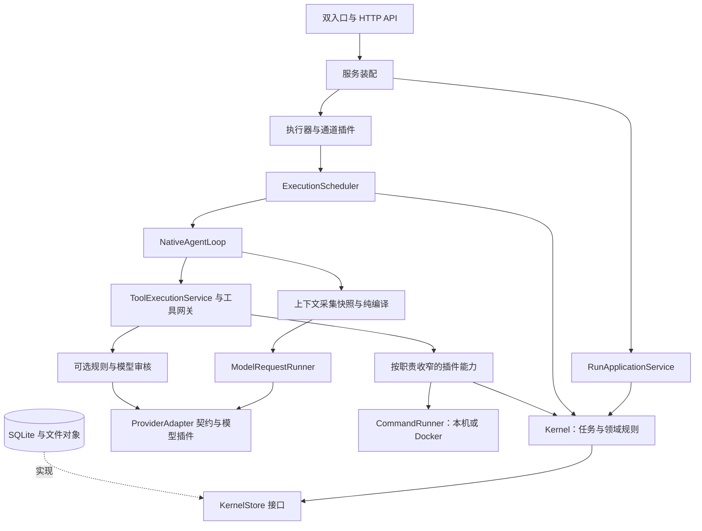

# 架构与内置插件

当前架构为 v1.22.18。v1.17.0 建立内置插件注册表，v1.21.0 参考 [架构视频](https://www.bilibili.com/video/BV1winH6DEgt) 展示的依赖接口、集中装配和角色分离思路，将领域规则、执行流程与基础设施的职责明确分开。内核继续拥有任务状态、授权、预算、租约、模型隔离和验收规则，模型提出意图，宿主校验并记录实际结果。

## 当前模块职责

应用仍在本机进程内协作。Electron 承载 React 界面，Fastify 提供原生 `/api` 与终端 `/terminal/api` 两个入口；两者分别装配 Store、Kernel 和执行器，共用本机认证规则。数据继续由 SQLite 和文件对象保存。

| 模块 | 职责与依赖边界 |
| --- | --- |
| `packages/contracts` | 模型输入输出、工具定义、执行策略、实体与版本契约；不依赖供应商或数据库实现 |
| `packages/kernel/src/ports.ts` | 定义实体、会话、事务、请求账本及恢复接口；Kernel 通过接口访问存储 |
| `apps/server/src/kernel-services.ts` | 创建内核并注入项目能力快照；缺少必要服务时明确失败 |
| `apps/server/src/run-application.ts` | 协调运行控制、持久停止及模型切换，路由保留认证、幂等与事务边界 |
| `packages/runtime` | 调度器管理准入和取消；Agent Loop 串联单步；模型请求服务管理预算、流式响应与重试；工具执行服务管理顺序、重放与进展 |
| `packages/context` | `snapshot.ts` 一次采集所需状态，`compiler.ts` 只根据快照编译；外围负责持久化压缩对象，原文引用可回查 |
| `packages/providers` | 实现共享 `ProviderAdapter`；由服务装配注入协议和凭据能力 |
| `packages/tools` | 校验授权、参数、调用来源及操作账本，执行前审核，并向插件提供最少所需能力 |
| `packages/storage` | 实现内核存储接口、有界投影查询、事务、对象持久化和迁移 |

`NativeExecutor` 与原模型类型导出继续作为兼容入口。运行时服务在构造时装配，正常流程不再通过事后覆盖回调切换模型或入口。相同上下文快照可重复编译得到相同结果，快照采集与编译不会暗中扩展项目授权。

## 工具执行前审核

新建原生项目任务可选关闭、规则审核或规则与模型审核。策略及审核模型绑定创建时冻结；修改连接不改写已有绑定。内核统一检查合同更新，API 编辑和模型提出的计划也不能删除或改变冻结配置。定时模板同时保存审核连接指纹，连接配置变化后暂停后续调度并要求重新核对。此审核与交付后的多模型评分分别记录。

网关先校验工具授权、参数、所属模型回复及已有操作。已有 DONE/FAILED 操作直接重放原结果，新调用才进入审核。审核绑定工具参数、任务范围、合同、当前授权、计划版本、项目能力和审核连接；等待期间这些内容变化或出现待处理补充要求，原审核失效。通过后仍重读任务、运行、停止状态和工具权限。拒绝决定写入失败操作，重放不会再次计费或执行。

规则只拦截有限的高风险命令模式，不能理解所有脚本。模型审核使用无工具的独立请求，只接受严格的允许／拒绝决定与原因；最长等待 45 秒，响应最多 12,000 个 UTF-8 字节。审核请求登记到同一任务及祖先的累计预算，与普通模型请求共享账号并发和每分钟额度；额度不足时等待，保持原工具调用配对。模型已产生用量但返回无效决定时仍计费，调用不执行；取消后未知用量继续保守保留。审核不会授予额外权限。

请求记录标明 `tool-review` 用途，操作保存审核指纹和决定，事件保存可回查的审核记录。界面只展示当前载入范围内最近十条有效记录，不把审核通过当成操作成功。

## 命令后端与插件能力

`CommandRunner` 只接管模型调用的 `exec`。默认本机后端保留当前用户的进程权限，路径检查不构成操作系统隔离。Docker 后端要求本机引擎可用且已有所选镜像，使用 `--pull never`，不会下载镜像或回退到本机执行。命令以独立容器运行，仅挂载当前任务目录，禁用网络、只读根文件系统、移除额外 capabilities，并限制进程、内存和 CPU。

只有当前权限允许整个任务目录写入时，容器挂载才可写；分路径写入授权使用只读挂载，文件工具仍按各自路径授权工作。容器内程序和路径必须适配镜像。MCP 进程及宿主的 Git 管理流程仍在各自原有边界内，不属于此命令容器。

容器先创建再启动，取消或超时后单独清理。清理失败保留待重试记录，操作结果继续待核验。启动恢复只查找当前数据目录标签下的命令容器，记录清理结果；清理失败不阻止界面打开，停止容器也不证明副作用已撤销。本轮已验证参数、超时清理、失败保留、恢复及不回退行为；真实 Docker 隔离与中断恢复按用户选择保留待验收，见执行文档。

插件注入使用实际冻结的能力对象，而非仅以 TypeScript 类型隐藏成员。各职责插件只得到所需函数；存储对象不暴露数据库连接，内核对象不暴露完整状态机。计划插件仍通过专用宿主操作。这些插件随应用构建，能力收窄约束代码职责，不能代替第三方 JavaScript 代码沙箱。

## 提示词与技能

v1.22.2 使用提示词版本 10、共享执行策略 `autonomous-within-scope-v5` 和编译器版本 7，技能目录版本保持 3。八份内置提示词和程序拼接的规则说明统一使用英文，默认回复语言仍为中文，并服从用户指定的语言和格式。共享规则、角色指导、运行环境和技能资料分别维护。提示词描述已有能力；授权、预算、状态、路径及冻结策略仍由程序检查。

英文规则覆盖原生模型、Codex 单步传输、终端启动与续接、工具错误恢复、无进展提醒、评分上下文和历史压缩说明。工具标识、参数、枚举和 JSON 格式保持原样；用户原文、来源资料、已保存历史、技能内容、工具说明及界面诊断不自动翻译。独立工具审核的 reason 默认中文，终端指导也明确保留默认中文回复。

| 内容 | 位置与职责 |
| --- | --- |
| 共同规则 | `prompts/platform.md` 定义身份、资料信任边界、调用配对和交付证据；`workspace.md` 说明实际文件及命令工具 |
| 角色指导 | `coordinator.md`、`worker.md`、`reviewer.md` 和 `chat.md` 分别处理规划集成、执行、普通复核和聊天 |
| 候选评分 | `peer-reviewer.md` 只用于内核指定的评分任务，要求提交 pass／fail／insufficient，避免与普通复核的提交方式混淆 |
| 工具审核 | `tool-reviewer.md` 用于无工具的独立审核请求，返回严格决定；请求账本记录提示词版本及哈希 |
| 动态策略 | `context/harness.ts` 根据当前角色、工具、冻结审核及命令后端生成指导；操作系统信息在采集快照时取得，编译保持纯函数 |
| 内置技能 | `skills/*/SKILL.md` 保存触发说明与主流程，`references/*.md` 保存仅特定操作需要的细节 |

八项内置技能涵盖数据分析、DOCX、办公写作、PDF、PPTX、资料研究、软件开发和电子表格。按主要交付物选择最少相关技能；例如修改 XLSX 公式优先选 spreadsheets，解释统计口径再补 data-analysis。短问答和纯提纲无需套用文件制作流程。

加载分三步：目录只返回元数据；`load_skill` 返回正文与 `resourcePaths`；需要某个操作分支时才用 `load_skill_file` 读取参考文本并按 `nextOffset` 续读。参考正文不会随目录或技能入口一次性注入系统提示，也不会自动执行。角色限制继续适用，复核不会因加载制作技能获得写入权限。

内置参考文件使用显式注册清单，限制在所属技能目录内，单文件最多 64 KiB，要求有效 UTF-8。读取前核对真实路径，防止目录链接越界。项目创建时将入口和参考内容一起冻结，仍受整个能力快照 2 MiB 上限约束；任务读取冻结版本并核对哈希。旧快照缺少资源时明确拒绝读取，不回退到更新后的应用文件。独立聊天和未带能力快照的旧流程沿用当前内置资源，导入技能保留原有撤销与禁用规则。

定时模板的能力指纹包含参考资料；仅参考文件变化也会使已有模板要求重新核对。发布构建沿用既有资源收集入口，递归收集 prompts 与 skills 并校验哈希。新增技能需在 `context/skills.ts` 注册 ID 和参考路径，并同步入口链接、技能版本及加载验证；不添加无用途的脚本或占位参考文件。

v1.22.1 补充核对以下源码，链接固定到 2026-10-27 读取的提交。中文提示词独立编写，参考正文仅保存在本地忽略目录。

| 参考实现 | 采用的思路 | 本项目取舍 |
| --- | --- | --- |
| [Codex 执行指导](https://github.com/openai/codex/blob/c587d6e54cb1e4013bf0cf9ea769edde48a23a1e/codex-rs/protocol/src/prompts/base_instructions/default.md)与[续接摘要](https://github.com/openai/codex/blob/c587d6e54cb1e4013bf0cf9ea769edde48a23a1e/codex-rs/prompts/templates/compact/prompt.md) | 保留有效要求、决策、已完成工作和下一步；围绕当前改动验证 | 在共享指导中要求续接先核对实际状态；沿用本项目已有压缩及回查机制 |
| [Codex 复核准则](https://github.com/openai/codex/blob/c587d6e54cb1e4013bf0cf9ea769edde48a23a1e/codex-rs/prompts/templates/review/rubric.md) | 缺陷应具体、可操作、有证据；避免推测和重复报告 | 普通复核区分新旧问题；评分按本项目每项验收标准判断，不引入外部输出格式 |
| [Gemini CLI 提示词片段](https://github.com/google-gemini/gemini-cli/blob/363a13119a57354f469732577518b9d6b319d1d6/packages/core/src/prompts/snippets.ts) | 限定检索范围；无进展时重新检查假设 | 使用本项目字面 search 和实际分页参数；没有新证据或条件变化时不机械重试，不强制全面测试或架构重写 |
| [OpenCode 运行指导](https://github.com/anomalyco/opencode/blob/54bb0a9f6feb5d9f0e149aeea199aae075b59f38/packages/core/src/session/runner/prompt/system.txt) | 遵循现有代码习惯，保护来源不明的修改，清楚引用文件 | 继续按任务工作区及真实工具行动；资料中的角色标签不能获得指令权限 |
| [Cline 执行指导](https://github.com/cline/cline/blob/c35b729049c7bb26c340df63ea9235c40b32dd29/sdk/packages/shared/src/prompt/system/act.ts) | 先取得必要上下文，合批独立读取，实际验证后交付 | 依赖返回值的动作分轮，不移植并行写入约定或每轮必须调用工具的要求 |

同时核对 [OpenAI Codex 提示词指南](https://developers.openai.com/cookbook/examples/gpt-5/codex_prompting_guide)。采用执行、工具和验证规则需适配宿主的原则；保持当前模型和协议，没有采用特定型号的参数建议。

v1.22.1 明确三个执行边界。检索定位到改动点、直接依赖和验证方式后开始实施，局部搜索无结果不证明目标不存在。重试先区分参数、权限、环境和结果未知，未知副作用先核验。交付逐项关联证据；文件变更后更新引用，普通复核与评分分别提交各自结论。

`allocate_context` 的完整参数为 `taskId`、`expectedRevision` 和 `windowTokens`；`expectedRevision` 对应该子任务的最新 `revision`，不能使用代理版本或名为 `revision` 的参数。此处修正提示词说明，工具 Schema 保持原样。审核模型只依据提供的参数判断，不声称看过未提供的脚本；明确缺少关键影响信息时返回具体拒绝理由。

提示词、原生续接和终端启动共用同一版本的执行指导；Codex 的 JSON 传输格式继续单独维护。工具审核仍使用独立无工具请求，提交哈希和版本可回查。结构及协议检查不衡量真实模型遵循率，验证范围见 [执行文档](EXECUTION.md)。

v1.22.0 核对的公开实现如下。中文内容按本项目工具契约独立编写，没有移植第三方提示词正文或执行脚本。

| 参考实现 | 采用的思路 | 本项目取舍 |
| --- | --- | --- |
| [Cline 执行提示词](https://github.com/cline/cline/blob/a459f1d04dea030833b558be645011ab739c463b/sdk/packages/shared/src/prompt/system/act.ts) | 根据实际环境行动，先核对项目约定，再修改和验证 | 继续使用本项目 availableTools、工具参数和计划接受规则；不强制长篇规划 |
| [OpenHands 动态提示词](https://github.com/OpenHands/software-agent-sdk/blob/ab0fbb4b5a456f3df0a03df1bc50dd850725d8bd/openhands-sdk/openhands/sdk/context/prompts/sections/dynamic.py) | 动态环境、技能目录与不可信资料分开组织 | 保留现有纯编译和快照边界，资料不能改变授权或代理身份 |
| [Aider 编辑提示词](https://github.com/Aider-AI/aider/blob/5dc9490bb35f9729ef2c95d00a19ccd30c26339c/aider/coders/editblock_prompts.py) | 明确编辑协议，沿用已有代码约定 | 使用真实文件哈希和现有 write／apply_patch，不引入其他项目的编辑块协议 |
| [Anthropic Skills 创建指南](https://github.com/anthropics/skills/blob/dbd4588f9e1033efb41dad4bef2f7947c8993d44/skills/skill-creator/SKILL.md) | 区分触发描述、主流程及按需参考，使用真实任务检查适用边界 | 入口保持简短，参考资料冻结并分页读取；不把技能建议变成额外审批 |

另核对了公开的 [XLSX 技能](https://github.com/anthropics/skills/blob/dbd4588f9e1033efb41dad4bef2f7947c8993d44/skills/xlsx/SKILL.md)，其文件标有独立许可，本项目未复制或分发该技能。表格指导强调公式视图与缓存分开、实际重算及兼容性检测，不沿用其他运行环境的预装依赖或函数黑名单。

v1.22.0 的七种本地场景中，系统提示词字节数较 v1.21.0 减少约 4%～8%，工具集合不变。该记录只适用于当时的版本；实际质量评测仍需相同模型与任务的对照，结果见执行文档。

## 贡献点

| 扩展点   | 注册入口                                     | 实现与边界                                                                         |
| -------- | -------------------------------------------- | ---------------------------------------------------------------------------------- |
| 插件基础 | `packages/plugins/src/index.ts`              | `PluginRegistry` 固定注册，`LazyPlugin` 管理按需实例；只依赖共享契约               |
| 工具     | `packages/tools/src/plugins/index.ts`        | 6 类插件、31 个工具；每项声明名称、参数、描述、处理函数及事务/串行/副作用/进展属性 |
| 模型接入 | `apps/server/src/provider-plugins.ts`        | OpenAI API、DeepSeek API、ChatGPT 订阅、Codex 订阅；精确按协议和认证方式匹配       |
| 执行通道 | `NativeExecutor` 构造参数 `executionPlugins` | 原生通道与终端通道共享调度；终端插件提供容量检查、预约、释放、停止与清理           |
| 计划对齐 | `packages/tools/src/module-host.ts`          | 复用共用按需生命周期，保留原 `PlanAlignmentHost` 接口与错误码                      |

每份插件清单都有 `id`、插件自身 `version` 和 `apiVersion: 1`。插件接口版本独立于应用版本。重复插件身份、重复贡献点或不兼容契约会在装配时拒绝，不依赖注册顺序选择覆盖项。注册表只公开查询和只读清单，没有运行中替换接口。

工具的参数、描述和实现位于同一职责文件。工具网关保留按任务角色、阶段和有效权限计算可用工具的规则；增加一个处理函数不会自动授予模型调用权限。描述与 JSON Schema 延迟编译并缓存，返回独立副本，避免不同任务修改同一目录对象。执行器从同一工具声明读取串行和进展属性，不再维护另外两份工具名称集合。

## 多模型协作

总代理、执行子代理和复核子代理继续持有各自的会话、工作区及模型绑定。每次请求由对应代理冻结的 `ProviderConfig` 选择模型插件，并向适配器提供独立绑定副本；修改当前供应商配置不会改写已有代理。

接入键为 `openai:apiKey`、`deepseek:apiKey`、`openai:chatgpt`、`openai:codex`。没有匹配插件时明确失败，不能回退到另一个协议或认证方式。凭据能力由服务层注入，创建原生 API 适配器和编译请求不会提前读取密钥；实际请求沿用原认证、用量和取消规则。终端入口装配空模型接入注册表，保留原入口隔离。

独立模型复核规则仍在 Kernel 的计划、接受、委派、切换和请求登记处校验。同一型号的不同账号、端点或思考强度仍不构成独立模型。插件不能修改合同中的同模型例外。执行器统一管理全局、任务和账号并发、累计预算与持久停止；执行通道插件只提供通道能力。

v1.20.0 新增可选评审模式。内核冻结所选的 1 至 3 个其他模型，为其保留代理名额，并提供受评审任务工作区的只读视图。协作插件新增 `read_peer_evidence` 和 `submit_peer_review`，分别读取候选的命令证据和提交逐项评分。各模型独立评分，全部达标且通过后，总代理重新提交候选并核验证据，才确认完成。失败意见交回执行模型修订，累计预算与轮次上限继续生效。同模型例外不适用于此模式。

## 生命周期与恢复

计划插件首次使用时加载；同一宿主的并发请求共享加载过程，不同宿主不共享实例。加载失败且清理成功后可重试。关闭先禁止新加载，等待在途加载收束；即使实例在关闭期间才创建，也会释放后拒绝激活。释放失败会保留失败状态，避免继续创建可能重复副作用的实例。

工具网关继续持有操作账本：调用身份、参数核对、旧记录关联、DONE/FAILED 重放和 UNCERTAIN 核验均经过原路径。协作工具和账本结果仍在同一同步事务内提交；事务工具返回异步结果会被拒绝。文件、进程、网络和 MCP 动作在事务外执行，再记录结果。未知工具按串行处理，并在网关拒绝，不影响其他调用的归属判断。

关闭执行器时停止调度并中止当前请求，等待执行和通道清理后释放工具资源。执行器、通道管理器、工具网关和按需插件均支持重复关闭。某项清理失败仍尝试其他清理，并返回失败；不把局部成功报告为全部退出。

v1.17.1 将队列展示与实际派发收敛到同一准入检查，随后仍由驱动原子预约资源。即使任务已有预约，通道不可用或容量不足时也不能启动；恢复容量后才能继续。调度先核对入口归属、持久停止与运行状态，再查找驱动，避免当前入口被其他通道的未装配插件阻塞。

关闭时逐个尝试保存暂停状态，某个运行或状态读取失败也不跳过取消和清理。并发调度共享同一在途 Promise；宿主等待容量检测收束后释放驱动，关闭期间不再启动下一项检测。活动任务的拒绝立即被观察，最终聚合暂停、执行和释放的失败原因。多个贡献键引用同一驱动时，每次停止或关闭只调用该实例一次。按需加载器自身的聚合错误不会被误认作释放失败，激活回滚实际失败仍保留并阻止重新激活。

v1.17.2 将通道准备状态独立为 `packages/runtime/src/execution-admission.ts`。同轮候选中的各资源域并行准备，无需准备的任务先进入宿主准入；每个资源域就绪后按原候选顺序再次检查，失败只阻塞自身。队列增加 `execution-preparing` / `execution-unavailable`，界面显示执行环境检查中或失败，下一轮成功准备后解除。共享资源域使用同一个 admission 实例，每轮只准备一次；prepare 必须支持取消和有界等待，不自行启动任务。宿主仍重读任务、运行和持久停止状态，统一限制全局/运行/账号并发、依赖与原子预约。每任务每轮最多派发一次，整轮等待全部准备和回调收束后才结束；新候选及任务下一模型步骤仍在下一轮调度，并非跨轮独立执行。

入口归属同时约束调度与直接 `step()`，拒绝发生在 claim、工作区准备和模型请求之前。原生入口读取旧终端会话只返回只读能力，不启动 CLI 探测；终端入口保持会话检查行为。原生入口启动时处理历史遗留容器与环境文件的恢复服务继续保留。

## 新增内置能力

1. 工具：在相应职责插件中声明 Schema、描述、处理函数与行为属性；在网关中明确角色、阶段及权限准入。使用宿主提供的文件、进程、网络和内核能力，并验证副作用恢复。
2. 模型接入：实现 `ProviderAdapter`，在服务装配处注册唯一接入键，按需注入对应凭据能力。新增持久协议类型时还需显式更新共享 Schema 与配置界面，不能仅靠运行时注册绕过数据约束。
3. 执行通道：通过构造参数贡献驱动；需要资源时实现 `admission`，在异步容量检查后由宿主重新核对任务。驱动仍须通过内核 claim，不能自行绕过状态机启动任务。
4. 需要按需激活的能力：使用 `LazyPlugin`，只注入必要服务，返回可释放实例。工厂在返回实例前若发生失败，负责清理尚未交给宿主的资源。

这些是随应用构建、经过代码审查的可信插件。注册表不提供第三方代码沙箱、插件市场、远程安装或热更新；权限保障来自固定宿主边界和内核，并非 JavaScript 模块隔离。界面、账户管理接口和存储格式沿用现有实现。

## 兼容与验证

原 `NativeProvider` 和计划模块接口继续导出。内部执行通道由五个可变终端回调改为构造时注册，不再允许运行中改接执行服务。v1.20.0 增加交付评分，v1.21.0 增加可选工具审核和命令后端，旧任务默认关闭额外审核并使用本机进程。数据升级为 schema10，最低读取版本 1.21.0；升级前保留原格式备份，schema9 备份仍声明最低读取 1.20.0。实际旧版 Store 已验证拒绝打开新库，避免跳过审核或改变命令后端。

定向验证覆盖插件冲突、按需加载与关闭竞态、清理失败、工具目录与 v1.16.0 的逐项对照、只读审查、终端资源与持久停止、双入口隔离、三模型协作、协议回放及崩溃恢复。具体结果与版本提交见 [执行文档](EXECUTION.md)。测试脚本和证据留在本地忽略目录；本地 SSE 与合成 RPC 证明接线和约束，不代表真实供应商的模型质量评测。
