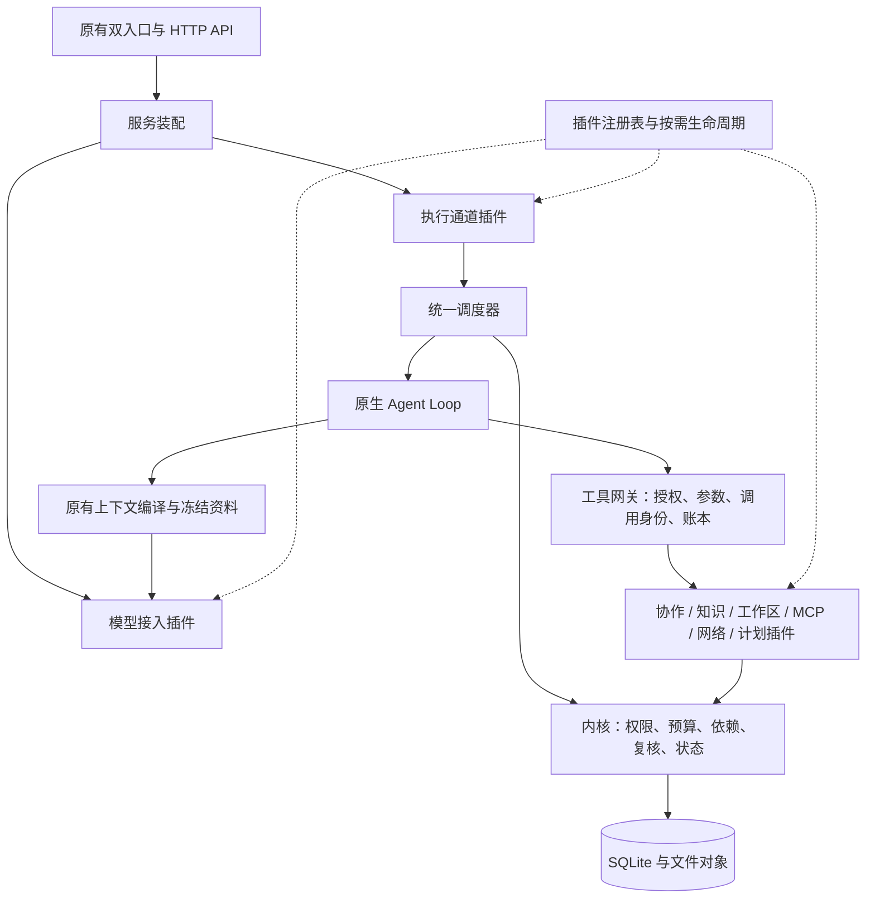

# 内置插件架构

v1.17.0 将可替换的执行能力放入显式插件注册表。内核继续拥有任务状态、授权、预算、租约、模型隔离和验收规则。模型提出意图，插件提供实现，宿主校验并记录实际结果。

## 贡献点

| 扩展点   | 注册入口                                     | 实现与边界                                                                         |
| -------- | -------------------------------------------- | ---------------------------------------------------------------------------------- |
| 插件基础 | `packages/plugins/src/index.ts`              | `PluginRegistry` 固定注册，`LazyPlugin` 管理按需实例；只依赖共享契约               |
| 工具     | `packages/tools/src/plugins/index.ts`        | 6 类插件、31 个工具；每项声明名称、参数、描述、处理函数及事务/串行/副作用/进展属性 |
| 模型接入 | `apps/server/src/provider-plugins.ts`        | OpenAI API、DeepSeek API、ChatGPT 订阅、Codex 订阅；精确按协议和认证方式匹配       |
| 执行通道 | `NativeExecutor` 构造参数 `executionPlugins` | 原生通道与终端通道共享调度；终端插件提供容量检查、预约、释放、停止与清理           |
| 计划对齐 | `packages/tools/src/module-host.ts`          | 复用共用按需生命周期，保留原 `PlanAlignmentHost` 接口与错误码                      |

每份插件清单都有 `id`、插件自身 `version` 和 `apiVersion: 1`。插件接口版本独立于应用版本。重复插件身份、重复贡献点或不兼容契约会在装配时拒绝，不依赖注册顺序选择覆盖项。注册表只公开查询和只读清单，没有运行中替换接口。

工具的参数、描述和实现位于同一职责文件。工具网关保留按任务角色、阶段和有效权限计算可用工具的规则；增加一个处理函数不会自动授予模型调用权限。描述与 JSON Schema 延迟编译并缓存，返回独立副本，避免不同任务修改同一目录对象。执行器从同一工具声明读取串行和进展属性，不再维护另外两份工具名称集合。

## 多模型协作

总代理、执行子代理和复核子代理继续持有各自的会话、工作区及模型绑定。每次请求由对应代理冻结的 `ProviderConfig` 选择模型插件，并向适配器提供独立绑定副本；修改当前供应商配置不会改写已有代理。

接入键为 `openai:apiKey`、`deepseek:apiKey`、`openai:chatgpt`、`openai:codex`。没有匹配插件时明确失败，不能回退到另一个协议或认证方式。凭据能力由服务层注入，创建原生 API 适配器和编译请求不会提前读取密钥；实际请求沿用原认证、用量和取消规则。终端入口装配空模型接入注册表，保留原入口隔离。

独立模型复核规则仍在 Kernel 的计划、接受、委派、切换和请求登记处校验。同一型号的不同账号、端点或思考强度仍不构成独立模型。插件不能修改合同中的同模型例外。执行器统一管理全局、任务和账号并发、累计预算与持久停止；执行通道插件只提供通道能力。

v1.20.0 新增可选评审模式。内核冻结所选的 1 至 3 个其他模型，为其保留代理名额，并提供受评审任务工作区的只读视图。协作插件新增 `read_peer_evidence` 和 `submit_peer_review`，分别读取候选的命令证据和提交逐项评分。各模型独立评分，全部达标且通过后，总代理重新提交候选并核验证据，才确认完成。失败意见交回执行模型修订，累计预算与轮次上限继续生效。同模型例外不适用于此模式。

## 生命周期与恢复

计划插件首次使用时加载；同一宿主的并发请求共享加载过程，不同宿主不共享实例。加载失败且清理成功后可重试。关闭先禁止新加载，等待在途加载收束；即使实例在关闭期间才创建，也会释放后拒绝激活。释放失败会保留失败状态，避免继续创建可能重复副作用的实例。

工具网关继续持有操作账本：调用身份、参数核对、旧记录关联、DONE/FAILED 重放和 UNCERTAIN 核验均经过原路径。协作工具和账本结果仍在同一同步事务内提交；事务工具返回异步结果会被拒绝。文件、进程、网络和 MCP 动作在事务外执行，再记录结果。未知工具按串行处理，并在网关拒绝，不影响其他调用的归属判断。

关闭执行器时停止调度并中止当前请求，等待执行和通道清理后释放工具资源。执行器、通道管理器、工具网关和按需插件均支持重复关闭。某项清理失败仍尝试其他清理，并返回失败；不把局部成功报告为全部退出。

v1.17.1 将队列展示与实际派发收敛到同一准入检查，随后仍由驱动原子预约资源。即使任务已有预约，通道不可用或容量不足时也不能启动；恢复容量后才能继续。调度先核对入口归属、持久停止与运行状态，再查找驱动，避免当前入口被其他通道的未装配插件阻塞。

关闭时逐个尝试保存暂停状态，某个运行或状态读取失败也不跳过取消和清理。并发调度共享同一在途 Promise；宿主等待容量检测收束后释放驱动，关闭期间不再启动下一项检测。活动任务的拒绝立即被观察，最终聚合暂停、执行和释放的失败原因。多个贡献键引用同一驱动时，每次停止或关闭只调用该实例一次。按需加载器自身的聚合错误不会被误认作释放失败，激活回滚实际失败仍保留并阻止重新激活。

v1.17.2 将通道准备状态独立为 `packages/runtime/src/execution-admission.ts`。同轮候选中的各资源域并行准备，无需准备的任务先进入宿主准入；每个资源域就绪后按原候选顺序再次检查，失败只阻塞自身。队列增加 `execution-preparing` / `execution-unavailable`，界面显示执行环境检查中或失败，下一轮成功准备后解除。共享资源域使用同一个 admission 实例，每轮只准备一次；prepare 必须支持取消和有界等待，不自行启动任务。宿主仍重读任务、运行和持久停止状态，统一限制全局/运行/账号并发、依赖与原子预约。每任务每轮最多派发一次，整轮等待全部准备和回调收束后才结束；新候选及任务下一模型步骤仍在下一轮调度，并非跨轮独立执行。

入口归属同时约束调度与直接 `step()`，拒绝发生在 claim、工作区准备和模型请求之前。原生入口读取旧终端会话只返回只读能力，不启动 CLI 探测；终端入口保持会话检查行为。原生入口启动时处理历史遗留容器与环境文件的恢复服务继续保留。

## 新增内置能力

1. 工具：在相应职责插件中声明 Schema、描述、处理函数与行为属性；在网关中明确角色、阶段及权限准入。使用宿主提供的文件、进程、网络和内核能力，并验证副作用恢复。
2. 模型接入：实现 `ProviderAdapter`，在服务装配处注册唯一接入键，按需注入对应凭据能力。新增持久协议类型时还需显式更新共享 Schema 与配置界面，不能仅靠运行时注册绕过数据约束。
3. 执行通道：通过构造参数贡献驱动；需要资源时实现 `admission`，在异步容量检查后由宿主重新核对任务。驱动仍须通过内核 claim，不能自行绕过状态机启动任务。
4. 需要按需激活的能力：使用 `LazyPlugin`，只注入必要服务，返回可释放实例。工厂在返回实例前若发生失败，负责清理尚未交给宿主的资源。

这些是随应用构建、经过代码审查的可信插件。注册表不提供第三方代码沙箱、插件市场、远程安装或热更新；权限保障来自固定宿主边界和内核，并非 JavaScript 模块隔离。界面、账户管理接口和存储格式沿用现有实现。

## 兼容与验证

原 `NativeProvider` 和计划模块接口继续导出。内部执行通道由五个可变终端回调改为构造时注册，不再允许运行中改接执行服务。v1.20.0 在原有工具与接口上增加评审配置及评分工具，旧任务默认关闭评审。数据升级为 schema9，最低读取版本 1.20.0；升级前保留 schema8 备份，旧版拒绝打开新库，避免绕过评审要求。

定向验证覆盖插件冲突、按需加载与关闭竞态、清理失败、工具目录与 v1.16.0 的逐项对照、只读审查、终端资源与持久停止、双入口隔离、三模型协作、协议回放及崩溃恢复。具体结果与版本提交见 [执行文档](EXECUTION.md)。测试脚本和证据留在本地忽略目录；本地 SSE 与合成 RPC 证明接线和约束，不代表真实供应商的模型质量评测。
